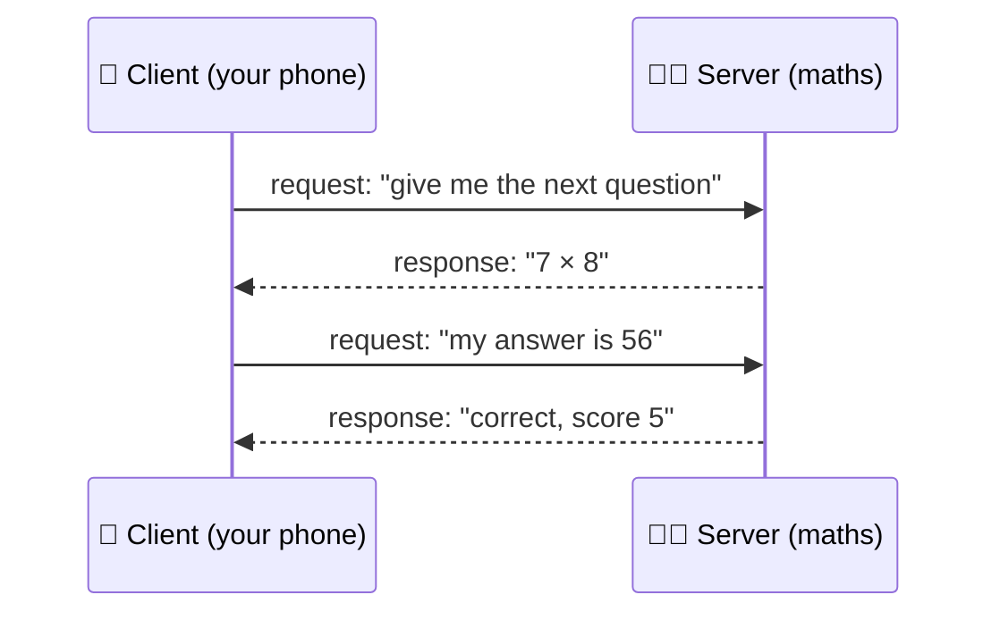

import Stepper from '../../../components/Stepper.astro';
import Think from '../../../components/Think.astro';
import Quiz from '../../../components/Quiz.astro';
import { Aside, Steps } from '@astrojs/starlight/components';

<Aside type="tip" title="Your win today (≈20 min)">
You'll **be a server yourself**: one terminal waits, another asks it a question, and you type the answer back by hand. You'll see, letter by letter, what a phone actually sends.
</Aside>

## The problem: who decides who won?

You and your friend Sita start a duel. The question `7 × 8` appears on both phones. You both type `56`.

**Who was first?** Your phone says "I was first at 10:00:03.2". Sita's phone says "No, *I* was first at 10:00:03.1". Her phone's clock runs a little fast, and phone clocks are never exactly in sync. And what if Sita's cousin edits the app so it always reports "56, in 0.1 seconds"?

If the phones decide, every phone can say "I won", and nobody can prove otherwise.

## The real-world fix: an umpire

In cricket, the batter doesn't decide whether they're out, and neither does the bowler. The **umpire** does. Both teams send their appeals to one person in the middle, and that person's decision is final.

The duel needs the same thing: one program, running on a computer neither of you controls, that

- **hands out** the questions,
- **receives** every answer,
- **checks** it against *its own* answer key and *its own* clock,
- **tells** both phones the score.

That program is a **server**. The phones are **clients**.

<Stepper
  caption="Step through it with the buttons or the ← → keys"
  steps={[
    {
      title: 'Without an umpire: phones decide',
      art: `  📱 You                         📱 Sita
  "56 at 10:00:03.2"  ◀──────▶   "56 at 10:00:03.1"
  "I WON"                        "No, I WON"
                ¯\\_(ツ)_/¯  nobody can settle it`,
      note: "Two clocks, two opinions, and nothing stops a modified app from lying.",
    },
    {
      title: 'With an umpire: both phones ask the server',
      art: `  📱 You                                 📱 Sita
    │  "my answer: 56"        "my answer: 56"  │
    └──────────────▶ 🧑‍⚖️ server ◀───────────────┘
                     (one clock, one answer key)`,
      note: 'The phones only *send* answers. They never decide anything.',
    },
    {
      title: 'The server decides, then tells everyone',
      art: `  📱 You                                 📱 Sita
    ▲  "correct! you 5, Sita 4"   "correct! Sita 4, you 5"  ▲
    └─────────────── 🧑‍⚖️ server ──────────────────────────────┘
          arrived first: You (by the SERVER's clock)`,
      note: "Its clock and its answer key are the only ones that count. This idea has a name you'll use for the rest of the course: the server is the *source of truth*.",
    },
  ]}
/>

## Request and response

Every conversation between a client and a server has the same shape. The client **asks** (a **request**), and the server **answers** (a **response**). It's like a counter at a momo shop: you place an order, and the counter hands it back. The counter never shouts out an order nobody placed.



You already know this from Android. When your app calls `api.getBalance()` through Retrofit, the app is the **client** and your bank's backend is the **server**. Until now you've always written the left side of this picture. From today, you write the right side.

> 📖 Read alongside: [MDN: Client-Server overview](https://developer.mozilla.org/en-US/docs/Learn_web_development/Extensions/Server-side/First_steps/Client-Server_overview) (15 min). It's the clearest short explanation of request/response, and today's primary source.

## Hands-on: be the server

A server is not a special machine. It's just **a program that waits for someone to talk to it**. Let's prove it with two tools already on your Mac:

- **`nc`** (netcat) is a bare-bones program that waits for a connection and shows whatever arrives ([`man nc`](https://man.openbsd.org/nc.1)).
- **`curl`** is a client, like a tiny browser for the terminal ([Everything curl](https://everything.curl.dev/)).

<Steps>

1. Open **Terminal window A** and start waiting on port `8080` (a port number; lesson 2 explains exactly what that is):

   ```bash
   nc -l 8080
   ```

   Nothing happens. It's waiting. **Window A is now your server.**

2. Open **Terminal window B** and play the phone asking for a question:

   ```bash
   curl -v http://localhost:8080/question
   ```

   `curl` now sits waiting for an answer.

3. Look at **window A**. The request has arrived:

   ```text
   GET /question HTTP/1.1
   Host: localhost:8080
   User-Agent: curl/8.7.1
   Accept: */*
   ```

   That's what every phone sends to every server on the web. It's just text.

4. Now **you are the server**. In window A, type this response by hand, pressing Enter after each line (including the empty line in the middle):

   ```text
   HTTP/1.1 200 OK

   7 x 8 = ?
   ```

   Then press **Ctrl+C** in window A to close the connection.

5. Look at **window B**. `curl` printed **`7 x 8 = ?`**. Your hand-typed answer travelled to the client. 🎉

</Steps>

```text
  window B (client: curl)                   window A (server: you + nc)
  ──────────────────────                    ───────────────────────────
  GET /question HTTP/1.1      ───────▶      you read this
  Host: localhost:8080
                              ◀───────      you typed:  HTTP/1.1 200 OK
  prints: 7 x 8 = ?                                      (empty line)
                                                         7 x 8 = ?
```

<Aside type="note" title="Notice what you just did">
You were a slow, human server. The real `maths` server will do exactly what you did, just in microseconds: **wait → read the request → decide → write the response**. Everything else we build is a better version of those four steps.
</Aside>

We'll take the request and response apart line by line in the next lesson (that's HTTP). For now, spot three things:
- the first line names **what** the client wants: `GET /question`;
- the client says who it is: `User-Agent: curl/...`;
- your reply started with **`200 OK`**, which told the client "here's what you asked for".

## Check yourself

<Quiz
  question="In a maths duel, who should decide which player answered first?"
  options={[
    'The faster phone using its clock',
    'The server using its own clock',
    'Both phones comparing their two clocks',
  ]}
  answer={1}
>
Phone clocks drift, and a modified app can lie. Only one clock can be the referee, and that's the server's.
</Quiz>

<Quiz
  question="In today's exercise, which window was the server?"
  options={[
    'Window B, the one running curl',
    'Window A, the one running nc',
    'Neither window, servers are special machines',
  ]}
  answer={1}
>
A server is a *program that waits*. `nc -l 8080` waited and you answered. Your laptop was both client and server at the same time.
</Quiz>

<Quiz
  question="Your Android app calls api.getBalance() through Retrofit. What is the app?"
  options={[
    'The server that answers the call',
    'The umpire that holds the truth',
    'The client that sends a request',
  ]}
  answer={2}
>
The app asks, so it's the client. The bank's backend holds the real balance, so it's the server (the source of truth).
</Quiz>

<Think id="maths-l1-teachback" prompt="Teach-back: explain to a friend who doesn't code why the maths game can't just let the two phones decide who won. Use the umpire idea, in 2–4 sentences." revealLabel="Compare with a model answer">
*Model answer:* Each phone has its own clock, and the clocks never agree exactly, so both could honestly claim to be first. Someone could also edit the app to lie about their answers. So both phones send their answers to one server, like appeals to an umpire. It checks them with its own clock and answer key, and everyone accepts its decision.
</Think>

## Before the next lesson
- **Do the exercise for real**, and paste what window A printed into our chat.
- Tell me one thing that surprised you, and one thing that's still fuzzy.
- 🙋 **Stuck or curious about anything?** Ask me in the chat. "What does `-v` do?", "why port 8080?" and "what if two curls connect at once?" are all great questions.

**Next:** [Lesson 2: processes, IP addresses, ports](../0002-processes-ips-ports/). What `nc -l 8080` was actually doing.
