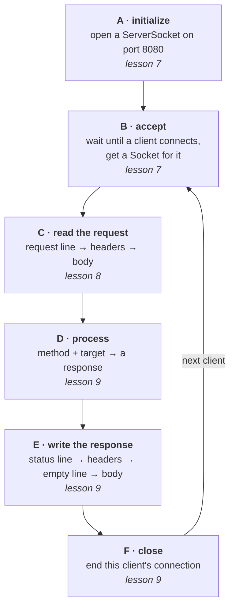
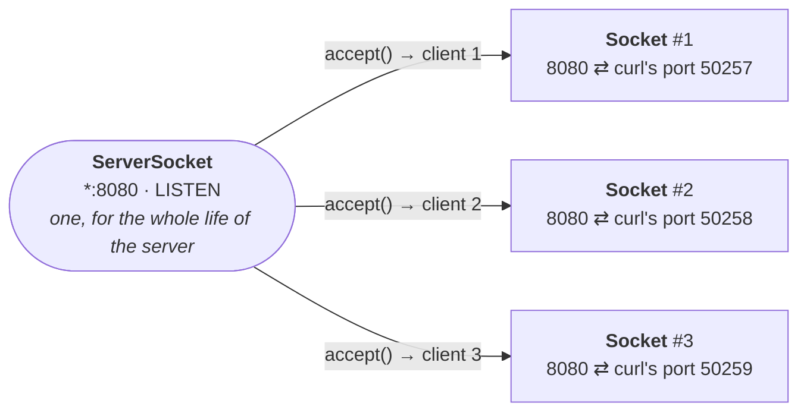
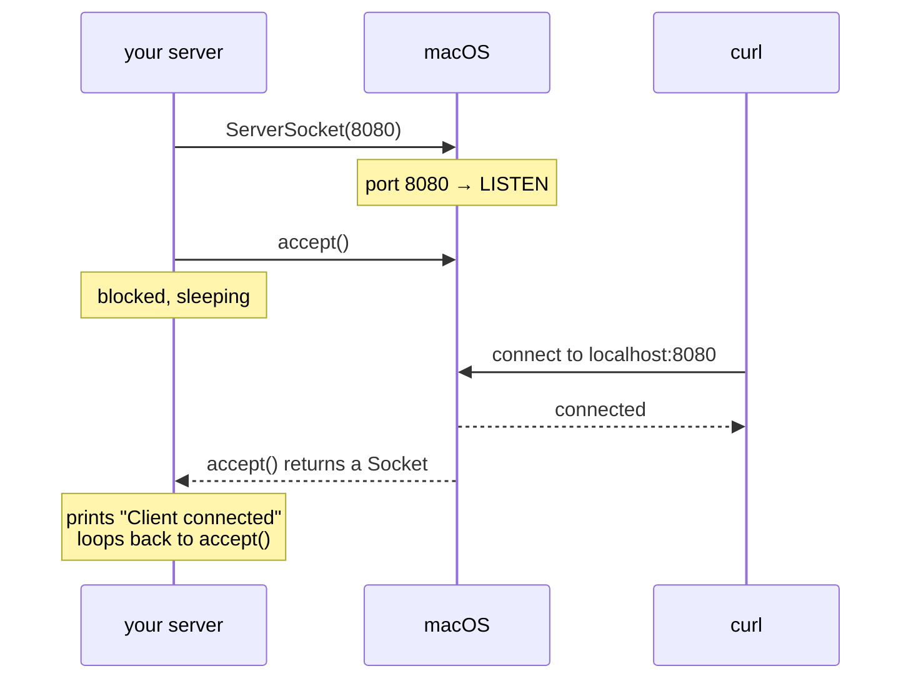

import Quiz from '../../../components/Quiz.astro';
import Think from '../../../components/Think.astro';
import { Aside, Steps } from '@astrojs/starlight/components';

<Aside type="tip" title="Part 1 of 3 · building your first server · ≈30 min">
Lessons 7, 8 and 9 build one server, step by step, one commit per step. Today: **the plan for the whole server**, then **step A** (start listening) and **step B** (accept a client). Win: `curl` connects to a program *you* wrote, and your program says so.
</Aside>

## Recall (from memory)

<Think id="maths-l7r-recall-1" prompt="A client asks for duel QQQQ, which doesn't exist. 400 or 404? And what does the other one mean?" revealLabel="Check">
**404 Not Found**: the request is fine, but the thing it names doesn't exist. **400 Bad Request** means the request *itself* is malformed, like `{"answer":"fifty-six"}`.
</Think>

<Think id="maths-l7r-recall-2" prompt="Which lesson-3 tool shows a process listening on a port, and what word does it print next to the port?" revealLabel="Check">
`lsof -nP -iTCP:8080 -sTCP:LISTEN`, which prints `(LISTEN)`. Once a client connects, `lsof -nP -iTCP:8080` also shows `(ESTABLISHED)` lines, one per end of the connection.
</Think>

## The whole server on one page

Lessons 2–6 covered everything a server does, from the outside. A server is those pieces in a fixed order, repeated forever:



Step A runs **once**. Steps B to F run **once per client**, in a loop that never ends. Every HTTP server works this way, including the Spring server you'll build later. Spring just writes most of these steps for you.

Write this plan at the top of your file *before* any code. It's a map you'll fill in one step at a time:

```kotlin
/*
- lifecycle of a server:
    a. initialize a server
    b. wait for a client to connect to the server & accept it
    c. read request [request line + headers + body]
    d. process request [determine method + target + response]
    e. write response [status line + headers + empty line + body]
    f. close connection & repeat step b to f in a loop
 */
```

## Your workspace

The server lives in your private repo `maths`, in `handmade/Server.kt`. Open the `maths` folder in IntelliJ and let it load the Gradle project. That gives you hover docs, autocomplete and red underlines. (Gradle is the build tool. Lesson 11 explains its files. For now, they make the IDE and the run command work.)

Run the server from the repo root, in IntelliJ's terminal:

```bash
./gradlew -q run
```

It keeps running, because a server never finishes, and Gradle shows `EXECUTING` until you stop it with **Ctrl+C**. Use a second terminal tab for `curl` and `lsof`.

**One commit per step.** After each step works, commit it. Your git history then becomes a record of how the server was built.

## Step A · Initialize: start listening

```kotlin
import java.net.ServerSocket

fun main() {
    // step A: initialize the server
    val serverSocket = ServerSocket(8080)
    println("Listening on port 8080")
}
```

`ServerSocket(8080)` asks the OS to do exactly what `nc -l 8080` did in lesson 2: "anything that arrives for port 8080, hand it to this process" ([Java docs: `ServerSocket`](https://docs.oracle.com/en/java/javase/25/docs/api/java.base/java/net/ServerSocket.html)).

<Think id="maths-l7r-predict-a" prompt="Before running it: this main() opens the ServerSocket, prints, and then reaches its last line. What happens to the port when the program ends? Would lsof find anything a second later?" />

When `main()` ends, the process ends, and the OS takes the port back. A listener that's gone before anyone can connect is useless. So step B has to *keep the program alive*, waiting.

**Commit:** `feat: initialize the server`

## Step B · Accept: wait for a client

```kotlin
fun main() {
    // step A: initialize the server
    val serverSocket = ServerSocket(8080)
    println("Listening on port 8080")

    while (true) {
        /*
        step B: accept a client connection
            - [ServerSocket] merely listens for connections
            - [Socket] represents an established connection with a client
         */
        val socket = serverSocket.accept()
        println("Client connected")
    }
}
```

Two new ideas here.

**1. `accept()` blocks.** The program stops on that line. The thread sleeps, using no CPU, until a client connects. Then `accept()` returns, and the code moves on ([Java docs: `accept()`](https://docs.oracle.com/en/java/javase/25/docs/api/java.base/java/net/ServerSocket.html#accept())). This is the "a process can sit and wait" brick from lesson 2, now in your own code.

**2. Two kinds of socket.** This is the part that confuses everyone at first, so here it is as a picture:



- The **`ServerSocket`** never carries any request bytes. Its only job is to wait for connections. There's one, and it lives as long as the server.
- Each **`Socket`** that `accept()` returns is **one connection**, the two-way byte pipe from lesson 3, to one client. Request and response bytes travel through it. You get a new one for every client.

`lsof` shows the same split: one `LISTEN` line for the `ServerSocket`, and, while a client is connected, an `ESTABLISHED` line for each `Socket`.

Here's what happens, in time order, when `curl` connects:



The `while (true)` is what makes it a *server* and not a one-shot program. After handling a client, it goes straight back to `accept()` for the next one.

<Steps>

1. **Run it**, and in the second tab:

   ```bash
   lsof -nP -iTCP:8080 -sTCP:LISTEN
   ```

   ```text
   COMMAND   PID       USER   FD   TYPE  ...  NODE NAME
   java    29724 hari.joshi    5u  IPv6  ...   TCP *:8080 (LISTEN)
   ```

   That's your `ServerSocket`. `*` means "on every address this machine has", and `IPv6` covers IPv4 clients too.

2. **Connect.**

   ```bash
   curl http://localhost:8080/health
   ```

   Your server prints `Client connected`. `curl`, however, is left waiting: the server accepted the connection but never reads the request or writes a response. Press Ctrl+C in the `curl` tab.

3. **Connect again.** It prints `Client connected` again. That's the loop going back to `accept()`.

</Steps>

**Commit:** `feat: accept incoming client connections`

<Aside type="note" title="The thing to remember">
A server is a loop: **accept → read → process → write → close**, forever. `ServerSocket` listens (one per server). `accept()` blocks until a client connects, then returns a `Socket`, which is one connection to that client. Every byte of the conversation goes through the `Socket`.
</Aside>

## Check yourself

<Quiz
  question="What does serverSocket.accept() do when no client is connecting?"
  options={[
    'It returns null straight away',
    'It blocks until a client connects',
    'It throws an exception after a timeout',
  ]}
  answer={1}
>
It blocks. The thread sleeps on that line until a client connects, then returns that client's `Socket`.
</Quiz>

<Quiz
  question="Three clients have connected. How many ServerSocket and Socket objects exist?"
  options={[
    'One ServerSocket and three Sockets',
    'Three ServerSockets and three Sockets',
    'One ServerSocket and one Socket',
  ]}
  answer={0}
>
One `ServerSocket` listens for the whole life of the server. `accept()` makes a new `Socket` for each client.
</Quiz>

<Quiz
  question="Which object do the request and response bytes actually travel through?"
  options={[
    'The ServerSocket listening on 8080',
    'The OS port table for 8080',
    'The Socket that accept() returned',
  ]}
  answer={2}
>
The `ServerSocket` only accepts connections. The conversation happens on each client's `Socket`.
</Quiz>

## Your turn

<Think id="maths-l7r-teachback" prompt="Explain to another Android developer, in 3–4 sentences, the difference between ServerSocket and Socket, and why the server needs while (true)." revealLabel="Compare with a model answer">
`ServerSocket` is the listener: it tells the OS to hand this process the connections arriving on a port, and it exists once for the whole server. Each call to `accept()` blocks until a client connects, then returns a `Socket`: one two-way byte connection to that one client, which is where the request and response travel. `while (true)` sends the server back to `accept()` after each client. Without it, the server would serve one client and exit.
</Think>

## Read alongside
- 📖 **Primary:** [Oracle's Java tutorial: Writing the Server Side of a Socket](https://docs.oracle.com/javase/tutorial/networking/sockets/clientServer.html) (10 min). The same `ServerSocket` → `accept()` → `Socket` in Java, which Kotlin uses directly.
- [Java docs: `ServerSocket`](https://docs.oracle.com/en/java/javase/25/docs/api/java.base/java/net/ServerSocket.html). Hover over `accept` in IntelliJ: it's the same text.

🙋 Ask me anything that's fuzzy. Good ones: "what is the `5u` in lsof?", "can two programs have a ServerSocket on 8080?", "what happens to a client that connects while my server is busy?"

**Next:** [Lesson 8: reading a request, byte by byte](../0008-reading-a-request/). The `Socket` is open, so now we read what the client sent.
