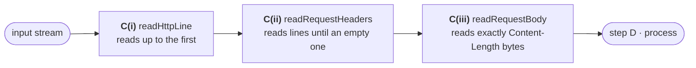
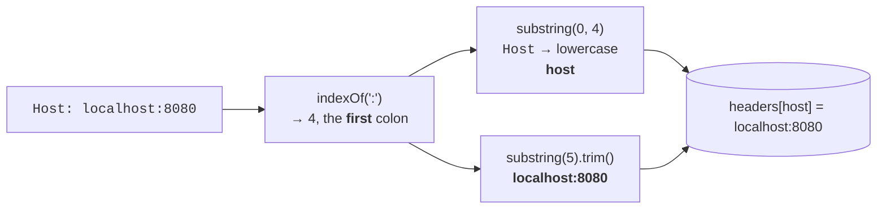

import Quiz from '../../../components/Quiz.astro';
import Think from '../../../components/Think.astro';
import ByteStrip from '../../../components/ByteStrip.astro';
import { Aside } from '@astrojs/starlight/components';
import anatomy from '../../../assets/mdn/http-message-anatomy.svg';

<Aside type="tip" title="Part 2 of 3 · building your first server · ≈40 min">
**Step C: read the request.** Three functions: `readHttpLine`, `readRequestHeaders`, `readRequestBody`. Win: your server prints every part of whatever `curl` sends it, already split into pieces.
</Aside>

## Recall (from memory)

<Think id="maths-l8-recall-1" prompt="accept() returned a Socket. What is that Socket, and why isn't the request read from the ServerSocket?" revealLabel="Check">
The `Socket` is one connection to one client: the two-way byte pipe. The `ServerSocket` only accepts connections and never carries request bytes.
</Think>

<Think id="maths-l8-recall-2" prompt="Name the four parts of an HTTP request, in order. Which one is optional, and how does a reader know where the second part ends?" revealLabel="Check">
Request line, headers, empty line, body. The body is optional. The headers end at the empty line (`\r\n` on its own).
</Think>

## What arrives

You've seen this shape since lesson 4. MDN draws it like this:

<figure class="not-content" style="margin:1.5rem 0">
  
  <figcaption style="font-size:.85rem;opacity:.75;margin-top:.4rem">Image: <a href="https://developer.mozilla.org/en-US/docs/Web/HTTP/Guides/Messages">MDN, HTTP messages</a>, by Mozilla Contributors, <a href="https://creativecommons.org/licenses/by-sa/2.5/">CC BY-SA 2.5</a>.</figcaption>
</figure>

Your server never sees that neat box. It sees **one row of bytes**, in the order they were sent. Here's a real request, `curl -X POST localhost:8080/answer -d 56` (some headers left out), as your `Socket`'s input stream delivers it:

<ByteStrip
  segments={[
    { label: 'request line', text: 'POST /answer HTTP/1.1\r\n', tone: 'line' },
    { label: 'header', text: 'Host: localhost:8080\r\n', tone: 'head' },
    { label: 'header', text: 'Content-Length: 2\r\n', tone: 'head' },
    { label: 'empty line', text: '\r\n', tone: 'gap' },
    { label: 'body', text: '56', tone: 'body' },
  ]}
  caption="One stream. Every \r\n is two real bytes. ␣ is a space. Nothing marks where the body ends except the number in Content-Length."
/>

## The one rule of an input stream: reading *consumes*

`socket.getInputStream()` gives you an `InputStream`. Think of it as a **cursor** over that row of bytes. Every `read()` returns the byte at the cursor and moves the cursor forward one place. Nothing ever goes back.

That rule shapes the whole of step C. Each function picks up **exactly where the previous one stopped**:



So the **order of the three calls is fixed**. If you read the body first, you'd get `POST /answer…` as your "body".

## C(i) · Read one line

**The question first:** HTTP lines end in `\r\n`. You have a stream that gives you one byte at a time. How do you get one line?

Collect bytes until you see `\n`, then drop the `\r` before it:

```kotlin
/*
 step C(i): read one HTTP line from input stream
    - collect all the bytes belonging to the request line [incomingBytes]
    - read each byte one by one [nextByte] in a loop
    - stop the loop when we reach end of file(-1) or end of the line (\n)
    - add that byte to our mutable list [incomingBytes]

    - convert the collected bytes into String
    - remove (\r) at the end of line
 */
private fun readHttpLine(inputStream: InputStream): String {
    val incomingBytes = mutableListOf<Byte>()

    while (true) {
        val nextByte = inputStream.read()
        if (nextByte == -1 || nextByte == '\n'.code) break
        incomingBytes.add(nextByte.toByte())
    }

    val requestLine = incomingBytes.toByteArray().decodeToString()
    return requestLine.removeSuffix("\r")
}
```

Three details worth understanding, because each one is a real decision:

- **`read()` returns an `Int`, not a `Byte`.** Hover over it: it returns 0–255 for a byte, or **-1** when the client has closed and no bytes will ever come ([Java docs: `InputStream.read()`](https://docs.oracle.com/en/java/javase/25/docs/api/java.base/java/io/InputStream.html#read())). A `Byte` has no spare value to mean "the end", so `read()` needs the wider `Int`.
- **We collect bytes and decode once, at the end.** `×` is two bytes (lesson 3). Decoding one byte at a time would cut it in half.
- **`'\n'.code` is 10**, the `0a` you saw in `xxd`. We compare numbers with numbers.

After `readHttpLine` returns, the cursor sits at the first header:

<ByteStrip
  cursor={23}
  segments={[
    { label: 'request line ✓', text: 'POST /answer HTTP/1.1\r\n', tone: 'line' },
    { label: 'header', text: 'Host: localhost:8080\r\n', tone: 'head' },
    { label: 'header', text: 'Content-Length: 2\r\n', tone: 'head' },
    { label: 'empty line', text: '\r\n', tone: 'gap' },
    { label: 'body', text: '56', tone: 'body' },
  ]}
  caption="Faded = already consumed. The highlighted byte is where the next read() starts."
/>

**On names and comments.** In your first draft, this function had `byte`, `correctByte`, `string` and `clean`. Names like that describe *operations*. Good names describe the *data*: `nextByte`, `incomingBytes`, `requestLine`. And a comment earns its place when it says *why* (why -1, why remove `\r`), not when it repeats the code.

**Commit:** `feat: read HTTP request line from input stream`

## C(ii) · Read the headers

<Think id="maths-l8-ds" prompt="Before the code: which data structure should hold the headers? Think about how step C(iii) will need to find content-length." revealLabel="Check">
A **map** from name to value. Step C(iii) needs `headers["content-length"]`, a lookup by name. A list of pairs would mean searching it every time.
</Think>

Read lines with the same `readHttpLine`, and stop at the empty one:

```kotlin
/*
 step C(ii): read headers line by line
    - read one header line.
    - stop when we encounter an empty line ("").
    - separate the header name from its value.
    - store the pair in headers.
 */
private fun readRequestHeaders(inputStream: InputStream): Map<String, String> {
    val headers = mutableMapOf<String, String>()

    while (true) {
        val headerLine = readHttpLine(inputStream)
        if (headerLine == "") break

        val firstColon = headerLine.indexOf(':')

        val key = headerLine.substring(0, firstColon).lowercase()
        val value = headerLine.substring(firstColon + 1).trim()

        headers[key] = value
    }
    return headers
}
```

How one header line becomes a map entry:



- **The *first* colon.** `Host: localhost:8080` has two. Splitting on every colon would break the value in half.
- **`lowercase()` on the name.** Header names are case-insensitive (lesson 6): `Content-Length` and `content-length` are the same header. Store one spelling, and lookups always work.
- **`trim()` on the value** removes the space after the colon.
- **Why `readHttpLine` returned without `\r`:** the empty line arrives as `\r\n`, so it comes back as `""`, and `headerLine == ""` is a clean way to stop.

Now the cursor sits at the first byte of the body:

<ByteStrip
  cursor={66}
  segments={[
    { label: 'request line ✓', text: 'POST /answer HTTP/1.1\r\n', tone: 'line' },
    { label: 'header ✓', text: 'Host: localhost:8080\r\n', tone: 'head' },
    { label: 'header ✓', text: 'Content-Length: 2\r\n', tone: 'head' },
    { label: 'empty line ✓', text: '\r\n', tone: 'gap' },
    { label: 'body', text: '56', tone: 'body' },
  ]}
/>

**Commit:** `feat: read HTTP request headers`

## C(iii) · Read the body

The empty line can't tell you where the body *ends*. Only `Content-Length` can (lesson 5):

```kotlin
/*
step C(iii): read the HTTP request body
    - retrieve the expected body length from the content-length header
    - default to 0 if the header is absent or invalid
    - read exactly that many bytes from the input stream
    - verify that the complete body was received
    - return the body as a ByteArray
*/
private fun readRequestBody(
    inputStream: InputStream,
    headers: Map<String, String>
): ByteArray {
    val contentLength = headers["content-length"]?.toIntOrNull() ?: 0
    val requestBody = inputStream.readNBytes(contentLength)

    if (requestBody.size != contentLength) {
        throw IOException("Incomplete request body")
    }
    return requestBody
}
```

- **`?: 0`**: no `Content-Length` means **no body**. This is the rule you wrestled with in lessons 5–7, now one line of your code. The server doesn't wait for a close, so nothing deadlocks.
- **`readNBytes(n)`** reads exactly `n` bytes and stops. Here that's `35 36`, and the cursor ends at the very end of the request.
- **`ByteArray`, not `String`.** A body can be anything: text, JSON, an image. Step C just delivers the bytes. Whoever handles the request decides how to decode them.

**Commit:** `feat: read HTTP request body using content-length`

## See it work

Step C wired into `main()`:

```kotlin
val inputStream = socket.getInputStream()

val requestLine = readHttpLine(inputStream)
println(requestLine)

val headers = readRequestHeaders(inputStream)
println(headers)

val body = readRequestBody(inputStream, headers)
println(body.contentToString())
```

This is your server's real log for a `GET` and a `POST`:

```text
Client connected
GET /health HTTP/1.1
{host=localhost:8080, user-agent=curl/8.7.1, accept=*/*}
[]
Client connected
POST /health HTTP/1.1
{host=localhost:8080, user-agent=curl/8.7.1, accept=*/*, content-length=5, content-type=application/x-www-form-urlencoded}
[104, 101, 108, 108, 111]
```

- The `GET` has no `content-length`, so the body is `[]`: zero bytes, no waiting.
- The `POST` body is printed as raw byte values. `104 101 108 108 111` is `h e l l o` in UTF-8 (`curl -d "hello"`). That's lesson 3's "text is bytes", in your own server's output.
- Every header name is lowercase, even though `curl` sent `Content-Length`.

<Aside type="note" title="The thing to remember">
An input stream is a cursor that only moves forward. Read the **request line** (up to `\n`), then the **headers** (lines until an empty one, into a map), then exactly **Content-Length** bytes of body (0 if the header is missing). Each read starts where the last one stopped.
</Aside>

## Check yourself

<Quiz
  question="Why does InputStream.read() return an Int instead of a Byte?"
  options={[
    'Ints are faster than Bytes here',
    'It needs -1 for the end',
    'Bytes are unable to store letters',
  ]}
  answer={1}
>
A byte uses all 256 values, 0–255. `read()` needs one more, -1, to say "the client closed and nothing more will come", so it returns an `Int`.
</Quiz>

<Quiz
  question="You call readRequestBody before readRequestHeaders. What does the body contain?"
  options={[
    'Zero bytes, the map is empty',
    'The header bytes instead of body',
    'The correct body, order is irrelevant',
  ]}
  answer={0}
>
Without the headers, there's no `content-length` in the map, so the length defaults to 0 and nothing is read. And the headers would still be sitting in the stream, unread. Order matters because reading consumes.
</Quiz>

<Quiz
  question="Why split a header line at the first colon only?"
  options={[
    'Header names never contain spaces',
    'Values like localhost:8080 contain colons',
    'HTTP allows only one colon',
  ]}
  answer={1}
>
The name can't contain a colon, but the value can. `Host: localhost:8080` has two colons, and only the first one separates name from value.
</Quiz>

## Your turn

<Think id="maths-l8-trace" prompt="Trace it: curl sends GET /question HTTP/1.1, then Host: localhost:8080, then the empty line. What does each of your three functions return, and where is the cursor after each one?" revealLabel="Check">
`readHttpLine` returns `GET /question HTTP/1.1`, with the cursor at `H` of `Host`. `readRequestHeaders` returns `{host=localhost:8080}`, with the cursor just past the empty line, at the end of the request. `readRequestBody` finds no `content-length`, reads 0 bytes, and returns an empty array, so the cursor doesn't move.
</Think>

## Read alongside
- 📖 **Primary:** [MDN: HTTP messages](https://developer.mozilla.org/en-US/docs/Web/HTTP/Guides/Messages), "Anatomy of an HTTP message" and "HTTP requests". Now read it as a parser would: where does each part end?
- [Java docs: `InputStream`](https://docs.oracle.com/en/java/javase/25/docs/api/java.base/java/io/InputStream.html): `read()` and `readNBytes()`.

🙋 Ask me: "what happens if a client sends `\n` without `\r`?", "can a header appear twice?", "why does `println(body)` print `[B@1a2b3c`?"

**Next:** [Lesson 9: deciding and responding](../0009-deciding-and-responding/). You have the request in pieces. Now decide what to do, and send the answer back.
