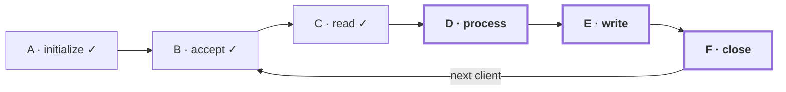
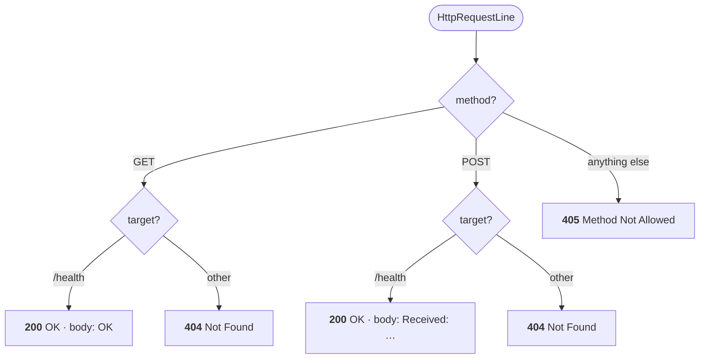
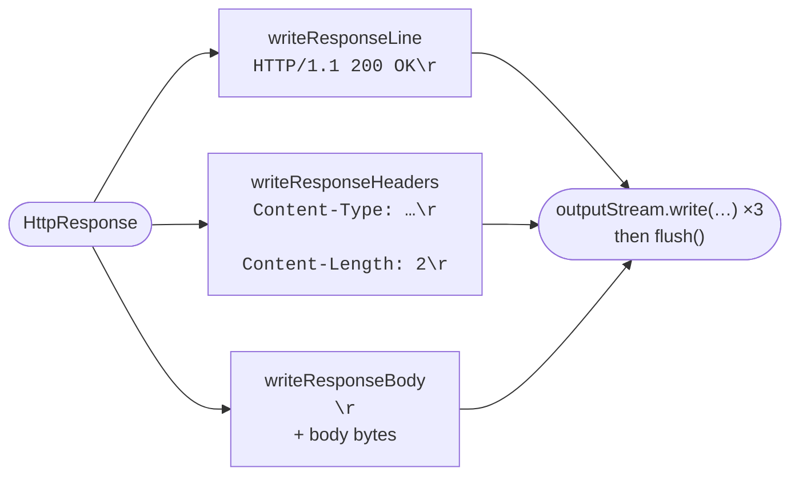
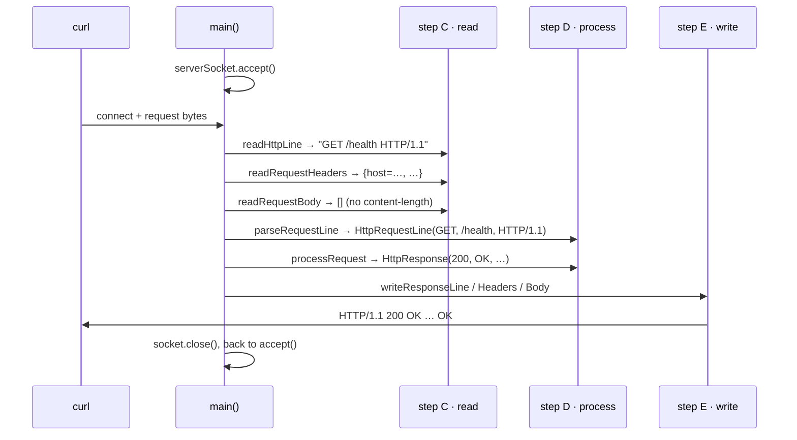

import Quiz from '../../../components/Quiz.astro';
import Think from '../../../components/Think.astro';
import ByteStrip from '../../../components/ByteStrip.astro';
import { Aside, Steps } from '@astrojs/starlight/components';

<Aside type="tip" title="Part 3 of 3 · building your first server · ≈45 min">
**Step D** (process), **step E** (write the response), **step F** (close). Win: four different `curl` requests get four correct answers: `200`, `404`, `200` with your echo, and `405`. All from a server you built from nothing.
</Aside>

## Recall (from memory)

<Think id="maths-l9-recall-1" prompt="Step C ends with three values. What are they, and what type is each one?" revealLabel="Check">
`requestLine: String` (e.g. `GET /health HTTP/1.1`), `headers: Map<String, String>` (lowercase names), and `body: ByteArray` (exactly Content-Length bytes, possibly empty).
</Think>

<Think id="maths-l9-recall-2" prompt="Write the bytes of a response with status 200 and the body OK. Every line, every \r\n." revealLabel="Check">
`HTTP/1.1 200 OK\r\n` `Content-Type: text/plain\r\n` `Content-Length: 2\r\n` `\r\n` `OK`. That's the status line, the headers, the empty line, then exactly 2 body bytes.
</Think>

## Where we are



Today's three steps have very different jobs, and keeping them separate is the most important design idea in this lesson:

| Step | Input | Output | Knows about bytes? |
|---|---|---|---|
| **D · process** | the request, as data | an `HttpResponse` **object** | no |
| **E · write** | the `HttpResponse` | bytes on the `Socket` | yes |
| **F · close** | the `Socket` | nothing | no |

Step D only *decides*. Step E only *formats*. Spring is built the same way: your controller returns an object, and Spring writes the bytes.

## D(i) · Parse the request line

`"GET /health HTTP/1.1"` is just a string. Code that wants the method has to dig it out every time, so pull it apart once, into data:

```kotlin
/*
step D(i): parse the HTTP request line
    - split the line into method, target, and HTTP version
    - validate that exactly three parts are present
    - return the parsed values as an HttpRequestLine
*/
private fun parseRequestLine(requestLine: String): HttpRequestLine {
    val words = requestLine.trim().split(Regex("\\s+"))

    if (words.size != 3) {
        throw IOException("Invalid HTTP request line: $requestLine")
    }
    return HttpRequestLine(
        method = words[0],
        target = words[1],
        version = words[2]
    )
}

data class HttpRequestLine(
    val method: String,
    val target: String,
    val version: String,
)
```

<ByteStrip
  segments={[
    { label: 'method', text: 'GET', tone: 'line' },
    { label: '', text: ' ', tone: 'gap' },
    { label: 'target', text: '/health', tone: 'head' },
    { label: '', text: ' ', tone: 'gap' },
    { label: 'version', text: 'HTTP/1.1', tone: 'body' },
  ]}
  caption={'split(Regex("\\s+")) cuts at each run of whitespace, giving exactly three words: HttpRequestLine(method=GET, target=/health, version=HTTP/1.1).'}
/>

A `data class` is the same tool you use for Retrofit responses: named fields, a readable `toString()` for your log, and `requestLine.method` instead of `words[0]` everywhere else.

**Commit:** `feat: parse(understand) the obtained HTTP request line`

## D(ii) · Process: choose the response

<Think id="maths-l9-predict-route" prompt="Before the code: your server knows GET /health and POST /health. What should it answer for GET /unknown? And for DELETE /health? (Lesson 6 has both codes.)" revealLabel="Check">
`GET /unknown` → **404 Not Found**: no such thing. `DELETE /health` → **405 Method Not Allowed**: the server doesn't handle that method.
</Think>

The decision, as a tree. The method is checked first, then the target:



Choosing which code runs from the method and target is **routing**. You just wrote a router by hand. Every web framework has one, and Spring's version is the `@GetMapping("/health")` style of annotation you'll write in lesson 12.

The decision produces a **response object**, not bytes:

```kotlin
data class HttpResponse(
    val statusCode: Int,
    val statusMessage: String,
    val headers: Map<String, String>,
    val body: ByteArray
)
```

And `processRequest` is the tree above, in Kotlin. Here's one branch of it (the rest have the same shape):

```kotlin
/*
step D(ii): process the HTTP request
    - inspect the request method and target
    - determine how the server should handle the request
    - construct and return an HTTP response
*/
private fun processRequest(
    requestLine: HttpRequestLine,
    headers: Map<String, String>,
    body: ByteArray
): HttpResponse {
    when (requestLine.method) {
        "GET" -> {
            // Handle GET requests
            if (requestLine.target == "/health") {
                return HttpResponse(
                    statusCode = 200,
                    statusMessage = "OK",
                    headers = mapOf("Content-Type" to "text/plain"),
                    body = "OK".toByteArray()
                )
            } else {
                return HttpResponse(404, "Not Found", mapOf("Content-Type" to "text/plain"), "Not Found".toByteArray())
            }
        }
        "POST" -> { /* same shape: /health echoes "Received: ${body.decodeToString()}", else 404 */ }
        else -> {
            // Handle unsupported methods
            return HttpResponse(405, "Method Not Allowed", mapOf("Content-Type" to "text/plain"), "Method Not Allowed".toByteArray())
        }
    }
}
```

Notice where `body.decodeToString()` happens: here, in the `POST` branch. Step C delivered raw bytes. Only the code that handles `/health` knows they should be read as text.

**Commit:** `feat: implement HTTP request processing and routing`

## E · Write the response

Now turn the object into bytes. The response has the same four parts as the request (lesson 5), so step E has three small functions:



```kotlin
/*
step E(i): write HTTP response
*/
private fun writeResponseLine(response: HttpResponse): ByteArray {
    return "HTTP/1.1 ${response.statusCode} ${response.statusMessage}\r\n".toByteArray()
}

/*
step E(ii): write HTTP response headers
    - iterate through the response headers
    - append each header in "Name: Value" format
    - calculate and append Content-Length using the response body size
*/
private fun writeResponseHeaders(response: HttpResponse): ByteArray {
    val headers = StringBuilder()

    for ((name, value) in response.headers) {
        headers.append("$name: $value\r\n")
    }

    val contentLength = response.body.size
    headers.append("Content-Length: $contentLength\r\n")

    return headers.toString().toByteArray()
}

/*
step E(iii): write the empty line and response body
*/
private fun writeResponseBody(response: HttpResponse): ByteArray {
    return "\r\n".toByteArray() + response.body
}
```

- **`Content-Length` is computed, never typed.** `response.body.size` counts *bytes*, which is exactly what the header means (lesson 5). The processing code can't get it wrong, because it never writes it.
- **The empty line travels with the body** in `writeResponseBody`. Whichever function writes it, it must come after the last header and before the first body byte.

And in `main()`, step E sends them into the `Socket`, in order:

```kotlin
val outputStream = socket.getOutputStream()

outputStream.write(writeResponseLine(response))
outputStream.write(writeResponseHeaders(response))
outputStream.write(writeResponseBody(response))
outputStream.flush()
```

The **output stream** is the other direction of the same pipe from lesson 3: the input stream carries client → server, the output stream carries server → client. `flush()` makes sure nothing is left waiting in a buffer.

What leaves your server for `GET /health`:

<ByteStrip
  segments={[
    { label: 'status line · writeResponseLine', text: 'HTTP/1.1 200 OK\r\n', tone: 'line' },
    { label: 'header · from response.headers', text: 'Content-Type: text/plain\r\n', tone: 'head' },
    { label: 'header · computed', text: 'Content-Length: 2\r\n', tone: 'head' },
    { label: 'empty line', text: '\r\n', tone: 'gap' },
    { label: 'body', text: 'OK', tone: 'body' },
  ]}
  caption="The colours match the request in lesson 8: same four parts, other direction."
/>

**Commit:** `feat: write HTTP responses to clients`

## F · Close the connection

```kotlin
/*
 step F: close the client connection
 */
socket.close()
```

Why is this a step of its own? Each `Socket` holds one end of a connection, and the OS keeps that end alive until the program closes it. I ran your server once *without* this line and sent it three requests. All three got their answer (thanks to `Content-Length`), but then:

```text
java 33038 TCP *:8099 (LISTEN)
java 33038 TCP [::1]:8099->[::1]:50257 (CLOSE_WAIT)
java 33038 TCP [::1]:8099->[::1]:50258 (CLOSE_WAIT)
java 33038 TCP [::1]:8099->[::1]:50259 (CLOSE_WAIT)
```

`CLOSE_WAIT` means "the client has closed its end, and this process still hasn't closed its own". One stale connection piles up per request, forever. With step F in place, `lsof` shows only the `LISTEN` line between requests.

**Commit:** `feat: close the connection`

## One full lap

Every function you wrote, in the order one request passes through them:



<Steps>

1. **Run it:** `./gradlew -q run`.

2. **Send four requests** from the other tab. These are your server's real answers:

   ```text
   ❯ curl -i http://localhost:8080/health
   HTTP/1.1 200 OK
   Content-Type: text/plain
   Content-Length: 2

   OK

   ❯ curl -i http://localhost:8080/unknown
   HTTP/1.1 404 Not Found
   Content-Type: text/plain
   Content-Length: 9

   Not Found

   ❯ curl -i -X POST http://localhost:8080/health -d "hello"
   HTTP/1.1 200 OK
   Content-Type: text/plain
   Content-Length: 15

   Received: hello

   ❯ curl -i -X DELETE http://localhost:8080/health
   HTTP/1.1 405 Method Not Allowed
   Content-Type: text/plain
   Content-Length: 18

   Method Not Allowed
   ```

   (zsh prints a `%` after `OK` because the body has no final newline. It's not part of the response.)

3. **Read your server's log** for the `POST`. It's the whole lifecycle, one line per step:

   ```text
   Client connected                                              ← B
   POST /health HTTP/1.1                                         ← C(i)
   {host=localhost:8080, …, content-length=5, content-type=…}    ← C(ii)
   [104, 101, 108, 108, 111]                                     ← C(iii)
   HttpRequestLine(method=POST, target=/health, version=HTTP/1.1)  ← D(i)
   HttpResponse(statusCode=200, statusMessage=OK, …)             ← D(ii)
   ```

   Four `Client connected` lines for four requests, all from one running server: that's the loop.

4. **Count bytes** against `Content-Length`: `OK` 2, `Not Found` 9, `Received: hello` 15, `Method Not Allowed` 18. Each one matches, because `body.size` computed it.

</Steps>

<Aside type="note" title="The thing to remember">
**D** turns the request into data and *decides*, producing an `HttpResponse` object. Choosing code by method + target is **routing**. **E** formats that object as bytes: status line, headers (with a computed `Content-Length`), empty line, body. **F** closes the client's `Socket`, and the loop returns to `accept()`.
</Aside>

## Check yourself

<Quiz
  question="Why does processRequest return an HttpResponse instead of writing bytes?"
  options={[
    'Deciding stays separate from byte formatting',
    'Kotlin cannot write bytes inside when',
    'Objects travel faster through the socket',
  ]}
  answer={0}
>
Step D decides *what* to answer. Step E knows *how* HTTP formats it. Each can change without touching the other, and that's exactly how Spring splits controllers from response writing.
</Quiz>

<Quiz
  question="Where does Content-Length come from in your response?"
  options={[
    'Each route types it into headers',
    'curl adds it to the response',
    'writeResponseHeaders computes it from body.size',
  ]}
  answer={2}
>
It's computed from the body's byte count, in one place, so no route can get it wrong.
</Quiz>

<Quiz
  question="lsof shows CLOSE_WAIT lines piling up on your server. Which step is missing?"
  options={[
    'Step B, the server never accepted',
    'Step F, sockets are never closed',
    'Step E, the response was never flushed',
  ]}
  answer={1}
>
`CLOSE_WAIT`: the client closed its end, and your process never closed its own. That's `socket.close()`, step F.
</Quiz>

## Your turn

<Think id="maths-l9-route" prompt="Add GET /question, returning 200 with the body 7 x 8 = ?. Which function changes, which branch, and what Content-Length will curl see?" revealLabel="Check">
Only `processRequest`, in the `"GET"` branch: one more `if` (or a `when` on the target) for `/question`, returning `HttpResponse(200, "OK", mapOf("Content-Type" to "text/plain"), "7 x 8 = ?".toByteArray())`. Steps C, E and F don't change at all. `curl` sees `Content-Length: 9`, computed by `writeResponseHeaders`.
</Think>

<Think id="maths-l9-teachback" prompt="Walk one request through your whole server, A to F, naming the function at each step and what it hands to the next one. Use POST /health with body hello." revealLabel="Compare with a model answer">
**A**: `ServerSocket(8080)` listens. **B**: `accept()` blocks until `curl` connects, then returns a `Socket`. **C**: `readHttpLine` returns `POST /health HTTP/1.1`, `readRequestHeaders` returns a map with `content-length=5`, and `readRequestBody` reads exactly 5 bytes, `hello`. **D**: `parseRequestLine` makes `HttpRequestLine(POST, /health, HTTP/1.1)`, and `processRequest` routes it to the POST + `/health` branch, which returns `HttpResponse(200, OK, …, "Received: hello")`. **E**: the three write functions send the status line, the headers with a computed `Content-Length: 15`, the empty line and the body, then `flush()`. **F**: `socket.close()`, and the loop goes back to `accept()`.
</Think>

## Read alongside
- 📖 **Primary:** [MDN: HTTP messages, "HTTP responses"](https://developer.mozilla.org/en-US/docs/Web/HTTP/Guides/Messages#http_responses) (10 min). Read it as the *writer*: what must your step E produce?
- [Java docs: `OutputStream`](https://docs.oracle.com/en/java/javase/25/docs/api/java.base/java/io/OutputStream.html): `write(byte[])` and `flush()`.

🙋 Ask me: "what does `flush()` actually flush?", "why is `HttpResponse.body` a `ByteArray`, not a `String`?", "what would a JSON response need?"

**Next:** Lesson 10: threads. Your server handles one client at a time. In a duel, two phones send answers at the same moment. What does Sita's request do while yours is being processed?
