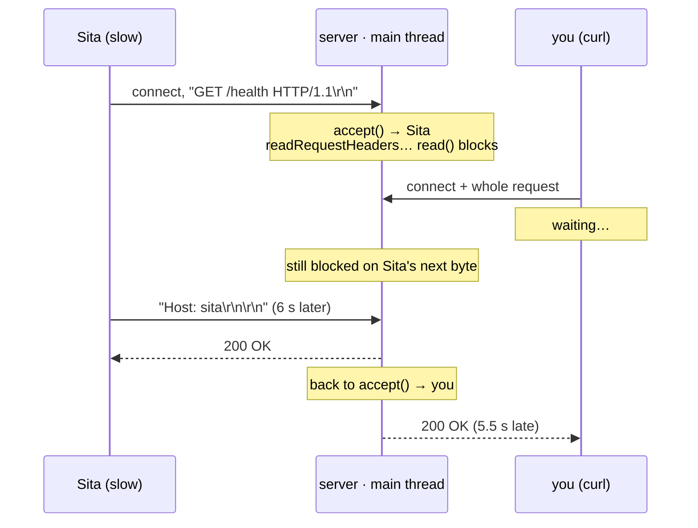
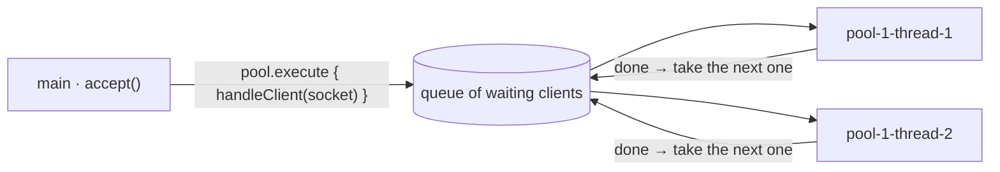

import Quiz from '../../../components/Quiz.astro';
import Think from '../../../components/Think.astro';
import { Aside, Steps } from '@astrojs/starlight/components';

<Aside type="tip" title="3 steps · ≈45 min · same server, three small changes">
**Step 0:** watch one slow client freeze your server, and find the exact line. **Step 1:** one thread per client. **Step 2:** a thread pool. Win: your `curl` gets its answer in **0.04 s** while another client is still dawdling, where it used to wait 5.5 s.
</Aside>

## Recall (from memory)

<Think id="maths-l10-recall-1" prompt="Name two calls in your server that block, meaning the thread sleeps on that line until something arrives. What is each one waiting for?" revealLabel="Check">
`serverSocket.accept()` waits for a client to **connect**. `inputStream.read()` (inside `readHttpLine`) waits for the client's next **byte**. Each one sleeps until its thing arrives.
</Think>

<Think id="maths-l10-recall-2" prompt="Your loop is: accept → read → process → write → close → accept again. While it's on 'read' for client 1, can it accept client 2?" revealLabel="Check">
No. There's one loop, and it does one thing at a time. It only reaches `accept()` again after client 1 is closed. Today is about what that costs, and how to fix it.
</Think>

## Step 0 · See the problem

Your server is **one loop on one thread**. Usually each client takes microseconds, so nobody notices. Now make one client slow.

<Steps>

1. **Start your server**, then open two more terminal tabs.

2. **Tab 2, playing Sita:** connect and send *only* the request line, then stop typing:

   ```bash
   nc localhost 8080
   ```

   Type `GET /health HTTP/1.1`, press Enter **once**, and wait.

3. **Tab 3, playing you:**

   ```bash
   curl http://localhost:8080/health
   ```

   <Think id="maths-l10-predict" prompt="Before you press Enter in tab 3: what will curl do?" />

   Nothing comes back. `curl` just hangs.

4. **Back in tab 2**, type `Host: sita`, then press Enter twice. Sita gets her response, and **at the same moment** your `curl` prints `OK`.

</Steps>

I timed it, with Sita taking 6 seconds to finish her request:

```text
OK ← you, after 5.5s
```

Your request needs about a millisecond of work. It waited 5.5 seconds, the whole time Sita was typing:



### Where exactly is it stuck?

<Think id="maths-l10-where" prompt="Point to the exact line in your Server.kt where the server waits while Sita doesn't type. Which function, which call?" revealLabel="Check">
Inside `readRequestHeaders`, which calls `readHttpLine`, on the line `val nextByte = inputStream.read()`. `read()` blocks until Sita's next byte arrives.
</Think>

Don't guess: the JDK can show you. `jstack <pid>` prints where every thread of a Java process is *right now* (get the PID from `lsof -nP -iTCP:8080 -sTCP:LISTEN`). I ran it while Sita was silent:

```text
"main" #1 …
	at java.net.Socket$SocketInputStream.read(Socket.java:966)
	at ServerKt.readHttpLine(Server.kt:93)
	at ServerKt.readRequestHeaders(Server.kt:113)
	at ServerKt.main(Server.kt:40)
```

Read it **bottom up**. `main` (line 40) called `readRequestHeaders` (line 113), which called `readHttpLine`, which is sitting on line 93: `inputStream.read()`. And `main` can't be on line 93 *and* in `accept()` at the same time.

**So where was your `curl`?** It had already connected. The OS finished the connection and **queued your request bytes**, waiting for the program to call `accept()` again. Your request was ready. Nobody was free to take it.

### You know this bug from Android

It's network I/O on the main thread. One slow call, and every tap and frame waits behind it, until you get an ANR. On Android, the fix is to move slow work off the main thread so the main thread stays free for the next event. The server needs the same fix.

## Step 1 · One thread per client

A **thread** is an independent line of execution inside one process, with its own "which line am I on". Threads run at the same time. When one blocks on `read()`, the others keep going ([Java tutorial: Processes and Threads](https://docs.oracle.com/javase/tutorial/essential/concurrency/procthread.html)). Your server process already has 19 threads (the JVM's own), but only `main` runs your code.

<Think id="maths-l10-design" prompt="Design first. Your loop has steps B (accept), C (read), D (process), E (write), F (close). Which ones stay on main, and which move to a per-client thread? Why?" revealLabel="Check">
Only **B** stays on `main`. **C, D, E and F all move**, together and in order: they're one client's whole conversation on that client's `Socket`. You can't process before reading, or close before writing. After handing off, `main` goes straight back to `accept()`.
</Think>

```text
main thread:     accept ─▶ hand off ─▶ accept ─▶ hand off ─▶ accept …
                              │                     │
Thread-0 (Sita):              └─ C ─ D ─ E ─ F      │        (Sita can be slow,
Thread-1 (you):                                     └─ C ─ D ─ E ─ F   nobody else waits)
```

**Change 1: move C–F into one function.** Cut everything after `accept()` (from `val inputStream = …` down to `socket.close()`) and paste it in, unchanged:

```kotlin
/*
steps C to F handle one client [each on its own thread]
    - read the request, process it, write the response & close
    - may block (eg a slow client) without stopping other clients
 */
private fun handleClient(socket: Socket) {
    val inputStream = socket.getInputStream()
    // … C, D, E exactly as before …
    socket.close()
}
```

**Change 2: hand each client to a new thread.**

```kotlin
import java.net.Socket
import kotlin.concurrent.thread

    while (true) {
        val socket = serverSocket.accept()
        println("Client connected")

        /*
         step C-F: hand this client to a new thread, and go straight back to accept()
         */
        thread {
            handleClient(socket)
        }
    }
```

- **`thread { … }` returns immediately.** It creates a thread, starts it running the block, and `main` carries on, back to `accept()` within microseconds ([Kotlin docs: `thread`](https://kotlinlang.org/api/core/kotlin-stdlib/kotlin.concurrent/thread.html)).
- **Each thread gets the right client.** Every pass of the loop has its own `val socket`, and the lambda captures *that* one. Sita's thread holds Sita's socket, and yours holds yours.

Same experiment, same slow Sita:

```text
OK ← you, after 0.04s
```

And `jstack`, while Sita is still silent:

```text
"main" #1 …
	at java.net.ServerSocket.accept(ServerSocket.java:532)
	at ServerKt.main(Server.kt:28)                    ← in accept(), free
"Thread-0" #14 …
	at ServerKt.readHttpLine(Server.kt:55)            ← Sita's thread, blocked on read()
	at ServerKt.readRequestHeaders(Server.kt:75)
	at ServerKt.handleClient(Server.kt:268)
	at ServerKt.main$lambda$0(Server.kt:35)           ← started by thread { … }
```

The blocked `read()` is still there, but it now blocks only **Sita's** thread.

**Commit:** `feat: handle each client on its own thread`

### Whose line is this? Tag the log

Look at the log after that experiment:

```text
Client connected
GET /health HTTP/1.1          ← Sita's request line
Client connected
GET /health HTTP/1.1          ← yours
{host=localhost:8080, …}      ← yours
{host=sita}                   ← Sita's, seconds later
```

Two threads, each printing the moment it reaches a `println`, so their lines **interleave**. Every client has its own socket, and `socket.port` is the **client's** port, the temporary one from lesson 3. So tag every line in `handleClient` with the thread's name and that port:

```kotlin
// who is this? the thread's name + the client's port, on every log line
val tag = "[${Thread.currentThread().name} :${socket.port}]"

println("$tag $requestLine")
```

Your server's log for the same experiment (I ran your code on port 8099, so the port shows up in `host`):

```text
Client connected
[Thread-0 :50865] GET /health HTTP/1.1
Client connected
[Thread-1 :50866] GET /health HTTP/1.1
[Thread-1 :50866] {host=localhost:8099, user-agent=curl/8.7.1, accept=*/*}
[Thread-1 :50866] []
[Thread-1 :50866] HttpRequestLine(method=GET, target=/health, version=HTTP/1.1)
[Thread-1 :50866] HttpResponse(statusCode=200, statusMessage=OK, …)
[Thread-0 :50865] {host=sita}
[Thread-0 :50865] HttpResponse(statusCode=200, statusMessage=OK, …)
```

Now each client's story can be followed through the mix. Real server logs do the same: every line of a Spring log carries a thread name like `[nio-8080-exec-3]`.

**Commit:** `feat: tag log lines with thread and client port`

## Step 2 · A thread pool

A new thread for every client works, but every thread has a cost:

- **Memory.** Each thread reserves its own stack. On this Mac's JDK, that's 2 MB by default (`java -XX:+PrintFlagsFinal -version | grep ThreadStackSize` prints `2048`, in KB).
- **No limit.** Your server creates as many threads as clients arrive. A flood of clients, or one buggy app retrying in a loop, means unbounded threads, until the machine runs out of memory.

<Think id="maths-l10-cost" prompt="A duel: each phone sends an answer about every 3 seconds, for 60 seconds. 1,000 people play at once. Roughly how many threads does your server create per minute?" revealLabel="Check">
1,000 phones × 20 answers each (60 s ÷ 3 s) = about **20,000** threads created and thrown away every minute. Each one is created, used for a millisecond, and then discarded.
</Think>

You've never created a thread per Retrofit call on Android. OkHttp, `Dispatchers.IO` and Room all use the same idea: a **thread pool**, a fixed set of threads that are created once and reused for task after task. Java's version is an `ExecutorService` ([Java tutorial: Thread Pools](https://docs.oracle.com/javase/tutorial/essential/concurrency/pools.html)):

```kotlin
import java.util.concurrent.Executors

    val serverSocket = ServerSocket(8080)
    val pool = Executors.newFixedThreadPool(2)   // 2 to make the limit visible; a real server uses many more

    while (true) {
        val socket = serverSocket.accept()
        println("Client connected")

        pool.execute {
            handleClient(socket)
        }
    }
```

The change is **one line**: `thread { … }` becomes `pool.execute { … }`. Everything else stays the same.



A pool makes **a trade**, and you should see both sides. I sent two slow clients (Sita and Ravi, 5 s each) and then a normal `curl` to a pool of size 2:

```text
OK ← you, after 4.5s
```

```text
[pool-1-thread-1 :50818] GET /health HTTP/1.1      ← Sita takes thread 1
[pool-1-thread-2 :50819] GET /health HTTP/1.1      ← Ravi takes thread 2
                                                    ← you: queued, both threads busy
[pool-1-thread-1 :50818] {host=sita}
[pool-1-thread-2 :50819] {host=ravi}
…
[pool-1-thread-2 :50821] GET /health HTTP/1.1      ← you, on a REUSED thread
```

- **The good side:** threads are reused. Look at the last line: `pool-1-thread-2` served Ravi (port 50819), then *you* (port 50821). No thread was created for you.
- **The price:** with both threads busy, you waited in the queue, just like in step 0. The pool caps the cost, and the cap is how many slow clients it takes to make everyone else wait.

So the pool's **size** is a real decision. Spring Boot's built-in server, Tomcat, uses a pool with a default maximum of **200** threads ([Spring Boot: `server.tomcat.threads.max`](https://docs.spring.io/spring-boot/appendix/application-properties/index.html#application-properties.server.server.tomcat.threads.max)). Lesson 11's "what Spring does for you" includes exactly this.

**Commit:** `feat: serve clients from a fixed thread pool`

<Aside type="note" title="Coming up: virtual threads">
JDK 21 added **virtual threads**: threads so cheap you *can* have one per client, even millions of them ([JEP 444](https://openjdk.org/jeps/444)). Spring Boot can switch to them with one setting. You'll see them in a later lesson. They make sense once you've felt why ordinary threads are expensive, which you now have.
</Aside>

<Aside type="caution" title="A door you just opened">
Threads now run **at the same time**. That's harmless today, because each thread only touches its own client's data. From lesson 15, duels live in the server's memory, and two threads will update the **same duel** (yours and Sita's answers). That's where threads get dangerous: race conditions, in lesson 19. Keep this in mind.
</Aside>

## Check yourself

<Quiz
  question="With one thread per client, Sita is slow. Where is your curl handled?"
  options={[
    'On main, after Sita is done',
    'On its own new thread, immediately',
    'Queued in the OS, behind Sita',
  ]}
  answer={1}
>
`main` accepted you right away and handed you to a fresh thread. Sita's slow `read()` only blocks her own thread.
</Quiz>

<Quiz
  question="A pool of 2 threads, both serving slow clients. A third client connects. What happens?"
  options={[
    'It waits until a thread is free',
    'The pool simply creates a third thread',
    'It is rejected with a 503 error',
  ]}
  answer={0}
>
`execute` puts the task in the pool's queue. It runs when a thread finishes its current client. That's the 4.5 s you saw.
</Quiz>

<Quiz
  question="In jstack, a thread's stack is listed top to bottom. Where is the line it's on now?"
  options={[
    'The bottom line, where it started',
    'Whichever line mentions your own file',
    'The top line, the newest call',
  ]}
  answer={2}
>
The top is the call happening now, like `read()`. Below it is who called it, down to `main` at the bottom. Read it bottom up to follow the story.
</Quiz>

## Your turn

<Think id="maths-l10-teachback" prompt="Explain to another Android developer, in 4–5 sentences: why your first server made everyone wait for one slow client, how a thread per client fixed it, and why real servers use a pool instead." revealLabel="Compare with a model answer">
The server ran on one thread, and `read()` blocks until the client's next byte arrives. So while it waited on a slow client, it couldn't get back to `accept()`, and other clients sat in the OS queue. Giving each client its own thread moves that blocking off `main`, which goes straight back to `accept()`, so a slow client only blocks its own thread. But a thread per client is unbounded: each thread reserves memory (2 MB of stack here), and a flood of clients means a flood of threads. A pool reuses a fixed set of threads and queues the rest, the same way OkHttp and `Dispatchers.IO` do on Android. Spring's Tomcat uses a pool of up to 200.
</Think>

## Read alongside
- 📖 **Primary:** [Java tutorial: Concurrency](https://docs.oracle.com/javase/tutorial/essential/concurrency/index.html): read "Processes and Threads", "Defining and Starting a Thread" and "Thread Pools" (20 min).
- [Java docs: `Executors`](https://docs.oracle.com/en/java/javase/25/docs/api/java.base/java/util/concurrent/Executors.html): `newFixedThreadPool`.

🙋 Ask me: "how big should the pool be?", "what does `jstack` show for an idle pool thread?", "why does `Client connected` have no tag?", "what's a virtual thread, really?"

**Next:** Lesson 11: Spring Boot. You'll see which of the things you built by hand (the loop, threads, routing, writing the response) Spring now does for you.
