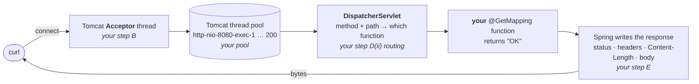

import Quiz from '../../../components/Quiz.astro';
import Think from '../../../components/Think.astro';
import { Aside, Steps } from '@astrojs/starlight/components';

<Aside type="tip" title="5 steps · ≈50 min · a new app next to your hand-made one">
**Generate** a Spring Boot project, **read** its Gradle files, **run** it, **rebuild `/health`** in Spring, then **find your steps A–F** inside it. Win: the same four `curl`s you sent your own server get the same answers from Spring, and you can say which part of Spring did what.
</Aside>

## Recall (from memory)

<Think id="maths-l11-recall-1" prompt="1,000 phones each send an answer every 3 seconds for 60 seconds. With one thread per request, about how many threads get created per minute? (Every answer is a new HTTP request, so a new connection.)" revealLabel="Check">
1,000 × 20 = about **20,000**. Not 1,000: each *answer* is its own request, its own `accept()`, and so its own thread. A thread is per **request** here, not per **player**. That churn is why servers use a pool.
</Think>

<Think id="maths-l11-recall-2" prompt="Your server has steps A–F. Name them, and say which thread runs each one after lesson 10." revealLabel="Check">
**A** initialize (`ServerSocket`) and **B** accept run on `main`. **C** read, **D** process, **E** write and **F** close run on a pool thread, inside `handleClient`.
</Think>

## The idea: you already wrote Spring's core

Everything you built by hand is still there in a Spring Boot app. Spring and its embedded web server, **Tomcat**, do it for you:

| Your hand-made server | In Spring Boot |
|---|---|
| **A** `ServerSocket(8080)` | Tomcat, started for you on port 8080 |
| **B** `while (true) { accept() }` on `main` | Tomcat's **Acceptor** thread |
| `Executors.newFixedThreadPool(2)` | Tomcat's pool: `http-nio-8080-exec-N`, up to **200** threads |
| **C** `readHttpLine`, headers map, `readNBytes` | Tomcat parses the request for you |
| **D(i)** `parseRequestLine` | Tomcat again: method, path and version |
| **D(ii)** `when (method) { … target == "/health" … }` | Spring's **DispatcherServlet** + your `@GetMapping("/health")` |
| automatic 404 / 405 branches | automatic, including the `Allow` header |
| **E** status line, headers, `Content-Length` from `body.size` | Spring + Tomcat write it |
| **F** `socket.close()` | Tomcat (and it keeps connections open for reuse, lesson 5) |

What's left for *you* is one thing: **the function that decides**, the body of your `processRequest` branch. The rest of this lesson proves the table line by line.



## Step 1 · Generate the project

**Stop your hand-made server first** (Ctrl+C). Both servers want port 8080, and you know what happens if two processes try to listen on the same port (lesson 2).

Go to [start.spring.io](https://start.spring.io) and choose:

| Field | Value |
|---|---|
| Project | **Gradle - Kotlin** |
| Language | **Kotlin** |
| Spring Boot | **4.1.2** (the current default) |
| Group / Artifact | `dev.hari` / `app` |
| Package name | `dev.hari.maths` |
| Java | **25** |
| Dependencies | **Spring Web** |

Click **Generate** and unzip it into your `maths` repo as `app/`, next to `handmade/`. Open `app/` in IntelliJ as its own Gradle project. This is what you get:

```text
app/
├── build.gradle.kts                       ← what to build, and with which libraries
├── settings.gradle.kts                    ← the project's name
├── gradlew, gradle/wrapper/…              ← runs the right Gradle version
└── src/main/
    ├── kotlin/dev/hari/maths/AppApplication.kt   ← main()
    └── resources/application.properties          ← settings (port, name…)
```

**Commit:** `feat: generate Spring Boot app`

## Step 2 · Read the Gradle build

Gradle is the build tool. It downloads libraries, compiles your Kotlin, and runs the app. Android Studio uses it too: this is the same kind of `build.gradle.kts` as your Android projects, just without the `android { }` block ([Gradle basics](https://docs.gradle.org/current/userguide/gradle_basics.html)). Here's the generated `app/build.gradle.kts`:

```kotlin
plugins {
    kotlin("jvm") version "2.3.21"                         // compile Kotlin for the JVM
    kotlin("plugin.spring") version "2.3.21"               // makes Spring-annotated classes 'open' (Kotlin classes are final by default)
    id("org.springframework.boot") version "4.1.2"         // adds ./gradlew bootRun and builds a runnable jar
    id("io.spring.dependency-management") version "1.1.7"  // picks matching versions for every Spring library
}

java {
    toolchain {
        languageVersion = JavaLanguageVersion.of(25)       // compile and run on JDK 25
    }
}

repositories {
    mavenCentral()                                         // where libraries are downloaded from
}

dependencies {
    implementation("org.springframework.boot:spring-boot-starter-webmvc")  // ← the whole web server
    implementation("org.jetbrains.kotlin:kotlin-reflect")
    implementation("tools.jackson.module:jackson-module-kotlin")           // JSON ⇄ Kotlin data classes
    // (test dependencies left out)
}
```

The important line is **`spring-boot-starter-webmvc`**. A **starter** is one dependency that pulls in a matching set of libraries. Gradle can show you what this one brings:

```bash
./gradlew -q dependencies --configuration runtimeClasspath
```

```text
+--- org.springframework.boot:spring-boot-starter-webmvc -> 4.1.2
|    +--- org.springframework.boot:spring-boot-starter:4.1.2
|    +--- org.springframework.boot:spring-boot-starter-jackson:4.1.2     ← JSON
|    +--- org.springframework.boot:spring-boot-starter-tomcat:4.1.2      ← the server: A, B, C, E, F
|    +--- org.springframework.boot:spring-boot-http-converter:4.1.2
|    \--- org.springframework.boot:spring-boot-webmvc:4.1.2              ← routing: D
```

Your hand-made server needed no dependencies at all: just the JDK. This one line brings in a whole HTTP server.

`gradlew` is the **Gradle wrapper**: a small script that downloads the exact Gradle version written in `gradle/wrapper/gradle-wrapper.properties` (9.8.2 here), so everyone builds with the same one ([Gradle wrapper](https://docs.gradle.org/current/userguide/gradle_wrapper_basics.html)). It's the same `./gradlew` you've been using for `handmade/`.

## Step 3 · Run it

The generated `main()`:

```kotlin
@SpringBootApplication
class AppApplication

fun main(args: Array<String>) {
    runApplication<AppApplication>(*args)
}
```

From `app/`:

```bash
./gradlew bootRun
```

I ran it. (Your hand-made server was holding 8080, so I used `--args='--server.port=8091'` and wrote 8080 in the outputs below, the only thing I changed.) Here are the important lines of the startup log (trimmed):

```text
 :: Spring Boot ::                (v4.1.2)
… [main] Starting AppApplicationKt using Java 25.0.5 with PID 55879
… [main] Tomcat initialized with port 8080 (http)                  ← step A
… [main] Starting Servlet engine: [Apache Tomcat/11.0.27]
… [main] Tomcat started on port 8080 (http) with context path '/'  ← listening
… [main] Started AppApplicationKt in 0.783 seconds
```

`Tomcat started on port 8080` is your `println("Listening on port 8080")`. Check it the same way: `lsof -nP -iTCP:8080 -sTCP:LISTEN` shows a `java` process listening.

Now `curl -i http://localhost:8080/health` gets a **404**. The server is up, but nothing handles `/health` yet. That's your next step.

## Step 4 · `/health` in Spring

<Think id="maths-l11-predict" prompt="Before the code: in your hand-made server, which parts of processRequest would you still have to write in Spring, and which parts do you think disappear?" revealLabel="Check">
You still write the *decision*: for `GET /health`, return `OK`, and for `POST /health`, return `Received: …`. What disappears: the `when` on the method, the `if` on the target, the 404 and 405 branches, building `HttpResponse`, and writing the bytes.
</Think>

Create `app/src/main/kotlin/dev/hari/maths/HealthController.kt`:

```kotlin
package dev.hari.maths

import org.springframework.web.bind.annotation.GetMapping
import org.springframework.web.bind.annotation.PostMapping
import org.springframework.web.bind.annotation.RequestBody
import org.springframework.web.bind.annotation.RestController

@RestController
class HealthController {

    @GetMapping("/health")
    fun health(): String {
        println("[${Thread.currentThread().name}] GET /health")
        return "OK"
    }

    @PostMapping("/health")
    fun echo(@RequestBody body: String): String {
        println("[${Thread.currentThread().name}] POST /health body=$body")
        return "Received: $body"
    }
}
```

Each piece, in terms of your own code:

- **`@RestController`**: "this class handles HTTP requests, and what its functions return is the response body". Spring finds it on startup.
- **`@GetMapping("/health")`**: one branch of your `when`, `method == "GET" && target == "/health"`, written as an annotation ([Spring docs: request mapping](https://docs.spring.io/spring-framework/reference/web/webmvc/mvc-controller/ann-requestmapping.html)). **Routing** is now a table that Spring builds from these annotations.
- **`return "OK"`**: your `HttpResponse(200, "OK", …, "OK".toByteArray())`. Returning normally means `200`, and the string becomes the body.
- **`@RequestBody body: String`**: your `readRequestBody` plus `decodeToString()`, as a function parameter.

Restart (`./gradlew bootRun`) and send **exactly the four requests you sent your own server in lesson 9**:

```text
❯ curl -i localhost:8080/health
HTTP/1.1 200
Content-Type: text/plain;charset=UTF-8
Content-Length: 2
Date: Mon, 16 Nov 2026 09:45:06 GMT

OK

❯ curl -i localhost:8080/unknown
HTTP/1.1 404
Content-Type: application/json
Transfer-Encoding: chunked

{"timestamp":"2026-11-16T09:45:06.421Z","status":404,"error":"Not Found","path":"/unknown"}

❯ curl -i -X POST localhost:8080/health -d hello
HTTP/1.1 200
Content-Type: text/plain;charset=UTF-8
Content-Length: 16

Received: hello=

❯ curl -i -X DELETE localhost:8080/health
HTTP/1.1 405
Allow: GET, POST
Content-Type: application/json
Transfer-Encoding: chunked

{"timestamp":"2026-11-16T09:45:06.464Z","status":405,"error":"Method Not Allowed","path":"/health"}
```

Compare them with your server's answers. Everything you know shows up here:

- **`HTTP/1.1 200` has no `OK`.** The reason phrase is optional: the standard writes the status line as `HTTP-version SP status-code SP [ reason-phrase ]`, and the brackets mean optional ([RFC 9112 §4](https://www.rfc-editor.org/rfc/rfc9112#section-4)). Tomcat leaves it out. Clients read the number.
- **You never wrote a 404 or a 405,** and both came back. Spring knows every `@…Mapping` you declared, so it can tell "no such path" (404) apart from "path exists, wrong method" (405). It even adds **`Allow: GET, POST`**, listing the methods that path does accept.
- **`Transfer-Encoding: chunked`** on the error bodies: the second way to mark where a body ends (lesson 5), chosen by Spring.
- **`Content-Length: 2`** for `OK`: computed from the body's bytes, exactly like your `writeResponseHeaders`.
- **`Received: hello=`?** There's a stray `=`. That's lesson 6's `Content-Type` trap. `curl -d` labels the body `application/x-www-form-urlencoded`, so Spring read `hello` as a *form field* named `hello` with an empty value, and wrote it back as `hello=`. Send the right label and it's fine:

  ```bash
  curl -X POST localhost:8080/health -H 'Content-Type: text/plain' -d hello
  ```

  ```text
  Received: hello
  ```

  Your hand-made server ignored `Content-Type`. Spring believes it. That's the difference between reading bytes and reading *meaning*.

**Commit:** `feat: GET and POST /health in Spring`

## Step 5 · Find your threads inside Spring

Look at your `println`s in the log:

```text
[http-nio-8080-exec-1] GET /health
[http-nio-8080-exec-2] GET /health
[http-nio-8080-exec-5] POST /health body=hello=
```

Those are **pool threads**, the same idea as your `pool-1-thread-1`. Spring's own log lines show the same name, shortened: `[nio-8080-exec-1]`. Now ask `jstack` what threads exist (I grouped them by name):

```text
  10 "http-nio-8080-exec-N"     ← the pool (Tomcat starts 10, grows up to 200)
   1 "http-nio-8080-Acceptor"   ← your while (true) { accept() }
   1 "http-nio-8080-Poller"     ← watches open connections for incoming bytes
   …  (the JVM's own: GC, compiler, signal handler…)
```

- **Acceptor** is your step B. One thread, looping on `accept()`.
- **exec-N** is your pool. Tomcat keeps at least 10 threads ready (`server.tomcat.threads.min-spare`), and creates more as needed, up to 200 (`server.tomcat.threads.max`) ([Spring Boot properties](https://docs.spring.io/spring-boot/appendix/application-properties/index.html#application-properties.server.server.tomcat.threads.max)).
- **Poller** is something your server didn't have. It watches all the open connections and wakes a pool thread when bytes arrive. That's the "NIO" in `http-nio`.

And the lesson 10 test, a slow Sita plus your `curl`:

```text
OK ← you, after 0.033s
```

Same result as your pooled server: a slow client doesn't block anyone else.

<Aside type="note" title="The thing to remember">
Spring Boot is your server with every step but one written for you. **Tomcat** listens, accepts (Acceptor), hands each request to a pool thread (`http-nio-8080-exec-N`), parses it, and writes the response. **Spring MVC** routes by method + path (`@GetMapping`), answers 404/405 by itself, and turns your return value into the body. You write the function that decides.
</Aside>

## Check yourself

<Quiz
  question="DELETE /health returns 405 with Allow: GET, POST. Who wrote that response?"
  options={[
    'Spring, from your mapping annotations',
    'Your controller, in a hidden branch',
    'curl, after the server closed early',
  ]}
  answer={0}
>
Spring knows `/health` has a GET mapping and a POST mapping and nothing else. So it answers 405 and lists the allowed methods. You wrote no code for it.
</Quiz>

<Quiz
  question="Which Tomcat thread is the equivalent of your while (true) { accept() } loop?"
  options={[
    'http-nio-8080-exec-1',
    'http-nio-8080-Poller',
    'http-nio-8080-Acceptor',
  ]}
  answer={2}
>
The Acceptor accepts connections, like your `main`. The `exec` threads are the pool, and the Poller waits for bytes on open connections.
</Quiz>

<Quiz
  question="curl -d hello came back as Received: hello=. Why?"
  options={[
    'Tomcat adds = to every body',
    'The form Content-Type changed its meaning',
    'Kotlin strings always end with =',
  ]}
  answer={1}
>
`curl -d` sends `Content-Type: application/x-www-form-urlencoded`, so Spring parsed the body as a form. With `-H 'Content-Type: text/plain'` the body comes back exactly as `hello`.
</Quiz>

## Your turn

<Think id="maths-l11-map" prompt="Take your handmade/Server.kt and, for each of steps A–F plus the thread pool, name what does that job in your Spring app." revealLabel="Check">
**A** Tomcat started by `runApplication` (log: `Tomcat started on port 8080`). **B** the Acceptor thread. **Pool**: `http-nio-8080-exec-N`, 10 to 200 threads. **C and D(i)**: Tomcat parses the request. **D(ii)**: DispatcherServlet picks your `@GetMapping`/`@PostMapping` function, with automatic 404/405. **E**: Spring turns your return value into the body and Tomcat writes the status line, headers and `Content-Length`. **F**: Tomcat closes, or keeps the connection open for reuse.
</Think>

<Think id="maths-l11-question" prompt="Add GET /question to your Spring app, returning 7 x 8 = ?. How many lines did it take, compared with your hand-made server? What didn't you have to touch?" />

## Read alongside
- 📖 **Primary:** [Kotlin docs: Create a Spring Boot project with Kotlin](https://kotlinlang.org/docs/jvm-get-started-spring-boot.html) (15 min). The same steps, from the Kotlin team.
- [Spring Boot reference: Servlet web applications](https://docs.spring.io/spring-boot/reference/web/servlet.html), the "Embedded Servlet Container Support" part: Tomcat, ports, threads.
- [Spring Framework: DispatcherServlet](https://docs.spring.io/spring-framework/reference/web/webmvc/mvc-servlet.html), the first section only, for now.

🙋 Ask me: "what is a servlet?", "why does `kotlin(\"plugin.spring\")` need classes to be open?", "where do I change the port?", "can I see Spring's routing table?"

**Next:** [Lesson 12: controllers and DTOs](../0012-controllers-and-dtos/). Real JSON in and out: `POST /duels/K7QM/answers` with `{"answer":56}`, as Kotlin data classes.
