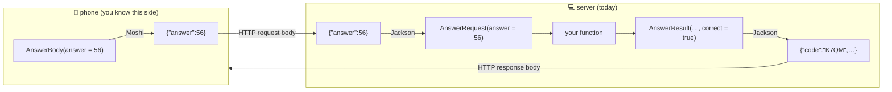
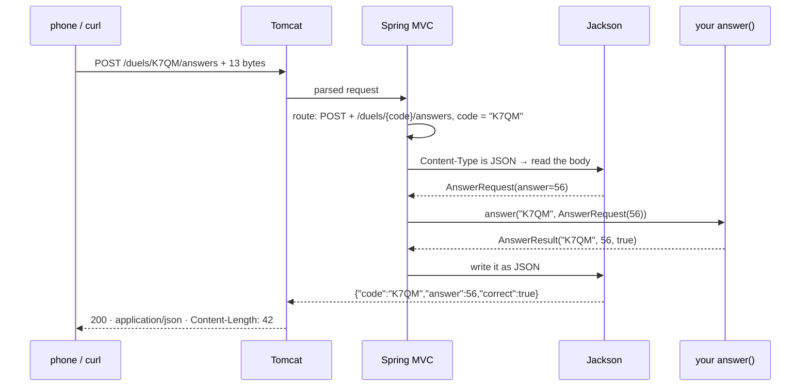

import Quiz from '../../../components/Quiz.astro';
import Think from '../../../components/Think.astro';
import ByteStrip from '../../../components/ByteStrip.astro';
import { Aside } from '@astrojs/starlight/components';

<Aside type="tip" title="4 steps · ≈45 min · in your Spring app">
**Step 1:** return JSON. **Step 2:** read the duel code from the path. **Step 3:** read JSON into a data class. **Step 4:** break it six ways. Win: `POST /duels/K7QM/answers` with `{"answer":56}` answers `{"code":"K7QM","answer":56,"correct":true}`, and you know what Spring does with every bad input before your code even runs.
</Aside>

## Recall (from memory)

<Think id="maths-l12-recall-1" prompt="In lesson 11, curl -d hello came back as Received: hello=. Which header caused that, and what value fixed it?" revealLabel="Check">
`Content-Type`. `curl -d` sends `application/x-www-form-urlencoded`, so Spring read the body as a form. `-H 'Content-Type: text/plain'` fixed it. Spring believes `Content-Type`, and today that matters a lot.
</Think>

<Think id="maths-l12-recall-2" prompt="In lesson 11, what did Spring do for you that your hand-made server did with if (requestLine.target == &quot;/health&quot;)?" revealLabel="Check">
**Routing.** `@GetMapping("/health")` tells Spring "GET + /health → this function". Spring's DispatcherServlet builds the table and also answers 404 and 405 by itself.
</Think>

## The idea: a DTO is the JSON's shape, as a data class

You've written these on the **phone** side for years. A Retrofit call like this:

```kotlin
// Android
data class AnswerBody(val answer: Int)
data class AnswerResult(val code: String, val answer: Int, val correct: Boolean)

@POST("duels/{code}/answers")
suspend fun answer(@Path("code") code: String, @Body body: AnswerBody): AnswerResult
```

Moshi (or Gson, or kotlinx.serialization) turns `AnswerBody(56)` into the bytes `{"answer":56}`, and turns the reply's bytes back into an `AnswerResult`. Those data classes are **DTOs**, *data transfer objects*: classes whose only job is to match the shape of what travels over the wire.

The server needs **the same thing, mirrored**. Spring uses **Jackson** instead of Moshi, but the job is identical ([Spring Boot: JSON](https://docs.spring.io/spring-boot/reference/features/json.html)):



Both sides must agree on the JSON, not on the class names. The phone's `AnswerBody` and the server's `AnswerRequest` match because both have one field, `answer`, holding a number.

## Step 1 · Return JSON

Your `QuestionController` returns a `String`. Return a data class instead:

```kotlin
data class QuestionResponse(val id: Int, val text: String)

@RestController
class QuestionController {
    @GetMapping("/question")
    fun getQuestion(): QuestionResponse {
        return QuestionResponse(id = 1, text = "7 x 8 = ?")
    }
}
```

```text
❯ curl -i localhost:8080/question
HTTP/1.1 200
Content-Type: application/json
Content-Length: 27

{"id":1,"text":"7 x 8 = ?"}
```

Two things changed without you asking:
- **The body is JSON.** Field names come from your property names, and values from your values.
- **`Content-Type: application/json`.** It used to be `text/plain`. Spring picks the converter by the return type: a `String` goes out as text, anything else goes through Jackson as JSON, labelled so the client knows how to read it (lesson 6). `Content-Length: 27` is still counted from the bytes.

**Commit:** `feat: return the question as JSON`

## Step 2 · Read the duel code from the path

Every duel has a code, like `K7QM`, and the code is part of the **target**: `/duels/K7QM/answers`. One mapping has to match *every* code. You write the changing part in braces:

```kotlin
@PostMapping("/duels/{code}/answers")
fun answer(@PathVariable code: String, /* … */)
```

- **`{code}`** in the pattern matches one path segment: `K7QM`, `ZZZZ`, anything up to the next `/` ([Spring docs: URI patterns](https://docs.spring.io/spring-framework/reference/web/webmvc/mvc-controller/ann-requestmapping.html#mvc-ann-requestmapping-uri-templates)).
- **`@PathVariable code: String`** hands you that segment, with the parameter name matching the name in braces.

In your hand-made router, this would have been `target.startsWith("/duels/") && target.endsWith("/answers")`, plus cutting the code out of the middle. It's the same `{code}` as Retrofit's `@Path("code")`, on the other side of the wire.

## Step 3 · Read JSON into a data class

<Think id="maths-l12-design" prompt="Before the code: the phone sends {&quot;answer&quot;:56}. Write the Kotlin data class the server should receive it into. Then write the one the server answers with, containing the duel code, the answer, and whether it was correct." revealLabel="Check">
```kotlin
data class AnswerRequest(val answer: Int)
data class AnswerResult(val code: String, val answer: Int, val correct: Boolean)
```
One DTO for each direction. The property names *are* the JSON field names.
</Think>

Create `DuelController.kt`:

```kotlin
package dev.hari.maths

import org.springframework.web.bind.annotation.PathVariable
import org.springframework.web.bind.annotation.PostMapping
import org.springframework.web.bind.annotation.RequestBody
import org.springframework.web.bind.annotation.RestController

// What the phone sends: {"answer":56}
data class AnswerRequest(val answer: Int)

// What the server sends back
data class AnswerResult(val code: String, val answer: Int, val correct: Boolean)

@RestController
class DuelController {

    @PostMapping("/duels/{code}/answers")
    fun answer(@PathVariable code: String, @RequestBody request: AnswerRequest): AnswerResult {
        println("[${Thread.currentThread().name}] duel=$code request=$request")
        return AnswerResult(code = code, answer = request.answer, correct = request.answer == 56)
    }
}
```

**`@RequestBody request: AnswerRequest`** is your lesson-8 `readRequestBody`, *plus* parsing JSON, *plus* building the object ([Spring docs: `@RequestBody`](https://docs.spring.io/spring-framework/reference/web/webmvc/mvc-controller/ann-methods/requestbody.html)). Here's what arrives, and who handles which part:

<ByteStrip
  segments={[
    { label: 'request line → @PostMapping + {code}', text: 'POST /duels/K7QM/answers HTTP/1.1\r\n', tone: 'line' },
    { label: 'header → picks Jackson', text: 'Content-Type: application/json\r\n', tone: 'head' },
    { label: 'header → how many bytes', text: 'Content-Length: 13\r\n', tone: 'head' },
    { label: 'empty line', text: '\r\n', tone: 'gap' },
    { label: 'body → AnswerRequest(answer=56)', text: '{"answer":56}', tone: 'body' },
  ]}
  caption="Tomcat reads exactly 13 body bytes. Content-Type tells Spring to hand them to Jackson. Jackson builds the data class through its constructor."
/>



Run it:

```text
❯ curl -i -X POST localhost:8080/duels/K7QM/answers \
    -H 'Content-Type: application/json' -d '{"answer":56}'
HTTP/1.1 200
Content-Type: application/json
Content-Length: 42

{"code":"K7QM","answer":56,"correct":true}

❯ curl -X POST localhost:8080/duels/K7QM/answers \
    -H 'Content-Type: application/json' -d '{"answer":65}'
{"code":"K7QM","answer":65,"correct":false}
```

And your log:

```text
[http-nio-8080-exec-9] duel=K7QM request=AnswerRequest(answer=56)
[http-nio-8080-exec-1] duel=K7QM request=AnswerRequest(answer=65)
```

`correct = request.answer == 56` is lesson 1's source of truth, in Spring: the server compares the answer against **its own** value. The phone only ever sends a number. It never gets a say in `correct`.

**Commit:** `feat: POST /duels/{code}/answers with JSON DTOs`

## Step 4 · Break it six ways

A phone, a bug, or a cheater can send anything. Before you look at the answers, predict what Spring does with each of these. Every one was sent with `-H 'Content-Type: application/json'` unless it says otherwise.

<Think id="maths-l12-break" prompt="Predict the status code for each: (a) {&quot;answer&quot;:&quot;fifty-six&quot;} (b) {} (c) {&quot;answer&quot;:56 (missing the closing brace) (d) {&quot;answer&quot;:56} with no Content-Type header (e) {&quot;answer&quot;:56,&quot;cheat&quot;:true} (f) {&quot;answer&quot;:&quot;56&quot;}" />

What I got (with the WARN line Spring logged for each failure):

| Sent | Status | Spring's log says |
|---|---|---|
| (a) `{"answer":"fifty-six"}` | **400** | `Cannot deserialize value of type 'int' from String "fifty-six"` |
| (b) `{}` | **400** | `Missing required creator property 'answer'` |
| (c) `{"answer":56` | **400** | `Unexpected end-of-input: expected close marker for Object` |
| (d) no `Content-Type` | **415** | `Content-Type 'application/x-www-form-urlencoded' is not supported` |
| (e) `{"answer":56,"cheat":true}` | **200** | (nothing: `cheat` was ignored) |
| (f) `{"answer":"56"}` | **200** | (nothing: `"56"` was converted to the number 56) |

What each one teaches:

- **(a), (b) and (c) are the client's fault**, so they're a **400**, the status you'd pick yourself (lesson 6). And look at your log: there's **no `duel=` line** for them. Spring rejected the request *before calling your function*. You never see an `AnswerRequest` that didn't parse.
- **(b) is Kotlin null safety at work.** `val answer: Int` can't be null, and there's no default, so Jackson can't build the object without it. Jackson's Kotlin module reads your constructor ([jackson-module-kotlin](https://github.com/FasterXML/jackson-module-kotlin)). If `answer` were optional, you'd write `val answer: Int? = null`, and that's a decision you make in the DTO.
- **(d) is 415 Unsupported Media Type** ([MDN: 415](https://developer.mozilla.org/en-US/docs/Web/HTTP/Reference/Status/415)): "I can't read bytes labelled like *that*". The response even carries `Accept: application/json, application/*+json`, listing what it can read. That's lesson 6's `Content-Type`, now enforced.
- **(e): unknown fields are ignored.** A modified app can send `"cheat":true` or `"correct":true`, and it changes nothing, because your DTO has no such property. The DTO is a filter: only fields you declared get in.
- **(f): Jackson is lenient about numbers in strings.** `"56"` became `56`. Worth knowing, because it's the kind of surprise that shows up in a bug report.

The error bodies are Spring's default: `{"timestamp":…,"status":400,"error":"Bad Request","path":…}`. They're honest but not very helpful to a phone. Lesson 13 replaces them with errors *you* design.

<Aside type="note" title="The thing to remember">
A **DTO** is a data class shaped like the JSON on the wire, one for each direction. `@PathVariable` takes a piece of the path (`{code}`). `@RequestBody` turns the body into your DTO through Jackson, and returning a DTO turns it into JSON. When the body can't become your DTO, Spring answers **400** (or **415** for the wrong `Content-Type`) **before your function runs**.
</Aside>

## Check yourself

<Quiz
  question={'A modified app sends {"answer":65,"correct":true}. What does the server answer?'}
  options={[
    'true, because the app said',
    'false, from its own check',
    '400, an unexpected field arrived',
  ]}
  answer={1}
>
`AnswerRequest` has no `correct` property, so Jackson ignores it. Your function computes `correct` from `answer == 56`: the source of truth.
</Quiz>

<Quiz
  question="The phone forgets the Content-Type header. Which status comes back, and why?"
  options={[
    '400, because the JSON is broken',
    '500, because Jackson crashed on it',
    '415, the body type is unsupported',
  ]}
  answer={2}
>
Without `Content-Type: application/json`, Spring won't hand the body to Jackson. It answers 415 with an `Accept` header listing what it can read.
</Quiz>

<Quiz
  question="Your log has no duel= line for the {} request. What does that tell you?"
  options={[
    'Spring rejected it before calling you',
    'The println output was lost somewhere',
    'The request never reached the server',
  ]}
  answer={0}
>
The request arrived. Spring got a 400 back from Jackson trying to build `AnswerRequest`, and never called your function. Spring's own WARN line explains why.
</Quiz>

## Your turn

<Think id="maths-l12-create" prompt="Design POST /duels: the phone sends {&quot;playerName&quot;:&quot;Sita&quot;} and the server answers {&quot;code&quot;:&quot;K7QM&quot;,&quot;playerName&quot;:&quot;Sita&quot;}. Write both DTOs and the controller function. (Generate any 4-letter code for now. Storing duels comes in lesson 15.)" revealLabel="Check">
```kotlin
data class CreateDuelRequest(val playerName: String)
data class DuelCreated(val code: String, val playerName: String)

@PostMapping("/duels")
fun create(@RequestBody request: CreateDuelRequest): DuelCreated {
    val code = (1..4).map { ('A'..'Z').random() }.joinToString("")
    return DuelCreated(code = code, playerName = request.playerName)
}
```
It returns 200 for now. "Something new was created" deserves **201 Created** (lesson 6), and choosing the status yourself is lesson 13.
</Think>

<Think id="maths-l12-teachback" prompt="Explain to another Android developer, in 3–4 sentences, what a DTO is on the server, how it relates to their Retrofit data classes, and what Spring does when the JSON doesn't fit it." revealLabel="Compare with a model answer">
A DTO is a data class shaped like the JSON on the wire: the server's mirror of the Retrofit request and response classes on the phone. Spring uses Jackson where Android uses Moshi: `@RequestBody` turns the body bytes into the DTO, and returning a DTO turns it back into JSON with `Content-Type: application/json`. If the JSON can't become the DTO (wrong type, missing non-null field, broken syntax), Spring answers 400 before your function runs. If the `Content-Type` isn't JSON, it answers 415. Unknown fields are ignored, so the DTO acts as a filter.
</Think>

## Read alongside
- 📖 **Primary:** [Spring docs: `@RequestBody`](https://docs.spring.io/spring-framework/reference/web/webmvc/mvc-controller/ann-methods/requestbody.html) and [`@ResponseBody`](https://docs.spring.io/spring-framework/reference/web/webmvc/mvc-controller/ann-methods/responsebody.html) (10 min, both short).
- [Spring docs: URI patterns](https://docs.spring.io/spring-framework/reference/web/webmvc/mvc-controller/ann-requestmapping.html#mvc-ann-requestmapping-uri-templates) for `{code}` and friends.
- [jackson-module-kotlin](https://github.com/FasterXML/jackson-module-kotlin): its README explains why Kotlin data classes just work.

🙋 Ask me: "can a DTO have a default value?", "how do I rename a JSON field?", "should I make unknown fields an error?", "why did `\"56\"` become 56?"

**Next:** [Lesson 13: errors you design](../0013-errors-you-design/). Choose your own status codes (201, 404) and replace Spring's default error body with one the phone can actually use.
