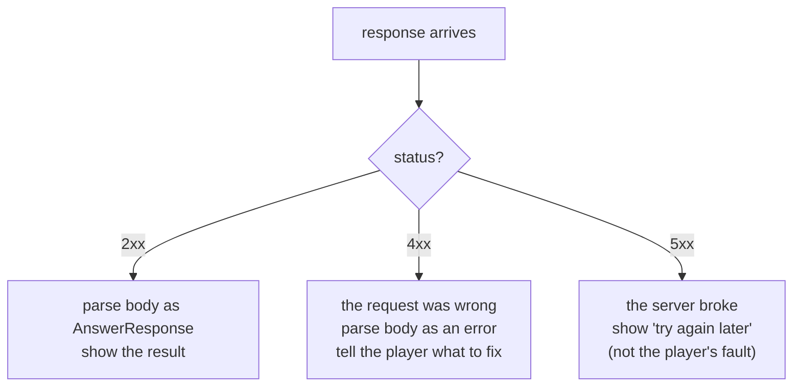
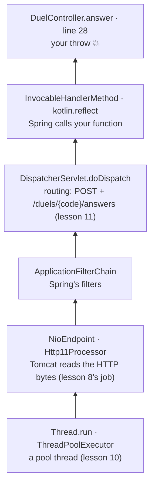
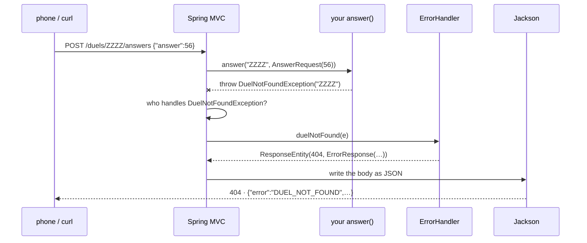
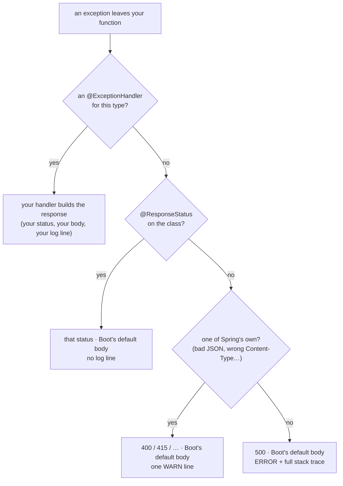

import Quiz from '../../../components/Quiz.astro';
import Think from '../../../components/Think.astro';
import { Aside } from '@astrojs/starlight/components';

<Aside type="tip" title="4 steps · ≈45 min · in your Spring app">
**Step 1:** say 201 when a duel is created. **Step 2:** throw an exception and read the stack trace. **Step 3:** turn your own exception into a 404. **Step 4:** give every error one shape with `@RestControllerAdvice`. Win: `POST /duels/ZZZZ/answers` answers `404 {"error":"DUEL_NOT_FOUND","message":"No duel with code ZZZZ"}`, and you can tell from the log alone what went wrong and where.
</Aside>

## Recall (from memory)

<Think id="maths-l13-recall-1" prompt="In lesson 12, you sent {&quot;answer&quot;:56} with no Content-Type header. Which status came back, and why?" revealLabel="Check">
**415 Unsupported Media Type.** `curl -d` labels the body `application/x-www-form-urlencoded`, and Spring won't hand a form to Jackson. It only reads JSON into your DTO when the request says `Content-Type: application/json`.
</Think>

<Think id="maths-l13-recall-2" prompt="When you sent {} to /duels/K7QM/answers, did your answer() function run? How do you know?" revealLabel="Check">
No. Spring answered 400 because Jackson couldn't build `AnswerRequest` without `answer`, so your function was never called. The proof is the log: no line from your code, only Spring's `WARN … HttpMessageNotReadableException`.
</Think>

## The problem: the phone reads the status first

Your server today, asked about a duel that doesn't exist:

```text
❯ curl -i -X POST localhost:8080/duels/ZZZZ/answers \
    -H 'Content-Type: application/json' -d '{"answer":56}'
HTTP/1.1 200
Content-Type: application/json
Content-Length: 42

{"code":"ZZZZ","answer":56,"correct":true}
```

**200 and `correct: true`, for a duel nobody created.** Your server is telling a confident lie.

Now look at it from the side you know. A Retrofit call that returns `Response<T>` hands you the status before anything else:

```kotlin
// Android
val response = api.answer("ZZZZ", AnswerBody(56))   // Response<AnswerResult>
if (response.isSuccessful) {                          // true for any 2xx
    show(response.body()!!)
} else {
    val raw = response.errorBody()?.string()         // the body of a 4xx/5xx
    // ...and now what? What shape is `raw`?
}
```

Every client works this way: **status first, body second**. The status picks the branch, and the body fills in the details. So the server owes the phone two things:

1. **The right status**, so the phone takes the right branch.
2. **An error body with a known shape**, so the `else` branch can say something useful.



The statuses you'll use for the duel game, all from [RFC 9110 §15](https://www.rfc-editor.org/rfc/rfc9110#section-15) (the HTTP spec):

| Status | Means | In the duel game |
|---|---|---|
| **200 OK** | here's what you asked for | an answer was checked |
| **201 Created** | I made a new thing | a duel was created |
| **400 Bad Request** | your request is malformed | broken JSON (lesson 12) |
| **404 Not Found** | there's nothing at that target | no duel with that code |
| **409 Conflict** | it clashes with the current state | joining a full duel (lesson 15, once duels are stored) |
| **415 Unsupported Media Type** | I can't read that kind of body | missing `Content-Type` (lesson 12) |
| **500 Internal Server Error** | I broke | a bug in your code |

The split that matters most: **4xx means the client should change something. 5xx means the server has a bug.** Retrying a 404 gets you the same 404. A 500 is your problem, not the player's.

## Step 1 · Say 201 when you create something

`POST /duels` creates a duel, so "200 OK" undersells it. One annotation on the function picks the status:

```kotlin
import org.springframework.http.HttpStatus
import org.springframework.web.bind.annotation.ResponseStatus

    @PostMapping("/duels")
    @ResponseStatus(HttpStatus.CREATED)
    fun duel(
        @RequestBody request: DuelRequest
    ): DuelResponse {
        return DuelResponse(code = "K7QM", playerName = request.playerName)
    }
```

```text
❯ curl -i -X POST localhost:8080/duels \
    -H 'Content-Type: application/json' -d '{"playerName":"Sita"}'
HTTP/1.1 201
Content-Type: application/json
Content-Length: 35

{"code":"K7QM","playerName":"Sita"}
```

`@ResponseStatus` says "when this function returns normally, use this status instead of 200" ([Spring javadoc: `@ResponseStatus`](https://docs.spring.io/spring-framework/docs/current/javadoc-api/org/springframework/web/bind/annotation/ResponseStatus.html)). `HttpStatus.CREATED` is just Spring's name for 201, and `HttpStatus` has one entry per code, so you never type a bare number.

On the phone, `isSuccessful` is true for 201 as well, so nothing breaks there.

**Commit:** `feat: POST /duels answers 201 Created`

## Step 2 · Throw, and read the stack trace

Duels aren't stored anywhere yet; that's lesson 15. Until then, pretend **`K7QM` is the only duel that exists**. Any other code is unknown. In `answer()`, add a check before the return:

```kotlin {6-8}
    @PostMapping("/duels/{code}/answers")
    fun answer(
        @PathVariable("code") code: String,
        @RequestBody request: AnswerRequest
    ): AnswerResponse {
        if (code != "K7QM") {
            throw RuntimeException("No duel with code $code")
        }
        return AnswerResponse(
            code = code,
            answer = request.answer,
            correct = request.answer == 56
        )
    }
```

`throw` is the same `throw` you use on Android. It stops the function right there, and the exception travels up to whoever called `answer()`. You didn't call `answer()`; Spring did. So Spring catches it.

<Think id="maths-l13-predict-500" prompt="Send {&quot;answer&quot;:56} to /duels/ZZZZ/answers. Which status do you expect, and what will the body say?" />

What came back:

```text
❯ curl -i -X POST localhost:8080/duels/ZZZZ/answers \
    -H 'Content-Type: application/json' -d '{"answer":56}'
HTTP/1.1 500
Content-Type: application/json
Transfer-Encoding: chunked
Connection: close

{"timestamp":"2026-11-16T12:04:40.565Z","status":500,"error":"Internal Server Error","path":"/duels/ZZZZ/answers"}
```

- **500.** Spring caught an exception that nobody told it how to handle, so it assumes the worst: a bug in the server. From the phone's side that's now the "try again later" branch, which is wrong. The player typed a bad code; that's a 4xx.
- **Your message isn't in the body.** "No duel with code ZZZZ" is gone. Spring Boot leaves the exception's message out of error bodies by default (`server.error.include-message=never`), because messages often contain internals you don't want to show the world ([Spring Boot: error handling](https://docs.spring.io/spring-boot/reference/web/servlet.html#web.servlet.spring-mvc.error-handling)).

So where *did* the message go? **Into your log**, along with a stack trace. Look at your terminal.

### Brick · Reading a stack trace

Here's what printed: one log line, then 49 lines of trace. Here it is cut down to the parts you read:

```text
2026-11-16T17:49:40.560+05:45 ERROR 97344 --- [app] [nio-8080-exec-4] o.a.c.c.C.[.[.[/].[dispatcherServlet] : Servlet.service() for servlet [dispatcherServlet] in context with path [] threw exception [Request processing failed: java.lang.RuntimeException: No duel with code ZZZZ] with root cause

java.lang.RuntimeException: No duel with code ZZZZ                                  ← ① what was thrown + message
	at dev.hari.maths.DuelController.answer(DuelController.kt:28) ~[main/:na]          ← ② YOUR line: start here
	at java.base/jdk.internal.reflect.DirectMethodHandleAccessor.invoke(...)
	at kotlin.reflect.jvm.internal.calls.CallerImpl$Method.callMethod(CallerImpl.kt:97)
	at org.springframework.web.method.support.InvocableHandlerMethod.doInvoke(InvocableHandlerMethod.java:250)
	at org.springframework.web.servlet.DispatcherServlet.doDispatch(DispatcherServlet.java:963)
	at org.springframework.web.servlet.FrameworkServlet.doPost(FrameworkServlet.java:903)
	at org.apache.catalina.core.ApplicationFilterChain.doFilter(ApplicationFilterChain.java:132)
	… 25 more Spring and Tomcat lines …
	at org.apache.coyote.http11.Http11Processor.service(Http11Processor.java:411)
	at org.apache.tomcat.util.net.NioEndpoint$SocketProcessor.doRun(NioEndpoint.java:2202)
	at org.apache.tomcat.util.threads.ThreadPoolExecutor$Worker.run(ThreadPoolExecutor.java:481)
	at java.base/java.lang.Thread.run(Thread.java:1474)                                  ← ③ where the thread began
```

Read it in this order:

1. **The log line.** `ERROR` is the level. `[nio-8080-exec-4]` is the thread: one of Tomcat's pool threads, exactly like `jstack` showed you in lesson 10. The message ends with the exception.
2. **① The first trace line** is the exception's class and its message: `RuntimeException: No duel with code ZZZZ`. That's *what* happened.
3. **② The first line with your package, `dev.hari.maths`,** is *where* it happened: `DuelController.kt:28`, the `throw` line (your number may be a line or two off). In IntelliJ's console that's a link you can click.
4. **Everything below** is *how you got there*. Each line is a function that called the line above it. You don't need to read them, but they tell a story you already know:



It's the call stack at the moment of the `throw`, frozen and printed with the newest call on top. The ~45 framework lines in the middle are the same every time, so you'll learn to skim past them to the first `dev.hari.maths` line. A trace that has *no* line from your package means the problem happened inside Spring, often in one of your annotations or your config.

<Think id="maths-l13-trace" prompt="A teammate pastes you a 60-line stack trace from the server. Which two lines do you read first, and what does each tell you?" revealLabel="Check">
1. The exception line at the top (class + message): **what** went wrong, e.g. `RuntimeException: No duel with code ZZZZ`.
2. The first `at dev.hari.maths…` line: **where** in your code, as `File.kt:line`.

The thread name in the log line tells you which request's thread it was, and the rest is the chain of callers.
</Think>

Don't commit this step. A 500 is the wrong answer, and the next step fixes it.

## Step 3 · Your own exception, your own status

The problem with `RuntimeException` is that it means nothing in particular, so Spring can only guess 500. Give the situation **its own exception class**, and tell Spring what status it means. New file `DuelNotFoundException.kt`:

```kotlin
package dev.hari.maths

import org.springframework.http.HttpStatus
import org.springframework.web.bind.annotation.ResponseStatus

@ResponseStatus(HttpStatus.NOT_FOUND)
class DuelNotFoundException(code: String) : RuntimeException("No duel with code $code")
```

- **It's just a class** that extends `RuntimeException`, the same way you'd write a custom exception on Android. The message is passed up to `RuntimeException`'s constructor.
- **`@ResponseStatus` on the class** means "whenever this exception escapes a controller, answer with 404".

In `answer()`, throw it instead:

```kotlin
        if (code != "K7QM") {
            throw DuelNotFoundException(code)
        }
```

```text
❯ curl -i -X POST localhost:8080/duels/ZZZZ/answers \
    -H 'Content-Type: application/json' -d '{"answer":56}'
HTTP/1.1 404
Content-Type: application/json
Transfer-Encoding: chunked

{"timestamp":"2026-11-16T12:04:52.735Z","status":404,"error":"Not Found","path":"/duels/ZZZZ/answers"}
```

The status is right now. And look at your log: **nothing at all**. No ERROR, no stack trace. That's deliberate: Spring treats a status you declared as an expected outcome, not a bug. A 404 is the client's mistake, and there's no line of your code to go and fix.

Two problems remain, both in the body. Compare it with what Spring sends for a URL that has no route at all:

```text
❯ curl -i localhost:8080/nope
HTTP/1.1 404
Content-Type: application/json

{"timestamp":"2026-11-16T12:04:25.439Z","status":404,"error":"Not Found","path":"/nope"}
```

1. **The phone can't tell them apart.** "This duel code doesn't exist" is something the player fixes by retyping. "This URL doesn't exist" is a bug in the app. Same status, same body shape, same `"error":"Not Found"`.
2. **The useful part is missing.** "No duel with code ZZZZ" is still hidden, and `timestamp` and `path` don't help the player.

**Commit:** `feat: unknown duel code answers 404`

## Step 4 · One error shape, designed by you

You want every error your server sends on purpose to look like this:

```json
{"error":"DUEL_NOT_FOUND","message":"No duel with code ZZZZ"}
```

- **`error`** is a fixed code, the same every time. The phone `when`s on it.
- **`message`** is for a human: a log, a toast, a bug report. The phone never parses it.

It's a DTO, like the ones in lesson 12, only it goes out on errors. Then you need one place that turns exceptions into it. Spring calls that place a **controller advice**: a class whose `@ExceptionHandler` functions catch exceptions thrown by *any* controller ([Spring docs: `@ExceptionHandler`](https://docs.spring.io/spring-framework/reference/web/webmvc/mvc-controller/ann-exceptionhandler.html), [Controller Advice](https://docs.spring.io/spring-framework/reference/web/webmvc/mvc-controller/ann-advice.html)).

First, take `@ResponseStatus` off the exception and give it a `val code`, so the handler can read the code back:

```kotlin
package dev.hari.maths

class DuelNotFoundException(val code: String) : RuntimeException("No duel with code $code")
```

New file `ErrorHandler.kt`:

```kotlin
package dev.hari.maths

import org.springframework.http.HttpStatus
import org.springframework.http.ResponseEntity
import org.springframework.http.converter.HttpMessageNotReadableException
import org.springframework.web.bind.annotation.ExceptionHandler
import org.springframework.web.bind.annotation.RestControllerAdvice

// Every error the phone gets has this one shape
data class ErrorResponse(val error: String, val message: String)

@RestControllerAdvice
class ErrorHandler {

    @ExceptionHandler(DuelNotFoundException::class)
    fun duelNotFound(e: DuelNotFoundException): ResponseEntity<ErrorResponse> {
        println("[${Thread.currentThread().name}] duel not found: ${e.code}")
        return ResponseEntity
            .status(HttpStatus.NOT_FOUND)
            .body(ErrorResponse(error = "DUEL_NOT_FOUND", message = "No duel with code ${e.code}"))
    }

    @ExceptionHandler(HttpMessageNotReadableException::class)
    fun badBody(e: HttpMessageNotReadableException): ResponseEntity<ErrorResponse> {
        println("[${Thread.currentThread().name}] bad body: ${e.message}")
        return ResponseEntity
            .status(HttpStatus.BAD_REQUEST)
            .body(ErrorResponse(error = "BAD_BODY", message = "The body is not the JSON this endpoint expects"))
    }
}
```

Piece by piece:

- **`@RestControllerAdvice`** means "this class advises every `@RestController`". Spring finds it on startup, like it finds your controllers.
- **`@ExceptionHandler(DuelNotFoundException::class)`** means "when a controller throws *this* type, call *this* function instead of the default". The exception arrives as the parameter `e`, so `e.code` is right there.
- **`ResponseEntity<ErrorResponse>`** is a whole response as an object: status, headers and body together ([Spring docs: `ResponseEntity`](https://docs.spring.io/spring-framework/reference/web/webmvc/mvc-controller/ann-methods/responseentity.html)). You've built this before. It's your lesson-9 `HttpResponse(statusCode, statusMessage, headers, body)`, and Spring writes it out just like your `writeResponseLine` / `writeResponseHeaders` / `writeResponseBody` did. The body goes through Jackson, so it becomes JSON.
- **`HttpMessageNotReadableException`** is the exception Spring itself throws when Jackson can't build your DTO: lesson 12's (a), (b) and (c). Handling it here means even *Spring's* 400s now use your shape.

Here's the whole path of the 404, from `throw` to bytes:



And how Spring decides what to do with *any* exception that leaves your function:



Run it:

```text
❯ curl -i -X POST localhost:8080/duels/ZZZZ/answers \
    -H 'Content-Type: application/json' -d '{"answer":56}'
HTTP/1.1 404
Content-Type: application/json

{"error":"DUEL_NOT_FOUND","message":"No duel with code ZZZZ"}

❯ curl -X POST localhost:8080/duels/K7QM/answers -H 'Content-Type: application/json' -d '{}'
{"error":"BAD_BODY","message":"The body is not the JSON this endpoint expects"}

❯ curl -X POST localhost:8080/duels/K7QM/answers -H 'Content-Type: application/json' -d '{"answer":"fifty-six"}'
{"error":"BAD_BODY","message":"The body is not the JSON this endpoint expects"}

❯ curl -X POST localhost:8080/duels/K7QM/answers -H 'Content-Type: application/json' -d '{"answer":56'
{"error":"BAD_BODY","message":"The body is not the JSON this endpoint expects"}

❯ curl -X POST localhost:8080/duels/K7QM/answers -H 'Content-Type: application/json' -d '{"answer":56}'
{"code":"K7QM","answer":56,"correct":true}
```

And your log:

```text
[http-nio-8080-exec-2] duel not found: ZZZZ
[http-nio-8080-exec-2] bad body: JSON parse error: Missing required creator property 'answer' (index 0)
[http-nio-8080-exec-3] bad body: JSON parse error: Cannot deserialize value of type `int` from String "fifty-six": not a valid `int` value
[http-nio-8080-exec-4] bad body: JSON parse error: Unexpected end-of-input: expected close marker for Object (start marker at [Source: REDACTED …])
```

Look at where each piece of information ended up:

- **The phone gets** a status and a stable `error` code. That's enough to pick a branch and a message.
- **The log gets** the full detail from Jackson: which property, which value, which character. That's for you, when you debug.
- **Jackson's text never reaches the phone.** It names your Kotlin types, and it can change with any Jackson upgrade. If the app matched on that text, a library update could break the app.

One thing to notice: **Spring's WARN line for bad bodies is gone.** Once you handle an exception, Spring stays quiet about it, and logging it becomes your job. That's why `badBody` prints `e.message`. Without that line, a 400 would leave no trace at all.

Now the phone side can be finished:

```kotlin
// Android
data class ErrorResponse(val error: String, val message: String)

if (!response.isSuccessful) {
    val err = moshi.adapter(ErrorResponse::class.java).fromJson(response.errorBody()!!.source())
    when (err?.error) {
        "DUEL_NOT_FOUND" -> showError("No duel with that code. Check it and try again.")
        "BAD_BODY"       -> reportBug("server could not read our request")
        else             -> showError("Something went wrong. Try again later.")
    }
}
```

The same `ErrorResponse` data class sits on both sides of the wire, mirrored like the DTOs in lesson 12.

**Commit:** `feat: one JSON error shape via @RestControllerAdvice`

<Aside type="note" title="What's still Spring's default, and why that's fine">
Three cases still get Boot's `{"timestamp",…}` body: a URL with no route (`/nope`), a missing `Content-Type` (415), and any exception you didn't plan for (500, with the full stack trace). The first two you can take over with more handlers, which is the exercise below. For the 500, the default is honest: it's a bug, and the stack trace in the log is exactly what you need to fix it.
</Aside>

<Aside type="tip" title="There's a standard for this: RFC 9457 Problem Details">
[RFC 9457](https://www.rfc-editor.org/rfc/rfc9457) defines a standard error shape with `type`, `title`, `status`, `detail` and `instance`, sent as `Content-Type: application/problem+json`. Spring supports it ([Spring docs: Error Responses](https://docs.spring.io/spring-framework/reference/web/webmvc/mvc-ann-rest-exceptions.html)). One line in `application.properties`, `spring.mvc.problemdetails.enabled=true`, switches Spring's own errors to it:

```text
❯ curl -i localhost:8080/nope
HTTP/1.1 404
Content-Type: application/problem+json

{"detail":"No static resource nope.","instance":"/nope","status":404,"title":"Not Found"}
```

This course keeps `ErrorResponse` because you own both ends and two fields are easier to learn from. What matters is the rule underneath: **one shape for every error, with a stable code the client can switch on.** If you build an API that strangers use, the standard is worth choosing.
</Aside>

<Aside type="note" title="The thing to remember">
The **status** picks the client's branch: 2xx done, 4xx the client must change something, 5xx the server has a bug. Pick it yourself with `@ResponseStatus` on a function (201) or an exception class (404). An exception nobody handles becomes a **500**, plus a **stack trace** in the log: read the exception line for *what*, and the first `dev.hari.maths` line for *where*. A **`@RestControllerAdvice`** with `@ExceptionHandler` functions turns exceptions into a `ResponseEntity` with **one error DTO**: a stable code for the phone, and the details in your log.
</Aside>

## Check yourself

<Quiz
  question="The phone answers a duel whose code doesn't exist. Which status fits best?"
  options={[
    '500: the server broke down',
    '404: no such duel exists',
    '400: the JSON is malformed',
  ]}
  answer={1}
>
The request is well-formed, but there's nothing at that target. That's a 404: the client should change something (the code), and retrying won't help.
</Quiz>

<Quiz
  question="Your function throws an exception with no handler and no @ResponseStatus. What does the phone get?"
  options={[
    'A 400 with the message',
    'Nothing, the connection just hangs',
    'A 500 with Boot\'s body',
  ]}
  answer={2}
>
Spring catches it, assumes a bug, and answers 500 with `{"timestamp",…,"status":500,…}`. Your message stays out of the body, and goes into the log with the stack trace.
</Quiz>

<Quiz
  question="Why does the error body carry a fixed code like DUEL_NOT_FOUND?"
  options={[
    'Phone code can switch on it',
    'Spring requires a field called error',
    'JSON cannot hold a longer message',
  ]}
  answer={0}
>
The `message` is for humans and can be reworded at any time. `error` is a contract: the app's `when` matches on it, so it never changes.
</Quiz>

<Quiz
  question="A stack trace is 49 lines long. Which line tells you where to look?"
  options={[
    'The very bottom one, at Thread.run',
    'The first one from dev.hari.maths',
    'Every Tomcat line, from the top',
  ]}
  answer={1}
>
The first line from your package is the line of *your* code that was running when it was thrown. The lines below it are the callers, mostly Tomcat and Spring.
</Quiz>

## Your turn

<Think id="maths-l13-415" prompt="Take over the 415 too. Write an @ExceptionHandler in ErrorHandler for Spring's HttpMediaTypeNotSupportedException (package org.springframework.web) that answers 415 with {&quot;error&quot;:&quot;NOT_JSON&quot;,&quot;message&quot;:&quot;Send Content-Type: application/json&quot;}. Then test it with curl -d and no -H." revealLabel="Check">
```kotlin
import org.springframework.web.HttpMediaTypeNotSupportedException

    @ExceptionHandler(HttpMediaTypeNotSupportedException::class)
    fun notJson(e: HttpMediaTypeNotSupportedException): ResponseEntity<ErrorResponse> {
        return ResponseEntity
            .status(HttpStatus.UNSUPPORTED_MEDIA_TYPE)
            .body(ErrorResponse(error = "NOT_JSON", message = "Send Content-Type: application/json"))
    }
```
```text
❯ curl -i -X POST localhost:8080/duels/K7QM/answers -d '{"answer":56}'
HTTP/1.1 415
Content-Type: application/json

{"error":"NOT_JSON","message":"Send Content-Type: application/json"}
```
Notice one thing it lost: Spring's own 415 carried `Accept: application/json, application/*+json`. Your `ResponseEntity` only has the headers you add. To keep it, add `.header("Accept", "application/json")` before `.body(…)`.
</Think>

<Think id="maths-l13-teachback" prompt="Explain to another Android developer, in 3–4 sentences: what happens on the server, from throw to bytes, when the phone asks about duel ZZZZ, and why the body carries an error code instead of Spring's default body." revealLabel="Compare with a model answer">
`answer()` sees that ZZZZ isn't a known duel and throws `DuelNotFoundException`. Spring catches it, finds the `@ExceptionHandler` for that type in the `@RestControllerAdvice`, and that handler returns a `ResponseEntity` with status 404 and an `ErrorResponse`, which Jackson writes as JSON. The phone reads the 404 first, takes its error branch, and switches on `"error":"DUEL_NOT_FOUND"` to show the right message. Spring's default body can't do that: it looks the same for "no such duel" and "no such URL", and it hides the message.
</Think>

## Read alongside
- 📖 **Primary:** [Spring docs: `@ExceptionHandler`](https://docs.spring.io/spring-framework/reference/web/webmvc/mvc-controller/ann-exceptionhandler.html) and [Controller Advice](https://docs.spring.io/spring-framework/reference/web/webmvc/mvc-controller/ann-advice.html) (10 min, both short).
- [RFC 9110 §15: Status Codes](https://www.rfc-editor.org/rfc/rfc9110#section-15). Read the first paragraph of each class (15.3 2xx, 15.5 4xx, 15.6 5xx) to see what "client error" and "server error" promise.
- [Spring Boot: error handling](https://docs.spring.io/spring-boot/reference/web/servlet.html#web.servlet.spring-mvc.error-handling), for where the default `{"timestamp",…}` body comes from.

🙋 Ask me: "should validation errors list every bad field?", "what about a catch-all handler for `Exception`?", "why does a 400 come with `Connection: close`?", "how do real APIs version their error codes?"

**Next:** [Lesson 14: layers and dependency injection](../0014-layers-and-di/). `DuelController` is starting to decide things (which duels exist, what's correct). You'll move those decisions into a service, so the controller only translates HTTP.
