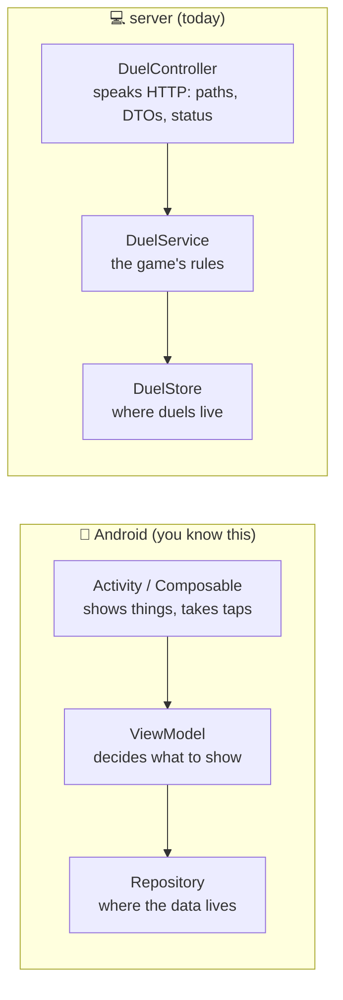
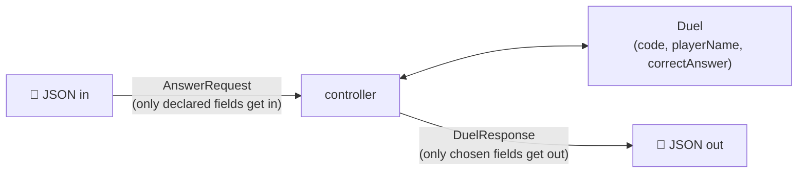
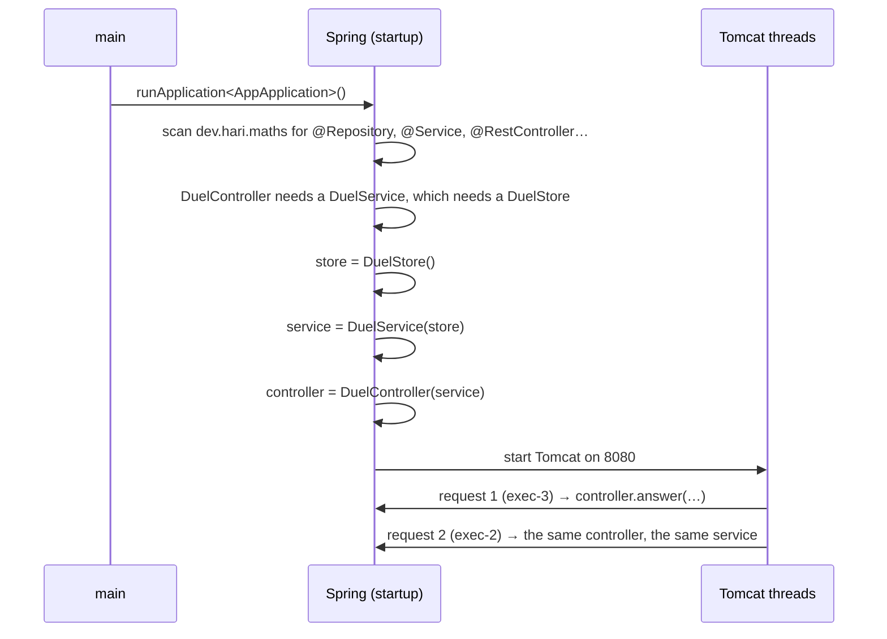

import Quiz from '../../../components/Quiz.astro';
import Think from '../../../components/Think.astro';
import { Aside } from '@astrojs/starlight/components';

<Aside type="tip" title="4 steps · ≈45 min · in your Spring app">
**Step 1:** a domain class, `Duel`, and why it must never go out as JSON. **Step 2:** split the decisions into `DuelService` and `DuelStore`. **Step 3:** let Spring build them and pass them in. **Step 4:** break the wiring and read the error. Win: the same four curls give the same answers, but `DuelController` only speaks HTTP, and one `DuelService` serves every thread.
</Aside>

## Recall (from memory)

<Think id="maths-l14-recall-1" prompt="In a stack trace, which line tells you what went wrong, and which line tells you where in your code?" revealLabel="Check">
**What:** the first trace line, the exception's class and message (`RuntimeException: No duel with code ZZZZ`). **Where:** the first `at dev.hari.maths…` line, as `File.kt:line`. The log line above it tells you the thread.
</Think>

<Think id="maths-l14-recall-2" prompt="Your answer() throws DuelNotFoundException. Name the class and the function that turn it into a 404, and what that function returns." revealLabel="Check">
`ErrorHandler`, marked `@RestControllerAdvice`. Its `@ExceptionHandler(DuelNotFoundException::class)` function `duelNotFound` returns a `ResponseEntity<ErrorResponse>`: status 404 plus the `{"error":"DUEL_NOT_FOUND",…}` body.
</Think>

## The problem: one class, two jobs

Read your `DuelController` again and list what it decides:

```kotlin
    fun answer(...): AnswerResponse {
        if (code != "K7QM") {                         // ← which duels exist
            throw DuelNotFoundException(code)
        }
        return AnswerResponse(
            code = code,
            answer = request.answer,
            correct = request.answer == 56            // ← what the right answer is
        )
    }

    fun duel(...): DuelResponse {
        return DuelResponse(code = "K7QM", ...)       // ← how a duel is created
    }
```

Mixed in with `@PostMapping`, `@PathVariable`, `@RequestBody` and `@ResponseStatus`, which are all **HTTP**, are three **game rules**. And the rules are about to grow: lesson 15 stores real duels, 16 gives them states (waiting, playing, finished), and 18 adds deadlines. In lesson 25, a WebSocket handler needs *the same rules*, but it doesn't speak HTTP, so it can't call `answer()` with an `AnswerRequest`.

You've had this problem on Android, and you know the fix. You don't put Retrofit calls, Room queries and business rules inside an Activity. The [Android architecture guide](https://developer.android.com/topic/architecture) splits them into layers: UI, then ViewModel, then Repository, with Hilt handing each one the next. A server splits the same way:



- **Controller:** the server's UI. Its "screen" is HTTP. It turns a request into a function call, and the result back into a response. No game rules.
- **Service:** the rules. Which duel, is it correct, can you join. No HTTP: no annotations from `org.springframework.web`, no DTOs, no status codes.
- **Store:** where duels are kept. Today that's one hard-coded duel. In lesson 15 it's a map in memory, and later a database. No rules.
- **Domain classes** (like `Duel`) are the nouns all three share.

Calls only go **down**. A store never calls a service, and a service never calls a controller. (Martin Fowler calls this [presentation / domain / data layering](https://martinfowler.com/bliki/PresentationDomainDataLayering.html).)

## Step 1 · A domain class, `Duel`

The rules need something to work on. A duel has a code, a player, and (for now, while there's one question) the answer key. New file `Duel.kt`:

```kotlin
package dev.hari.maths

// A duel, as the game sees it. No Spring, no JSON, no HTTP.
data class Duel(val code: String, val playerName: String, val correctAnswer: Int)
```

It looks a lot like `DuelResponse`. So why not skip the DTO and return a `Duel` straight from `POST /duels`? Try it, just to see:

```kotlin
    fun duel(@RequestBody request: DuelRequest): Duel {
        return Duel(code = "K7QM", playerName = request.playerName, correctAnswer = 56)
    }
```

<Think id="maths-l14-leak" prompt="Predict the JSON that POST /duels returns now. What's wrong with it?" />

```text
❯ curl -i -X POST localhost:8080/duels \
    -H 'Content-Type: application/json' -d '{"playerName":"Sita"}'
HTTP/1.1 201
Content-Type: application/json
Content-Length: 54

{"code":"K7QM","playerName":"Sita","correctAnswer":56}
```

**The server just sent the answer key to the phone.** Jackson writes every property of whatever you return. It has no idea that `correctAnswer` is a secret. Lesson 1's whole point, that the phone never gets a say in correctness, is gone the moment a cheater reads the response.

That's the second half of what a DTO is for. In lesson 12, `AnswerRequest` was a filter on the way **in**: unknown fields like `"cheat"` were dropped. `DuelResponse` is a filter on the way **out**: only the fields you chose to put in it leave the server.



**The rule: domain classes never cross the wire. The controller converts at the edge.** Put `DuelResponse` back as the return type before you go on.

## Step 2 · Move the decisions into a service and a store

New file `DuelStore.kt`. It holds the "only K7QM exists" stand-in from lesson 13, because *which duels exist* is a question about storage:

```kotlin
package dev.hari.maths

// Where duels live. Stand-in until lesson 15: exactly one duel exists.
class DuelStore {

    init {
        println("[${Thread.currentThread().name}] DuelStore created: $this")
    }

    private val onlyDuel = Duel(code = "K7QM", playerName = "Sita", correctAnswer = 56)

    fun find(code: String): Duel? {
        return if (code == onlyDuel.code) onlyDuel else null
    }
}
```

New file `DuelService.kt`, which holds the rules:

```kotlin
package dev.hari.maths

// The game's rules. Knows nothing about HTTP.
class DuelService(private val store: DuelStore) {

    init {
        println("[${Thread.currentThread().name}] DuelService created: $this")
    }

    fun create(playerName: String): Duel {
        // Lesson 15: make up a new code and save the duel in the store
        return Duel(code = "K7QM", playerName = playerName, correctAnswer = 56)
    }

    fun checkAnswer(code: String, answer: Int): Boolean {
        println("[${Thread.currentThread().name}] $this checking duel $code")
        val duel = store.find(code) ?: throw DuelNotFoundException(code)
        return answer == duel.correctAnswer
    }
}
```

- **`init { … }`** runs when the object is constructed. The `println` is there so you can *see* when each object is created, and on which thread.
- **`$this`** prints the object as `ClassName@hex`. Kotlin uses Java's default `toString` for a regular (non-data) class, and the hex part is different for every object. It lets you tell objects apart in the log.
- **`store.find(code) ?: throw …`** means "the duel, or if there's none, throw". The 404 now comes from the service, and your `ErrorHandler` still catches it unchanged, because a `@ExceptionHandler` catches whatever escapes the controller call, however deep it was thrown.
- `checkAnswer` returns a plain `Boolean`. It doesn't know that an `AnswerResponse` exists.

The controller shrinks to pure translation. For now, it builds its own service:

```kotlin
@RestController
class DuelController {

    private val duelService = DuelService(DuelStore())

    @PostMapping("/duels/{code}/answers")
    fun answer(
        @PathVariable("code") code: String,
        @RequestBody request: AnswerRequest
    ): AnswerResponse {
        val correct = duelService.checkAnswer(code, request.answer)
        return AnswerResponse(code = code, answer = request.answer, correct = correct)
    }

    @PostMapping("/duels")
    @ResponseStatus(HttpStatus.CREATED)
    fun duel(
        @RequestBody request: DuelRequest
    ): DuelResponse {
        val duel = duelService.create(request.playerName)
        return DuelResponse(code = duel.code, playerName = duel.playerName)
    }
}
```

Each function now has the same three beats: **DTO in → service call → DTO out.** Run your four curls. The answers don't change:

```text
{"code":"K7QM","answer":56,"correct":true}
{"code":"K7QM","answer":65,"correct":false}
HTTP/1.1 404   {"error":"DUEL_NOT_FOUND","message":"No duel with code ZZZZ"}
HTTP/1.1 201   {"code":"K7QM","playerName":"Sita"}
```

The log is where it gets interesting:

```text
[main] DuelStore created: dev.hari.maths.DuelStore@1668919e
[main] DuelService created: dev.hari.maths.DuelService@22c53d82
… Started AppApplicationKt in 0.797 seconds
[http-nio-8080-exec-2] dev.hari.maths.DuelService@22c53d82 checking duel K7QM
[http-nio-8080-exec-4] dev.hari.maths.DuelService@22c53d82 checking duel K7QM
[http-nio-8080-exec-6] dev.hari.maths.DuelService@22c53d82 checking duel ZZZZ
[http-nio-8080-exec-6] duel not found: ZZZZ
```

- **The objects were created on `[main]`, before `Started`.** No request had arrived yet. Spring created `DuelController` while starting up, and constructing the controller ran `DuelService(DuelStore())`.
- **Three requests on three different threads used the same `DuelService@22c53d82`.** Spring creates **one** controller, and every Tomcat thread calls into that one object. Remember this. It matters a lot in lesson 19.

**Commit:** `refactor: split DuelController into service and store`

## Step 3 · Let Spring build them, like Hilt

`DuelService(DuelStore())` works, until a second class needs the service. Say you add a `LobbyController` that also writes `private val duelService = DuelService(DuelStore())`.

<Think id="maths-l14-two" prompt="With two controllers that each write DuelService(DuelStore()), how many &quot;DuelStore created&quot; lines print at startup? Why will that be a bug in lesson 15, when the store holds a map of duels?" revealLabel="Check">
I tried it. Two of each:
```text
[main] DuelStore created: dev.hari.maths.DuelStore@36b9cb99
[main] DuelService created: dev.hari.maths.DuelService@2bfaba70
[main] DuelStore created: dev.hari.maths.DuelStore@68f6e55d
[main] DuelService created: dev.hari.maths.DuelService@6fff46bf
```
Two stores means two separate sets of duels. In lesson 15, Sita creates a duel through one controller's store, you look it up through the other's, and get a 404 for a duel that exists. The game needs **one** store that everybody shares.
</Think>

On Android you'd never write `DuelRepository()` inside each ViewModel, for exactly this reason. You'd mark it `@Singleton`, give the ViewModel an `@Inject constructor(repo: DuelRepository)`, and let Hilt build one and hand it to everyone ([Android docs: Hilt](https://developer.android.com/training/dependency-injection/hilt-android)). Spring does the same job, and it's called **dependency injection** (DI): a class says what it needs in its constructor, and the framework provides it.

Three small edits. Mark the store and the service so Spring knows to create them:

```kotlin
import org.springframework.stereotype.Repository

@Repository
class DuelStore {
```

```kotlin
import org.springframework.stereotype.Service

@Service
class DuelService(private val store: DuelStore) {
```

Then the controller **asks** for the service instead of building it:

```kotlin
@RestController
class DuelController(private val duelService: DuelService) {
```

That's all the wiring there is. Here's what Spring does with it at startup ([Spring Boot: Spring Beans and Dependency Injection](https://docs.spring.io/spring-boot/reference/using/spring-beans-and-dependency-injection.html)):



- **Scanning.** `@SpringBootApplication` sits in `dev.hari.maths`, so Spring looks through that package (and the ones below it) for classes with these annotations ([Spring docs: classpath scanning](https://docs.spring.io/spring-framework/reference/core/beans/classpath-scanning.html)). `@RestController`, `@Service` and `@Repository` are all variants of one annotation, `@Component`. The different names just say which layer the class is in.
- **Order from constructors.** Spring reads each constructor's parameters to work out what to build first. A class with one constructor needs no `@Inject`: Spring uses that constructor.
- **One of each.** The objects Spring creates and manages are called **beans**. By default there's exactly one of each bean, which Spring calls a *singleton* ([Spring docs: bean scopes](https://docs.spring.io/spring-framework/reference/core/beans/factory-scopes.html)). That's Hilt's `@Singleton`, as the default.

| Hilt (Android) | Spring |
|---|---|
| `@HiltAndroidApp` on the Application | `@SpringBootApplication` on the main class |
| `@Inject constructor(...)` | just a constructor (if there's only one) |
| `@Singleton` | the default for every bean |
| `@AndroidEntryPoint` on an Activity | `@RestController`: Spring creates it, so it can be injected |

Run it. Three requests at once:

```text
[main] DuelStore created: dev.hari.maths.DuelStore@64c781a9
[main] DuelService created: dev.hari.maths.DuelService@124dac75
… Started AppApplicationKt in 0.747 seconds
[http-nio-8080-exec-3] dev.hari.maths.DuelService@124dac75 checking duel K7QM
[http-nio-8080-exec-2] dev.hari.maths.DuelService@124dac75 checking duel K7QM
[http-nio-8080-exec-4] dev.hari.maths.DuelService@124dac75 checking duel K7QM
```

One store and one service, created once on `main`, and shared by every request thread. With the two-controller experiment and DI, there's still just **one** of each: both controllers get the same service.

<Aside type="caution" title="One object, many threads">
Every request thread calls into the same `DuelService` at the same time. Today that's harmless, because nothing inside it ever changes. In lesson 15, `DuelStore` gets a map that requests *write to*. Many threads writing one map at once is lesson 19's race condition. Keep this log in mind.
</Aside>

**Commit:** `refactor: inject DuelService and DuelStore with Spring`

## Step 4 · Break the wiring

Comment out `@Service` on `DuelService` and start the app.

<Think id="maths-l14-break" prompt="Predict: does the app start? If it does, what does POST /duels/K7QM/answers answer? If it doesn't, what should the error say?" />

```text
***************************
APPLICATION FAILED TO START
***************************

Description:

Parameter 0 of constructor in dev.hari.maths.DuelController required a bean of type 'dev.hari.maths.DuelService' that could not be found.


Action:

Consider defining a bean of type 'dev.hari.maths.DuelService' in your configuration.
```

Read it like a sentence:
- **"Parameter 0 of constructor in DuelController"** is *who* was asking: the first constructor parameter, `duelService`.
- **"required a bean of type DuelService that could not be found"** is *what's* missing. Without `@Service`, scanning skipped the class, so Spring never created one.
- **"Action"** is Spring's suggestion. Here it means "make Spring create a `DuelService`", which is what `@Service` did.

The useful part is *when* it failed: **at startup, before Tomcat opened the port.** A wiring mistake never reaches a player as a 500. Hilt does the same thing even earlier, failing the *build* with "cannot be provided without an @Inject constructor".

Put `@Service` back.

<Aside type="note" title="The thing to remember">
A **controller** speaks HTTP and converts DTOs; a **service** holds the rules; a **store** holds the data; **domain classes** like `Duel` are what they share, and they **never go out as JSON**, because Jackson sends every property. Calls only go down. **Dependency injection:** mark classes `@Service` / `@Repository`, ask for what you need in the constructor, and Spring creates **one** of each at startup and passes them in, like Hilt with `@Singleton`. That one object is shared by every request thread.
</Aside>

## Check yourself

<Quiz
  question="Your controller returns a Duel directly. What does the phone receive?"
  options={[
    'Only code and playerName, as before',
    'Every property, the answer key included',
    'An error, Duel is not a DTO',
  ]}
  answer={1}
>
Jackson serializes every property of whatever you return. It doesn't know `correctAnswer` is a secret. Only a DTO with chosen fields keeps it on the server.
</Quiz>

<Quiz
  question="With @Service on DuelService, how many DuelService objects exist while the server runs?"
  options={[
    'A new one for every request',
    'One for each Tomcat pool thread',
    'Exactly one, shared by every thread',
  ]}
  answer={2}
>
Beans are singletons by default: Spring creates one at startup, and every request thread calls into that same object. Your log proves it: the same `@124dac75` on exec-2, 3 and 4.
</Quiz>

<Quiz
  question="You forget @Repository on DuelStore. When do you find out?"
  options={[
    'At startup, the app refuses to start',
    'On the first request, with a 500',
    'Never, Spring builds it some other way',
  ]}
  answer={0}
>
`DuelService` needs a `DuelStore` and Spring can't find one, so startup fails with "required a bean of type 'dev.hari.maths.DuelStore' that could not be found". Wiring errors happen before the port opens.
</Quiz>

## Your turn

<Think id="maths-l14-place" prompt="Which layer does each of these belong in, and why? (a) @GetMapping(&quot;/duels/{code}&quot;) (b) &quot;a duel can't start until two players have joined&quot; (c) the map that holds every duel (d) turning a Duel into a DuelResponse (e) throwing DuelNotFoundException" revealLabel="Check">
(a) **Controller**: it's HTTP. (b) **Service**: it's a game rule. (c) **Store**: it's where data lives. (d) **Controller**: converting at the edge is its job, and the service never sees DTOs. (e) **Service**: deciding that "no such duel" is an error is a rule. The store just returns `null`, and the controller doesn't check.
</Think>

<Think id="maths-l14-teachback" prompt="Explain to another Android developer, in 3–4 sentences, how a Spring server's controller / service / store maps onto their Activity / ViewModel / Repository, and what Spring does with @Service and a constructor parameter." revealLabel="Compare with a model answer">
The controller is the server's UI layer: its screen is HTTP, so it only maps paths, reads DTOs and picks statuses, like an Activity that only displays and forwards taps. The service is the ViewModel's decision-making (the game rules), and the store is the Repository (where duels live). `@Service` and `@Repository` tell Spring to create one instance of each at startup. Any class that lists one as a constructor parameter gets that same instance passed in: Hilt's `@Inject constructor` and `@Singleton`, without the annotations.
</Think>

## Read alongside
- 📖 **Primary:** [Spring Boot: Spring Beans and Dependency Injection](https://docs.spring.io/spring-boot/reference/using/spring-beans-and-dependency-injection.html) (5 min, one page).
- [Android: Guide to app architecture](https://developer.android.com/topic/architecture), the "Recommended app architecture" section, to see the same layering on the side you know.
- [Martin Fowler: Presentation Domain Data Layering](https://martinfowler.com/bliki/PresentationDomainDataLayering.html) (short essay).

🙋 Ask me: "why `@Repository` and not `@Component`?", "can a bean have more than one constructor?", "what's `@Autowired` and why don't we need it?", "should the service return DTOs instead?"

**Next:** Lesson 15: state in memory. `DuelStore` gets a real map, and `POST /duels` makes a new code every time. Notice how few files change: that's what the layers bought you.
