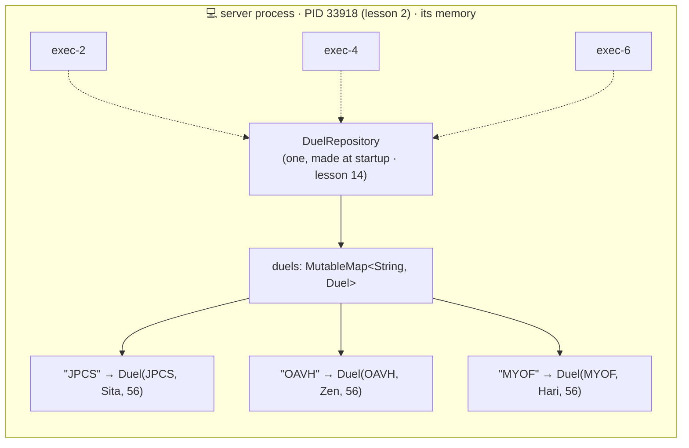
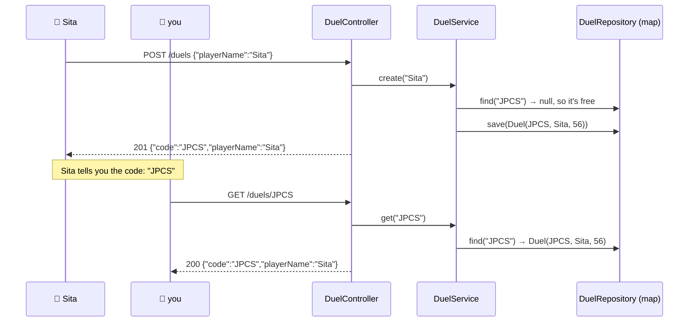
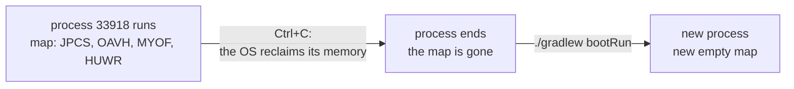

import Quiz from '../../../components/Quiz.astro';
import Think from '../../../components/Think.astro';
import { Aside } from '@astrojs/starlight/components';

<Aside type="tip" title="4 steps · ≈40 min · in your Spring app">
**Step 1:** the repository holds a map. **Step 2:** the service makes real codes and saves duels. **Step 3:** `GET /duels/{code}`. **Step 4:** look inside the process, then restart it. Win: create four duels, read and answer them by their codes, and count them in the JVM's memory with `jcmd`. Then lose all of them with one Ctrl+C, and know exactly why.
</Aside>

## Recall (from memory)

<Think id="maths-l15-recall-1" prompt="Lesson 14: how many DuelRepository objects exist while your server runs, who creates them, and when?" revealLabel="Check">
**One.** Spring creates it at startup, on the `main` thread, before Tomcat opens the port (because of `@Repository`). Then it passes that same object into `DuelService`'s constructor. Every request thread uses that one instance.
</Think>

<Think id="maths-l15-recall-2" prompt="Lesson 2: what is a process, and what happens to it when you press Ctrl+C on your running server?" revealLabel="Check">
A process is a program *while it's running*: the OS gave it memory and a PID. Ctrl+C ends it, and the OS takes all of its memory back.
</Think>

## The problem: a server with no memory

Every duel today is `K7QM`. `POST /duels` returns `K7QM` to everybody, and `DuelRepository` knows exactly one hard-coded duel. If Sita creates a duel and you create one, you're both in "the same" duel, which doesn't really exist.

To be the source of truth (lesson 1), the server has to **remember** what it has decided: which duels exist, who's in them and, soon, the scores. That remembered data is the server's **state**.

The simplest place to keep state is the place your objects already live: the **memory of the running process**. You know this from Android: a `ViewModel` holds a list of items in a property, and it stays there while the app process is alive. Your repository is a singleton that lives as long as the server process, so a map inside it lives that long too.



Every request thread reaches the same repository, so every request sees the same map. That's what makes it **shared state**.

## Step 1 · The repository holds a map

Replace the stand-in in `DuelRepository.kt`:

```kotlin
package dev.hari.maths

import org.springframework.stereotype.Repository

// Where duels live: in this process's memory, gone when it stops
@Repository
class DuelRepository {

    init {
        println("[${Thread.currentThread().name}] DuelRepository created: $this")
    }

    private val duels = mutableMapOf<String, Duel>()

    fun save(duel: Duel) {
        duels[duel.code] = duel
        println("[${Thread.currentThread().name}] saved ${duel.code}, now holding ${duels.size}: ${duels.keys}")
    }

    fun find(code: String): Duel? {
        return duels[code]
    }
}
```

- **`mutableMapOf<String, Duel>()`** is a map from a duel's code to the duel. It's the same Kotlin you use on Android ([Kotlin docs: `mutableMapOf`](https://kotlinlang.org/api/core/kotlin-stdlib/kotlin.collections/mutable-map-of.html)). It keeps the order things were added, which is why the log lists the codes in creation order.
- **`private`**: nothing outside the repository touches the map. The rest of the server only gets `save` and `find`. That way, swapping the map for a database later changes only this file.
- **`duels[code]`** returns `null` when there's no such key, which is exactly the `Duel?` that `find` promised in lesson 14.

## Step 2 · The service makes real codes

In `DuelService.kt`, `create` now builds a duel with a new code and saves it. `get` is the "find it or 404" rule, so both the new endpoint and `checkAnswer` can use it:

```kotlin
    fun create(playerName: String): Duel {
        val duel = Duel(code = newCode(), playerName = playerName, correctAnswer = 56)
        store.save(duel)
        return duel
    }

    fun get(code: String): Duel {
        return store.find(code) ?: throw DuelNotFoundException(code)
    }

    fun checkAnswer(code: String, answer: Int): Boolean {
        val duel = get(code)
        return answer == duel.correctAnswer
    }

    // Four random letters that no existing duel uses
    private fun newCode(): String {
        while (true) {
            val code = (1..4).map { ('A'..'Z').random() }.joinToString("")
            if (store.find(code) == null) return code
        }
    }
```

`(1..4).map { ('A'..'Z').random() }` picks four random letters, and `joinToString("")` glues them into `"JPCS"`.

<Think id="maths-l15-loop" prompt="There are 26 × 26 × 26 × 26 = 456,976 possible codes. Why does newCode() still loop and check store.find(code) == null? What would go wrong without the check?" revealLabel="Check">
Random picks can repeat. Without the check, a new duel could get a code that's already in use, and `duels[duel.code] = duel` would **replace** the existing duel. Two players would be in the middle of a game, and it would silently disappear. The more duels there are, the likelier a repeat (it's the birthday problem). The loop just tries again until the code is unused.
</Think>

<Aside type="caution" title="Two warnings for later">
1. **"Check, then act."** `newCode()` checks that a code is free, and `create` saves it a moment later. If two requests on two threads pick the same code in between, both pass the check. That's lesson 20.
2. **`mutableMapOf` isn't built for many threads.** Many request threads now write to one map (lesson 14: one repository, every thread). That's lesson 19. For one person testing with curl, it's fine.
</Aside>

## Step 3 · `GET /duels/{code}`

A phone that has been given a code needs to look the duel up. Add it to `DuelController`. The pattern is the same three beats as lesson 14, with `@GetMapping` instead of `@PostMapping`:

```kotlin
import org.springframework.web.bind.annotation.GetMapping

    @GetMapping("/duels/{code}")
    fun getDuel(@PathVariable("code") code: String): DuelResponse {
        val duel = duelService.get(code)
        return DuelResponse(code = duel.code, playerName = duel.playerName)
    }
```

`POST /duels` and `GET /duels/{code}` share the noun, `/duels`. The method says what to do with it, as in lesson 6: `POST` makes one, and `GET` reads one.



**Commit:** `feat: keep duels in memory with real codes`

## Step 4 · Look inside the process, then end it

<Think id="maths-l15-predict" prompt="After this change, what does POST /duels/K7QM/answers answer, and why?" revealLabel="Check">
`404 {"error":"DUEL_NOT_FOUND","message":"No duel with code K7QM"}`. The hard-coded K7QM is gone. Only duels that someone created with `POST /duels` exist now, and nobody has created K7QM.
</Think>

Create four duels, then use the last one:

```text
❯ curl -i -X POST localhost:8080/duels -H 'Content-Type: application/json' -d '{"playerName":"Sita"}'
HTTP/1.1 201
{"code":"JPCS","playerName":"Sita"}
❯ … the same for Zen and Hari …
{"code":"OAVH","playerName":"Zen"}
{"code":"MYOF","playerName":"Hari"}
❯ … and for Asha …
{"code":"HUWR","playerName":"Asha"}

❯ curl -i localhost:8080/duels/HUWR
HTTP/1.1 200
{"code":"HUWR","playerName":"Asha"}

❯ curl -X POST localhost:8080/duels/HUWR/answers -H 'Content-Type: application/json' -d '{"answer":56}'
{"code":"HUWR","answer":56,"correct":true}

❯ curl -X POST localhost:8080/duels/K7QM/answers -H 'Content-Type: application/json' -d '{"answer":56}'
{"error":"DUEL_NOT_FOUND","message":"No duel with code K7QM"}
```

Your codes will be different, because they're random. The log shows the map growing, each save on a different thread, all into the one repository:

```text
[main] DuelRepository created: dev.hari.maths.DuelRepository@7112ce6
[main] DuelService created: dev.hari.maths.DuelService@40de8f93
[http-nio-8080-exec-2] saved JPCS, now holding 1: [JPCS]
[http-nio-8080-exec-4] saved OAVH, now holding 2: [JPCS, OAVH]
[http-nio-8080-exec-6] saved MYOF, now holding 3: [JPCS, OAVH, MYOF]
[http-nio-8080-exec-8] saved HUWR, now holding 4: [JPCS, OAVH, MYOF, HUWR]
```

### Find the duels in the process's memory

"In memory" isn't a figure of speech. The JDK ships with `jcmd`, which can ask a running Java process to count the objects in its memory ([JDK docs: `jcmd`](https://docs.oracle.com/en/java/javase/25/docs/specs/man/jcmd.html)). First find your server's PID, exactly as in lesson 2:

```text
❯ lsof -tiTCP:8080 -sTCP:LISTEN
33918

❯ jcmd 33918 GC.class_histogram | grep dev.hari
1149:             4             96  dev.hari.maths.Duel
2909:             1             16  dev.hari.maths.DuelController
2910:             1             16  dev.hari.maths.DuelRepository
2911:             1             16  dev.hari.maths.DuelService
2912:             1             16  dev.hari.maths.ErrorHandler
2913:             1             16  dev.hari.maths.HealthController
2914:             1             16  dev.hari.maths.QuestionController
```

The columns are rank, **number of objects**, total bytes, and class. There they are:
- **4 `Duel` objects, 96 bytes in all**: JPCS, OAVH, MYOF and HUWR, sitting in the heap of process 33918. (`-t` makes `lsof` print only the PID.)
- **Exactly 1 of every bean**: lesson 14's singletons, counted by the JVM itself.

### Now end the process

Stop the server with Ctrl+C, start it again, and ask for the duel you just played:

```text
❯ curl -i localhost:8080/duels/HUWR
HTTP/1.1 404
{"error":"DUEL_NOT_FOUND","message":"No duel with code HUWR"}

❯ jcmd <new PID> GC.class_histogram | grep -w 'dev.hari.maths.Duel'
(nothing)
```

**All four duels are gone.** The map lived in the old process's memory, and when the process ended, the OS took that memory back (lesson 2). The new process started with a fresh, empty repository. Nothing was written anywhere else.



Is that acceptable? **For a duel, yes, for now.** A duel lasts a minute or two. A restart kills the games in progress, players see a 404 and start a new one, and nothing of lasting value is lost. Scores you want to keep for weeks, or accounts, would be different. That data has to live *outside* the process, in a file or a database, so it survives restarts. In-memory state is fast and simple, and it's tied to one process's life.

<Aside type="note" title="Look how little changed">
This lesson touched three places: the **insides** of `DuelRepository`, `create`/`get` in `DuelService`, and one new function in `DuelController`. `ErrorHandler`, the DTOs, and `answer()` in the controller didn't change at all, even though the source of the duels did. That's lesson 14's layers paying off. Moving to a database later would again change only the repository's insides.
</Aside>

<Aside type="note" title="The thing to remember">
**State** is what the server remembers. The simplest home for it is a map in a singleton repository: one map, in the **memory of the server process**, shared by every request thread. It lives exactly as long as the process. Restart it and the state is gone, because the OS reclaims the memory. `jcmd <pid> GC.class_histogram` counts your objects in that memory. New codes have to be **checked for clashes**, or a new duel silently replaces an old one.
</Aside>

## Check yourself

<Quiz
  question="You restart the server mid-game. The phone asks GET /duels/HUWR. What comes back?"
  options={[
    '200, the duel is still saved',
    '500, because the server crashed earlier',
    '404, the new process lacks it',
  ]}
  answer={2}
>
The map lived in the old process's memory, which the OS reclaimed when it ended. The new process has an empty map, so `find` returns `null` and the service throws `DuelNotFoundException`.
</Quiz>

<Quiz
  question="Why is the map private inside DuelRepository, with only save and find outside?"
  options={[
    'Spring refuses to inject public maps',
    'A database can replace it later',
    'Private maps use far less memory',
  ]}
  answer={1}
>
The rest of the server depends only on `save` and `find`. Their insides can become a database query without the service or the controller noticing.
</Quiz>

<Quiz
  question="jcmd shows 4 Duel objects but 1 DuelRepository. Why only one repository?"
  options={[
    'Spring makes one singleton at startup',
    'Each Tomcat thread shares its copy',
    'The other copies were garbage collected',
  ]}
  answer={0}
>
`@Repository` makes it a bean, and beans are singletons by default (lesson 14). Duels are created on every `POST /duels`, so there are as many of them as you've made.
</Quiz>

## Your turn

<Think id="maths-l15-lowercase" prompt="Players will type codes on their phones in lowercase: GET /duels/huwr gives a 404 today. Make lookups ignore case. Which layer does the change belong in, and what is the one-line change?" revealLabel="Check">
**The service.** "Codes ignore case" is a game rule, and the controller and repository shouldn't have to know it. In `get`:
```kotlin
return store.find(code.uppercase()) ?: throw DuelNotFoundException(code)
```
I ran it. A duel created as `MOOR` is found as `moor`:
```text
❯ curl localhost:8080/duels/moor
{"code":"MOOR","playerName":"Sita"}
❯ curl -X POST localhost:8080/duels/moor/answers -H 'Content-Type: application/json' -d '{"answer":56}'
{"code":"moor","answer":56,"correct":true}
```
Notice the second response echoes `moor`: the controller copies the code from the path, not from the duel. That's harmless here, but it shows the controller only knows what the request told it.
</Think>

<Think id="maths-l15-teachback" prompt="Explain to another Android developer, in 3–4 sentences: where the duels live now, why every request sees the same ones, and why they disappear on restart. Use the words process, singleton and memory." revealLabel="Compare with a model answer">
The duels are in a `MutableMap` inside `DuelRepository`, which Spring creates once as a singleton. Every request thread gets that same repository injected, so every request reads and writes the same map: that's shared state. The map, like every object, lives in the memory of the server process. When the process ends, the OS reclaims that memory and the map goes with it, so the new process starts empty, like a ViewModel's data after Android kills your app.
</Think>

## Read alongside
- 📖 **Primary:** [OSTEP ch. 13: The Abstraction: Address Spaces](https://pages.cs.wisc.edu/~remzi/OSTEP/vm-intro.pdf), the first 4 pages: what "a process's memory" is, and why it's private to that process.
- [Kotlin docs: Map-specific operations](https://kotlinlang.org/docs/map-operations.html), if `duels[code] = duel` and `duels[code]` feel new on maps.
- [JDK docs: `jcmd`](https://docs.oracle.com/en/java/javase/25/docs/specs/man/jcmd.html), for the other things you can ask a running JVM (`jcmd <pid> help`).

🙋 Ask me: "how much memory would a million duels take?", "when should I reach for a database?", "what's the heap?", "why does `GC.class_histogram` say GC?"

**Next:** Lesson 16: the state machine. A duel is *waiting* for a second player, then *playing*, then *finished*. Today you can answer a duel that only one person has joined. Next, the rules say when each action is allowed, and 409 Conflict finally gets used.
