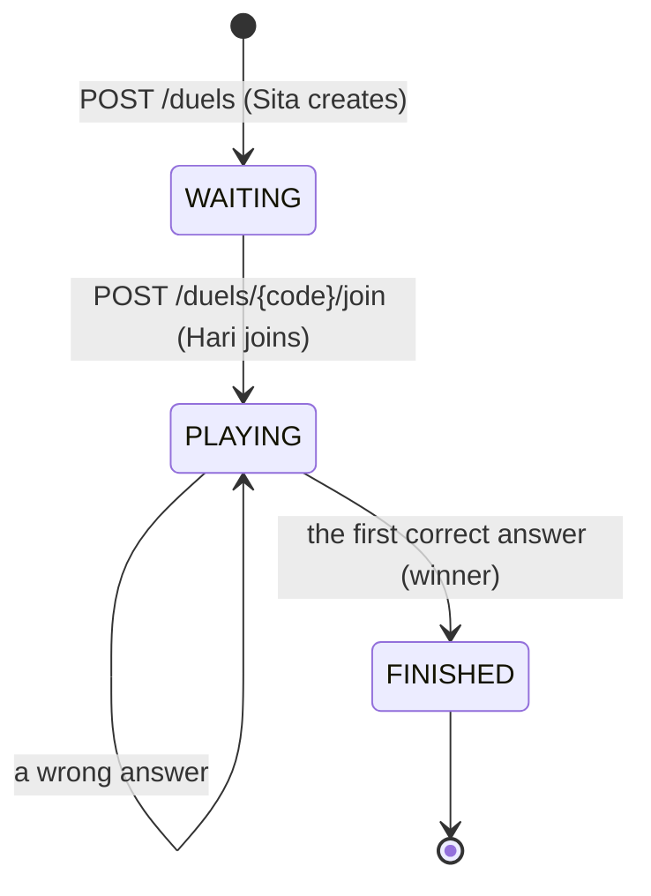
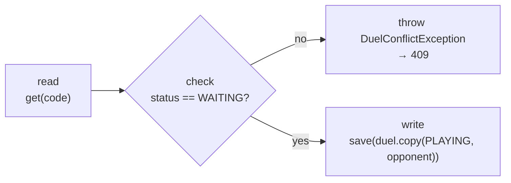

import Quiz from '../../../components/Quiz.astro';
import Think from '../../../components/Think.astro';
import { Aside } from '@astrojs/starlight/components';

<Aside type="tip" title="4 steps · ≈50 min · in your Spring app">
**Step 1:** give `Duel` a status. **Step 2:** a second player joins. **Step 3:** the first correct answer wins. **Step 4:** play a whole duel and try every wrong move. Win: Sita creates, Hari joins, Hari misses, Sita wins, and every out-of-turn action answers `409` with a reason the phone can show.
</Aside>

## Recall (from memory)

<Think id="maths-l16-recall-1" prompt="Lesson 15: where exactly do the duels live while the server runs, and what does repository.save(duel) do when a duel with that code is already in the map?" revealLabel="Check">
In a `MutableMap<String, Duel>` inside the one `DuelRepository`, in the server process's memory. `duels[duel.code] = duel` **replaces** whatever was stored under that code. That's why `newCode()` checks for clashes, and today that replacement becomes useful.
</Think>

<Think id="maths-l16-recall-2" prompt="Lesson 13: what's the difference between a 4xx and a 5xx, and when is 404 the right one?" revealLabel="Check">
4xx means the client should change something; 5xx means the server has a bug. 404 means there's nothing at that target, e.g. no duel with that code.
</Think>

## The problem: every action is allowed at every moment

Your server today, with one player:

```text
❯ curl -X POST localhost:8080/duels -H 'Content-Type: application/json' -d '{"playerName":"Sita"}'
{"code":"LCFU","playerName":"Sita"}
❯ curl -X POST localhost:8080/duels/LCFU/answers -H 'Content-Type: application/json' -d '{"answer":56}'
{"code":"LCFU","answer":56,"correct":true}
```

Sita answered a duel **nobody else has joined**, and she can keep answering forever. There's no opponent, no winner, and no end. A real duel goes through stages, and what's allowed depends on the stage:



That's a **state machine**: a fixed set of states, and a fixed set of moves (transitions) between them. Anything not drawn as an arrow is not allowed.

You've met one on Android. [`MediaPlayer`](https://developer.android.com/reference/android/media/MediaPlayer#state-diagram) has a famous state diagram: Idle, Prepared, Started, Paused, Stopped… Call `start()` before `prepare()` and it throws `IllegalStateException`. Each method is only valid in certain states, and the object checks. Your duel will do the same. The difference is that a server can't throw at the phone, so it answers with a status code.

## Brick · 409 Conflict

Which status fits "you can't join, it's already playing"?

- Not **400**: the JSON is fine.
- Not **404**: the duel exists.
- It's **409 Conflict**: "the request could not be completed due to a conflict with the current state of the target resource" ([RFC 9110 §15.5.10](https://www.rfc-editor.org/rfc/rfc9110#section-15.5.10), [MDN: 409](https://developer.mozilla.org/en-US/docs/Web/HTTP/Reference/Status/409)).

So the same request, joining duel `BRSL`, is right in one state and a 409 in another. The answer depends on **state** the server holds, which is why only the server can decide it.

## Step 1 · Give `Duel` a status

In `Duel.kt`, an `enum` for the three states, and the fields a duel needs to move through them:

```kotlin
package dev.hari.maths

// The three states a duel can be in
enum class DuelStatus { WAITING, PLAYING, FINISHED }

// A duel, as the game sees it. No Spring, no JSON, no HTTP.
data class Duel(
    val code: String,
    val playerName: String,
    val correctAnswer: Int,
    val status: DuelStatus = DuelStatus.WAITING,
    val opponentName: String? = null,
    val winner: String? = null
)
```

- **`enum class`** is exactly the Kotlin you know ([Kotlin docs: enums](https://kotlinlang.org/docs/enum-classes.html)). There are three values, and the compiler won't let you invent a fourth.
- **Defaults** (`= DuelStatus.WAITING`, `= null`): a new duel starts waiting, with no opponent and no winner. Your `create()` doesn't change at all, because the defaults fill in the new fields.
- **`String?`**: before anyone joins, there *is* no opponent. Kotlin's nullability says so in the type.

The phone needs to see the state, so `DuelResponse` grows too. Converting `Duel` to `DuelResponse` is now five fields, written in three places, so put it in one function. At the bottom of `DuelController.kt`:

```kotlin
data class DuelResponse(
    val code: String,
    val playerName: String,
    val status: DuelStatus,
    val opponentName: String?,
    val winner: String?
)

// Domain → DTO, in one place
fun Duel.toResponse() = DuelResponse(
    code = code,
    playerName = playerName,
    status = status,
    opponentName = opponentName,
    winner = winner
)
```

`fun Duel.toResponse()` is a Kotlin **extension function** ([Kotlin docs](https://kotlinlang.org/docs/extensions.html)): it reads as if `Duel` had the method, but it lives next to the DTO, in the controller's file. The domain class still knows nothing about JSON. Replace each `DuelResponse(code = duel.code, playerName = duel.playerName)` with `duel.toResponse()`. `correctAnswer` is still not in the DTO (lesson 14's leak).

```text
❯ curl -X POST localhost:8080/duels -H 'Content-Type: application/json' -d '{"playerName":"Sita"}'
{"code":"BRSL","playerName":"Sita","status":"WAITING","opponentName":null,"winner":null}
```

Jackson writes an enum as its name, `"WAITING"`, and a `null` as `null`.

**Commit:** `feat: duels have a status`

## Step 2 · A second player joins

Joining is a **transition**: WAITING → PLAYING. In `DuelService`:

```kotlin
    fun join(code: String, playerName: String): Duel {
        val duel = get(code)
        if (duel.status != DuelStatus.WAITING) {
            throw DuelConflictException("DUEL_NOT_WAITING", "Duel $code is ${duel.status}, so nobody can join it")
        }
        val playing = duel.copy(status = DuelStatus.PLAYING, opponentName = playerName)
        repository.save(playing)
        return playing
    }
```

Three beats, and every transition you write from now on has the same shape:

1. **Read** the current duel (`get` gives you the 404 for free).
2. **Check** the state: if this move isn't an arrow out of the current state, refuse.
3. **Write** the new state: `copy(…)` makes a new `Duel` with only those fields changed, the same `copy` you use for Compose UI state ([Kotlin docs: copying](https://kotlinlang.org/docs/data-classes.html#copying)). Then `save` **replaces** the old duel under the same code (recall 1).



The new exception, `DuelConflictException.kt`. It carries the error code too, because the phone needs to know *which* conflict:

```kotlin
package dev.hari.maths

// The duel exists, but it's in the wrong state for this action
class DuelConflictException(val error: String, val reason: String) : RuntimeException(reason)
```

And its handler, in `ErrorHandler` (lesson 13's pattern):

```kotlin
    @ExceptionHandler(DuelConflictException::class)
    fun conflict(e: DuelConflictException): ResponseEntity<ErrorResponse> {
        println("[${Thread.currentThread().name}] conflict: ${e.reason}")
        return ResponseEntity
            .status(HttpStatus.CONFLICT)
            .body(ErrorResponse(error = e.error, message = e.reason))
    }
```

The endpoint, in `DuelController`. Joining changes a duel, so it's a `POST` (lesson 6), and the body says who's joining:

```kotlin
data class JoinRequest(val playerName: String)

    @PostMapping("/duels/{code}/join")
    fun join(
        @PathVariable("code") code: String,
        @RequestBody request: JoinRequest
    ): DuelResponse {
        val duel = duelService.join(code, request.playerName)
        return duel.toResponse()
    }
```

<Think id="maths-l16-predict-join" prompt="Hari joins BRSL. Then Zen tries to join BRSL too. Predict both statuses and bodies." />

```text
❯ curl -i -X POST localhost:8080/duels/BRSL/join -H 'Content-Type: application/json' -d '{"playerName":"Hari"}'
HTTP/1.1 200
{"code":"BRSL","playerName":"Sita","status":"PLAYING","opponentName":"Hari","winner":null}

❯ curl -i -X POST localhost:8080/duels/BRSL/join -H 'Content-Type: application/json' -d '{"playerName":"Zen"}'
HTTP/1.1 409
{"error":"DUEL_NOT_WAITING","message":"Duel BRSL is PLAYING, so nobody can join it"}
```

**Commit:** `feat: a second player joins, 409 when the duel isn't waiting`

## Step 3 · The first correct answer wins

Answering is the other transition: PLAYING → FINISHED, but only on a correct answer. The server now has to know **who** answered, so the request carries a name:

```kotlin
data class AnswerRequest(val playerName: String, val answer: Int)
```

The service returns two things: whether the answer was right, and the duel after it. That's a small domain class, next to `Duel` in `Duel.kt`:

```kotlin
// What happened when someone answered
data class AnswerOutcome(val correct: Boolean, val duel: Duel)
```

`checkAnswer` becomes `answer`, with the same read → check → write shape:

```kotlin
    fun answer(code: String, playerName: String, answer: Int): AnswerOutcome {
        val duel = get(code)
        if (duel.status != DuelStatus.PLAYING) {
            throw DuelConflictException("DUEL_NOT_PLAYING", "Duel $code is ${duel.status}, so it takes no answers")
        }
        if (answer != duel.correctAnswer) {
            return AnswerOutcome(correct = false, duel = duel)
        }
        val finished = duel.copy(status = DuelStatus.FINISHED, winner = playerName)
        repository.save(finished)
        return AnswerOutcome(correct = true, duel = finished)
    }
```

A wrong answer is the arrow from PLAYING back to PLAYING: nothing changes, so nothing is saved. A correct answer finishes the duel and records the winner. And because the duel is now FINISHED, **the second correct answer is refused**. "First correct answer wins" is enforced by the state, not by comparing times.

The response tells the phone what happened:

```kotlin
data class AnswerResponse(
    val code: String,
    val answer: Int,
    val correct: Boolean,
    val status: DuelStatus,
    val winner: String?
)

    @PostMapping("/duels/{code}/answers")
    fun answer(
        @PathVariable("code") code: String,
        @RequestBody request: AnswerRequest
    ): AnswerResponse {
        val outcome = duelService.answer(code, request.playerName, request.answer)
        return AnswerResponse(
            code = outcome.duel.code,
            answer = request.answer,
            correct = outcome.correct,
            status = outcome.duel.status,
            winner = outcome.duel.winner
        )
    }
```

**Commit:** `feat: first correct answer finishes the duel`

## Step 4 · Play a whole duel, and try every wrong move

<Think id="maths-l16-predict-game" prompt="Predict the status code for each, in order: (1) Sita answers 56 right after creating BRSL (2) Hari joins (3) Zen joins (4) Hari answers 65 (5) Sita answers 56 (6) Hari answers 56 (7) Zen joins again (8) an old-style answer body {&quot;answer&quot;:56}" />

What I got, one duel from start to end:

```text
❯ POST /duels                 {"playerName":"Sita"}
201 {"code":"BRSL","playerName":"Sita","status":"WAITING","opponentName":null,"winner":null}

(1) Sita answers before anyone joined
❯ POST /duels/BRSL/answers    {"playerName":"Sita","answer":56}
409 {"error":"DUEL_NOT_PLAYING","message":"Duel BRSL is WAITING, so it takes no answers"}

(2) Hari joins
❯ POST /duels/BRSL/join       {"playerName":"Hari"}
200 {"code":"BRSL","playerName":"Sita","status":"PLAYING","opponentName":"Hari","winner":null}

(3) Zen tries to join
❯ POST /duels/BRSL/join       {"playerName":"Zen"}
409 {"error":"DUEL_NOT_WAITING","message":"Duel BRSL is PLAYING, so nobody can join it"}

(4) Hari misses
❯ POST /duels/BRSL/answers    {"playerName":"Hari","answer":65}
200 {"code":"BRSL","answer":65,"correct":false,"status":"PLAYING","winner":null}

(5) Sita gets it
❯ POST /duels/BRSL/answers    {"playerName":"Sita","answer":56}
200 {"code":"BRSL","answer":56,"correct":true,"status":"FINISHED","winner":"Sita"}

(6) Hari gets it too, but too late
❯ POST /duels/BRSL/answers    {"playerName":"Hari","answer":56}
409 {"error":"DUEL_NOT_PLAYING","message":"Duel BRSL is FINISHED, so it takes no answers"}

(7) Zen tries again
❯ POST /duels/BRSL/join       {"playerName":"Zen"}
409 {"error":"DUEL_NOT_WAITING","message":"Duel BRSL is FINISHED, so nobody can join it"}

(8) an old phone still sends lesson 12's body
❯ POST /duels/BRSL/answers    {"answer":56}
400 {"error":"BAD_BODY","message":"The body is not the JSON this endpoint expects"}

❯ GET /duels/BRSL
200 {"code":"BRSL","playerName":"Sita","status":"FINISHED","opponentName":"Hari","winner":"Sita"}
```

And the log, where the map holds **one** entry the whole time, replaced at each transition:

```text
[http-nio-8080-exec-2] saved BRSL, now holding 1: [BRSL]
[http-nio-8080-exec-6] conflict: Duel BRSL is WAITING, so it takes no answers
[http-nio-8080-exec-8] saved BRSL, now holding 1: [BRSL]
[http-nio-8080-exec-10] conflict: Duel BRSL is PLAYING, so nobody can join it
[http-nio-8080-exec-4] saved BRSL, now holding 1: [BRSL]
[http-nio-8080-exec-6] conflict: Duel BRSL is FINISHED, so it takes no answers
[http-nio-8080-exec-10] conflict: Duel BRSL is FINISHED, so nobody can join it
[http-nio-8080-exec-2] bad body JSON parse error: Instantiation of [simple type, class dev.hari.maths.AnswerRequest] value failed for JSON property playerName due to missing (therefore NULL) value for creator parameter playerName which is a non-nullable type
```

Line (8) is lesson 12 again: `playerName` is a non-null `String` with no default, so a body without it can't become an `AnswerRequest`. **Changing a request DTO breaks every phone still sending the old shape.** That's worth remembering when an app is already out in the world.

Here's the whole machine as a table: every action, in every state. A state machine is only finished when every cell has an answer:

| action ↓ · state → | WAITING | PLAYING | FINISHED |
|---|---|---|---|
| **join** | ✅ → PLAYING | 409 `DUEL_NOT_WAITING` | 409 `DUEL_NOT_WAITING` |
| **wrong answer** | 409 `DUEL_NOT_PLAYING` | ✅ stays PLAYING | 409 `DUEL_NOT_PLAYING` |
| **correct answer** | 409 `DUEL_NOT_PLAYING` | ✅ → FINISHED, winner | 409 `DUEL_NOT_PLAYING` |
| **GET** | ✅ | ✅ | ✅ |

<Aside type="caution" title="Read → check → write, on many threads">
Every transition reads the duel, checks its state, then writes a new one. If Hari and Zen send `join` **at the same instant**, on two Tomcat threads, both can read WAITING before either writes PLAYING. Then both "succeed", and the second one silently overwrites the first. With one curl at a time you'll never see it. Lesson 19 makes it happen on purpose.
</Aside>

<Aside type="note" title="The thing to remember">
A **state machine** is a fixed set of states and the allowed moves between them. In Kotlin that's an `enum` for the states, and transitions in the service that **read** the duel, **check** that the move is allowed from its current state, and **write** `duel.copy(…)` back. A move that isn't allowed in the current state is **409 Conflict**: the request is fine and the duel exists, but it clashes with the duel's state. "First correct answer wins" falls out of the machine: once FINISHED, no more answers are taken.
</Aside>

## Check yourself

<Quiz
  question="Zen joins a duel that is already PLAYING. Which status fits best?"
  options={[
    '400, the request body is wrong',
    '404, the duel cannot be found',
    '409, it clashes with the state',
  ]}
  answer={2}
>
The JSON is fine and the duel exists, so it's not 400 or 404. The same request would succeed if the duel were WAITING: it conflicts with the current state.
</Quiz>

<Quiz
  question="Sita and Hari both answer 56. Why can only one of them win?"
  options={[
    'A correct answer finishes the duel',
    'The server compares both answer times',
    'Hari typed his answer more slowly',
  ]}
  answer={0}
>
The first correct answer moves the duel to FINISHED. The second one arrives at a duel that no longer takes answers, and gets 409. The state decides, not a timestamp.
</Quiz>

<Quiz
  question="Why does join write duel.copy(…) instead of changing the duel's fields?"
  options={[
    'Spring never lets objects change',
    'Duel properties are all val',
    'Maps only accept new objects',
  ]}
  answer={1}
>
`Duel`'s properties are `val`, so they can't change. `copy` builds a new `Duel` with a few fields replaced, and `save` puts it in the map under the same code, replacing the old one.
</Quiz>

## Your turn

<Think id="maths-l16-stranger" prompt="Sita and Hari are PLAYING. Zen, who never joined, sends {&quot;playerName&quot;:&quot;Zen&quot;,&quot;answer&quot;:56}. What happens today? Then fix it: which layer, which check, and which status should Zen get?" revealLabel="Check">
Today **Zen wins**. I ran it:
```text
{"code":"AKXT","answer":56,"correct":true,"status":"FINISHED","winner":"Zen"}
```
The fix is a rule, so it goes in the **service**, in `answer`, after the state check:
```kotlin
        if (playerName != duel.playerName && playerName != duel.opponentName) {
            throw NotInDuelException(code, playerName)
        }
```
```kotlin
class NotInDuelException(val code: String, val playerName: String) : RuntimeException("$playerName is not in duel $code")
```
Its handler answers **403 Forbidden** ("I understood you, and I refuse": [RFC 9110 §15.5.4](https://www.rfc-editor.org/rfc/rfc9110#section-15.5.4)) with `{"error":"NOT_IN_DUEL",…}`:
```text
403 {"error":"NOT_IN_DUEL","message":"Zen is not in duel PYIO"}
```
Hari's answer in the same duel still wins. One honest gap: `playerName` is just text the phone sends, so a cheater can type "Hari". Proving *who* someone is is authentication, a topic of its own. The server still enforces everything it can check.
</Think>

<Think id="maths-l16-teachback" prompt="Explain to another Android developer, in 3–4 sentences: what a duel's state machine is, how a transition is written in the service, and why the server answers 409 rather than 400 or 404. Compare it to MediaPlayer." revealLabel="Compare with a model answer">
A duel can only be WAITING, PLAYING or FINISHED, and each action is allowed only from certain states, like MediaPlayer's `start()` only being valid after `prepare()`. Each transition in the service reads the duel, checks its status, and writes `duel.copy(newStatus, …)` back into the repository. When the action isn't allowed in the current state, the service throws `DuelConflictException`, and the handler turns it into 409, because the request is valid and the duel exists: it just conflicts with the duel's current state. MediaPlayer throws `IllegalStateException`; a server sends 409 instead.
</Think>

## Read alongside
- 📖 **Primary:** [Android docs: MediaPlayer, "Valid and invalid states"](https://developer.android.com/reference/android/media/MediaPlayer#valid-and-invalid-states) and its state diagram, the same idea on the side you know (10 min).
- [RFC 9110 §15.5.10: 409 Conflict](https://www.rfc-editor.org/rfc/rfc9110#section-15.5.10), one paragraph.
- [Kotlin docs: data classes, copying](https://kotlinlang.org/docs/data-classes.html#copying).

🙋 Ask me: "should `join` be `PUT` or `POST`?", "what if Sita joins her own duel?", "how does the phone find out Hari joined without asking?", "should the state machine live in `Duel` instead of the service?"

**Next:** Lesson 17: seeds. One question isn't a duel. Both players must get the **same** questions in the same order, and a restart mustn't change them. A seed makes that cheap.
