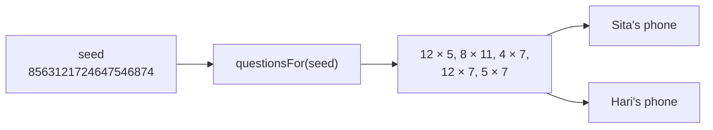
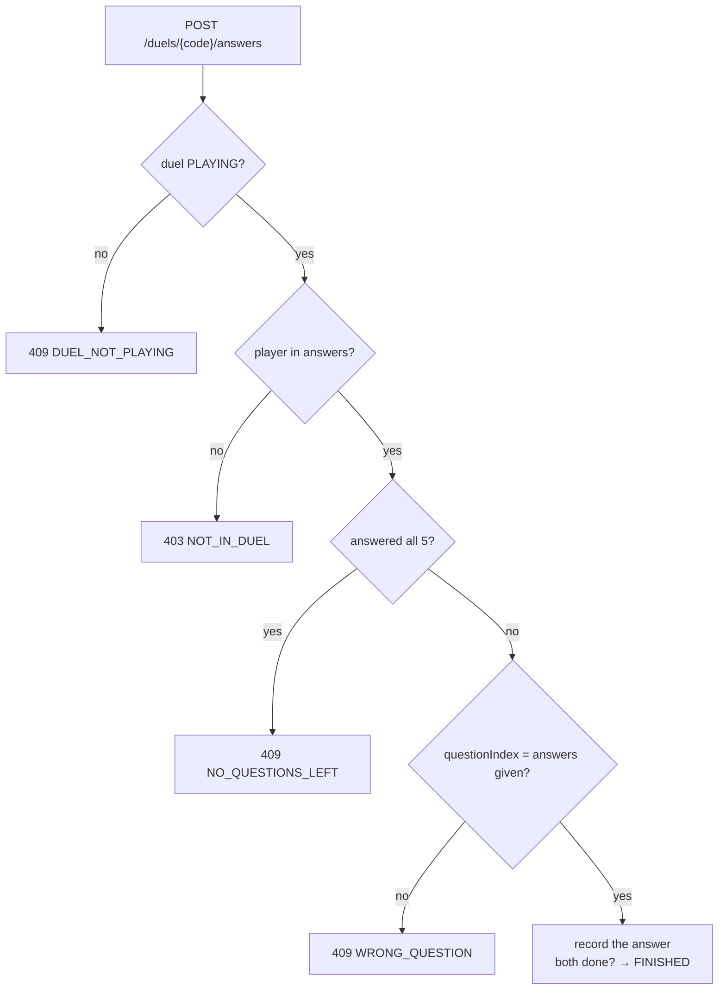

import Quiz from '../../../components/Quiz.astro';
import Think from '../../../components/Think.astro';
import { Aside } from '@astrojs/starlight/components';

<Aside type="tip" title="4 steps · ≈50 min · in your Spring app">
**Step 1:** a function that turns a seed into questions. **Step 2:** a duel stores its seed. **Step 3:** the phone asks for the questions, without the answers. **Step 4:** answers are checked per question and scored. Win: Sita and Hari play the same five questions, and the higher score wins.
</Aside>

## Recall (from memory)

<Think id="maths-l17-recall-1" prompt="Lesson 16: Hari answers a duel that is already FINISHED. Which status does he get, and why not 400?" revealLabel="Check">
**409 Conflict**, `DUEL_NOT_PLAYING`. The JSON is fine (so not 400) and the duel exists (so not 404). The request clashes with the duel's *state*: the same answer would have been taken while the duel was PLAYING.
</Think>

<Think id="maths-l17-recall-2" prompt="Lesson 1: why must the server, and not the phone, decide whether an answer is correct?" revealLabel="Check">
The phone is in the player's hands, so anything it decides can be changed or faked. The server is the **source of truth**: it holds the right answers and the only copy of the duel that counts. Keep this one in mind, because it decides a design choice in Step 3.
</Think>

## The problem: one question is not a duel

Today every duel has the same single question, because `create` hard-codes it:

```kotlin
            correctAnswer = 56
```

A Live Duel needs several questions, say five, and three things must be true about them:

1. **Different for each duel**, or players learn the answers.
2. **The same for both players in a duel, in the same order**, or it isn't a fair race.
3. **Known only to the server**, the rule from recall 2.

Two simple ideas fail. If each phone picks its own random questions, Sita and Hari get different questions (rule 2 broken). If the server picks five questions at random and keeps them, that works, but you'd need to store a list of questions in every duel. There's a neater way: store **one number**, and make the questions from it whenever they're needed.

## Brick · A seed

Computers don't roll dice. `Random` is an **algorithm**: it starts from a number, called the **seed**, and computes each "random" value from the one before it. Same starting number, same sequence, every time. That's why it's called **pseudo-random**.

A small Kotlin script, `seeds.main.kts`:

```kotlin
import kotlin.random.Random

val a = Random(42)
println("Random(42):  " + List(6) { a.nextInt(2, 13) })
val b = Random(42)
println("Random(42):  " + List(6) { b.nextInt(2, 13) })
val c = Random(43)
println("Random(43):  " + List(6) { c.nextInt(2, 13) })
println("Random:      " + List(6) { Random.nextInt(2, 13) })
```

`nextInt(2, 13)` gives a number from 2 to 12 (13 itself is left out). I ran it twice:

```text
❯ kotlin seeds.main.kts
Random(42):  [10, 11, 10, 11, 12, 3]
Random(42):  [10, 11, 10, 11, 12, 3]
Random(43):  [11, 2, 7, 9, 7, 2]
Random:      [2, 4, 9, 4, 12, 8]
❯ kotlin seeds.main.kts
Random(42):  [10, 11, 10, 11, 12, 3]
Random(42):  [10, 11, 10, 11, 12, 3]
Random(43):  [11, 2, 7, 9, 7, 2]
Random:      [6, 11, 4, 7, 11, 7]
```

- `Random(42)` gives `[10, 11, 10, 11, 12, 3]` in both runs, and in both generators within a run.
- `Random(43)`, one number away, gives a completely different list.
- Plain `Random` has no seed you chose (Kotlin picks one for you), so it's different every run.

The [Kotlin docs for `Random(seed)`](https://kotlinlang.org/api/core/kotlin-stdlib/kotlin.random/-random.html) promise exactly this, with one honest limit: "Two generators with the same seed produce the same sequence of values **within the same version of Kotlin runtime**." An upgrade of Kotlin may change the sequence. A duel lasts a minute, so that's fine for us.



## Step 1 · From a seed to questions

A new file, `Questions.kt`. It's plain Kotlin, with no Spring and no HTTP, so it belongs with the domain:

```kotlin
package dev.hari.maths

import kotlin.random.Random

// One multiplication question
data class Question(val a: Int, val b: Int) {
    val text get() = "$a × $b"
    val answer get() = a * b
}

const val QUESTIONS_PER_DUEL = 5

// The same seed always gives the same questions, in the same order
fun questionsFor(seed: Long): List<Question> {
    val random = Random(seed)
    return List(QUESTIONS_PER_DUEL) {
        Question(a = random.nextInt(2, 13), b = random.nextInt(2, 13))
    }
}
```

- A `Question` stores only `a` and `b`. `text` and `answer` are computed from them (`get()`), so they can never disagree.
- `questionsFor` makes a **new** `Random(seed)` on every call. That's what makes it repeatable: each call starts the sequence from the beginning. (It also means no two threads ever share one generator, which the docs warn against: "On JVM the returned generator is NOT thread-safe.")

**Commit:** `feat: questions come from a seed`

## Step 2 · A duel stores its seed

In `Duel.kt`, `correctAnswer` is replaced by `seed`, and the duel can give you its questions:

```kotlin {4,10}
data class Duel(
    val code: String,
    val playerName: String,
    val seed: Long,

    val status: DuelStatus = DuelStatus.WAITING,
    val opponentName: String? = null,
    val winner: String? = null,
) {
    val questions get() = questionsFor(seed)
}
```

In `DuelService.create`, each new duel gets a random seed, and the log says which one:

```kotlin
import kotlin.random.Random
```

```kotlin {5,7}
    fun create(playerName: String): Duel {
        val duel = Duel(
            code = newCode(),
            playerName = playerName,
            seed = Random.nextLong()
        )
        println("[${Thread.currentThread().name}] duel ${duel.code} uses seed ${duel.seed}")
        repository.save(duel)
        return duel
    }
```

`answer` still uses `duel.correctAnswer`, so the build breaks there. For now, check against the first question: `duel.questions[0].answer`. Step 4 replaces that line.

### Why store the seed, not the questions?

Five questions would fit in memory easily, so size isn't the main reason. There are two better ones:

- **One source.** The questions are *derived* from the seed, like `answer` is derived from `a` and `b`. Nothing stored can drift out of step with something else stored.
- **You can replay it.** The log line is enough to rebuild a duel's questions anywhere. From my run:

```text
[http-nio-8080-exec-2] duel UZUH uses seed 8563121724647546874
```

I pasted `Question` and `questionsFor` into a script, `replay.main.kts`, and called it with that seed, on my laptop, with no server:

```kotlin
questionsFor(8563121724647546874).forEachIndexed { i, q -> println("$i: ${q.text} = ${q.answer}") }
```

```text
❯ kotlin replay.main.kts
0: 12 × 5 = 60
1: 8 × 11 = 88
2: 4 × 7 = 28
3: 12 × 7 = 84
4: 5 × 7 = 35
```

Those are exactly the questions the server gave UZUH's players (you'll see them in Step 3). When a player reports "question 3 was weird", the seed in the log is all you need. This matters more in Lesson 28, where the Cross Math grid is far bigger than five questions.

**Commit:** `feat: a duel stores a seed instead of one answer`

## Step 3 · The phone asks for the questions

A DTO for a question **as the phone sees it**, with no answer, in `DuelController.kt`:

```kotlin
// A question as the phone sees it: no answer
data class QuestionDto(val index: Int, val text: String)
```

```kotlin
    @GetMapping("/duels/{code}/questions")
    fun questions(@PathVariable("code") code: String): List<QuestionDto> {
        val duel = duelService.get(code)
        return duel.questions.mapIndexed { index, question -> QuestionDto(index, question.text) }
    }
```

`mapIndexed` is `map` with the position passed in too. Sita's phone and Hari's phone both ask:

```text
❯ curl localhost:8080/duels/AFTS/questions
[{"index":0,"text":"10 × 3"},{"index":1,"text":"4 × 9"},{"index":2,"text":"4 × 2"},{"index":3,"text":"10 × 9"},{"index":4,"text":"3 × 5"}]
❯ curl localhost:8080/duels/AFTS/questions
[{"index":0,"text":"10 × 3"},{"index":1,"text":"4 × 9"},{"index":2,"text":"4 × 2"},{"index":3,"text":"10 × 9"},{"index":4,"text":"3 × 5"}]
❯ curl localhost:8080/duels/HKVP/questions
[{"index":0,"text":"8 × 11"},{"index":1,"text":"5 × 12"},{"index":2,"text":"11 × 8"},{"index":3,"text":"12 × 4"},{"index":4,"text":"8 × 11"}]
```

The same duel gives the same list every time. Another duel (HKVP) gives a different one. Notice HKVP asks `8 × 11` **twice**: nothing stops a repeat yet. That's your exercise at the end.

<Think id="maths-l17-send-seed" prompt="The server could send just the seed (one number), and the phone could run questionsFor itself. Less data, and the phone works even offline. Why is that a bad idea for this game?" revealLabel="Check">
Anyone who has the seed can run `questionsFor` and get the **answers** too, before the duel starts: `answer` is computed from the same `a` and `b`. The seed is as secret as the answers. So it stays on the server, and the phone only gets the question text.

Real story, from the world of word games: the original Wordle picked each day's word from a list **inside the page's JavaScript**, by counting days since launch. People opened the code and read the answers for years ahead ([PCWorld](https://www.pcworld.com/article/606109/how-to-cheat-at-wordle.html), [Make:](https://makezine.com/?p=556823)). For a daily puzzle that was mostly harmless. In a duel with a winner, it's cheating.
</Think>

**Commit:** `feat: get a duel's questions, without answers`

## Step 4 · Answer each question, and keep score

With five questions, an answer has to say **which** question it's for, and the duel has to remember each player's answers. A player goes through the questions **in order**, so the number of answers they've given is also the index of the question they're on.

In `Duel.kt`, one more field, and a score:

```kotlin {9-10,14-17}
data class Duel(
    val code: String,
    val playerName: String,
    val seed: Long,

    val status: DuelStatus = DuelStatus.WAITING,
    val opponentName: String? = null,
    val winner: String? = null,
    // each player's answers so far, in question order
    val answers: Map<String, List<Int>> = mapOf(playerName to emptyList()),
) {
    val questions get() = questionsFor(seed)

    fun score(player: String): Int {
        val given = answers[player] ?: return 0
        return given.zip(questions).count { (answer, question) -> answer == question.answer }
    }
}
```

- `answers` starts with the creator and no answers: `{"Sita": []}`. A default can use an earlier parameter (`playerName`), so `create` doesn't change.
- `zip` pairs each answer with its question: `[60, 88]` and the questions become `(60, 12 × 5), (88, 8 × 11)`. `count` keeps the pairs that match. The score is derived, like the questions.

In `join`, the opponent gets an empty list too:

```kotlin {4}
        val playing = duel.copy(
            status = DuelStatus.PLAYING,
            opponentName = playerName,
            answers = duel.answers + (playerName to emptyList())
        )
```

`map + (key to value)` makes a **new** map with one more entry. The duel stays immutable, as in Lesson 16.

### The rules, in the service

`answers` also knows who is in the duel, so the membership check from your Lesson 16 exercise comes almost free: a stranger's name isn't a key. `NotInDuelException.kt`:

```kotlin
package dev.hari.maths

// Someone who isn't one of the duel's two players tried to play
class NotInDuelException(val code: String, val playerName: String) : RuntimeException("$playerName is not in duel $code")
```

Its handler in `ErrorHandler` is the same shape as `conflict`, with `HttpStatus.FORBIDDEN` and `error = "NOT_IN_DUEL"`.

`answer` gets `questionIndex`, and four checks before anything is written:



```kotlin
    fun answer(code: String, playerName: String, questionIndex: Int, answer: Int): AnswerOutcome {
        val duel = get(code)
        if (duel.status != DuelStatus.PLAYING) {
            throw DuelConflictException("DUEL_NOT_PLAYING", "Duel $code is ${duel.status}, so it takes no answers")
        }
        val given = duel.answers[playerName] ?: throw NotInDuelException(code, playerName)
        if (given.size == QUESTIONS_PER_DUEL) {
            throw DuelConflictException("NO_QUESTIONS_LEFT", "$playerName has answered all $QUESTIONS_PER_DUEL questions")
        }
        if (questionIndex != given.size) {
            throw DuelConflictException("WRONG_QUESTION", "$playerName is on question ${given.size}, not $questionIndex")
        }
        val correct = answer == duel.questions[questionIndex].answer
        var updated = duel.copy(answers = duel.answers + (playerName to given + answer))
        if (updated.answers.values.all { it.size == QUESTIONS_PER_DUEL }) {
            updated = finish(updated)
        }
        repository.save(updated)
        return AnswerOutcome(correct = correct, duel = updated)
    }

    // Both players are done: the higher score wins, a tie has no winner
    private fun finish(duel: Duel): Duel {
        val player = duel.score(duel.playerName)
        val opponent = duel.score(duel.opponentName!!)
        val winner = when {
            player > opponent -> duel.playerName
            opponent > player -> duel.opponentName
            else -> null
        }
        return duel.copy(status = DuelStatus.FINISHED, winner = winner)
    }
```

- `NO_QUESTIONS_LEFT` comes before `WRONG_QUESTION` on purpose. Without it, a player who has answered 5 and sends `questionIndex: 5` would pass the index check, and `duel.questions[5]` would throw `IndexOutOfBoundsException`: a **500**.
- `given + answer` is a new list with one more answer. A wrong answer is recorded too: it uses up the question.
- `opponentName!!` is safe here: a duel is only PLAYING after someone joined.

**The win rule changed.** In Lesson 16 the first correct answer won. Now the duel ends when **both** players have answered all five, and the higher score wins. That's the Live Duel's rule, minus the 60 seconds, which is Lesson 18.

### The controller

```kotlin
data class AnswerRequest(val playerName: String, val questionIndex: Int, val answer: Int)

data class AnswerResponse(
    val code: String,
    val questionIndex: Int,
    val answer: Int,
    val correct: Boolean,
    val score: Int,
    val status: DuelStatus,
    val winner: String?
)
```

```kotlin {6,9,12}
    @PostMapping("/duels/{code}/answers")
    fun answer(
        @PathVariable("code") code: String,
        @RequestBody request: AnswerRequest
    ): AnswerResponse {
        val outcome = duelService.answer(code, request.playerName, request.questionIndex, request.answer)
        return AnswerResponse(
            code = outcome.duel.code,
            questionIndex = request.questionIndex,
            answer = request.answer,
            correct = outcome.correct,
            score = outcome.duel.score(request.playerName),
            status = outcome.duel.status,
            winner = outcome.duel.winner
        )
    }
```

And `DuelResponse` gets `val scores: Map<String, Int>`, filled in `toResponse()`:

```kotlin
    scores = answers.keys.associateWith { score(it) }
```

`associateWith` turns the names into a map from name to score: `{"Sita":5,"Hari":4}`.

**Commit:** `feat: answer each question in order, higher score wins`

## A whole duel

Duel UZUH, with the questions from the replay above (answers 60, 88, 28, 84, 35).

<Think id="maths-l17-predict" prompt="Sita has created UZUH and Hari has joined. Predict the status code: (1) Sita answers question 0 with 60 (2) Sita sends the same request again (3) Hari answers question 2 first (4) Zen answers question 0 (5) Hari, having answered all five, sends questionIndex 5. And after Sita gets all five right while Hari got four, who wins?" />

What I got:

```text
❯ POST /duels/UZUH/join     {"playerName":"Hari"}
200 {"code":"UZUH","playerName":"Sita","status":"PLAYING","opponentName":"Hari","winner":null,"scores":{"Sita":0,"Hari":0}}

(1) Sita answers question 0
❯ POST /duels/UZUH/answers  {"playerName":"Sita","questionIndex":0,"answer":60}
200 {"code":"UZUH","questionIndex":0,"answer":60,"correct":true,"score":1,"status":"PLAYING","winner":null}

(2) the same request again
❯ POST /duels/UZUH/answers  {"playerName":"Sita","questionIndex":0,"answer":60}
409 {"error":"WRONG_QUESTION","message":"Sita is on question 1, not 0"}

(3) Hari skips ahead
❯ POST /duels/UZUH/answers  {"playerName":"Hari","questionIndex":2,"answer":28}
409 {"error":"WRONG_QUESTION","message":"Hari is on question 0, not 2"}

(4) Zen, who never joined
❯ POST /duels/UZUH/answers  {"playerName":"Zen","questionIndex":0,"answer":60}
403 {"error":"NOT_IN_DUEL","message":"Zen is not in duel UZUH"}

Hari answers all five, getting question 2 wrong (27, not 28)
❯ POST /duels/UZUH/answers  {"playerName":"Hari","questionIndex":0,"answer":60}
200 {…,"questionIndex":0,"answer":60,"correct":true,"score":1,"status":"PLAYING",…}
❯ POST /duels/UZUH/answers  {"playerName":"Hari","questionIndex":1,"answer":88}
200 {…,"questionIndex":1,"answer":88,"correct":true,"score":2,"status":"PLAYING",…}
❯ POST /duels/UZUH/answers  {"playerName":"Hari","questionIndex":2,"answer":27}
200 {…,"questionIndex":2,"answer":27,"correct":false,"score":2,"status":"PLAYING",…}
❯ POST /duels/UZUH/answers  {"playerName":"Hari","questionIndex":3,"answer":84}
200 {…,"questionIndex":3,"answer":84,"correct":true,"score":3,"status":"PLAYING",…}
❯ POST /duels/UZUH/answers  {"playerName":"Hari","questionIndex":4,"answer":35}
200 {…,"questionIndex":4,"answer":35,"correct":true,"score":4,"status":"PLAYING",…}

(5) Hari has nothing left
❯ POST /duels/UZUH/answers  {"playerName":"Hari","questionIndex":5,"answer":1}
409 {"error":"NO_QUESTIONS_LEFT","message":"Hari has answered all 5 questions"}

❯ GET /duels/UZUH
200 {"code":"UZUH","playerName":"Sita","status":"PLAYING","opponentName":"Hari","winner":null,"scores":{"Sita":1,"Hari":4}}

Sita answers questions 1 to 4, all right; the last one ends the duel
❯ POST /duels/UZUH/answers  {"playerName":"Sita","questionIndex":4,"answer":35}
200 {"code":"UZUH","questionIndex":4,"answer":35,"correct":true,"score":5,"status":"FINISHED","winner":"Sita"}

❯ GET /duels/UZUH
200 {"code":"UZUH","playerName":"Sita","status":"FINISHED","opponentName":"Hari","winner":"Sita","scores":{"Sita":5,"Hari":4}}

❯ POST /duels/UZUH/answers  {"playerName":"Hari","questionIndex":0,"answer":56}
409 {"error":"DUEL_NOT_PLAYING","message":"Duel UZUH is FINISHED, so it takes no answers"}
```

Look at (2). The phone sent the **same request twice** and the second got 409, so Sita's score stayed 1. Without `questionIndex`, the server would have recorded 60 as her answer to question 1 instead. Phones resend requests when the network is slow; Lesson 21 is about exactly that.

Look at the `GET` in the middle, too: Hari finished, and the duel is still PLAYING, waiting for Sita. If Sita never answers, it waits **forever**. Only a clock fixes that, in Lesson 18.

<Aside type="note" title="The thing to remember">
A **seed** is the starting number of a pseudo-random algorithm: the same seed gives the same sequence. A duel stores one `seed`, and `questionsFor(seed)` rebuilds the same questions whenever they're needed, for both players, and again from a log line. Derived things (questions, answers, scores) aren't stored, so they can't drift. The seed is as secret as the answers, so the phone gets only question **text**. Each answer names its `questionIndex`, and the server accepts only the question that player is on.
</Aside>

## Check yourself

<Quiz
  question="Two duels both happen to get seed 77. What do their players see?"
  options={[
    'Each duel gets its own questions',
    'Both duels get the same questions',
    'The second duel fails to start',
  ]}
  answer={1}
>
The questions depend only on the seed. Same seed, same questions. With `Random.nextLong()` choosing from about 18 quintillion values, it practically never happens, and nothing breaks if it does.
</Quiz>

<Quiz
  question="Why doesn't the server send the seed to the phone?"
  options={[
    'The seed reveals every answer',
    'Phones cannot run Kotlin Random',
    'A Long cannot become JSON',
  ]}
  answer={0}
>
Whoever has the seed can run `questionsFor` and compute every `answer`. The phone can store and send a `Long` just fine; the problem is what it gives away.
</Quiz>

<Quiz
  question="Sita resends her answer to question 0. What stops a double score?"
  options={[
    'Spring ignores repeated requests by default',
    'The phone remembers which it sent',
    'The questionIndex no longer matches hers',
  ]}
  answer={2}
>
After her first answer, Sita is on question 1. The repeat says `questionIndex: 0`, so the service answers 409 `WRONG_QUESTION` and records nothing. Spring knows nothing about your game, and the server can't trust the phone's memory.
</Quiz>

## Your turn

<Think id="maths-l17-repeats" prompt="Duel HKVP asked 8 × 11 twice. Change questionsFor so a duel never repeats a question, and keep it repeatable: the same seed must still give the same five questions. Hint: keep drawing questions from the same Random until you have five different ones." revealLabel="Check">
`generateSequence { … }` makes an endless sequence of questions from the same `random`. `distinct()` skips any question already seen (a `data class` compares by `a` and `b`), and `take(5)` stops after five:

```kotlin
fun questionsFor(seed: Long): List<Question> {
    val random = Random(seed)
    return generateSequence { Question(a = random.nextInt(2, 13), b = random.nextInt(2, 13)) }
        .distinct()
        .take(QUESTIONS_PER_DUEL)
        .toList()
}
```

It's still repeatable, because the same seed draws the same questions in the same order, so it skips the same ones. I searched seeds 1 to 10,000 for repeats: 786 of them (about 8%) had one. Seed 2, before and after, run twice:

```text
seed 2, before: [7 × 11, 9 × 4, 9 × 4, 4 × 3, 11 × 11]
seed 2, after:  [7 × 11, 9 × 4, 4 × 3, 11 × 11, 6 × 7]
seed 2, again:  [7 × 11, 9 × 4, 4 × 3, 11 × 11, 6 × 7]
```

Notice that the change gives some old seeds different questions. That's fine while duels live only in memory: after a deploy, no old duel is left. `8 × 11` and `11 × 8` still both count as different; making them the same is up to you.
</Think>

<Think id="maths-l17-teachback" prompt="Explain to another Android developer, in 3–4 sentences: what a seed is, why a duel stores a seed instead of its questions, and why the phone gets question text but never the seed." revealLabel="Compare with a model answer">
`Random` is an algorithm, and the seed is its starting number: `Random(seed)` with the same seed always produces the same sequence. So a duel stores one `Long`, and `questionsFor(seed)` rebuilds the same five questions every time anyone asks, for both players, and later from the seed in the log. Questions, answers and scores are all derived from the seed and the stored answers, so nothing can get out of step. The phone only gets the question text, because the seed would let it compute every answer, and the server is the source of truth for what's correct.
</Think>

## Read alongside
- 📖 **Primary:** [Kotlin docs: `Random(seed)`](https://kotlinlang.org/api/core/kotlin-stdlib/kotlin.random/-random.html): the repeatability promise, the "same version" limit, and the thread-safety note (5 min).
- [Kotlin docs: `zip`](https://kotlinlang.org/docs/collection-transformations.html#zip) and [`associateWith`](https://kotlinlang.org/docs/collection-transformations.html#associate), the two collection functions behind the score.
- [Kotlin docs: sequences](https://kotlinlang.org/docs/sequences.html), for the exercise.

🙋 Ask me: "is `Random.nextLong()` safe enough for a game, or do I need `SecureRandom`?", "why not let a player answer questions in any order?", "where should the scoring rule live, in `Duel` or in the service?", "how would a tie show on the phone?"

**Next:** Lesson 18: the server's clock. Hari finished and UZUH waited forever for Sita. A Live Duel lasts 60 seconds, and only the server's clock can say when time's up.
