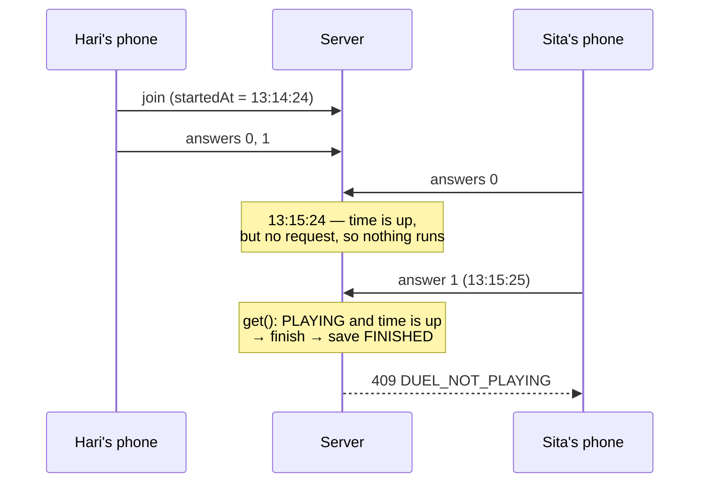
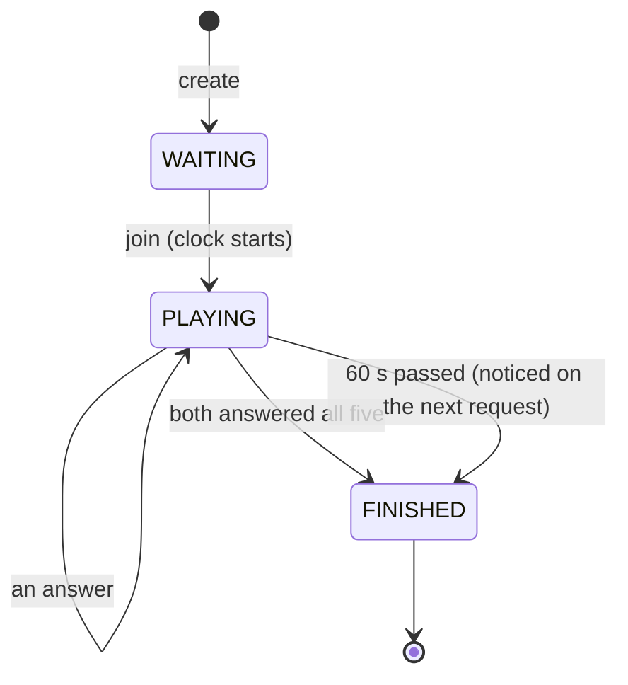

import Quiz from '../../../components/Quiz.astro';
import Think from '../../../components/Think.astro';
import { Aside } from '@astrojs/starlight/components';

<Aside type="tip" title="3 steps · ≈45 min · in your Spring app">
**Step 1:** a duel remembers when it started. **Step 2:** the service finishes a duel whose time is up. **Step 3:** the phone gets a countdown. Win: Hari answers two questions, Sita answers one and stops, and 60 seconds later the server says Hari won, with nobody answering all five.
</Aside>

## Recall (from memory)

<Think id="maths-l18-recall-1" prompt="Lesson 17: what does the server store for a duel's questions, and what does the phone receive? Why not send the phone the other one?" revealLabel="Check">
The server stores only the **seed**, and rebuilds the questions with `questionsFor(seed)` whenever it needs them. The phone receives the question **text** (`QuestionDto(index, text)`), never the seed. Whoever has the seed can compute every answer, so it never leaves the server.
</Think>

<Think id="maths-l18-recall-2" prompt="Lesson 10: when Tomcat runs your code for a request, what is it running on? And what runs your code when no request arrives?" revealLabel="Check">
On a **thread** from Tomcat's pool (`http-nio-8080-exec-N`), one request at a time per thread. When no request arrives, **nothing** runs your code: your controller and service only run because a request came in. Keep that in mind for Step 2.
</Think>

## The problem: a duel that never ends

At the end of Lesson 17, Hari answered all five questions, and duel UZUH stayed PLAYING, waiting for Sita:

```text
❯ GET /duels/UZUH
200 {"code":"UZUH",…,"status":"PLAYING",…,"scores":{"Sita":1,"Hari":4}}
```

If Sita puts her phone down, it stays PLAYING **forever**. Hari never gets a result. The Live Duel's rule fixes it: **60 seconds**, then the higher score wins, whoever has answered how much.

That needs a clock. There are two clocks in this game, and only one of them can be trusted.

## Brick · Whose clock?

Your Android example for this lesson: **Settings → System → Date & time → turn off "Set time automatically"**. Any user can set their phone to any date and time. Games with timers (lives that refill in 30 minutes, daily rewards) were famously cheated exactly this way: move the clock forward, get the reward now.

So a phone that says "I answered at 12:00:30" proves nothing. The rule from Lesson 1 again: the server is the source of truth, and that includes **time**. The phone may show a countdown, but only the server's clock decides when the duel is over.

On the server, Java's [`Instant`](https://docs.oracle.com/en/java/javase/25/docs/api/java.base/java/time/Instant.html) is a point on the timeline, counted from 1970 in UTC, with no time zone. [`Duration`](https://docs.oracle.com/en/java/javase/25/docs/api/java.base/java/time/Duration.html) is an amount of time between two instants. A script, `clock.main.kts`:

```kotlin
import java.time.Duration
import java.time.Instant
import java.time.ZoneId

val now = Instant.now()
println("now:            $now")
println("in Kathmandu:   ${now.atZone(ZoneId.of("Asia/Kathmandu"))}")
println("in New York:    ${now.atZone(ZoneId.of("America/New_York"))}")
val end = now.plus(Duration.ofSeconds(60))
println("ends at:        $end")
println("seconds left:   ${Duration.between(now, end).toSeconds()}")
println("time up now?    ${!now.isBefore(end)}")
println("time up at end? ${!end.isBefore(end)}")
```

```text
❯ kotlin clock.main.kts
now:            2026-11-18T07:29:11.960812Z
in Kathmandu:   2026-11-18T13:14:11.960812+05:45[Asia/Kathmandu]
in New York:    2026-11-18T02:29:11.960812-05:00[America/New_York]
ends at:        2026-11-18T07:30:11.960812Z
seconds left:   60
time up now?    false
time up at end? true
```

- One `Instant`, three ways to write it. `Z` means UTC. Kathmandu and New York are the **same moment** shown on different wall clocks. A duel's deadline is a moment, so `Instant` is the right type, and players in different countries share it.
- `!now.isBefore(end)` means "now is at or after the end". At exactly `end`, time is up.

## Step 1 · A duel remembers when it started

The 60 seconds start when the second player **joins** (before that, nobody can answer). In `Duel.kt`:

```kotlin
import java.time.Duration
import java.time.Instant

// How long a Live Duel lasts, from the moment the second player joins
val DUEL_LENGTH: Duration = Duration.ofSeconds(60)
```

```kotlin {2-3,7,9-12}
    val answers: Map<String, List<Int>> = mapOf(playerName to emptyList()),
    // when the duel started PLAYING, by the server's clock
    val startedAt: Instant? = null,
) {
    val questions get() = questionsFor(seed)

    val endsAt get() = startedAt?.plus(DUEL_LENGTH)

    fun isTimeUp(now: Instant): Boolean {
        val end = endsAt ?: return false
        return !now.isBefore(end)
    }
```

- `startedAt` is `null` while WAITING: the clock hasn't started.
- `endsAt` is **derived**, like `questions` and `score`. Only the start is stored.
- `isTimeUp` takes `now` as a parameter instead of calling `Instant.now()` itself. `Duel` stays a plain object that does no I/O, and "what time is it" is decided in one place, the service.

In `DuelService.join`, the clock starts:

```kotlin {5}
        val playing = duel.copy(
            status = DuelStatus.PLAYING,
            opponentName = playerName,
            answers = duel.answers + (playerName to emptyList()),
            startedAt = Instant.now()
        )
```

(`import java.time.Instant` at the top of `DuelService.kt`.)

**Commit:** `feat: a duel remembers when it started`

## Step 2 · Who notices that time is up?

Recall 2: your code only runs when a request arrives. At second 60 there is no request, so **nothing happens**. No thread is watching the duel. So who moves it to FINISHED?

Two options:

1. **A timer**: something that wakes up at second 60 and finishes the duel. That's a separate thread running your code at the same time as Tomcat's threads. Lesson 19 shows why "another thread touches the same duel" needs care, so not yet.
2. **Lazily**: nothing happens at second 60. The **next time anyone asks** about the duel, the server compares the clock with `endsAt` and finishes it then. Before anyone asks, nobody can tell the difference.

We'll do option 2. Every action already starts with `get(code)` (`answer`, `join`, `GET /duels/{code}`, the questions), so that's the one place to check:

```kotlin
    fun get(code: String): Duel {
        val duel = repository.find(code) ?: throw DuelNotFoundException(code)
        if (duel.status == DuelStatus.PLAYING && duel.isTimeUp(Instant.now())) {
            val finished = finish(duel)
            println("[${Thread.currentThread().name}] time is up for ${duel.code}, winner: ${finished.winner}")
            repository.save(finished)
            return finished
        }
        return duel
    }
```

`finish` is the function from Lesson 17: the higher score wins, a tie has no winner. It never cared whether the players had answered everything, so it works for "time is up" unchanged. Update its comment:

```kotlin
    // Both players are done, or time is up: the higher score wins, a tie has no winner
```



And the answer that arrives late? `answer` calls `get` first, `get` returns the FINISHED duel, and the check you wrote in Lesson 16 refuses it: `409 DUEL_NOT_PLAYING`. No new error code needed.

The state machine gets one more arrow:



**Commit:** `feat: a duel finishes when its 60 seconds are up`

## Step 3 · A countdown for the phone

The phone needs to show a countdown. Two ways to tell it:

- Send `endsAt`, the moment it ends. The phone then compares it with **its own** clock, which is the clock the player can change. A phone 5 minutes slow would show 5:60.
- Send **`secondsLeft`**, how long is left by the server's clock. The phone counts down from there with its own timer, which only measures time passing, not what time it is.

`secondsLeft` it is. In `DuelController.kt`, `DuelResponse` gets one more field:

```kotlin
    val scores: Map<String, Int>,
    val secondsLeft: Long?
)
```

and `toResponse()` fills it (`import java.time.Duration` and `java.time.Instant`):

```kotlin
    scores = answers.keys.associateWith { score(it) },
    secondsLeft = if (status == DuelStatus.PLAYING) {
        Duration.between(Instant.now(), endsAt).toSeconds().coerceAtLeast(0)
    } else null
)
```

- `null` when WAITING (no clock yet) or FINISHED (no time left to count).
- `toSeconds()` drops the fraction: 59.98 seconds becomes 59.
- `coerceAtLeast(0)` never shows a negative number. That can't happen through `get`, which would have finished the duel, but a countdown below zero is a bug you'd see on screen, so it's guarded.

The countdown is a **display**. If the phone's timer says 0 a little early or late, nothing changes: the server's `get` still decides.

**Commit:** `feat: tell the phone how many seconds are left`

## A whole duel, with a real wait

<Think id="maths-l18-predict" prompt="Hari joins at 13:14:24. Hari answers 2 right, Sita answers 1 right, then nobody sends anything for 61 seconds. Then Sita answers question 1 correctly. Predict: (1) secondsLeft right after the join (2) the status code of Sita's late answer (3) the winner and the scores (4) what appears in the server log, and when." />

Duel SNYQ. I ran this one with a real 61-second wait:

```text
--- 13:14:24
❯ POST /duels/SNYQ/join     {"playerName":"Hari"}
200 {"code":"SNYQ","playerName":"Sita","status":"PLAYING","opponentName":"Hari","winner":null,"scores":{"Sita":0,"Hari":0},"secondsLeft":59}
❯ POST /duels/SNYQ/answers  {"playerName":"Hari","questionIndex":0,"answer":66}
200 {…,"questionIndex":0,"correct":true,"score":1,"status":"PLAYING",…}
❯ POST /duels/SNYQ/answers  {"playerName":"Hari","questionIndex":1,"answer":21}
200 {…,"questionIndex":1,"correct":true,"score":2,"status":"PLAYING",…}
❯ POST /duels/SNYQ/answers  {"playerName":"Sita","questionIndex":0,"answer":66}
200 {…,"questionIndex":0,"correct":true,"score":1,"status":"PLAYING",…}

--- 13:14:44
❯ GET /duels/SNYQ
200 {…,"status":"PLAYING",…,"scores":{"Sita":1,"Hari":2},"secondsLeft":39}

--- 13:15:25   (nobody sent anything for 41 more seconds)
❯ POST /duels/SNYQ/answers  {"playerName":"Sita","questionIndex":1,"answer":21}
409 {"error":"DUEL_NOT_PLAYING","message":"Duel SNYQ is FINISHED, so it takes no answers"}
❯ GET /duels/SNYQ
200 {"code":"SNYQ","playerName":"Sita","status":"FINISHED","opponentName":"Hari","winner":"Hari","scores":{"Sita":1,"Hari":2},"secondsLeft":null}
```

Sita's answer was **right** (7 × 3 = 21), and it still got 409: it arrived one second after the deadline. Hari won 2–1 without anyone answering all five. And the server log, which only shows anything when a request comes in:

```text
[http-nio-8080-exec-10] saved SNYQ, now holding 1: [SNYQ]
[http-nio-8080-exec-2] saved SNYQ, now holding 1: [SNYQ]
[http-nio-8080-exec-6] time is up for SNYQ, winner: Hari
[http-nio-8080-exec-6] saved SNYQ, now holding 1: [SNYQ]
[http-nio-8080-exec-6] conflict: Duel SNYQ is FINISHED, so it takes no answers
```

<Aside type="caution" title="A read that writes, on many threads">
`get` used to only read. Now it can also **write** (save the FINISHED duel). If two requests for SNYQ arrive in the same instant after the deadline, both can see PLAYING-and-time-up, both finish it, both save. Here they'd save the same thing, so no harm. But the pattern, read → check → write on two threads at once, is exactly what Lesson 19 breaks on purpose.
</Aside>

<Aside type="note" title="The thing to remember">
Time is part of the game's truth, so it comes from the **server's clock**: a phone's clock can be set to anything. A duel stores one moment, `startedAt` (an `Instant`, set at join), and derives `endsAt` from it. Nothing runs at the deadline itself, since your code only runs when a request arrives, so the service checks **lazily**: every `get` finishes a PLAYING duel whose time is up, before anything else happens. The phone gets `secondsLeft` to draw a countdown, but the server decides.
</Aside>

## Check yourself

<Quiz
  question="Sita sets her phone's clock back two minutes. What changes in the duel?"
  options={[
    'Sita gets two more playing minutes',
    'The duel ends two minutes early',
    'Nothing, the server keeps the time',
  ]}
  answer={2}
>
Only the server's `Instant.now()` decides. And since the phone gets `secondsLeft`, not a clock time, even its countdown stays right.
</Quiz>

<Quiz
  question="Nobody touches duel SNYQ for ten minutes after its deadline. What is stored?"
  options={[
    'Still PLAYING, until someone asks',
    'FINISHED, saved at second sixty',
    'Nothing, it was deleted automatically',
  ]}
  answer={0}
>
Nothing runs at second 60, so the stored duel is still PLAYING. The first request that calls `get` finishes it. From outside, nobody can tell: every answer they'd get is the same.
</Quiz>

<Quiz
  question="Why does isTimeUp take now as a parameter?"
  options={[
    'Kotlin forbids Instant.now() inside data classes',
    'The service decides the time, once',
    'A parameter makes it run faster',
  ]}
  answer={1}
>
`Duel` stays a plain object that does no I/O. The service reads the clock in one place and passes it in, so "what time is it" has one answer per request.
</Quiz>

## Your turn

<Think id="maths-l18-expire" prompt="The same problem one step earlier: Sita creates a duel and nobody ever joins. Make a duel that nobody joined within 2 minutes refuse to be joined. Which field does Duel need, where does the check go, and what does a late joiner get?" revealLabel="Check">
Same shape as Step 1: store one moment, derive the deadline, check it with the server's clock. In `Duel.kt`:

```kotlin
// How long a new duel waits for a second player
val JOIN_WINDOW: Duration = Duration.ofMinutes(2)
```

```kotlin
    val startedAt: Instant? = null,
    val createdAt: Instant = Instant.now(),
```

The default means `create` doesn't change. The check goes in the **service**, in `join`, right after the WAITING check:

```kotlin
        if (!Instant.now().isBefore(duel.createdAt.plus(JOIN_WINDOW))) {
            throw DuelConflictException("DUEL_EXPIRED", "Nobody joined duel $code within ${JOIN_WINDOW.toMinutes()} minutes")
        }
```

A late joiner gets **409**: the duel exists, but its state (too old) refuses the join. I ran it, with a real two-minute wait. Duel YYGB, joined straight away, wasn't affected:

```text
--- 13:16:15
{"code":"NJTC","playerName":"Sita","status":"WAITING",…}
❯ POST /duels/YYGB/join     {"playerName":"Ravi"}
200 {"code":"YYGB",…,"status":"PLAYING",…,"secondsLeft":59}
--- 13:18:17
❯ POST /duels/NJTC/join     {"playerName":"Hari"}
409 {"error":"DUEL_EXPIRED","message":"Nobody joined duel NJTC within 2 minutes"}
```

Notice that NJTC is still in the map, WAITING, and always will be. Expired duels are refused, not removed. Removing them needs either a timer (Lesson 19 territory) or a `delete` in the repository. For a game on your laptop, a few hundred bytes per old duel don't matter yet.
</Think>

<Think id="maths-l18-teachback" prompt="Explain to another Android developer, in 3–4 sentences: why the server's clock decides when a duel ends, how the server notices the deadline when no request arrives at that moment, and why the phone gets secondsLeft instead of endsAt." revealLabel="Compare with a model answer">
A phone's clock can be set to anything in Settings, so anything time-based that decides a winner uses the server's `Instant.now()`. The duel stores `startedAt` when the second player joins, and `endsAt` is 60 seconds later. Nothing runs at the deadline, because server code only runs when a request arrives, so `get` checks on every request: if the duel is PLAYING and time is up, it finishes it first. The phone gets `secondsLeft`, measured by the server's clock, and counts down with its own timer, so a wrong phone clock can't make the countdown wrong.
</Think>

## Read alongside
- 📖 **Primary:** [Java docs: `Instant`](https://docs.oracle.com/en/java/javase/25/docs/api/java.base/java/time/Instant.html), the first three paragraphs: what an instant is, and the "time-scale" it counts on (10 min).
- [Java docs: `Duration`](https://docs.oracle.com/en/java/javase/25/docs/api/java.base/java/time/Duration.html): `ofSeconds`, `between`, `toSeconds`.
- [Android docs: `SystemClock`](https://developer.android.com/reference/android/os/SystemClock): why Android itself says the wall clock "can be set by the user" and offers `elapsedRealtime()` for measuring intervals, the same idea as `secondsLeft`.

🙋 Ask me: "what if the server's own clock jumps?", "how would a timer thread finish the duel instead?", "should a late answer get its own error code?", "what does the phone do when its countdown hits 0?"

**Next:** [Lesson 19: race conditions](../0019-race-conditions/). Hari and Zen join the same duel at the same instant, and both get in. You'll make it happen on purpose, with real threads, and watch a duel lose an update.
