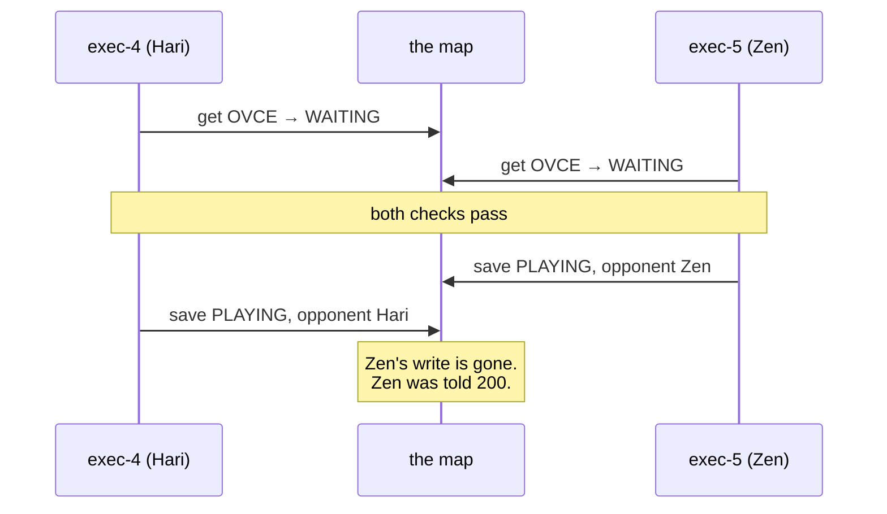
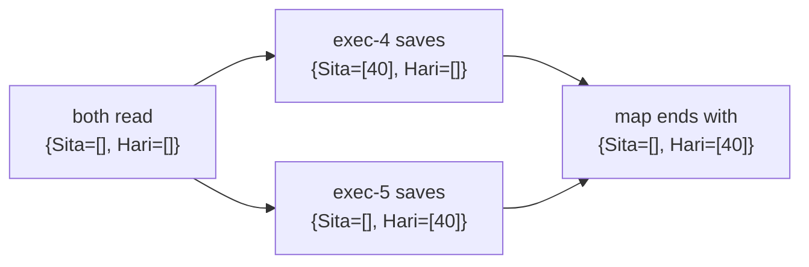

import Quiz from '../../../components/Quiz.astro';
import Think from '../../../components/Think.astro';
import { Aside } from '@astrojs/starlight/components';

<Aside type="tip" title="3 steps · ≈45 min · a scratch copy, then your Spring app">
**Step 1:** two threads add to one counter and lose updates. **Step 2:** Hari and Zen join the same duel at the same instant, and both get in. **Step 3:** Sita and Hari answer at the same instant, and Sita's answer disappears. Win: you can point at the exact line where a duel loses an update, and say why one curl at a time never shows it. Nothing gets fixed today: that's Lesson 20.
</Aside>

## Recall (from memory)

<Think id="maths-l19-recall-1" prompt="Lesson 14: how many DuelService objects and how many DuelRepository objects exist while the server runs, and how many threads can be inside them at once?" revealLabel="Check">
**One** of each: Spring makes each bean once at startup, on `[main]`, and hands the same object to everyone. Lesson 14 showed the same `DuelService@hex` on three threads. Tomcat's pool has up to 200 threads, so up to 200 requests can be inside the same service, and the same map, at once.
</Think>

<Think id="maths-l19-recall-2" prompt="Lesson 16: what are the three moves every transition in DuelService makes, in order?" revealLabel="Check">
**Read** the duel (`get(code)`), **check** that the move is allowed from its state (`status != WAITING` → 409), **write** the new duel (`repository.save(duel.copy(…))`). Today you'll see what happens in the gap between the check and the write.
</Think>

## The problem: a gap between check and write

Here is `join`, as you wrote it:

```kotlin
    fun join(code: String, playerName: String): Duel {
        val duel = get(code)                                  // read
        if (duel.status != DuelStatus.WAITING) {              // check
            throw DuelConflictException("DUEL_NOT_WAITING", "…")
        }
        val playing = duel.copy(status = DuelStatus.PLAYING, …)
        repository.save(playing)                              // write
        return playing
    }
```

With one request at a time, it's correct. But recall 1: two requests can run this function **at the same time**, on two threads, on the same duel. If both do their *read* before either does its *write*, both see WAITING, both pass the check, and both write:



That's a **race condition**: the result depends on the timing of threads you don't control. The second write doesn't fail, it doesn't log anything, and it doesn't throw. It just replaces the first. That's called a **lost update**.

## Brick · Even `count++` is three steps

You don't need a server to see this. A script, `counter.main.kts`: two threads, each adds 1 to the same variable a million times.

```kotlin
import kotlin.concurrent.thread

var count = 0

val a = thread { repeat(1_000_000) { count++ } }
val b = thread { repeat(1_000_000) { count++ } }
a.join()
b.join()

println("expected 2000000, got $count")
```

`thread { }` starts a new thread running the block (Lesson 10). `join()` waits for it to finish. Three runs:

```text
❯ kotlin counter.main.kts
expected 2000000, got 1052062
❯ kotlin counter.main.kts
expected 2000000, got 1221584
❯ kotlin counter.main.kts
expected 2000000, got 1686770
```

Wrong every time, and wrong by a different amount each time. `count++` looks like one step, but the CPU does three: **read** `count`, **add** 1, **write** it back. Thread A reads 5, thread B reads 5, both write 6: one increment is lost. Exactly `join`'s shape, a million times a second.

Your repository's map isn't safe either. `mutableMapOf()` is a `LinkedHashMap`, and the [Java docs](https://docs.oracle.com/en/java/javase/25/docs/api/java.base/java/util/LinkedHashMap.html) say it plainly: "**Note that this implementation is not synchronized.** If multiple threads access a linked hash map concurrently, and at least one of the threads modifies the map structurally, it must be synchronized externally." Two threads, each putting 100,000 **different** keys (`map.main.kts`):

```text
❯ kotlin map.main.kts
expected 200000 entries, got 195682
❯ kotlin map.main.kts
expected 200000 entries, got 199534
```

Different keys, nothing in common, and entries still vanish: two threads changing the map's insides at once corrupt them. For your server, two players **creating** duels at the same instant can lose one.

## Step 1 · Make the join race happen

In a real server the gap between read and write is a few microseconds, so two curls typed by hand never land inside it. To see it, make the gap **wider** on purpose. Do this in your app, but **don't commit it**. In `join`, between the check and the write:

```kotlin {4-5}
        if (duel.status != DuelStatus.WAITING) {
            throw DuelConflictException("DUEL_NOT_WAITING", "Duel $code is ${duel.status}, so nobody can join it")
        }
        println("[${Thread.currentThread().name}] $playerName: $code is WAITING, joining")
        Thread.sleep(200) // DEMO ONLY: widen the gap between check and write
        val playing = duel.copy(
```

`Thread.sleep(200)` makes this thread wait 200 ms: long enough that a second request arrives while the first is still between check and write. Then two joins **at the same instant**: a `&` at the end of a shell command runs it in the background, so both start together, and `wait` waits for both.

```bash
curl -s -X POST localhost:8080/duels/OVCE/join -H 'Content-Type: application/json' -d '{"playerName":"Hari"}' &
curl -s -X POST localhost:8080/duels/OVCE/join -H 'Content-Type: application/json' -d '{"playerName":"Zen"}' &
wait
```

<Think id="maths-l19-predict-join" prompt="Duel OVCE is WAITING. Hari and Zen send join at the same instant, with the 200 ms sleep in place. Predict: what status does each get, and what does GET /duels/OVCE show as opponentName afterwards?" />

What I got:

```text
Hari got: 200 {"code":"OVCE","playerName":"Sita","status":"PLAYING","opponentName":"Hari",…,"scores":{"Sita":0,"Hari":0},"secondsLeft":59}
Zen got:  200 {"code":"OVCE","playerName":"Sita","status":"PLAYING","opponentName":"Zen",…,"scores":{"Sita":0,"Zen":0},"secondsLeft":59}

❯ GET /duels/OVCE
{"code":"OVCE","playerName":"Sita","status":"PLAYING","opponentName":"Hari",…,"scores":{"Sita":0,"Hari":0},"secondsLeft":59}
```

**Both** got 200. Both phones now show "you're playing Sita". The duel only knows Hari. Zen will answer, get 403 `NOT_IN_DUEL`, and never understand why. The server log tells the story, thread by thread:

```text
[http-nio-8080-exec-4] Hari: OVCE is WAITING, joining
[http-nio-8080-exec-5] Zen: OVCE is WAITING, joining
[http-nio-8080-exec-5] saved OVCE, now holding 1: [OVCE]
[http-nio-8080-exec-4] saved OVCE, now holding 1: [OVCE]
```

Two threads both saw WAITING. Zen's thread (`exec-5`) saved first, and Hari's thread (`exec-4`) saved over it. Last write wins.

### Without the sleep, does it really happen?

The sleep made it certain. Without it, the gap is tiny. So I removed the sleep and the log lines, and sent 1,000 pairs of joins, each pair released at the same instant by a small Python script with two threads. Counting duels where **both** joins got 200, two runs:

```text
1000 duels, two joins each at the same instant: both got 200 in 88
1000 duels, two joins each at the same instant: both got 200 in 18
```

Rare, and different every run, but not zero. That's what makes races nasty. They don't show up when you test by hand, and they show up in production, at the busiest moment, with no error in any log.

## Step 2 · Make an answer disappear

Two people joining one duel is unusual. Two players **answering** at the same instant is normal: they're racing through the same questions. `answer` has the same shape. It reads the duel, then writes a copy with **one** player's new answer:

```kotlin
        var updated = duel.copy(answers = duel.answers + (playerName to given + answer))
```

That copy carries the **other** player's answers *as they were when this thread read the duel*. Put the same demo sleep just above that line:

```kotlin
        println("[${Thread.currentThread().name}] $playerName: read answers ${duel.answers}")
        Thread.sleep(200) // DEMO ONLY: widen the gap between check and write
```

Then Sita and Hari both answer question 0, correctly, at the same instant:

<Think id="maths-l19-predict-answer" prompt="Sita and Hari both answer question 0 of OVCE correctly, at the same instant. What does each response say about their score, and what does GET /duels/OVCE show in scores afterwards?" />

```text
Sita got: 200 {"code":"OVCE","questionIndex":0,"answer":40,"correct":true,"score":1,"status":"PLAYING","winner":null}
Hari got: 200 {"code":"OVCE","questionIndex":0,"answer":40,"correct":true,"score":1,"status":"PLAYING","winner":null}

❯ GET /duels/OVCE
{"code":"OVCE",…,"scores":{"Sita":0,"Hari":1},"secondsLeft":59}
```

```text
[http-nio-8080-exec-4] Sita: read answers {Sita=[], Hari=[]}
[http-nio-8080-exec-5] Hari: read answers {Sita=[], Hari=[]}
[http-nio-8080-exec-4] saved OVCE, now holding 1: [OVCE]
[http-nio-8080-exec-5] saved OVCE, now holding 1: [OVCE]
```

Sita was told "correct, score 1". Then Hari's thread saved **its** copy: `{Sita=[], Hari=[40]}`, built from what it read *before* Sita's write. Sita's answer is gone. She is now on question 0 again, and if she answers question 1 she gets `409 WRONG_QUESTION`. Her phone and the server disagree, and the server is the source of truth.



**Now remove both sleeps and both demo printlns.** Nothing from this lesson gets committed. Your server has the same bug with or without them: the sleep only made it visible.

## Where else is the same shape?

Every read → check → write on shared state is a candidate:

| Code | Read | Check | Write | What can go wrong |
|---|---|---|---|---|
| `join` | `get(code)` | `status == WAITING` | `save(playing)` | two players both join |
| `answer` | `get(code)` | right question, still PLAYING | `save(updated)` | one player's answer is lost |
| `get` (Lesson 18) | `find(code)` | time is up | `save(finished)` | two threads finish it; harmless today, both write the same |
| `newCode` | `find(code)` | `== null` | (`create` saves later) | your exercise |
| `save` itself | the map's insides | (none) | `duels[code] = …` | the map loses entries |

<Aside type="note" title="The thing to remember">
Spring gives every request the **same** `DuelService` and `DuelRepository`, and Tomcat runs requests on many threads at once. So every **read → check → write** on a duel is a race: two threads can both read the old state, both pass the check, and the second write silently replaces the first, a **lost update**. Even `count++` and `mutableMapOf()` aren't safe across threads. Races are rare and timing-dependent, so testing one request at a time never finds them. You find them by reading the code for "what if two threads are between these lines at once?"
</Aside>

## Check yourself

<Quiz
  question="Why did testing with one curl at a time never show this bug?"
  options={[
    'Spring locks every service by default',
    'Curl waits for Tomcat to finish',
    'Requests never overlap inside the gap',
  ]}
  answer={2}
>
One request at a time means one thread is ever inside `join`. The race needs two threads between the read and the write at once. Spring adds no locks: the same object is shared by every thread.
</Quiz>

<Quiz
  question="Two threads run count++ once each, starting from 5. What can count end as?"
  options={[
    'Either 6 or 7, depending',
    'Only 7, every single time',
    'Only 6, every single time',
  ]}
  answer={0}
>
If one thread finishes before the other reads, 7. If both read 5 before either writes, both write 6. Which one you get depends on timing, which is the definition of a race.
</Quiz>

<Quiz
  question="Hari and Zen both got 200 from join. Who is in the duel?"
  options={[
    'Both of them, as opponents',
    'The thread that saved last',
    'Whoever sent the request first',
  ]}
  answer={1}
>
`save` replaces whatever is under the code, so the last write wins. Who *sent* first doesn't matter; in the run above, Hari's thread saved last, so Hari is in and Zen isn't.
</Quiz>

## Your turn

<Think id="maths-l19-newcode" prompt="Find the race in create and newCode(). Which two requests have to arrive at the same instant, what has to be true about them, and what does each player end up with? (No code change: describe it.)" revealLabel="Check">
`newCode()` **reads** (`repository.find(code)`), **checks** (`== null`), and `create` **writes** later (`repository.save(duel)`). If two players create a duel at the same instant **and** both threads happen to pick the same four letters, both see "free", both save, and the second duel replaces the first. Both players are told 201 with the same code; the first player's duel no longer exists, and anyone joining that code joins the second player's duel.

It needs the same code out of 26⁴ = 456,976 at the same instant, so it's far rarer than the join race. But there's a second race on the same path that doesn't need a matching code at all: two `save` calls changing the map at once, which `map.main.kts` showed losing entries. Lesson 20 fixes both with one tool.
</Think>

<Think id="maths-l19-teachback" prompt="Explain to another Android developer, in 3–4 sentences: what a race condition is, why your DuelService is exposed to one, and why it never showed up when you tested with curl." revealLabel="Compare with a model answer">
A race condition is a bug where the result depends on how threads happen to interleave. Spring creates one `DuelService` and one map, and Tomcat runs many requests on different threads at the same time, so two requests can both read a duel, both pass the same check, and the second write silently replaces the first: a lost update, like two players both joining, or one player's answer vanishing. Testing with one curl at a time never puts two threads in that gap, which is microseconds wide, so it looks correct. On Android it's the same as two coroutines on `Dispatchers.Default` both doing `list = list + item` on a shared variable.
</Think>

## Read alongside
- 📖 **Primary:** [Java tutorial: Thread Interference](https://docs.oracle.com/javase/tutorial/essential/concurrency/interfere.html), one page: the `c++` example, step by step (10 min). Then [Memory Consistency Errors](https://docs.oracle.com/javase/tutorial/essential/concurrency/memconsist.html), the next page.
- [Java docs: `LinkedHashMap`](https://docs.oracle.com/en/java/javase/25/docs/api/java.base/java/util/LinkedHashMap.html), the bold "not synchronized" paragraph.

🙋 Ask me: "why doesn't Kotlin's `val` make it safe?", "does this happen with coroutines too?", "how do real databases avoid lost updates?", "could the phone retry to fix it?"

**Next:** Lesson 20: locks. One thread at a time inside a duel, so read → check → write happens as one step, and a map built for many threads.
