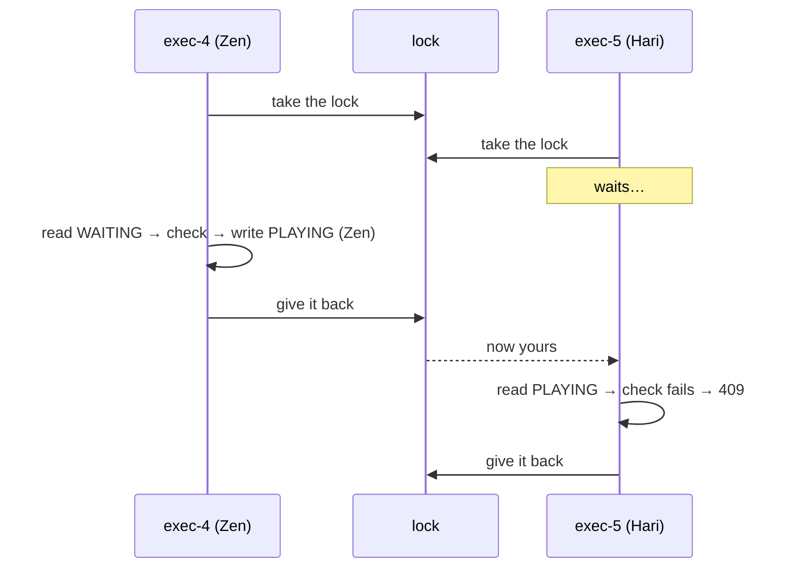

import Quiz from '../../../components/Quiz.astro';
import Think from '../../../components/Think.astro';
import { Aside } from '@astrojs/starlight/components';

<Aside type="tip" title="3 steps · ≈50 min · in your Spring app">
**Step 1:** one lock for the whole service, and what it costs. **Step 2:** a lock per duel: `ConcurrentHashMap` and `update(code) { … }`. **Step 3:** claim a code with `putIfAbsent`. Win: Lesson 19's three races, rerun against your fixed server: Zen gets 409, Sita's answer survives, and 1,000 pairs of joins give **zero** double joins.
</Aside>

## Recall (from memory)

<Think id="maths-l20-recall-1" prompt="Lesson 19: Hari and Zen join the same WAITING duel at the same instant. Walk through what the two threads do, step by step, and why both get 200." revealLabel="Check">
Both threads **read** the duel and see WAITING. Both **checks** pass. Both **write** a PLAYING copy, one with Hari, one with Zen. `save` replaces whatever is there, so the second write silently erases the first, and both threads return 200. The bug lives in the gap between the read and the write.
</Think>

<Think id="maths-l20-recall-2" prompt="Lesson 18: when the server notices that a duel's 60 seconds are up, what runs, and on which thread?" revealLabel="Check">
Nothing runs at second 60. The next request for that duel runs `get()` on its own Tomcat thread, sees PLAYING and time up, and finishes it. Today `get()` moves inside the lock too.
</Think>

## The fix, in one sentence

Lesson 19's races all had the same shape: two threads between the read and the write at the same time. So: **make sure only one thread at a time can be between them**. That's a **lock**. A thread takes the lock before it reads, gives it back after it writes, and any other thread that wants the lock **waits**.



## Brick · `synchronized`

Lesson 19's counter, with a lock. `synchronized(lock) { … }` runs the block only while holding `lock`. Any object can be a lock; `Any()` is the plainest object Kotlin has.

```kotlin
import kotlin.concurrent.thread
import kotlin.system.measureTimeMillis

var count = 0
val lock = Any()

val ms = measureTimeMillis {
    val a = thread { repeat(1_000_000) { synchronized(lock) { count++ } } }
    val b = thread { repeat(1_000_000) { synchronized(lock) { count++ } } }
    a.join()
    b.join()
}
println("expected 2000000, got $count ($ms ms)")
```

```text
❯ kotlin counter.main.kts
expected 2000000, got 2000000 (117 ms)
❯ kotlin counter.main.kts
expected 2000000, got 2000000 (122 ms)
❯ kotlin counter.main.kts
expected 2000000, got 2000000 (82 ms)
❯ kotlin nolock.main.kts
expected 2000000, got 1385257 (5 ms)
```

Correct every time. But look at the time: **5 ms** without the lock (and wrong), **82–122 ms** with it. While one thread holds the lock, the other just waits, and taking and returning a lock two million times isn't free. A lock buys correctness with waiting. So the question is always: **what does the lock cover?**

## Step 1 · One lock for the whole service

The quickest fix: `@Synchronized` on every public function of `DuelService`. It's Kotlin's annotation for "the whole function is `synchronized` on this object", and there's only one `DuelService`.

```kotlin
    @Synchronized
    fun join(code: String, playerName: String): Duel {
```

(and the same on `create`, `answer` and `get`). Every service function now runs one thread at a time. That fixes the map too, because only the service touches it.

I put Lesson 19's demo sleep back into `join` and ran two races: Hari and Zen on the **same** duel, then Ravi and Kiran joining two **different** duels, at the same instant. `curl -w '%{time_total}'` prints how long each request took:

```text
## Hari and Zen join LCTE at the same instant
Zen → 200 after 0.211699s
Hari → 409 after 0.225517s
GET: opponent Zen
## Ravi joins RDHO, Kiran joins PYFO, at the same instant
Kiran → 200 after 0.205945s
Ravi → 200 after 0.412270s
```

The race is fixed: Zen got in, Hari got 409, and the duel agrees with both responses. But Ravi waited **0.41 s**: 0.2 s for Kiran's join on a **different duel** to finish, then 0.2 s for his own. RDHO and PYFO have nothing in common. With one lock for everything, every request in the whole server queues behind every other: 200 Tomcat threads, and only one doing game work at a time.

The sleep exaggerates it, but the shape is real. The lock should cover **one duel**, not the whole game. Remove the `@Synchronized` lines.

## Step 2 · A lock per duel

Java has a map built for many threads: [`ConcurrentHashMap`](https://docs.oracle.com/en/java/javase/25/docs/api/java.base/java/util/concurrent/ConcurrentHashMap.html). Lesson 19's `map.main.kts`, with only the map changed:

```kotlin
val duels = ConcurrentHashMap<String, Int>()
```

```text
❯ kotlin map.main.kts
expected 200000 entries, got 200000
❯ kotlin map.main.kts
expected 200000 entries, got 200000
❯ kotlin map.main.kts
expected 200000 entries, got 200000
```

Its real gift is **`compute`**. `duels.compute(code) { _, current -> … }` gives your function the current duel, and stores whatever it returns, and the docs promise: "**The entire method invocation is performed atomically.**" While one thread is inside `compute` for `"OVCE"`, another thread's `compute` for `"OVCE"` waits. Threads working on other duels mostly don't. That's read → check → write as **one step**.

### `DuelRepository`

```kotlin {4,14-15,23-28}
package dev.hari.maths

import org.springframework.stereotype.Repository
import java.util.concurrent.ConcurrentHashMap

// Where duels live: in this process's memory, gone when it stops
@Repository
class DuelRepository {

    init {
        println("[${Thread.currentThread().name}] DuelRepository created: $this")
    }

    // A map that many threads can use at once
    private val duels = ConcurrentHashMap<String, Duel>()

    // (insert comes in Step 3)

    fun find(code: String): Duel? {
        return duels[code]
    }

    // Read → check → write as one step: no other thread can change this duel meanwhile
    fun update(code: String, change: (Duel) -> Duel): Duel {
        return duels.compute(code) { _, current ->
            change(current ?: throw DuelNotFoundException(code))
        }!!
    }
}
```

- `change: (Duel) -> Duel` is a function as a parameter: the service passes the rule, the repository runs it inside the lock. You've written these as lambdas all along (`map { … }`, `count { … }`).
- If `change` **throws**, nothing is written. The [`Map.compute` docs](https://docs.oracle.com/en/java/javase/25/docs/api/java.base/java/util/Map.html#compute(K,java.util.function.BiFunction)): "If the remapping function itself throws an (unchecked) exception, the exception is rethrown, and the current mapping is left unchanged." So the 404 and every 409 work exactly as before.
- `!!`: `compute` returns `Duel?` (a function may return `null` to remove an entry). Ours never does.
- `save` is gone. Every write now goes through `update` (or `insert`, next step), so there's no way left to write without the lock.

### `DuelService`

`join` becomes: "update this duel with this rule":

```kotlin
    fun join(code: String, playerName: String): Duel {
        return repository.update(code) { duel ->
            if (duel.status != DuelStatus.WAITING) {
                throw DuelConflictException("DUEL_NOT_WAITING", "Duel $code is ${duel.status}, so nobody can join it")
            }
            duel.copy(
                status = DuelStatus.PLAYING,
                opponentName = playerName,
                answers = duel.answers + (playerName to emptyList()),
                startedAt = Instant.now(),
            )
        }
    }
```

The same check and the same copy, but now they run **inside** the lock, with the duel as it is right now.

`get` and `answer` both need Lesson 18's "time is up" check inside the lock too, so it becomes a small function:

```kotlin
    private fun finishIfTimeUp(duel: Duel): Duel {
        if (duel.status == DuelStatus.PLAYING && duel.isTimeUp(Instant.now())) {
            println("[${Thread.currentThread().name}] time is up for ${duel.code}")
            return finish(duel)
        }
        return duel
    }

    fun get(code: String): Duel {
        return repository.update(code) { duel -> finishIfTimeUp(duel) }
    }
```

`answer` returns two things: the duel, and whether the answer was right. The lambda can only return the duel, so `correct` is a `var` outside it, which the lambda sets:

```kotlin
    fun answer(code: String, playerName: String, questionIndex: Int, answer: Int): AnswerOutcome {
        var correct = false
        val updated = repository.update(code) { current ->
            val duel = finishIfTimeUp(current)
            if (duel.status != DuelStatus.PLAYING) {
                throw DuelConflictException("DUEL_NOT_PLAYING", "Duel $code is ${duel.status}, so it takes no answers")
            }

            val given = duel.answers[playerName] ?: throw NotInDuelException(code, playerName)
            if (given.size == QUESTION_PER_DUEL) {
                throw DuelConflictException("NO_QUESTIONS_LEFT", "$playerName has answered all $QUESTION_PER_DUEL questions")
            }

            if (questionIndex != given.size) {
                throw DuelConflictException("WRONG_QUESTION", "$playerName is on question ${given.size}, not $questionIndex")
            }

            correct = answer == duel.questions[questionIndex].answer
            val next = duel.copy(answers = duel.answers + (playerName to given + answer))
            if (next.answers.values.all { it.size == QUESTION_PER_DUEL }) finish(next) else next
        }
        return AnswerOutcome(correct = correct, duel = updated)
    }
```

Same checks, same order as before. The last line of a lambda is what it returns, so the `if … else` gives back either the finished duel or `next`.

<Aside type="caution" title="Two rules for what goes inside update">
The docs: "Some attempted update operations on this map by other threads may be blocked while computation is in progress, so the computation should be **short and simple**." And: "The remapping function **must not modify this map** during computation."

1. **Short:** no network calls, no file reads, no `Thread.sleep` (except today's demo). Other threads are waiting. Not even all of them are for the same duel: the map locks a small group of keys, not exactly one.
2. **Pure:** no calls to `repository` from inside the lambda. Compute a new `Duel` from the old one and return it. `finishIfTimeUp`, `finish` and `copy` only build objects, so they're fine.
</Aside>

**Commit:** `fix: one thread at a time inside each duel`

## Step 3 · Claim a code in one step

Your Lesson 19 exercise: `newCode()` **reads** the map (is the code free?), and `create` **writes** later. Two creates can both see "free". `ConcurrentHashMap.putIfAbsent(code, duel)` does both in one step: it stores the duel **only if** no duel has that code, and returns `null` when it did. In `DuelRepository`:

```kotlin
    // Adds a new duel only if no duel has its code yet: check and write in one step
    fun insert(duel: Duel): Boolean {
        val added = duels.putIfAbsent(duel.code, duel) == null
        println("[${Thread.currentThread().name}] insert ${duel.code}: ${if (added) "added" else "code taken"}, now holding ${duels.size}")
        return added
    }
```

`create` keeps trying codes until `insert` succeeds. The loop moves from `newCode()` into `create`, and `newCode()` becomes `randomCode()`, which only makes letters:

```kotlin
    fun create(playerName: String): Duel {
        while (true) {
            val duel = Duel(
                code = randomCode(),
                playerName = playerName,
                seed = Random.nextLong(),
            )
            if (repository.insert(duel)) {
                println("[${Thread.currentThread().name}] duel ${duel.code} uses seed ${duel.seed}")
                return duel
            }
        }
    }

    // Four random letters
    private fun randomCode(): String {
        return (1..4).map {
            ('A'..'Z').random()
        }.joinToString("")
    }
```

There's no separate "is it free?" read any more. The question and the claim are one call, so no other thread can slip in between them.

**Commit:** `fix: claim a duel code in one step`

## Lesson 19's races, rerun

With the demo sleeps put back **inside** the `update` lambdas (between the check and the copy), the same scripts as Lesson 19:

<Think id="maths-l20-predict" prompt="Predict, with the 200 ms demo sleep inside update: (1) Hari and Zen join the same duel at the same instant: status codes, and how long the loser waits (2) Ravi and Kiran join two different duels at the same instant: how long each takes (3) Sita and Hari both answer question 0 correctly at the same instant: the scores afterwards." />

```text
## Hari and Zen join LYWY at the same instant
Zen → 200 after 0.207714s
Hari → 409 after 0.219989s
GET: opponent Zen
## Ravi joins CEYM, Kiran joins FNBA, at the same instant
Kiran → 200 after 0.205735s
Ravi → 200 after 0.206662s
## Sita and Hari answer question 0 of AQIO (44) at the same instant
Hari got: {…,"answer":44,"correct":true,…,"score":1} [200] after 0.227386s
Sita got: {…,"answer":44,"correct":true,…,"score":1} [200] after 0.418328s
GET: {…,"scores":{"Sita":1,"Hari":1},"secondsLeft":59}
```

```text
[http-nio-8080-exec-6] Hari: read answers {Sita=[], Hari=[]}
[http-nio-8080-exec-5] Sita: read answers {Sita=[], Hari=[44]}
```

1. Hari waited for Zen's join to finish, then saw PLAYING: 409, the right answer.
2. Two different duels: **0.206 s each**, side by side. With Step 1's global lock, Ravi took 0.41 s.
3. Sita waited 0.2 s for Hari's answer, and then **read Hari's answer** (`Hari=[44]`) before adding hers. Both scores survive. Compare Lesson 19, where both threads read `{Sita=[], Hari=[]}`.

And the honest test, with **no** sleeps: Lesson 19's 1,000 pairs of simultaneous joins.

```text
1000 duels, two joins each at the same instant: both got 200 in 0
1000 duels, two joins each at the same instant: both got 200 in 0
```

88 and 18 in Lesson 19. Zero now. Then a few of the usual wrong moves, to check nothing else changed: 404 for `NOPE`, 409 answering a WAITING duel, 403 for Zen, 409 `WRONG_QUESTION`. All as before.

**Remove the demo sleeps and printlns** before you commit.

<Aside type="note" title="The thing to remember">
A **lock** lets one thread at a time through a piece of code; the others wait. Correctness costs waiting, so lock as **little** as possible: one lock for the whole service fixes the race but makes every duel wait for every other. A lock **per duel** is the right size. `ConcurrentHashMap` is a map many threads can share, and `compute(code) { … }` runs read → check → write for one key as a single atomic step: your `repository.update`. `putIfAbsent` is the same idea for "claim this key if it's free". Keep what runs inside short and pure.
</Aside>

## Check yourself

<Quiz
  question="Why not keep @Synchronized on the whole DuelService?"
  options={[
    'It does not stop the race',
    'Spring rejects synchronized beans at startup',
    'Unrelated duels wait for each other',
  ]}
  answer={2}
>
It fixes the race: Zen got 409. But every request in the server queues behind every other, so Ravi's join on RDHO waited for Kiran's on PYFO. A lock per duel fixes the same race without that cost.
</Quiz>

<Quiz
  question="The lambda passed to update throws DuelConflictException. What gets stored?"
  options={[
    'Nothing changes, the old duel stays',
    'The duel is removed from map',
    'A half-finished copy of the duel',
  ]}
  answer={0}
>
`compute` rethrows the exception and leaves the mapping unchanged. That's why every 409 still leaves the duel exactly as it was.
</Quiz>

<Quiz
  question="Why does putIfAbsent fix the newCode race?"
  options={[
    'It makes random codes never ever repeat',
    'Checking and claiming happen as one step',
    'It locks the whole map while generating',
  ]}
  answer={1}
>
Codes can still repeat. But "is it free?" and "it's mine" are one call now, so if two threads pick the same code, exactly one gets `true` and the other tries another code.
</Quiz>

## Your turn

<Think id="maths-l20-retry" prompt="Sita's phone has a slow connection and sends her answer to question 0 twice, at the same instant. What did Lesson 19's server do with the two requests, and what does today's server do? Which response would you rather her phone get?" revealLabel="Check">
I ran it against both (with the demo sleep in place):

```text
## before (Lesson 19): Sita sends the same answer to HGIN twice at the same instant
200 {"code":"HGIN","questionIndex":0,"answer":14,"correct":true,"score":1,…}
200 {"code":"HGIN","questionIndex":0,"answer":14,"correct":true,"score":1,…}
GET: "scores":{"Sita":1,"Hari":0}

## after (today): Sita sends the same answer to KXTW twice at the same instant
200 {"code":"KXTW","answer":14,"correct":true,…,"score":1}
409 {"error":"WRONG_QUESTION","message":"Sita is on question 1, not 0"}
GET: "scores":{"Sita":1,"Hari":0}
```

Before: both threads read `Sita=[]`, both wrote `Sita=[14]`, and one write replaced the other. The score came out right **by luck**, because both writes held the same data. After: the second request ran with the duel as the first left it, so it got 409. The score is right **by design**.

But look at it from the phone. Its answer **was** recorded, yet one of its two requests says 409. If that's the response the phone sees (the first one timed out), it would show an error for an answer that counted. That's Lesson 21: a timeout is not a failure, and a retry should get the same answer as the original.
</Think>

<Think id="maths-l20-teachback" prompt="Explain to another Android developer, in 3–4 sentences: how update(code) { … } fixes the lost update, why it beats @Synchronized on the whole service, and what must not go inside the lambda. Compare it to MutableStateFlow.update { }." revealLabel="Compare with a model answer">
`ConcurrentHashMap.compute` runs the read → check → write for one duel as a single atomic step, so a second thread working on the same duel waits and then sees the first thread's result, instead of overwriting it. `@Synchronized` on the whole service also fixes it, but then every request in the server waits for every other, even on unrelated duels. The lock should be as small as the data it protects: one duel. The lambda must be short (others are waiting) and must not touch the repository. It's the same idea as `_state.update { it.copy(…) }` instead of `_state.value = _state.value.copy(…)` on a `MutableStateFlow`: the second form is read-then-write and can lose updates, the first is atomic.
</Think>

## Read alongside
- 📖 **Primary:** [Java tutorial: Synchronized Methods](https://docs.oracle.com/javase/tutorial/essential/concurrency/syncmeth.html) and [Intrinsic Locks](https://docs.oracle.com/javase/tutorial/essential/concurrency/locksync.html), two short pages, the next ones after Lesson 19's reading (15 min).
- [Java docs: `ConcurrentHashMap.compute`](https://docs.oracle.com/en/java/javase/25/docs/api/java.base/java/util/concurrent/ConcurrentHashMap.html#compute(K,java.util.function.BiFunction)) and `putIfAbsent`: the guarantees quoted above.
- [kotlinx.coroutines: `MutableStateFlow.update`](https://kotlinlang.org/api/kotlinx.coroutines/kotlinx-coroutines-core/kotlinx.coroutines.flow/update.html), the same pattern on Android.

🙋 Ask me: "what's a deadlock, and can `update` cause one?", "why not `@Synchronized` on the repository instead?", "how does `MutableStateFlow.update` do it without a lock?", "does a database do this for me?"

**Next:** [Lesson 21: retries and idempotency](../0021-retries/). Sita's answer counted, and her phone was told 409. When a request times out, did it happen or not? The phone can't know, so the server has to make "send it again" safe.
