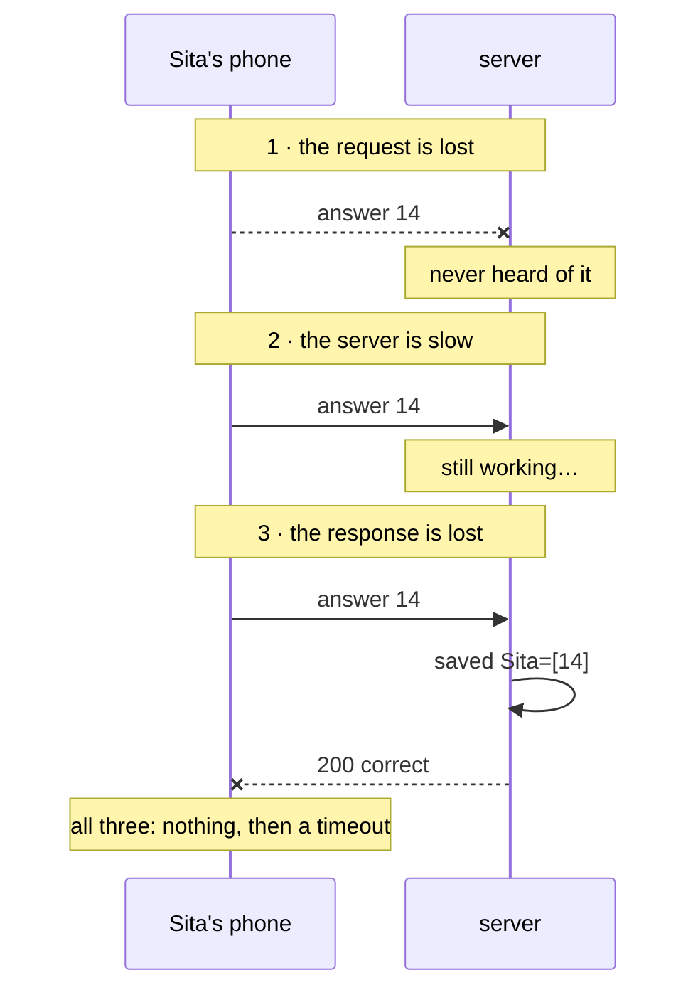
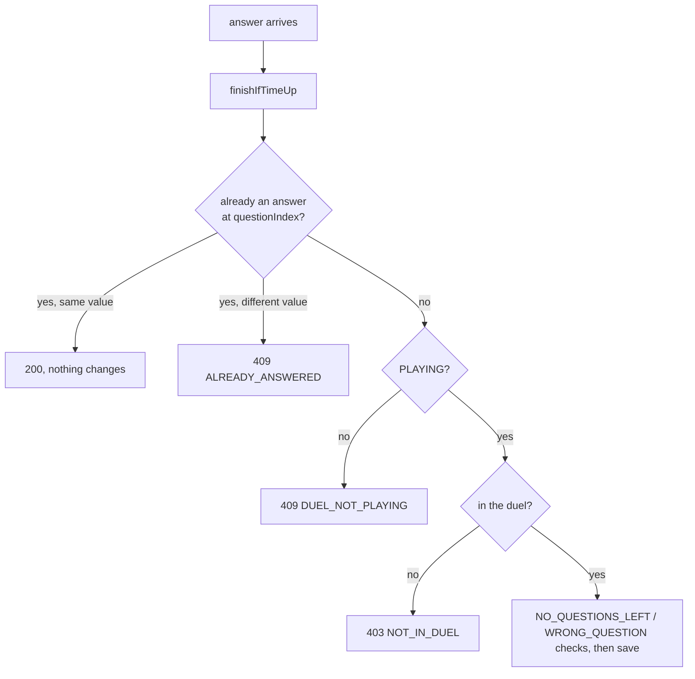
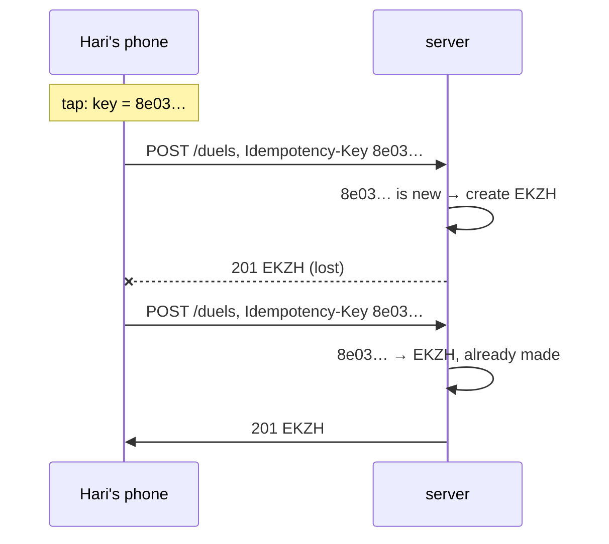

import Quiz from '../../../components/Quiz.astro';
import Think from '../../../components/Think.astro';
import { Aside } from '@astrojs/starlight/components';

<Aside type="tip" title="3 steps · ≈50 min · in your Spring app">
**Step 1:** lose a response on purpose and see what the phone knows. **Step 2:** a repeated answer gets the same result again. **Step 3:** a repeated create returns the same duel, using an `Idempotency-Key` header. Win: Sita's last answer wins her the duel 5–0, the response is lost, and her phone's retry gets **200 and the win** instead of 409.
</Aside>

## Recall (from memory)

<Think id="maths-l21-recall-1" prompt="Lesson 20: the lambda you pass to repository.update throws a DuelConflictException. What is stored for that duel afterwards?" revealLabel="Check">
Nothing changes. `compute` rethrows the exception and leaves the old duel where it was. Today you'll see the other way out of the lambda: returning the duel **unchanged**, on purpose, so the request gets a 200 and the duel stays as it was.
</Think>

<Think id="maths-l21-recall-2" prompt="Lesson 20's exercise: Sita's phone sends the same answer to question 0 twice, at the same instant. What does your server answer each copy, and is her score right?" revealLabel="Check">
The first copy gets 200. The second waits for the lock, then sees that Sita is on question 1: **409 `WRONG_QUESTION`**. Her score is right (1). But if the 409 is the only response her phone sees, it shows an error for an answer that counted.
</Think>

## What a timeout tells you

A request is two trips: the request goes to the server, and the response comes back. Either trip can be slow or lost. The phone can't wait forever, so it gives up after a while. That's a **timeout**.

The one Android example today: OkHttp, which Retrofit uses underneath. Its [`readTimeout`](https://github.com/square/okhttp/blob/master/okhttp/src/commonJvmAndroid/kotlin/okhttp3/OkHttpClient.kt) docs say "The default value is 10 seconds." If no response bytes arrive for 10 seconds, your `suspend fun` throws `SocketTimeoutException`. You've probably shown "Something went wrong, try again" for it.

But think about **where** the time went. The phone sees the same thing in all three of these:



In case 1 the answer didn't happen. In case 2 it may happen any moment now. In case 3 it **already happened**. A timeout is not a failure. It means "**I don't know**".

## Step 1 · Lose a response on purpose

To lose a response for real, make it slow and give curl less patience. In `answer`, **after** `repository.update` returns (outside the lock, so nobody else waits), add a demo sleep:

```kotlin
        Thread.sleep(3000) // demo only: the answer is saved, the response is slow
        return AnswerOutcome(correct = correct, duel = updated)
```

Create a duel as Hari, join it as Sita, read question 0, then answer it with `--max-time 1`: curl gives up after one second. (`-sS` keeps curl quiet but still prints its errors.)

```text
❯ curl -sS --max-time 1 -H "Content-Type: application/json" \
    -d '{"playerName":"Sita","questionIndex":0,"answer":14}' localhost:8080/duels/JUYE/answers
curl: (28) Operation timed out after 1005 milliseconds with 0 bytes received
```

"0 bytes received": as far as curl knows, nothing happened. Compare a server that isn't running at all:

```text
❯ curl -sS --max-time 1 -H "Content-Type: application/json" -d '{}' localhost:8099/duels/JUYE/answers
curl: (7) Failed to connect to localhost port 8099 after 0 ms: Couldn't connect to server
```

That one is different. The connection never opened, so the request never reached any server (OkHttp throws `ConnectException`). Retrying it is always safe. The timeout is the hard one.

<Think id="maths-l21-predict" prompt="Before you look: (1) after curl timed out, was Sita's answer counted? (2) Her phone sends the exact same request again. What does today's server answer?" />

```text
❯ curl -s localhost:8080/duels/JUYE
{"code":"JUYE",…,"status":"PLAYING",…,"scores":{"Hari":0,"Sita":1},"secondsLeft":58}

❯ curl -sS -H "Content-Type: application/json" \
    -d '{"playerName":"Sita","questionIndex":0,"answer":14}' localhost:8080/duels/JUYE/answers
{"error":"WRONG_QUESTION","message":"Sita is on question 1, not 0"}
```

Her answer counted: score 1. The server's log has no error either. The server wrote its response into a connection nobody was reading, and as far as it knows everything went fine. Then the retry, the obvious thing for a phone to do, gets **409**.

It gets worse on the last question. I let Hari answer all five, then Sita answered her first four, and her last answer's response was lost:

```text
## ELAX: Hari has answered all 5, Sita answers her last question, the response is lost
curl: (28) Operation timed out after 1002 milliseconds with 0 bytes received
## GET
{"code":"ELAX",…,"status":"FINISHED",…,"winner":"Sita","scores":{"Hari":0,"Sita":5},"secondsLeft":null}
## Sita's phone retries
{"error":"DUEL_NOT_PLAYING","message":"Duel ELAX is FINISHED, so it takes no answers"} [409]
```

Sita won 5–0. Her phone says "Duel ELAX is FINISHED, so it takes no answers."

## Brick · Idempotent

The phone can't know which case it was in, so the only thing it can do is **send it again**. That's only safe if sending it twice does the same thing as sending it once. That property has a name. [RFC 9110 §9.2.2](https://www.rfc-editor.org/rfc/rfc9110#section-9.2.2):

> A request method is considered "idempotent" if the intended effect on the server of multiple identical requests with that method is the same as the effect for a single such request.

And why it matters:

> Idempotent methods are distinguished because the request can be repeated automatically if a communication failure occurs before the client is able to read the server's response. […] It knows that repeating the request will have the same intended effect, even if the original request succeeded, though the response might differ.

`GET`, `PUT` and `DELETE` are idempotent by definition. **`POST` is not**, and all three of your write endpoints are `POST`. The RFC's rule for clients: "A client SHOULD NOT automatically retry a request with a non-idempotent method **unless it has some means to know that the request semantics are actually idempotent**." So you make them idempotent by design, and the phone is told it may retry.

Notice "the **intended effect**" and "the response **might differ**". Idempotent doesn't mean the second response is identical. It means the second request doesn't do anything **more**.

## Step 2 · An answer, sent twice

What does the duel already know? Sita's answers are a list, and the position in the list is the question. If `answers["Sita"]` already has something at `questionIndex`, this request is a repeat. There are two kinds:

- **Same value**: a retry. Do nothing, and answer as if it were the first time: 200, with `correct` worked out from the saved answer.
- **Different value**: not a retry. Sita is trying to change her answer. The first one stands: 409 `ALREADY_ANSWERED`.

Remove the Step 1 sleep, then in `DuelService.answer`:

```kotlin {6-14}
    fun answer(code: String, playerName: String, questionIndex: Int, answer: Int): AnswerOutcome {
        var correct = false
        val updated = repository.update(code) { current ->
            val duel = finishIfTimeUp(current)

            // A retry of an answer that was already saved: same result again, nothing changes
            val earlier = duel.answers[playerName]?.getOrNull(questionIndex)
            if (earlier != null) {
                if (earlier != answer) {
                    throw DuelConflictException("ALREADY_ANSWERED", "$playerName already answered question $questionIndex with $earlier")
                }
                correct = earlier == duel.questions[questionIndex].answer
                return@update duel
            }

            if (duel.status != DuelStatus.PLAYING) {
                throw DuelConflictException("DUEL_NOT_PLAYING", "Duel $code is ${duel.status}, so it takes no answers")
            }

            val given = duel.answers[playerName] ?: throw NotInDuelException(code, playerName)
            if (given.size == QUESTION_PER_DUEL) {
                throw DuelConflictException("NO_QUESTIONS_LEFT", "$playerName has answered all $QUESTION_PER_DUEL questions")
            }

            if (questionIndex != given.size) {
                throw DuelConflictException("WRONG_QUESTION", "$playerName is on question ${given.size}, not $questionIndex")
            }

            correct = answer == duel.questions[questionIndex].answer
            val next = duel.copy(answers = duel.answers + (playerName to given + answer))
            if (next.answers.values.all { it.size == QUESTION_PER_DUEL }) finish(next) else next
        }
        return AnswerOutcome(correct = correct, duel = updated)
    }
```

- `getOrNull(questionIndex)` gives the saved answer, or `null` when there's none yet (and for a stranger, whose `answers[playerName]` is `null`, or a question index of 7 or −1). Those all carry on to the old checks.
- `return@update duel` returns from the **lambda**, not from `answer`. The label is the name of the function the lambda was passed to. A plain `return` here wouldn't compile, because the lambda isn't inline. The duel goes back to `compute` unchanged.
- **Why before the `PLAYING` check?** Look at ELAX. Sita's last answer finished the duel. Her retry arrives at a FINISHED duel, and it should still get her result, not `DUEL_NOT_PLAYING`. The repeat check has to come first.



**Commit:** `feat: a repeated answer gets the same result`

### Rerun, with the demo sleep put back

```text
## ZSXE: Sita answers question 0 (54), the response is lost
curl: (28) Operation timed out after 1006 milliseconds with 0 bytes received
## the phone retries
{"code":"ZSXE","answer":54,"correct":true,"status":"PLAYING","winner":null,"questionIndex":0,"score":1} [200]
## the same question with a different answer
{"error":"ALREADY_ANSWERED","message":"Sita already answered question 0 with 54"} [409]
## a wrong answer to question 1, sent twice
{"code":"ZSXE","answer":0,"correct":false,"status":"PLAYING","winner":null,"questionIndex":1,"score":1} [200]
{"code":"ZSXE","answer":0,"correct":false,"status":"PLAYING","winner":null,"questionIndex":1,"score":1} [200]
## GET
{"code":"ZSXE",…,"scores":{"Hari":0,"Sita":1},"secondsLeft":49}
```

The retry gets 200 and `correct: true`, and the score stays 1. A wrong answer sent twice is wrong both times, and still worth nothing. And the last-question case:

```text
## QVEN: Hari has answered all 5, Sita answers her last question, the response is lost
curl: (28) Operation timed out after 1005 milliseconds with 0 bytes received
## GET
{"code":"QVEN",…,"status":"FINISHED",…,"winner":"Sita","scores":{"Hari":0,"Sita":5},"secondsLeft":null}
## Sita's phone retries
{"code":"QVEN","answer":48,"correct":true,"status":"FINISHED","winner":"Sita","questionIndex":4,"score":5} [200]
```

Her phone now gets what it needed: correct, FINISHED, winner Sita. Lesson 20's exercise, two copies at the same instant, now gets **200 and 200** and a score of 1: right by design, and with a response the phone can use. The old checks still work: Zen gets 403, and skipping ahead to question 4 gets `WRONG_QUESTION`.

## Step 3 · A create, sent twice

`POST /duels` has the same problem, and worse. Put the demo sleep in the controller's create, before `return duel.toResponse()`, and lose the response:

```text
## Hari taps Create, the response is lost
curl: (28) Operation timed out after 1001 milliseconds with 0 bytes received
## the phone retries
{"code":"QDZM","playerName":"Hari","status":"WAITING",…} [201]
```

```text
[http-nio-8080-exec-2] insert BYMZ: added, now holding 1
[http-nio-8080-exec-3] insert QDZM: added, now holding 2
```

Two duels. BYMZ waits forever for an opponent, and nobody will ever know its code. Can you use Step 2's trick, and spot the repeat in what the server already has? No. The retry's body is `{"playerName":"Hari"}`, and so is Hari tapping Create a second time because he **wants** a second duel. The server can't tell those two apart. Only the phone knows which one it's doing.

So the phone labels the attempt. It makes a random id **once per tap**, and sends that same id on every retry of that tap. The server remembers which duel each id created. The IETF is standardising this as the [`Idempotency-Key` header](https://datatracker.ietf.org/doc/draft-ietf-httpapi-idempotency-key-header/) (still a draft, revision 08), and payment APIs like [Stripe](https://docs.stripe.com/api/idempotent_requests) already work this way. The draft:

> An idempotency key is a unique value generated by the client which the resource uses to recognize subsequent retries of the same request. […] It is RECOMMENDED that a UUID or a similar random identifier be used as an idempotency key.



### `DuelRepository`

The ids are state, so they live next to the duels: a second `ConcurrentHashMap`, from key to the duel that request created.

```kotlin
    // Idempotency-Key → the duel that request created
    private val createdByKey = ConcurrentHashMap<String, Duel>()

    // Runs create only the first time a key is seen; every retry gets the same duel back
    fun createOnce(key: String, create: () -> Duel): Duel {
        return createdByKey.computeIfAbsent(key) { create() }
    }
```

[`computeIfAbsent`](https://docs.oracle.com/en/java/javase/25/docs/api/java.base/java/util/concurrent/ConcurrentHashMap.html#computeIfAbsent(K,java.util.function.Function)) is Lesson 20's `compute` for "only if it's missing": "The entire method invocation is performed atomically. The supplied function is invoked exactly once per invocation of this method if the key is absent, else not at all." Two retries arriving together can't both create. `create()` writes to the **other** map (`duels`, via `insert`), which is allowed. Only `createdByKey` must not be touched inside.

### `DuelService`

The old `create` becomes `newDuel`, unchanged. The new `create` picks: no key, make a duel as before; a key, make it once.

```kotlin {1-6,8}
    fun create(playerName: String, requestKey: String?): Duel {
        if (requestKey == null) {
            return newDuel(playerName)
        }
        return repository.createOnce(requestKey) { newDuel(playerName) }
    }

    private fun newDuel(playerName: String): Duel {
        while (true) {
            val duel = Duel(
                code = randomCode(),
                playerName = playerName,
                seed = Random.nextLong(),
            )
            if (repository.insert(duel)) {
                println("[${Thread.currentThread().name}] duel ${duel.code} uses seed ${duel.seed}")
                return duel
            }
        }
    }
```

### `DuelController`

A header is read like a path variable, with `@RequestHeader` (import `org.springframework.web.bind.annotation.RequestHeader`). `required = false` keeps old clients, and your curls, working without it:

```kotlin {2,5}
    fun duel(
        @RequestHeader("Idempotency-Key", required = false) requestKey: String?,
        @RequestBody request: DuelRequest
    ): DuelResponse {
        val duel = duelService.create(request.playerName, requestKey)
        return duel.toResponse()
    }
```

**Commit:** `feat: a retried create returns the same duel`

### Rerun

The phone would make the key with `UUID.randomUUID()`. In curl it's a header (the draft writes the value in quotes):

```text
❯ curl -sS --max-time 1 -H "Content-Type: application/json" \
    -H 'Idempotency-Key: "8e03978e-40d5-43e8-bc93-6894a57f9324"' -d '{"playerName":"Hari"}' localhost:8080/duels
curl: (28) Operation timed out after 1001 milliseconds with 0 bytes received
❯ curl -sS -H "Content-Type: application/json" -w ' [%{http_code}]\n' \
    -H 'Idempotency-Key: "8e03978e-40d5-43e8-bc93-6894a57f9324"' -d '{"playerName":"Hari"}' localhost:8080/duels
{"code":"EKZH","playerName":"Hari","status":"WAITING",…} [201]
## no key: as before
{"code":"HKMD","playerName":"Ravi","status":"WAITING",…} [201]
## a second tap, new key
{"code":"VPFI","playerName":"Hari","status":"WAITING",…} [201]
## two requests with one key, at the same instant
{"code":"FTKJ",…} [201] after 3.009025s
{"code":"FTKJ",…} [201] after 3.009025s
```

```text
[http-nio-8080-exec-2] insert EKZH: added, now holding 1
[http-nio-8080-exec-5] insert HKMD: added, now holding 2
[http-nio-8080-exec-7] insert VPFI: added, now holding 3
[http-nio-8080-exec-9] insert FTKJ: added, now holding 4
```

One `insert` per tap: the retry of EKZH didn't make a duel, and neither did the second FTKJ request. A new tap with a new key does make one.

<Aside type="caution" title="What this version leaves out">
1. **Keys are never forgotten.** `createdByKey` grows until the server restarts. Stripe: keys can be removed "after they're at least 24 hours old". A real server would drop old keys, which is Lesson 18's clock again.
2. **The same key with a different body.** The draft says a server SHOULD answer 422. Here, a reused key gets the first duel back whatever the body says.
3. **The retry gets the duel as it was created**, WAITING, even if someone has joined since. The phone asks `GET /duels/{code}` for the current state anyway.
</Aside>

**Remove the demo sleeps** before you commit.

<Aside type="note" title="The thing to remember">
A **timeout** means "I don't know": the request may have been lost, may still be running, or may have **already happened** with only the response lost. The client's only move is to send it again, so make sending it again safe. That's **idempotent**: many identical requests have the same effect as one. `POST` isn't idempotent by itself, so you build it in. When the server already has what it needs to spot a repeat (Sita's answer at that index), it answers the repeat with the original result and changes nothing. When it doesn't (a create), the client sends an **`Idempotency-Key`**, one per user action, and the server remembers what each key did.
</Aside>

## Check yourself

<Quiz
  question="The phone gets a timeout on POST /duels/JUYE/answers. What does it know?"
  options={[
    'The server never got the request',
    'Nothing about what the server did',
    'The server failed to save it',
  ]}
  answer={1}
>
The request may have been lost, may still be running, or may be done with only the response lost (JUYE: score 1). "Connection refused" is the one error that says the request never arrived.
</Quiz>

<Quiz
  question="Why does the repeat check come before the PLAYING check?"
  options={[
    'Reading the answers list is faster',
    'Kotlin requires early returns come first',
    'The last answer finishes the duel',
  ]}
  answer={2}
>
Sita's fifth answer finished QVEN. Her retry reaches a FINISHED duel, and it must still get her result instead of `DUEL_NOT_PLAYING`.
</Quiz>

<Quiz
  question="Why can't the server spot a retried POST /duels without a key?"
  options={[
    'A retry and new tap look identical',
    'Spring drops repeated requests before the controller',
    'The phone changes the body each time',
  ]}
  answer={0}
>
Both bodies are `{"playerName":"Hari"}`. Only the phone knows whether it's resending or asking for a second duel, so it has to say so with a key.
</Quiz>

## Your turn

<Think id="maths-l21-join" prompt="Sita joins a duel, and the response is lost. Her phone sends the same join again. What does your server answer, and why is that wrong for her? Make join retry-safe, in the same way as answer: what's the check, and where does it go?" revealLabel="Check">
Today the retry gets **409 `DUEL_NOT_WAITING`**: the first join worked, so the duel is PLAYING. Her phone thinks she couldn't join a duel she's already in, and her 60 seconds are running.

What the server already has is enough: if `opponentName` is the player asking, this join already happened. Return the duel unchanged, **before** the WAITING check:

```kotlin {2-5}
        return repository.update(code) { duel ->
            // A retry of a join that already happened: nothing changes
            if (duel.opponentName == playerName) {
                return@update duel
            }
            if (duel.status != DuelStatus.WAITING) {
```

Unchanged also means `startedAt` isn't reset, so a retry doesn't give her extra time. I ran it before and after (two joins in a row, the first response being the one her phone lost):

```text
=== before
## Sita joins DTWO (the phone never sees this response)
{"code":"DTWO",…,"status":"PLAYING","opponentName":"Sita",…,"secondsLeft":59} [200]
## the phone retries
{"error":"DUEL_NOT_WAITING","message":"Duel DTWO is PLAYING, so nobody can join it"} [409]
## Zen tries to join
{"error":"DUEL_NOT_WAITING","message":"Duel DTWO is PLAYING, so nobody can join it"} [409]
=== after
## Sita joins YFVJ (the phone never sees this response)
{"code":"YFVJ",…,"status":"PLAYING","opponentName":"Sita",…,"secondsLeft":59} [200]
## the phone retries
{"code":"YFVJ",…,"status":"PLAYING","opponentName":"Sita",…,"secondsLeft":59} [200]
## Zen tries to join
{"error":"DUEL_NOT_WAITING","message":"Duel YFVJ is PLAYING, so nobody can join it"} [409]
```

Sita's retry gets 200, and Zen still gets 409. No key needed: like answer, the duel itself remembers the join.

**Commit:** `feat: a repeated join gets the same duel`
</Think>

<Think id="maths-l21-teachback" prompt="Explain to another Android developer, in 3–4 sentences: why a SocketTimeoutException on an answer doesn't mean the answer failed, what idempotent means, and when the server needs an Idempotency-Key from the phone instead of spotting the retry itself." revealLabel="Compare with a model answer">
A timeout only says the phone stopped waiting: the request may have been lost, or the server may have saved the answer and only the response got lost. So the phone retries, and that's only safe if the request is idempotent: sending it twice has the same effect as sending it once. For an answer, the server can spot the repeat itself, because the duel already has an answer at that question index, so it returns the original result and changes nothing. For a create, a retry and a genuine second tap look identical, so the phone makes a UUID per tap and sends it as `Idempotency-Key`, and the server returns the duel that key already created.
</Think>

## Read alongside
- 📖 **Primary:** [RFC 9110 §9.2.2, Idempotent Methods](https://www.rfc-editor.org/rfc/rfc9110#section-9.2.2), the two paragraphs quoted above plus the rest of the section (10 min).
- [The Idempotency-Key HTTP Header Field](https://datatracker.ietf.org/doc/draft-ietf-httpapi-idempotency-key-header/), section 2: short, and it covers the cases this lesson leaves out (422, 409 while still processing, expiry).
- [Stripe: Idempotent requests](https://docs.stripe.com/api/idempotent_requests), the same design in a payments API.

🙋 Ask me: "should the phone retry automatically, and how many times?", "what's exponential backoff?", "how would I expire old keys?", "can a GET ever be unsafe to retry?"

**Next:** Lesson 22: out-of-order updates. Retries and slow networks mean responses can arrive in the wrong order: the phone can see score 2 after score 3. A version number tells it which one is newer.
