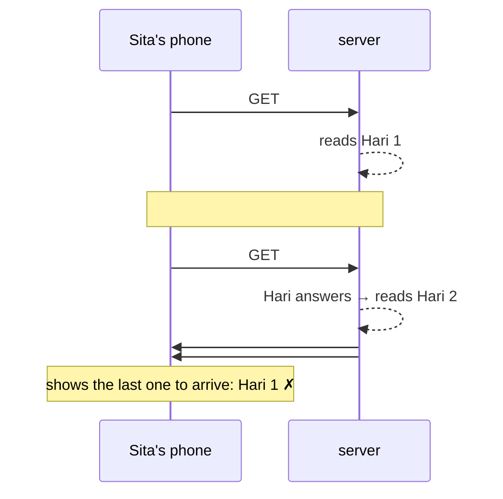
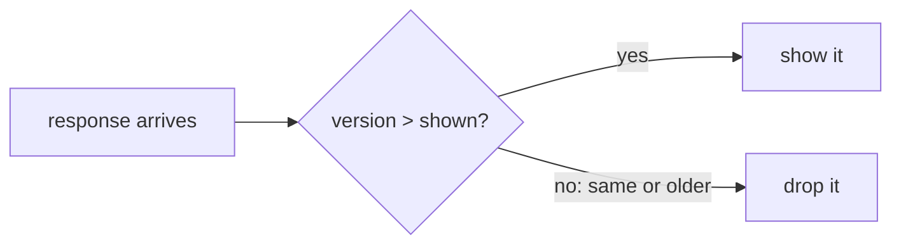

import Quiz from '../../../components/Quiz.astro';
import Think from '../../../components/Think.astro';
import { Aside } from '@astrojs/starlight/components';

<Aside type="tip" title="3 steps · ≈40 min · in your Spring app">
**Step 1:** watch responses arrive out of order, and a score go backwards. **Step 2:** a `version` on every duel, bumped in one place. **Step 3:** the phone's rule: show a response only if it's newer. Win: the same run as Step 1, and the phone ignores every stale response.
</Aside>

## Recall (from memory)

<Think id="maths-l22-recall-1" prompt="Lesson 21: Sita's answer to question 0 is saved, the response is lost, and her phone sends the same answer again. What does the server answer, and what changes in the duel?" revealLabel="Check">
200, with `correct` worked out from the saved answer, and **nothing changes**: the lambda hands the duel back as it was (`return@update duel`). That "nothing changed" matters today. A version number should only go up when something really did change.
</Think>

<Think id="maths-l22-recall-2" prompt="Lesson 20: what does repository.update guarantee when two threads change the same duel at the same instant?" revealLabel="Check">
`compute` runs read → change → write as one step for that duel. The second thread waits, then starts from the first thread's result. Neither change is lost. Today you'll rely on this: two changes can never both become "version 5".
</Think>

## Sent in order, not received in order

Every request is its own trip. A response can be held up anywhere on the way: a busy server thread, a weak Wi-Fi signal, a phone handing over from Wi-Fi to mobile data. Send A, then B, and B's response can arrive first.



Each response was true **when the server made it**. The problem is only the order: the phone shows whatever arrived last, and that isn't always the newest.

## Step 1 · See it happen

On your laptop every response is fast, so make the network slow and uneven, on purpose. In the controller's `GET /duels/{code}`, after the service call:

```kotlin {3}
    fun duel(@PathVariable("code") code: String): DuelResponse {
        val duel = duelService.get(code)
        Thread.sleep(kotlin.random.Random.nextLong(0, 1500)) // demo only: a slow, uneven network
        return duel.toResponse()
    }
```

Each response now waits somewhere between 0 and 1.5 s, like a phone on a bad connection. Then a small script plays Sita's phone. It asks for the duel every 0.3 s, each request on its own thread (the way a phone's HTTP client sends requests side by side), while Hari answers one question a second. It prints each response **in the order it arrives**:

```text
## duel QIGJ: Sita's phone asks every 0.3 s, Hari answers one question a second
request #1  sent at  0.0s, arrived at  0.5s: Hari 0
request #2  sent at  0.3s, arrived at  1.1s: Hari 0
request #3  sent at  0.6s, arrived at  1.7s: Hari 0
request #4  sent at  0.9s, arrived at  2.2s: Hari 0
request #5  sent at  1.2s, arrived at  2.3s: Hari 1
request #8  sent at  2.1s, arrived at  2.6s: Hari 2
request #6  sent at  1.5s, arrived at  2.9s: Hari 1  ⬅ went backwards
request #7  sent at  1.8s, arrived at  2.9s: Hari 1
request #9  sent at  2.4s, arrived at  3.0s: Hari 2
…
request #15 sent at  4.3s, arrived at  4.5s: Hari 4
```

Request #8 overtook #6 and #7. Sita's screen showed Hari 2, then **Hari 1** for a moment, then 2 again. In a 60-second duel where the opponent's score is the whole point, the number jumps around.

<Think id="maths-l22-predict" prompt="Could the phone fix this alone, without any change to the server? For example by comparing scores (higher is newer), or by the time each request was sent." revealLabel="Check">
Not reliably.

- **Higher score = newer** works for Hari's score, which only goes up. But a response carries a whole duel: status, winner, Sita's own score. WAITING → PLAYING → FINISHED has no "higher", and it won't hold for every field you add later.
- **Sent later = newer** is close, but the order the requests were sent isn't the order the server **read** the duel. Two requests sent 0.3 s apart can both read the same duel, and one sent first can be read after one sent later.

The only one who knows which state came after which is the server, inside the lock. So the server has to say so.
</Think>

## Step 2 · A version on every duel

The idea: a number on the duel that goes up by one **every time the duel changes**. Version 4 is the duel after its fourth change, whatever that was. The phone doesn't need to know what changed, only "is this number bigger than the one I'm showing?".

### `Duel`

```kotlin {3-4}
    val startedAt: Instant? = null,

    // Goes up by one every time the duel changes
    val version: Long = 1,
)
```

A new duel starts at version 1.

### `DuelRepository`

Where should the `+ 1` go? You could add `version = duel.version + 1` to every `copy` in `join`, `answer`, `finish`… and forget it in the next one you write. But every change already goes through **one** function: `update`. Since Lesson 20 there's no other way to write a duel. So the bump goes there, once:

```kotlin {3-6}
    fun update(code: String, change: (Duel) -> Duel): Duel {
        return duels.compute(code) { _, current ->
            val duel = current ?: throw DuelNotFoundException(code)
            val next = change(duel)
            // A real change gets the next version; a duel handed back unchanged keeps its own
            if (next == duel) duel else next.copy(version = duel.version + 1)
        }!!
    }
```

- `next == duel` uses the `equals` that Kotlin writes for every data class: it compares [all the properties in the primary constructor](https://kotlinlang.org/docs/data-classes.html). If `change` handed back an equal duel (a plain `get`, a retry from Lesson 21), nothing changed, and the version stays.
- It runs **inside** `compute`, so two threads can't both read version 4 and both write version 5. Lesson 20's lock is what makes the number trustworthy.
- `questions` and `endsAt` aren't in the constructor, so they're not compared. They're worked out from `seed` and `startedAt`, which are.

### `DuelResponse`

```kotlin {3}
    val scores: Map<String, Int>,
    val secondsLeft: Long?,
    val version: Long,
)
```

And in `toResponse()`, after `secondsLeft`:

```kotlin
    } else null,
    version = version,
)
```

Remove the demo sleep for a moment, and follow one duel through a game:

```text
## created
{"code":"RNZA",…,"status":"WAITING",…,"scores":{"Hari":0},"secondsLeft":null,"version":1}
## GET again (nothing changed)
{"code":"RNZA",…,"status":"WAITING",…,"scores":{"Hari":0},"secondsLeft":null,"version":1}
## after Sita joins
{"code":"RNZA",…,"status":"PLAYING",…,"scores":{"Hari":0,"Sita":0},"secondsLeft":59,"version":2}
## after Hari answers question 0
{"code":"RNZA",…,"scores":{"Hari":1,"Sita":0},"secondsLeft":58,"version":3}
## after Hari's retry of question 0
{"code":"RNZA",…,"scores":{"Hari":1,"Sita":0},"secondsLeft":57,"version":3}
{"error":"WRONG_QUESTION","message":"Hari is on question 1, not 3"} [409]
## after a 409
{"code":"RNZA",…,"scores":{"Hari":1,"Sita":0},"secondsLeft":56,"version":3}
```

And a duel left alone for 61 seconds, where Lesson 18's lazy finish is the change:

```text
## PHVI after join
"status":"PLAYING" "version":2
## 61 s later
"status":"FINISHED" "version":3
"status":"FINISHED" "version":3
```

| What happened | Version |
|---|---|
| create | 1 |
| a GET, nothing changed | same |
| join, answer, time up → FINISHED | + 1 |
| a retry (Lesson 21) | same |
| a 409 or 403 (the lambda threw) | same |

Notice `secondsLeft` changes on every response while the version doesn't. `secondsLeft` isn't stored in the duel. `toResponse()` works it out from the clock each time, so it isn't a change to the duel.

**Commit:** `feat: every duel change gets a version number`

## Step 3 · The phone keeps the newest

The server's part is done. The rule lives on the phone: **show a response only if its version is bigger than the one on screen**. On Android that's a few lines where the response lands (the one Android example today):

```kotlin
val shown = _duel.value
if (shown == null || response.version > shown.version) {
    _duel.value = response
}
// else: an older (or the same) duel arrived late. Drop it.
```

Equal versions are the same duel (only `secondsLeft` differs), so `>` and not `>=`. The script from Step 1 got the same rule. Put the demo sleep back and run it again:

```text
## duel CNTX: Sita's phone asks every 0.3 s, Hari answers one question a second
request #3  sent at  0.6s, arrived at  0.8s: Hari 0 (version 2)  → shown
request #1  sent at  0.0s, arrived at  1.0s: Hari 0 (version 2)  → same version, nothing new
request #2  sent at  0.3s, arrived at  1.1s: Hari 0 (version 2)  → same version, nothing new
request #4  sent at  0.9s, arrived at  1.5s: Hari 0 (version 2)  → same version, nothing new
request #5  sent at  1.2s, arrived at  1.6s: Hari 1 (version 3)  → shown
request #6  sent at  1.5s, arrived at  2.3s: Hari 1 (version 3)  → same version, nothing new
request #8  sent at  2.1s, arrived at  2.5s: Hari 2 (version 4)  → shown
request #7  sent at  1.8s, arrived at  2.9s: Hari 1 (version 3)  → ignored, older than 4
request #9  sent at  2.4s, arrived at  3.4s: Hari 2 (version 4)  → same version, nothing new
request #11 sent at  3.0s, arrived at  3.8s: Hari 3 (version 5)  → shown
request #12 sent at  3.3s, arrived at  3.9s: Hari 3 (version 5)  → same version, nothing new
request #10 sent at  2.7s, arrived at  4.2s: Hari 2 (version 4)  → ignored, older than 5
request #13 sent at  3.6s, arrived at  4.5s: Hari 3 (version 5)  → same version, nothing new
request #15 sent at  4.3s, arrived at  4.5s: Hari 4 (version 6)  → shown
request #14 sent at  3.9s, arrived at  4.9s: Hari 3 (version 5)  → ignored, older than 6
```

The responses arrived just as jumbled as before: #7 after #8, #10 after #11, #14 after #15. But what's **shown** only ever moves forward: 2, 3, 4, 5, 6. Hari's score goes 0, 1, 2, 3, 4 and never back.



**Remove the demo sleep** before you commit.

<Aside type="note" title="The thing to remember">
Responses arrive in any order, so "the last one to arrive" isn't "the newest". The server gives every duel a **version** that goes up by one on each real change. It's bumped in one place, `update`, inside the lock, so no two changes share a number, and a change that changes nothing (a GET, a retry, a 409) doesn't bump it. The phone shows a response only if its version is **bigger** than the one on screen, and drops the rest.
</Aside>

## Check yourself

<Quiz
  question="Hari's retried answer comes back 200. What happens to version?"
  options={[
    'It goes up by one',
    'It stays the same number',
    'It resets back to one',
  ]}
  answer={1}
>
The retry hands the duel back unchanged, `next == duel` is true, and `update` keeps the version. Nothing about the duel changed.
</Quiz>

<Quiz
  question="The phone shows version 5. A response with version 4 arrives. What should it do?"
  options={[
    'Show it, it arrived last',
    'Ask the server to explain',
    'Ignore it, it is older',
  ]}
  answer={2}
>
Version 4 is the duel before its fifth change. It was true once, but the phone already shows something newer.
</Quiz>

<Quiz
  question="Why does update bump the version, not each service function?"
  options={[
    'Every change passes through update',
    'Services cannot change data classes',
    'Spring requires repositories to version',
  ]}
  answer={0}
>
Since Lesson 20 every write goes through `update`. One `+ 1` there covers `join`, `answer`, the time-up finish, and whatever you add next. And it's inside the lock.
</Quiz>

## Your turn

<Think id="maths-l22-time" prompt="Why not an updatedAt: Instant instead, set to Instant.now() on every change, with the phone keeping the latest time? Give one reason the counter is better." revealLabel="Check">
Any one of these:

- **Ties.** Two changes in the same clock tick get the same `updatedAt`, and the phone can't order them. Two versions can never tie: each one is the previous one + 1, inside the lock.
- **Clocks move.** Lesson 18: the server's clock is the trusted one, but it still gets corrected now and then (it syncs with time servers), and a correction can move it backwards. A counter only moves forward.
- **It says more.** Version 6 means "the sixth state of this duel". If the phone has 4 and gets 6, it even knows it missed one.

Times are still useful to *show* people (Lesson 18's `secondsLeft`). For ordering, count.
</Think>

<Think id="maths-l22-answer-version" prompt="Sita's phone refreshes the duel, then she answers question 0 straight away. The answer's response comes back first (score 1), then the slow refresh (score 0). The phone shows 0. What's missing from the server, and what's the fix?" revealLabel="Check">
I ran it, with `version` added to `DuelResponse` only:

```text
## CALM: Sita's phone refreshes, then answers question 0 right away
answer arrived: Sita 1
GET    arrived: Sita 0, version 2
```

The refresh read the duel **before** her answer, and arrived after. The phone can't drop it: the answer's response has no version to compare with. **Every response that carries a duel's state needs its version**, so `AnswerResponse` gets one too:

```kotlin
    val score: Int,
    val version: Long,
)
```

and in the controller's `answer`, `version = outcome.duel.version`. Rerun:

```text
## HDQT: Sita's phone refreshes, then answers question 0 right away
answer arrived: Sita 1, version 3
GET    arrived: Sita 0, version 2
```

Now the phone shows version 3 and drops version 2.

**Commit:** `feat: answers carry the duel's version too`
</Think>

<Think id="maths-l22-teachback" prompt="Explain to another Android developer, in 3–4 sentences: why the phone can't just show the last response that arrived, what a version number is and where the server bumps it, and the phone's rule." revealLabel="Compare with a model answer">
Requests travel separately, so a response sent later can arrive earlier, and showing the last arrival can move the screen backwards (Hari 2, then Hari 1). The server gives each duel a version that goes up by one every time the duel really changes. It's bumped in one place, inside the per-duel lock in `update`, so no two changes share a number, and a GET, a retry or a 409 doesn't bump it. Every response that carries the duel carries its version, and the phone shows a response only if its version is bigger than the one it's showing.
</Think>

## Read alongside
- 📖 **Primary:** [Kotlin docs: Data classes](https://kotlinlang.org/docs/data-classes.html), the part on the generated `equals()` and which properties it compares (10 min). It's what `next == duel` relies on.
- [RFC 9110 §8.8.3, ETag](https://www.rfc-editor.org/rfc/rfc9110#section-8.8.3): HTTP's own header for "which version of this resource is this?". Same idea, made for caches.

🙋 Ask me: "what's an ETag, and could the version be one?", "what if the phone misses version 5 completely?", "does a database have versions too?", "what's optimistic locking?"

**Next:** [Lesson 23: why HTTP can't push](../0023-polling/). Sita's phone asked for the duel every 0.3 s to see Hari's score. Count what that costs, and why the server can't just tell her when it changes.
