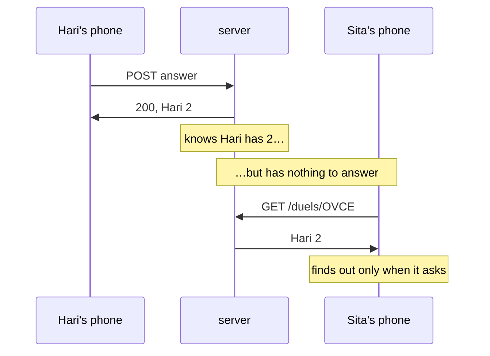
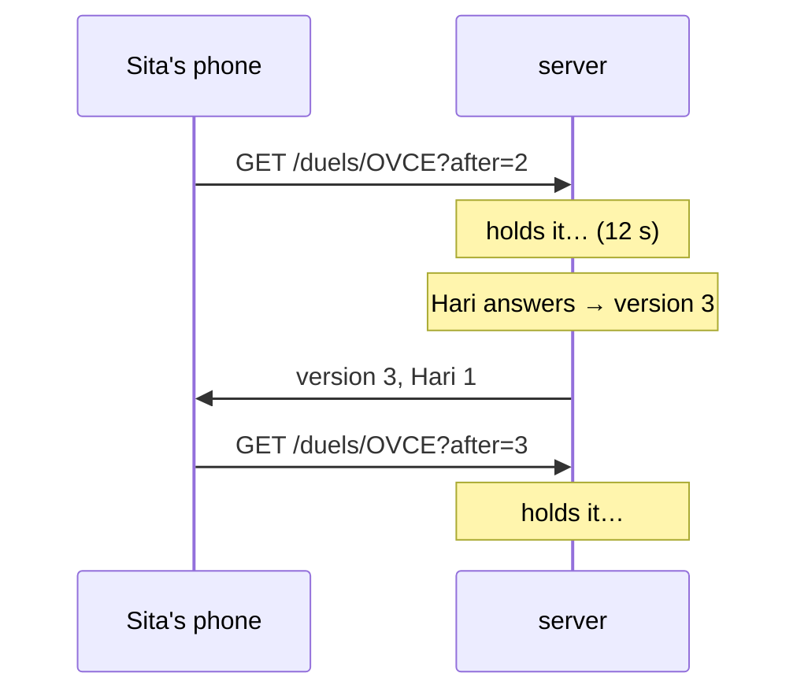
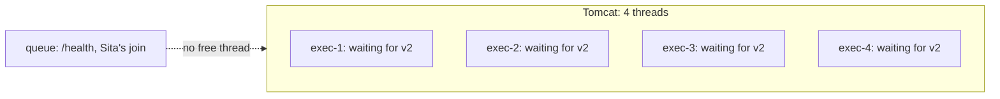

import Quiz from '../../../components/Quiz.astro';
import Think from '../../../components/Think.astro';
import { Aside } from '@astrojs/starlight/components';

<Aside type="tip" title="3 steps · ≈45 min · in your Spring app">
**Step 1:** measure polling: how many requests a 60-second duel costs, and how many bring nothing new. **Step 2:** long polling: `GET /duels/{code}?after=5` waits until the duel is newer than version 5. **Step 3:** what waiting costs: four held requests and a 4-thread server. Win: one table comparing all four ways over the same real duel. Long polling gets updates fastest, with 7 requests instead of 195.
</Aside>

## Recall (from memory)

<Think id="maths-l23-recall-1" prompt="Lesson 22: Sita's phone asked for the duel every 0.3 s while Hari answered. Of the responses that arrived, roughly how many were shown, and what happened to the rest?" revealLabel="Check">
In the run CNTX, 15 responses arrived and 5 were shown (versions 2 to 6). The other 10 were "same version, nothing new" or older and ignored. Two out of three requests bought nothing. Today you'll count that over a whole duel.
</Think>

<Think id="maths-l23-recall-2" prompt="Lesson 10: your hand-made server had a fixed pool of threads. What happened to a new client when every thread in the pool was busy?" revealLabel="Check">
It waited. The connection was accepted, but the request sat in the queue until a thread came free. Tomcat works the same way, with a pool of 200 threads by default. Remember this for Step 3.
</Think>

## The server knows. It can't say.

When Hari answers, `update` runs on a Tomcat thread, and the server knows at that moment that Hari's score is now 2. Sita's phone wants to know too. But look at who does what in HTTP ([RFC 9110 §3.3](https://www.rfc-editor.org/rfc/rfc9110#section-3.3)):

> An HTTP "client" is a program that establishes a connection to a server for the purpose of sending one or more HTTP requests. An HTTP "server" is a program that accepts connections in order to service HTTP requests by sending HTTP responses.

The server's only move is a **response**, and a response needs a request to answer. There's no HTTP message for "the server has news". If Sita's phone isn't asking right now, the server can't tell it anything. (Lesson 1 said it: the client speaks first.)



So the phone asks. Asking again and again on a timer is **polling**.

## Step 1 · What polling costs

No code change. A script plays four duels at the same time, each a full 60 seconds. In each, Hari answers at the same moments (7, 19, 26, 41 and 53 s), and Sita's phone asks for the duel on a timer: every 0.3 s, every 1 s or every 3 s. It counts the requests, how many brought **nothing new** (same version as last time), and the **delay**: from Hari's answer to Sita's phone seeing it.

```text
Sita asks    requests  nothing new  avg delay  worst delay
every 0.3 s       195          188      0.18s        0.28s
every 1 s          61           54      0.25s        0.47s
every 3 s          21           14      1.49s        2.07s
```

Only 7 things happen in a duel that Sita needs to see: the join, Hari's 5 answers and the finish. Every other request is wasted.

- **Every 0.3 s:** fresh within 0.28 s, but **188 of 195** requests brought nothing.
- **Every 3 s:** 21 requests, but Sita sees Hari's score up to 2 s late. In a 60-second duel, that's a long time to look at an old score.

That's the trade with polling: **fresher costs more requests.** You pick the interval, and you pay either way. [RFC 6202](https://www.rfc-editor.org/rfc/rfc6202#section-2.1), which describes these techniques: "the consumed resources (server processing and network) strongly depend on the acceptable latency".

And each "nothing new" is a full HTTP exchange:

```text
❯ curl -sv localhost:8080/duels/GAUT
> GET /duels/GAUT HTTP/1.1
> Host: localhost:8080
> User-Agent: curl/8.7.1
> Accept: */*
>
< HTTP/1.1 200
< Content-Type: application/json
< Content-Length: 148
< Date: Thu, 19 Nov 2026 09:55:46 GMT
```

87 bytes up, 107 bytes of headers and 148 of body down, a Tomcat thread, and a trip through `update`'s lock, all to learn nothing. With 1,000 duels at once, polling every second: 2 phones × 1,000 duels = **2,000 requests a second**, and about 9 in 10 of them come back empty-handed.

## Step 2 · Long polling: hold the request

What if the server didn't answer straight away? The phone sends "I have version 5", and the server **holds** the request until there's a version 6, then answers. The phone immediately asks again with 6. RFC 6202 calls this **long polling**:

> The server achieves these efficiencies by responding to a request only when a particular event, status, or timeout has occurred. Once the server sends a long poll response, typically the client immediately sends a new long poll request.



There's still a request for every response. HTTP hasn't changed. But no request is wasted, and the response leaves the moment there's news.

### `?after=` is a query

`/duels/OVCE?after=2`: everything after `?` is the **query**, part of the request target in the request line (Lesson 4). Spring reads it with `@RequestParam`, the way it reads the path with `@PathVariable`. The phone that wants an answer straight away leaves it out, as before.

### `DuelService`

```kotlin
    // Holds the request until the duel is newer than `after`, or until `maxWait` has passed
    fun getNewerThan(code: String, after: Long, maxWait: Duration): Duel {
        val giveUpAt = Instant.now().plus(maxWait)
        while (true) {
            val duel = get(code)
            if (duel.version > after || !Instant.now().isBefore(giveUpAt)) {
                return duel
            }
            Thread.sleep(100)
        }
    }
```

(`import java.time.Duration`.)

- It looks every 100 ms. Each look is your normal `get`, so it takes the duel's lock for a moment and still finishes a duel whose time is up (Lesson 18). That's how a waiting phone hears about FINISHED.
- The sleep is **outside** the lock (Lesson 20's rule): other requests for this duel aren't held up.
- `maxWait`: never wait forever. If nothing happens, answer with the same version, and the phone asks again. RFC 6202 §5.5: "generally 30 seconds is a safer value". Your exercise will push this number lower.
- Checking every 100 ms is the simple way. A real server would be **woken** when the duel changes instead of checking, but it would still be holding the request and its thread, and that's the part that matters in Step 3.

### `DuelController`

```kotlin {3,5-9}
    @GetMapping("duels/{code}")
    fun duel(
        @PathVariable("code") code: String,
        @RequestParam("after", required = false) after: Long?,
    ): DuelResponse {
        val duel = if (after == null) {
            duelService.get(code)
        } else {
            duelService.getNewerThan(code, after, LONG_POLL_WAIT)
        }
        return duel.toResponse()
    }
```

And next to the DTOs (import `org.springframework.web.bind.annotation.RequestParam` and `java.time.Duration`):

```kotlin
// How long a GET with ?after= may wait for something new
val LONG_POLL_WAIT: Duration = Duration.ofSeconds(25)
```

Try it: Hari creates a duel (version 1), the phone asks for something newer than 1, and Sita joins 2 seconds later:

```text
❯ curl -s "localhost:8080/duels/MJZE?after=1" -w ' [%{http_code}] after %{time_total}s\n'
{"code":"MJZE",…,"status":"PLAYING","opponentName":"Sita",…,"version":2} [200] after 2.068445s
❯ curl -s "localhost:8080/duels/MJZE?after=1" -w ' [%{http_code}] after %{time_total}s\n'
{"code":"MJZE",…,"status":"PLAYING","opponentName":"Sita",…,"version":2} [200] after 0.002709s
```

The first request was held for 2.07 s and answered the moment Sita joined. The second answered at once: it asked for something newer than 1, and 2 was already there.

**Commit:** `feat: GET can wait for a newer version`

The same script, with a fourth duel where Sita's phone long-polls, all four in the same 60 seconds:

```text
Sita asks    requests  nothing new  avg delay  worst delay
every 0.3 s       195          188      0.18s        0.28s
every 1 s          61           54      0.25s        0.47s
every 3 s          21           14      1.49s        2.07s
long poll           7            0      0.05s        0.10s
```

**7 requests**, one for each of the 7 things that happened, and the fastest updates of the four (the 0.1 s worst case is the 100 ms check). It didn't even hit the 25 s limit: the longest quiet gap in this duel was 15 s.

## Step 3 · What holding costs

A held request is held **by a thread**. `getNewerThan` runs on a Tomcat thread, and that thread does nothing else until it returns. Tomcat has 200 by default ([Spring Boot: `server.tomcat.threads.max`](https://docs.spring.io/spring-boot/appendix/application-properties/index.html#application-properties.server.server.tomcat.threads.max)). 200 waiting phones is 100 duels, and the 201st request of **any** kind waits.

200 is a lot of phones to fake, so shrink the pool instead. Start the server with 4 threads:

```text
❯ java -jar build/libs/app-0.0.1-SNAPSHOT.jar --server.tomcat.threads.max=4
```

(Any Spring property can be given on the command line like this.) Then 4 phones long-poll a WAITING duel, and other requests come in:

```text
## 4 phones long-poll EMLY, waiting for version 2
## 1 s later: GET /health
## 3 s later: Sita joins
long poll 2 → 200 after 25.022594s
health → 200 after 24.013573s
long poll 1 → 200 after 25.027424s
join → 200 after 22.008545s
long poll 3 → 200 after 25.037385s
long poll 4 → 200 after 25.049414s
```

Read it slowly. `/health`, the cheapest request there is, took **24 s**. And Sita's join, **the very change the four phones were waiting for**, couldn't run, because all four threads were busy waiting for it. Everything stood still until the long polls gave up at 25 s and answered "still version 1". Only then did the join get a thread.

That's the shape at any size: each waiting phone holds a thread, and threads run out. RFC 6202 calls it out too: long polling "requires that for each client both a TCP/IP connection and an HTTP request are held open". The connection is cheap. The request, with a thread stuck inside it, isn't.



<Aside type="note" title="The thing to remember">
HTTP only lets the server **answer**, so a server can't tell a phone about a change. The phone has to ask. **Polling** on a timer trades freshness for requests: every 0.3 s was fresh and 188 of 195 requests were wasted, and every 3 s was cheap and up to 2 s stale. **Long polling** holds the request until there's news (`?after=version`), so every response is new and arrives at once. But each waiting phone holds a Tomcat thread, and when the threads run out, every request waits, even the one with the news. What the game really wants is a connection where the server can **speak first**. That's Lesson 24.
</Aside>

## Check yourself

<Quiz
  question="Why can't the server tell Sita's phone when Hari scores?"
  options={[
    'Phones block all incoming network data',
    'Spring has no way to send',
    'HTTP only lets the server respond',
  ]}
  answer={2}
>
In HTTP the client sends requests and the server answers them. No request in progress, no way to send anything.
</Quiz>

<Quiz
  question="Polling every 0.3 s instead of every 3 s gives…"
  options={[
    'Fresher scores, about nine times more requests',
    'Fresher scores at the same overall cost',
    'Staler scores, about nine times fewer requests',
  ]}
  answer={0}
>
195 requests against 21, and a worst delay of 0.28 s against 2.07 s. With polling, freshness is paid for in requests.
</Quiz>

<Quiz
  question="A long poll is waiting. What is its Tomcat thread doing?"
  options={[
    'Serving other requests while it waits',
    'Only waiting, held by this request',
    'It was returned, then later reacquired',
  ]}
  answer={1}
>
`getNewerThan` runs on the request's thread until it returns. With 4 threads, 4 waiting phones were enough to stop `/health` and the join.
</Quiz>

## Your turn

<Think id="maths-l23-okhttp" prompt="Sita's phone uses Retrofit with OkHttp's defaults (Lesson 21: readTimeout is 10 seconds). It long-polls a duel where nothing happens for a while. With LONG_POLL_WAIT = 25 s, what does the phone get? What would you change, and to what?" revealLabel="Check">
The phone gives up first. After 10 s with no bytes, OkHttp throws `SocketTimeoutException`: Lesson 21's "I don't know", for a request that was only ever going to say "nothing new". I ran it with curl giving up at 10 s, like OkHttp:

```text
=== LONG_POLL_WAIT = 25 s
## a phone that gives up after 10 s (OkHttp's default) long-polls HFZM; nothing happens
curl: (28) Operation timed out after 10006 milliseconds with 0 bytes received
=== LONG_POLL_WAIT = 8 s
## a phone that gives up after 10 s (OkHttp's default) long-polls CYKE; nothing happens
{"code":"CYKE",…,"status":"WAITING",…,"version":1} [200] after 8.106295s
```

The server's wait has to end **before** the client's patience does, with a margin for the network: here 8 s against 10 s. Or raise the phone's `readTimeout` for this one call. Either way, the two numbers are a contract between phone and server, and one side can't change it alone. Every link in between (Wi-Fi routers, mobile networks, proxies) has its own timeout too, which is why RFC 6202 settles on 30 s as "safer", not on minutes.

Set `LONG_POLL_WAIT` to 8 seconds. **Commit:** `fix: a long poll answers before the phone gives up`
</Think>

<Think id="maths-l23-teachback" prompt="Explain to another Android developer, in 3–4 sentences: why the server can't push a score over HTTP, what polling costs, how long polling helps, and the new cost long polling brings." revealLabel="Compare with a model answer">
In HTTP the server only answers requests, so when Hari scores, the server can't tell Sita's phone until it asks. Polling on a timer trades freshness for requests: every 0.3 s was fresh but 188 of 195 requests brought nothing, every 3 s was cheap but up to 2 s stale. Long polling sends "I have version 5" and the server holds the request until there's a newer version, so every response is news and arrives at once. But each held request keeps a Tomcat thread busy, and with 4 threads, 4 waiting phones froze everything, including the join they were waiting for.
</Think>

## Read alongside
- 📖 **Primary:** [RFC 6202, sections 2.1 and 2.2](https://www.rfc-editor.org/rfc/rfc6202#section-2): long polling, defined, with its issues listed one by one (header overhead, allocated resources, timeouts) (15 min).
- [RFC 9110 §3.3, Connections, Clients, and Servers](https://www.rfc-editor.org/rfc/rfc9110#section-3.3), the definitions quoted above.
- [Spring Boot: Tomcat properties](https://docs.spring.io/spring-boot/appendix/application-properties/index.html#application-properties.server.server.tomcat.threads.max): `threads.max`, and its neighbours `max-connections` and `accept-count`.

🙋 Ask me: "can a waiting request give its thread back?", "what are virtual threads, and do they fix Step 3?", "how does a phone get a notification when the app is closed?", "what's Server-Sent Events?"

**Next:** Lesson 24: WebSocket. One HTTP request that turns into a two-way connection, kept open, where either side can send a message at any time, so the server can finally speak first.
