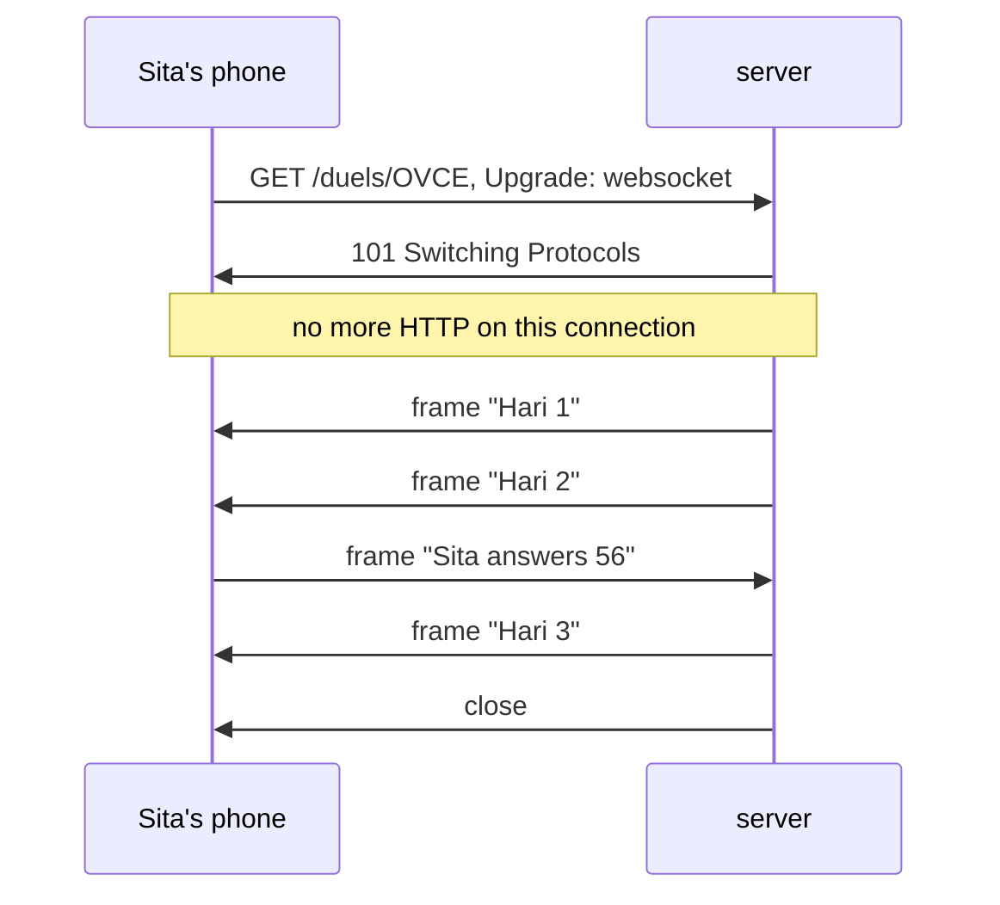
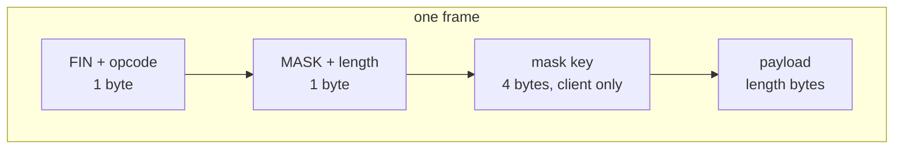

import Quiz from '../../../components/Quiz.astro';
import Think from '../../../components/Think.astro';
import { Aside } from '@astrojs/starlight/components';

<Aside type="tip" title="3 steps · ≈50 min · one Kotlin script, no Spring">
**Step 1:** the handshake: an HTTP request answered with `101 Switching Protocols`. **Step 2:** the server sends "Hari 1", "Hari 2", "Hari 3", and the phone never asked. **Step 3:** the phone sends a message back on the same connection, and both sides close properly. Win: a real WebSocket client (the one built into browsers) talking to a server you wrote byte by byte.
</Aside>

## Recall (from memory)

<Think id="maths-l24-recall-1" prompt="Lesson 23: why couldn't the server tell Sita's phone that Hari scored, and what did long polling cost?" revealLabel="Check">
In HTTP the server only **answers** requests, so with no request waiting there's nothing to answer. Long polling keeps one request waiting, but each waiting phone holds a Tomcat thread: with 4 threads, 4 waiting phones froze even the join they were waiting for. Today's fix changes the rules: after one HTTP request, the connection stops being HTTP.
</Think>

<Think id="maths-l24-recall-2" prompt="Lesson 5: a connection is a stream of bytes with no message boundaries. How does a reader know where an HTTP response's body ends?" revealLabel="Check">
`Content-Length` says how many bytes of body follow, so the reader reads exactly that many. Remember this for Step 2: every WebSocket message starts with its own length.
</Think>

## One request, then a different protocol

Lesson 3: a connection is a two-way pipe of bytes. Either side can write at any time. HTTP is what made it one-way-at-a-time: request, response, request, response. **WebSocket** keeps the pipe and drops that rule. [RFC 6455](https://www.rfc-editor.org/rfc/rfc6455#section-1.2):

> Once the client and server have both sent their handshakes, and if the handshake was successful, then the data transfer part starts. This is a two-way communication channel where each side can, independently from the other, send data at will.

It starts as HTTP, so it works on the same port and through the same networks. The phone sends one ordinary `GET` that says "let's switch". The server answers `101 Switching Protocols`. After that the connection carries WebSocket **frames** both ways, until someone closes it.



Compare Lesson 23's long poll: one request per update, and a thread held while waiting. Here it's one request **in total**, and then the server writes whenever it has news.

You'll build the server by hand, like Lessons 7–9: one Kotlin script, `ws.main.kts`. Put it anywhere outside `app/` and `handmade/` (say `maths/scripts/`), and run it with `kotlin ws.main.kts`.

## Step 1 · The handshake

The start of the script: imports, Lesson 7's `readHttpLine`, and one new function.

```kotlin
import java.io.InputStream
import java.io.OutputStream
import java.net.ServerSocket
import java.security.MessageDigest
import java.util.Base64

// Every WebSocket server adds this exact string to the client's key (RFC 6455, section 1.3)
val WEBSOCKET_GUID = "258EAFA5-E914-47DA-95CA-C5AB0DC85B11"

// Proof that this server speaks WebSocket: base64(SHA-1(key + GUID))
fun acceptFor(key: String): String {
    val sha1 = MessageDigest.getInstance("SHA-1").digest((key + WEBSOCKET_GUID).toByteArray())
    return Base64.getEncoder().encodeToString(sha1)
}

// Lesson 7: read bytes up to \n, drop the \r
fun readHttpLine(input: InputStream): String {
    val bytes = mutableListOf<Byte>()
    while (true) {
        val next = input.read()
        if (next == -1 || next == '\n'.code) break
        bytes.add(next.toByte())
    }
    return bytes.toByteArray().decodeToString().removeSuffix("\r")
}
```

The phone sends a random `Sec-WebSocket-Key`. The server glues the fixed GUID onto it, hashes it with SHA-1 and sends the result back as `Sec-WebSocket-Accept`. Why? The RFC: "the server has to prove to the client that it received the client's WebSocket handshake, so that the server doesn't accept connections that are not WebSocket connections." An ordinary HTTP server that knows nothing about WebSocket can't produce the right answer by accident.

The RFC even gives a worked example: key `dGhlIHNhbXBsZSBub25jZQ==` must give `s3pPLMBiTxaQ9kYGzzhZRbK+xOo=`. Check yours with `println(acceptFor("dGhlIHNhbXBsZSBub25jZQ=="))`:

```text
❯ kotlin rfc.main.kts
s3pPLMBiTxaQ9kYGzzhZRbK+xOo=
```

Then the server itself. It's your Lesson 7 loop, without the loop: one connection, read the request line and headers, answer.

```kotlin
val server = ServerSocket(9000)
println("Listening on port 9000")
val socket = server.accept()
val input = socket.getInputStream()
val output = socket.getOutputStream()

// 1. The handshake is an ordinary HTTP request
val requestLine = readHttpLine(input)
println("< $requestLine")
val headers = mutableMapOf<String, String>()
while (true) {
    val line = readHttpLine(input)
    if (line.isEmpty()) break
    println("< $line")
    val (name, value) = line.split(": ", limit = 2)
    headers[name.lowercase()] = value
}

val accept = acceptFor(headers.getValue("sec-websocket-key"))
output.write(
    ("HTTP/1.1 101 Switching Protocols\r\n" +
        "Upgrade: websocket\r\n" +
        "Connection: Upgrade\r\n" +
        "Sec-WebSocket-Accept: $accept\r\n" +
        "\r\n").toByteArray()
)
output.flush()
println("> 101 Switching Protocols, Sec-WebSocket-Accept: $accept")
// From here on, this connection carries WebSocket frames, not HTTP

Thread.sleep(500)
socket.close()
```

Header names are lowercased on the way in, because HTTP header names are case-insensitive: `Upgrade` and `upgrade` are the same header. Some real clients send them in lowercase, as you'll see in Step 3.

Run it, and be the client with `nc`, typing the handshake from the RFC by hand:

```text
❯ (printf 'GET /duels/OVCE HTTP/1.1\r\nHost: localhost:9000\r\nUpgrade: websocket\r\nConnection: Upgrade\r\nSec-WebSocket-Key: dGhlIHNhbXBsZSBub25jZQ==\r\nSec-WebSocket-Version: 13\r\n\r\n'; sleep 2) | nc localhost 9000
HTTP/1.1 101 Switching Protocols
Upgrade: websocket
Connection: Upgrade
Sec-WebSocket-Accept: s3pPLMBiTxaQ9kYGzzhZRbK+xOo=

```

```text
Listening on port 9000
< GET /duels/OVCE HTTP/1.1
< Host: localhost:9000
< Upgrade: websocket
< Connection: Upgrade
< Sec-WebSocket-Key: dGhlIHNhbXBsZSBub25jZQ==
< Sec-WebSocket-Version: 13
> 101 Switching Protocols, Sec-WebSocket-Accept: s3pPLMBiTxaQ9kYGzzhZRbK+xOo=
```

A `GET` with a path, a `Host` and headers: the request side is plain Lesson 4 HTTP. `101` is the one status code you haven't seen: a 1xx means "informational", and this one means the conversation is about to stop being HTTP. A 101 response has no body. After its empty line, the next byte is the first byte of the new protocol.

## Step 2 · The server speaks first

After the handshake, data moves in **frames**. A frame is a couple of header bytes, then the message. The smallest useful one, a text message under 126 bytes (add it after `readHttpLine`):

```kotlin
// One text message in one frame. Only for messages under 126 bytes.
fun sendText(output: OutputStream, text: String) {
    val payload = text.toByteArray()
    output.write(0x81)          // FIN = 1 (the whole message), opcode 1 (text)
    output.write(payload.size)  // MASK = 0, then the length
    output.write(payload)
    output.flush()
}
```

And after the 101, instead of closing straight away:

```kotlin
// 2. The server speaks first: nobody asked
for (score in 1..3) {
    Thread.sleep(1000)
    sendText(output, "Hari $score")
    println("> Hari $score")
}
```

The same `nc` handshake, with the bytes shown by `xxd`:

```text
00000000: 4854 5450 2f31 2e31 2031 3031 2053 7769  HTTP/1.1 101 Swi
00000010: 7463 6869 6e67 2050 726f 746f 636f 6c73  tching Protocols
…
00000070: 477a 7a68 5a52 624b 2b78 4f6f 3d0d 0a0d  GzzhZRbK+xOo=...
00000080: 0a81 0648 6172 6920 3181 0648 6172 6920  ...Hari 1..Hari
00000090: 3281 0648 6172 6920 33                   2..Hari 3
```

After `0d 0a 0d 0a`, the end of the 101, come three frames. One of them, byte by byte ([RFC 6455 §5.2](https://www.rfc-editor.org/rfc/rfc6455#section-5.2)):

| Byte | In bits | Means |
|---|---|---|
| `81` | `1000 0001` | first bit **FIN** = 1: this frame is the whole message. Last 4 bits, the **opcode**: 1 = text |
| `06` | `0000 0110` | first bit **MASK** = 0 (more in Step 3). The other 7: the **length**, 6 |
| `48 61 72 69 20 31` | | `Hari 1`, the 6 bytes |

The length up front is Lesson 5's `Content-Length` idea, per message. The reader takes two bytes, learns "6 more", reads exactly 6, and knows the next byte starts a new frame. That's how messages keep their boundaries in a stream that has none.

Now a real client. Browsers have WebSocket built in, and so does Node. This is browser code, run with `node phone.mjs`. (Or paste it into the DevTools console of an `about:blank` tab. A page served over https may not open a plain `ws://` connection.)

```js
// Sita's phone, with the WebSocket built into browsers (and Node)
const t0 = Date.now();
const at = () => `${((Date.now() - t0) / 1000).toFixed(1)}s`;
const ws = new WebSocket("ws://localhost:9000/duels/OVCE");
ws.onopen = () => console.log(at(), "open");
ws.onmessage = (event) => {
  console.log(at(), "server says:", event.data);
  if (event.data === "Hari 3") ws.send("Sita answers 56");
};
ws.onclose = (event) => console.log(at(), "closed, code", event.code);
ws.onerror = (event) => console.log(at(), "error:", event.message ?? event.type);
```

```text
❯ node phone.mjs
0.0s open
1.1s server says: Hari 1
2.1s server says: Hari 2
3.1s server says: Hari 3
3.6s error:
3.6s closed, code 1006
```

There it is: **three messages, one second apart, and the phone sent no request for any of them.** It opened the connection once and then only listened. (`ws.send` in `onmessage` does nothing yet: the server isn't reading.)

The ending is ugly: `1006` means "the connection dropped without a goodbye". The script just closed the socket. Step 3 fixes that too.

On Android you'd write the same thing with OkHttp, which you already have under Retrofit: `client.newWebSocket(request, listener)`, and the listener's `onMessage(webSocket, text)` gets called for every frame. That's your one Android example today. Lesson 26 deals with what happens when a phone's connection drops.

**Commit:** `feat: a hand-made WebSocket server that speaks first`

## Step 3 · The phone speaks back

The phone already sends "Sita answers 56". Reading it needs one rule that only applies in this direction. The RFC, §5.1: "a client **MUST mask** all frames that it sends to the server", and "A server **MUST NOT mask** any frames that it sends to the client." Masking: the client picks 4 random bytes and XORs them over the message. They're sent in the frame, so undoing it is the same XOR again. It's not secrecy. It stops a WebSocket page from writing bytes that a confused proxy on the way might mistake for an HTTP request (§10.3 has the story).

```kotlin
// One frame from the client. Clients always mask: 4 random bytes, XORed over the payload.
fun readText(input: InputStream): String {
    val first = input.read()             // FIN + opcode
    val second = input.read()            // MASK + length
    val opcode = first and 0x0F
    val length = second and 0x7F         // under 126 only, like sendText
    val mask = input.readNBytes(4)
    val payload = input.readNBytes(length)
    for (i in payload.indices) {
        payload[i] = (payload[i].toInt() xor mask[i % 4].toInt()).toByte()
    }
    println("frame: opcode $opcode, masked ${second shr 7 == 1}, length $length, mask ${mask.joinToString(" ") { "%02x".format(it) }}")
    return payload.decodeToString()
}
```

- `and 0x0F` keeps the last 4 bits (the opcode). `and 0x7F` drops the first bit (MASK) and keeps the 7-bit length.
- `readNBytes(n)` reads exactly `n` bytes, like Lesson 8's body read with `Content-Length`.
- `mask[i % 4]`: the 4 mask bytes are used over and over: byte 0 with mask 0, byte 4 with mask 0 again.

And a proper goodbye, a **Close** frame (opcode 8) with the status code 1000, "normal closure":

```kotlin
// Say goodbye: a Close frame (opcode 8) with status 1000, "normal closure"
fun sendClose(output: OutputStream) {
    output.write(0x88)          // FIN = 1, opcode 8 (close)
    output.write(2)             // 2 bytes of payload: the status code
    output.write(1000 shr 8)    // 1000 = 0x03E8, high byte first
    output.write(1000 and 0xFF)
    output.flush()
}
```

After the three scores:

```kotlin
// 3. The phone speaks too, on the same connection
val message = readText(input)
println("< $message")
sendText(output, "got it: $message")
println("> got it: $message")

sendClose(output)
println("> close 1000")
```

```text
❯ node phone.mjs
0.0s open
1.1s server says: Hari 1
2.1s server says: Hari 2
3.1s server says: Hari 3
3.1s server says: got it: Sita answers 56
3.6s closed, code 1000
```

```text
Listening on port 9000
< GET /duels/OVCE HTTP/1.1
< host: localhost:9000
< connection: upgrade
< upgrade: websocket
< sec-websocket-key: flyZiE3IoSqj/W5lpmsxMg==
< sec-websocket-version: 13
< sec-websocket-extensions: permessage-deflate; client_max_window_bits
< accept: */*
…
> 101 Switching Protocols, Sec-WebSocket-Accept: tRrS0SFCdDveEPmJUVb0QIMPCu8=
> Hari 1
> Hari 2
> Hari 3
frame: opcode 1, masked true, length 15, mask 2d fe dd 68
< Sita answers 56
> got it: Sita answers 56
> close 1000
```

- The phone's message arrived on the **same connection** the scores went out on, masked with `2d fe dd 68`. Run it again and the mask changes: the client picks new random bytes for every frame.
- The real client's handshake: lowercase names (hence `lowercase()`), and an offer of `permessage-deflate` compression. The 101 didn't mention it, so the client knows it was declined and sends plain frames.
- `closed, code 1000`: a clean goodbye this time.



**Commit:** `feat: read the phone's masked frames and close properly`

<Aside type="caution" title="What this server leaves out">
It's for seeing the protocol, not for running a game. It serves **one** connection and then exits. It handles neither long messages (your exercise) nor messages split over several frames (FIN = 0). It answers no **ping** frames (opcode 9, how each side checks the other is still there). And it has no `wss://` (TLS). Spring does all of that in Lesson 25. You'll just get `onMessage` and `send`.
</Aside>

<Aside type="note" title="The thing to remember">
A WebSocket starts as one HTTP `GET` with `Upgrade: websocket`. The server proves it understood with `Sec-WebSocket-Accept`, answers **101 Switching Protocols**, and from then on the connection carries **frames** in both directions, whenever either side likes. Nobody asks first. A frame is FIN + opcode, MASK + length, then the payload. Its length up front does the job `Content-Length` did. Clients mask their frames, servers don't, and a Close frame ends it cleanly.
</Aside>

## Check yourself

<Quiz
  question="What does 101 Switching Protocols mean here?"
  options={[
    'The request failed, try another protocol',
    'This connection now speaks WebSocket instead',
    'The server will redirect to WebSocket',
  ]}
  answer={1}
>
The handshake worked. The same connection, the one the GET came in on, now carries WebSocket frames instead of HTTP.
</Quiz>

<Quiz
  question="In the frame 81 06 48 61 72 69 20 31, what does 06 say?"
  options={[
    'This is the sixth frame',
    'It is message type six',
    'Six bytes of message follow',
  ]}
  answer={2}
>
The first bit (MASK) is 0, and the other 7 bits are the length: 6 bytes, `Hari 1`. The message type is the opcode, in `81`.
</Quiz>

<Quiz
  question="After the handshake, who can send a message?"
  options={[
    'Either side, at any time',
    'Only the client, like HTTP',
    'Only the server, in turns',
  ]}
  answer={0}
>
"Each side can, independently from the other, send data at will." The scores went out unasked, and Sita's message came in on the same connection.
</Quiz>

## Your turn

<Think id="maths-l24-long" prompt="In Lesson 25 the server will send the whole duel as JSON, like your DuelResponse: about 148 bytes. Send that with today's sendText and predict what the phone sees. Hint: write 148 in binary, and remember what the first bit of the second byte means." revealLabel="Check">
148 is `1001 0100` in binary. `output.write(148)` puts that byte where the client reads **MASK** + length, so it reads MASK = 1 and length = `001 0100` = **20**. A server must never mask, so the client gives up at once:

```text
=== exercise, before
open
error:
closed, code 1006
```

```text
00000080: 0a81 947b 2263 6f64 6522 3a22 4f56 4345  ...{"code":"OVCE
```

There it is: `81 94`. The RFC's answer: a length byte of 0–125 is the length. **126** means "the real length is in the next 2 bytes" (up to 65,535), and 127 means "the next 8 bytes". So:

```kotlin {5-12}
// One text message in one frame, up to 65,535 bytes
fun sendText(output: OutputStream, text: String) {
    val payload = text.toByteArray()
    output.write(0x81)                      // FIN = 1, opcode 1 (text)
    if (payload.size < 126) {
        output.write(payload.size)          // the length itself
    } else {
        output.write(126)                   // "the next 2 bytes are the length"
        output.write(payload.size shr 8)
        output.write(payload.size and 0xFF)
    }
    output.write(payload)
    output.flush()
}
```

```text
=== exercise, after
open
server says: {"code":"OVCE","playerName":"Hari","status":"PLAYING","opponentName":"Sita","winner":null,"scores":{"Hari":2,"Sita":1},"secondsLeft":41,"version":5}
closed, code 1000
```

```text
00000080: 0a81 7e00 947b 2263 6f64 6522 3a22 4f56  ..~..{"code":"OV
```

`7e` is 126, then `00 94` is 148, high byte first. Note the RFC's rule: always the shortest form. You may not use 126 for a 20-byte message.

**Commit:** `fix: send messages of 126 bytes and more`
</Think>

<Think id="maths-l24-teachback" prompt="Explain to another Android developer, in 3–4 sentences: how a WebSocket connection starts, what changes after the 101, how a frame marks where a message ends, and why this beats long polling for live scores." revealLabel="Compare with a model answer">
It starts as an ordinary HTTP `GET` with `Upgrade: websocket` and a random key. The server answers `101 Switching Protocols` with `Sec-WebSocket-Accept`, a hash of that key that proves it understood. After the 101 the connection isn't HTTP any more: both sides send frames whenever they like, so the server can push "Hari 2" the moment it happens, with no request waiting. Each frame starts with an opcode and the payload's length (in 1, 3 or 9 bytes), and that's how the reader knows where one message ends. Compared with long polling, there's one handshake for the whole duel instead of a request per update, and the server doesn't need a request in progress to say something.
</Think>

## Read alongside
- 📖 **Primary:** [RFC 6455, sections 1.2, 1.3 and 5.2](https://www.rfc-editor.org/rfc/rfc6455#section-1.2): the handshake (with the example key you checked) and the frame diagram, bit by bit (20 min).
- [MDN: Writing WebSocket servers](https://developer.mozilla.org/en-US/docs/Web/API/WebSockets_API/Writing_WebSocket_servers): the same steps as this lesson, in prose.
- [OkHttp `WebSocketListener`](https://github.com/square/okhttp/blob/master/okhttp/src/commonJvmAndroid/kotlin/okhttp3/WebSocketListener.kt): `onOpen`, `onMessage`, `onClosing`, `onClosed`, `onFailure`, the phone side.

🙋 Ask me: "what's a ping frame for?", "why does masking stop proxy attacks?", "does a WebSocket hold a thread like a long poll?", "what's `wss://`?"

**Next:** Lesson 25: WebSockets in Spring. The duel server gets a `/duels/{code}/live` socket, keeps track of which phones are watching which duel, and pushes the duel's JSON to both players every time `update` changes it.
