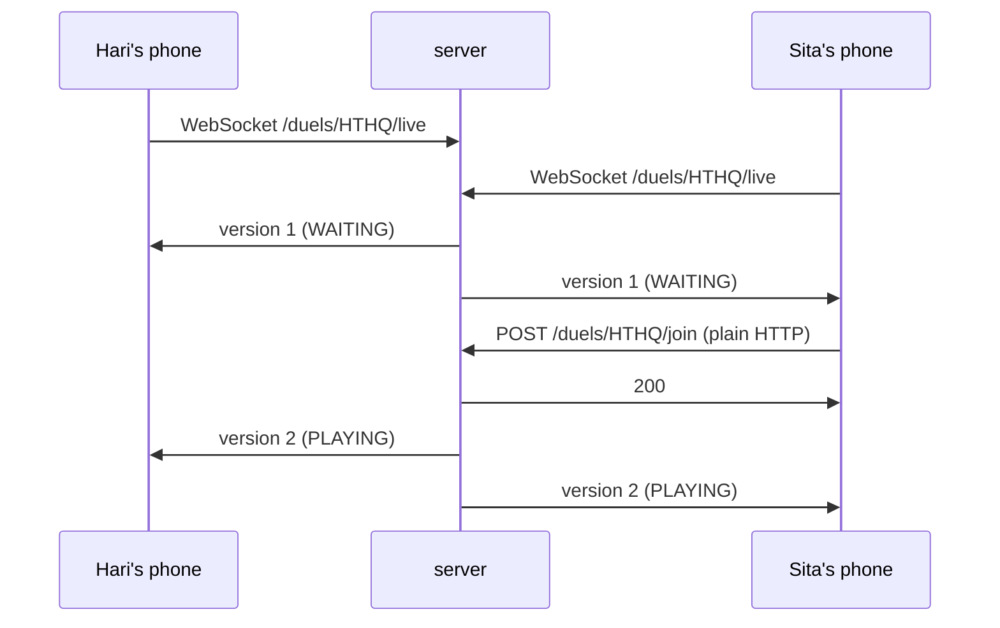

import Quiz from '../../../components/Quiz.astro';
import Think from '../../../components/Think.astro';
import { Aside } from '@astrojs/starlight/components';

<Aside type="tip" title="3 steps · ≈50 min · in your Spring app">
**Step 1:** a WebSocket endpoint, `/duels/{code}/live`, that sends the duel when a phone connects. **Step 2:** push the duel to every watching phone each time it changes, and delete the long polling. **Step 3:** one sender per socket at a time. Win: two phones see every change within 0.1 s. A 4-thread server holds 20 open sockets without slowing down, and 600 answers at once all get 200.
</Aside>

## Recall (from memory)

<Think id="maths-l25-recall-1" prompt="Lesson 24: list what your hand-made WebSocket server had to do itself, from the first byte of the request to the close." revealLabel="Check">
Read the HTTP request and headers, compute `Sec-WebSocket-Accept`, write the 101, then write frames (FIN + opcode, length in 1, 3 or 9 bytes), read masked frames and undo the mask, and send a Close frame. Spring does **all** of that today. You'll write `afterConnectionEstablished`, `afterConnectionClosed` and `sendMessage`, and never see a frame.
</Think>

<Think id="maths-l25-recall-2" prompt="Lesson 20: the lambda you pass to repository.update must be short and simple. What kind of work must never go inside it, and why?" revealLabel="Check">
Slow work, like network calls, file reads or sleeps. While the lambda runs, the duel is locked (and some other keys too), so everyone else waits. Sending a WebSocket message **is** a network call, so it goes after `update` returns, not inside.
</Think>

## The shape

The phone keeps doing what it did: `POST` answers, `POST` join, with all of Lessons 20–22's safety. What's new is a second connection, open for the whole duel, that only carries news **from** the server:



Answers stay on HTTP because you've already made them safe there (idempotent retries, clear status codes). The socket is the one thing HTTP couldn't do: the server speaking first.

## Step 1 · A live endpoint

Spring's WebSocket support is a separate starter. In `app/build.gradle.kts`:

```kotlin {2}
	implementation("org.springframework.boot:spring-boot-starter-webmvc")
	implementation("org.springframework.boot:spring-boot-starter-websocket")
```

Three small classes. First, **who's watching what**. It's state shared by many threads, so it's Lesson 20's `ConcurrentHashMap`, from a duel code to the set of open sockets:

```kotlin
package dev.hari.maths

import org.springframework.stereotype.Component
import org.springframework.web.socket.TextMessage
import org.springframework.web.socket.WebSocketSession
import tools.jackson.databind.json.JsonMapper
import java.util.concurrent.ConcurrentHashMap

// Which phones are watching which duel, and how to tell them
@Component
class LiveDuels(private val jsonMapper: JsonMapper) {

    // duel code → the open sockets watching it
    private val watchers = ConcurrentHashMap<String, MutableSet<WebSocketSession>>()

    fun watch(code: String, session: WebSocketSession) {
        val sessions = watchers.computeIfAbsent(code) { ConcurrentHashMap.newKeySet() }
        sessions.add(session)
        println("[${Thread.currentThread().name}] socket ${session.id} watches $code, ${sessions.size} watching")
    }

    fun unwatch(code: String, session: WebSocketSession) {
        watchers[code]?.remove(session)
        println("[${Thread.currentThread().name}] socket ${session.id} left $code")
    }

    // Sends the duel, as the phone sees it, to everyone watching it
    fun send(duel: Duel) {
        for (session in watchers[duel.code].orEmpty()) {
            sendTo(session, duel)
        }
    }

    fun sendTo(session: WebSocketSession, duel: Duel) {
        val message = TextMessage(jsonMapper.writeValueAsString(duel.toResponse()))
        if (session.isOpen) {
            session.sendMessage(message)
        }
    }
}
```

- A `WebSocketSession` is one open socket: Spring's object for Lesson 24's connection after the 101.
- `ConcurrentHashMap.newKeySet()` is a `Set` that many threads can share, made from the same map.
- `JsonMapper` is the Jackson object Spring already uses to turn your controllers' return values into JSON. Asking for it in the constructor gets the same one, so the socket sends exactly what `GET /duels/{code}` returns: `toResponse()`, with its `version`.

Second, the **handler**: the socket's controller. Spring calls it when a phone connects and when the socket closes:

```kotlin
package dev.hari.maths

import org.springframework.stereotype.Component
import org.springframework.web.socket.CloseStatus
import org.springframework.web.socket.WebSocketSession
import org.springframework.web.socket.handler.TextWebSocketHandler

// A phone's live connection to one duel: ws://localhost:8080/duels/{code}/live
@Component
class DuelSocketHandler(
    private val duelService: DuelService,
    private val liveDuels: LiveDuels,
) : TextWebSocketHandler() {

    override fun afterConnectionEstablished(session: WebSocketSession) {
        val code = codeOf(session)
        liveDuels.watch(code, session)
        // Start the phone off with the duel as it is now
        liveDuels.sendTo(session, duelService.get(code))
    }

    override fun afterConnectionClosed(session: WebSocketSession, status: CloseStatus) {
        liveDuels.unwatch(codeOf(session), session)
    }

    // "/duels/OVCE/live" → "OVCE"
    private fun codeOf(session: WebSocketSession): String {
        return session.uri!!.path.split("/")[2]
    }
}
```

**Watch first, then read.** If it read the duel first and then registered, a change landing in between could be missed. Registering first closes that gap, but the initial snapshot and a push can still cross in flight: version 2 can arrive just before the initial version 1. The phone must apply Lesson 22's rule (show only a newer version), which rejects that stale snapshot.

Third, **which path** goes to the handler. That's [Spring's `WebSocketConfigurer`](https://docs.spring.io/spring-framework/reference/web/websocket/server.html):

```kotlin
package dev.hari.maths

import org.springframework.context.annotation.Configuration
import org.springframework.web.socket.config.annotation.EnableWebSocket
import org.springframework.web.socket.config.annotation.WebSocketConfigurer
import org.springframework.web.socket.config.annotation.WebSocketHandlerRegistry

// Which WebSocket paths exist, and who handles them
@Configuration
@EnableWebSocket
class WebSocketConfig(private val duelSocketHandler: DuelSocketHandler) : WebSocketConfigurer {

    override fun registerWebSocketHandlers(registry: WebSocketHandlerRegistry) {
        registry.addHandler(duelSocketHandler, "/duels/*/live")
    }
}
```

`*` matches any one path segment, the duel code. Same port, same Tomcat: the handshake is an HTTP request, so it arrives like any other, and Spring answers it with the 101.

To play the phones, a small Node script using the browser's `WebSocket` (Lesson 24), which prints each message's version, status and scores. Connect to a duel that doesn't exist, too:

```text
❯ node watch.mjs Zen NOPE
Zen's phone 0.0s open
Zen's phone 0.1s closed, code 1011
```

```text
ERROR … ExceptionWebSocketHandlerDecorator : Closing session due to exception for StandardWebSocketSession[id=ccff813b-…, uri=ws://localhost:8080/duels/NOPE/live]
dev.hari.maths.DuelNotFoundException: No duel with NOPE
```

Your `DuelNotFoundException` from `get` became Close code **1011**, "the server hit an error". It's Spring's version of a 500 for sockets. (A `@RestControllerAdvice` doesn't apply here: it's for HTTP responses, and this socket isn't one any more.)

**Commit:** `feat: a live socket per duel`

## Step 2 · Push on every change

Since Lesson 20, every change goes through `repository.update`, and since Lesson 22 the version tells you whether anything changed. So one wrapper in `DuelService` covers everything:

```kotlin
    // Every change to a duel goes through here: update it, then tell whoever is watching
    private fun change(code: String, rule: (Duel) -> Duel): Duel {
        var before = 0L
        val after = repository.update(code) { duel ->
            before = duel.version
            rule(duel)
        }
        if (after.version != before) {
            liveDuels.send(after)
        }
        return after
    }
```

- `before` is captured the way `correct` is in `answer` (Lesson 20).
- `send` runs **after** `update` returns: outside the lock (recall 2).
- If `rule` throws (a 409, a 403), `update` throws, and nothing is sent. Nothing changed.
- A plain GET or a retry returns the duel unchanged, the version stays, and nothing is sent either.

Then use it: `DuelService` gets `LiveDuels` in its constructor, and every `repository.update(code)` in `join`, `answer` and `get` becomes `change(code)`:

```kotlin {3}
class DuelService(
    private val repository: DuelRepository,
    private val liveDuels: LiveDuels,
) {
```

In `answer`, the label follows the function name: `return@update duel` becomes `return@change duel`.

**Delete the long polling** from Lesson 23: `getNewerThan`, the `after` parameter and `LONG_POLL_WAIT`. `GET /duels/{code}` goes back to `duelService.get(code)`. The socket replaces it.

Hari and Sita's phones watch duel HTHQ, and everything else is curl:

```text
## 1.5 s: Sita joins
## 2.5 s: Hari answers question 0
## 3.5 s: Sita answers question 0 wrong
## 4.5 s: a plain GET, and a 409
--- Hari's phone
Hari's phone 0.0s open
Hari's phone 0.1s version 1: WAITING, scores {"Hari":0}
Hari's phone 1.5s version 2: PLAYING, scores {"Hari":0,"Sita":0}
Hari's phone 2.6s version 3: PLAYING, scores {"Hari":1,"Sita":0}
Hari's phone 3.6s version 4: PLAYING, scores {"Hari":1,"Sita":0}
Hari's phone 8.0s closed, code 1000
--- Sita's phone
Sita's phone 0.0s open
Sita's phone 0.1s version 1: WAITING, scores {"Hari":0}
Sita's phone 1.5s version 2: PLAYING, scores {"Hari":0,"Sita":0}
Sita's phone 2.6s version 3: PLAYING, scores {"Hari":1,"Sita":0}
Sita's phone 3.6s version 4: PLAYING, scores {"Hari":1,"Sita":0}
Sita's phone 8.0s closed, code 1000
```

```text
[http-nio-8080-exec-4] socket 4cd08c6a-… watches HTHQ, 1 watching
[http-nio-8080-exec-5] socket 6012b9ca-… watches HTHQ, 2 watching
[http-nio-8080-exec-8] socket 6012b9ca-… left HTHQ
[http-nio-8080-exec-9] socket 4cd08c6a-… left HTHQ
```

Every change reached both phones within about 0.1 s, and neither phone asked for anything. Sita's wrong answer is version 4 with the same scores: her list of answers changed, so the duel changed. The GET and the 409 at 4.5 s sent nothing.

On the phone, it's Lesson 24's OkHttp `WebSocketListener` (today's Android example): `onMessage` parses the JSON, and Lesson 22's rule decides whether it's shown:

```kotlin
override fun onMessage(webSocket: WebSocket, text: String) {
    val duel = json.decodeFromString<DuelResponse>(text)
    _duel.update { shown -> if (shown == null || duel.version > shown.version) duel else shown }
}
```

**Commit:** `feat: push the duel to every watching phone when it changes`

### What an open socket costs

Lesson 23's long polls each held a Tomcat thread, and 4 of them froze a 4-thread server. Same test, with sockets:

```text
## 20 phones open a WebSocket to NRPW (server has 4 threads)
## 2 s later: GET /health
health → 200 after 0.001565s
## Sita joins
join → 200 after 0.008905s
## phones that got version 2:
      20
```

**20 open sockets on 4 threads**, and `/health` took 1.6 ms. An open socket that isn't sending anything doesn't hold a thread. Tomcat watches all the idle connections together and only hands one to a thread when bytes arrive, the same way it waits for HTTP requests. The thread is only busy while a message is actually being read or written. That's the difference from a long poll, where your code sat in a loop **inside** the request.

## Step 3 · One sender at a time

Look at `send` again. Hari's answer runs on one Tomcat thread, Sita's on another. If they finish at the same instant, **both threads call `sendMessage` on Hari's socket at once**. Spring's docs: "the application must synchronize the sending of messages since the underlying standard WebSocket session (JSR-356) does not allow concurrent sending."

Is that real? I opened 300 duels with a watching socket on each, then had Hari and Sita answer question 0 at the same instant in every duel, Lesson 19 style:

```text
300 duels, two answers at the same instant in each: 388 of 600 answers got 200
```

```text
ERROR … Request processing failed: java.lang.IllegalStateException: The remote endpoint was in state [TEXT_PARTIAL_WRITING] which is an invalid state for called method
```

**212 answers got a 500.** Worse: the answer was **saved** (the push happens after `update`), but the phone was told the server failed. It's Lesson 19's race again, on the socket instead of the map: two threads in the middle of writing one frame each.

The fix is Lesson 20's first tool. `synchronized(session)`: one thread at a time per socket, and other sockets don't wait. In `sendTo`:

```kotlin {3-7}
    fun sendTo(session: WebSocketSession, duel: Duel) {
        val message = TextMessage(jsonMapper.writeValueAsString(duel.toResponse()))
        // One message at a time per socket: Spring's sessions don't allow sending from two threads at once
        synchronized(session) {
            if (session.isOpen) {
                session.sendMessage(message)
            }
        }
    }
```

```text
300 duels, two answers at the same instant in each: 600 of 600 answers got 200
messages received: 900, sockets closed by the server: 0
```

900 = 300 on connect + 2 pushes per duel. Every one delivered. (Spring also has a ready-made wrapper for this, `ConcurrentWebSocketSessionDecorator`, which queues messages instead of making threads wait.)

**Commit:** `fix: one thread at a time writes to a socket`

<Aside type="caution" title="What this version leaves out">
1. **A phone that loses its connection** misses pushes and doesn't know it. That's Lesson 26: heartbeats, reconnecting, and catching up with the version.
2. **No check on who's watching.** Anyone with a duel's code can watch it. Watching is read-only, so it's like `GET /duels/{code}` today.
3. **Codes with no remaining watchers** leave an empty set in `watchers`. It is reclaimed when the server restarts, but many different codes can leave many empty sets during a long run. Lesson 26 will remove the map entry when its final socket leaves.
</Aside>

<Aside type="note" title="The thing to remember">
Spring does Lesson 24's handshake and frames. You write a `TextWebSocketHandler` (connect, close) and register it on a path. Keep a thread-safe map from duel code to open sockets. Push from **one place**: a `change` wrapper around `repository.update`, sending **after** the lock and only when the version changed. An idle socket costs no thread, unlike a long poll. But a socket must only be written by **one thread at a time**, so wrap `sendMessage` in `synchronized(session)`.
</Aside>

## Check yourself

<Quiz
  question="Where does liveDuels.send run, and why there?"
  options={[
    "Inside the lambda, so it's atomic",
    'After update returns, outside the lock',
    'In the controller, after the response',
  ]}
  answer={1}
>
Sending is network work, and the lambda holds the duel's lock (Lesson 20). The `change` wrapper sends once `update` has returned, and only if the version moved.
</Quiz>

<Quiz
  question="20 open sockets on a 4-thread server. /health takes…"
  options={[
    'About 25 seconds, all threads held',
    'Forever, until one socket finally closes',
    'Milliseconds, idle sockets hold no thread',
  ]}
  answer={2}
>
1.6 ms in the real run. Tomcat only gives a socket a thread while a message is being read or written.
</Quiz>

<Quiz
  question="Why is sendMessage wrapped in synchronized(session)?"
  options={[
    'Two threads may send to one socket',
    'The watchers map is shared between threads',
    'Jackson cannot write JSON from two threads',
  ]}
  answer={0}
>
Hari's and Sita's answers can finish together and both push to the same phone. Without the lock, 212 of 600 answers got `TEXT_PARTIAL_WRITING` and a 500.
</Quiz>

## Your turn

<Think id="maths-l25-time" prompt="Lesson 18 finishes a duel lazily: the next request after second 60 notices that time is up. With phones now only listening on their sockets, what does Hari's phone show at second 60? How would you fix it? (Hint: Lesson 10's thread pools have a cousin that runs work later.)" revealLabel="Check">
Nothing happens at second 60. Nobody sends a request, so nobody runs `get`, so nothing finishes the duel and nothing is pushed:

```text
## duel TOMU, Sita has joined; Hari's phone watches for 65 s, nobody sends anything
Hari's phone 0.0s open
Hari's phone 0.0s version 2: PLAYING, scores {"Hari":0,"Sita":0}
Hari's phone 65.0s closed, code 1000
## then a GET
"status":"FINISHED" "version":3
```

The duel was over, but the screen said PLAYING until someone happened to ask. Polling hid this, because polling *was* a request every second. The fix: the server asks itself. A `ScheduledExecutorService` runs a task after a delay on its own thread. In `DuelService`:

```kotlin
    // Runs work later, on its own thread: here, the end of each duel
    private val timer = Executors.newSingleThreadScheduledExecutor()
```

and in `join`, after the change:

```kotlin {2,14-16}
    fun join(code: String, playerName: String): Duel {
        val joined = change(code) { duel ->
            if (duel.status != DuelStatus.WAITING) {
                throw DuelConflictException("DUEL_NOT_WAITING", "Duel $code is ${duel.status}, so nobody can join it")
            }
            duel.copy(
                status = DuelStatus.PLAYING,
                opponentName = playerName,
                answers = duel.answers + (playerName to emptyList()),
                startedAt = Instant.now(),
            )
        }
        // Nobody may ask at second 60, so the server asks itself
        timer.schedule({ get(code) }, DUEL_LENGTH.toMillis(), TimeUnit.MILLISECONDS)
        return joined
    }
```

(`import java.util.concurrent.Executors` and `java.util.concurrent.TimeUnit`.) It reuses `get`: `finishIfTimeUp` inside the lock, a new version, a push. If the duel already finished early, `get` changes nothing and pushes nothing.

```text
## duel IXLD, Sita has joined; Hari's phone watches for 65 s, nobody sends anything
Hari's phone 0.0s open
Hari's phone 0.0s version 2: PLAYING, scores {"Hari":0,"Sita":0}
Hari's phone 60.0s version 3: FINISHED, scores {"Hari":0,"Sita":0}
Hari's phone 65.0s closed, code 1000
```

```text
[pool-2-thread-1] time is up for IXLD
```

At 60.0 s, on the timer's own thread. The lazy check stays as a safety net.

**Commit:** `feat: the server finishes each duel at second 60`
</Think>

<Think id="maths-l25-teachback" prompt="Explain to another Android developer, in 3–4 sentences: how the server knows which phones to tell, where the push happens and why there, why an open socket is cheaper than a long poll, and the one threading rule for sending." revealLabel="Compare with a model answer">
When a phone opens `/duels/{code}/live`, the handler adds its session to a thread-safe map from duel code to sockets, and removes it when the socket closes. Every change to a duel goes through one `change` wrapper around `repository.update`, which pushes the duel's JSON to that duel's sockets after the lock is released, and only if the version changed. An idle socket costs no thread, because Tomcat only gives it one while bytes are moving, so 20 sockets on 4 threads were fine, where 4 long polls froze everything. Two threads can push to the same socket at once, so each send is wrapped in `synchronized(session)`; without it, 212 of 600 answers failed with a 500.
</Think>

## Read alongside
- 📖 **Primary:** [Spring Framework: WebSocket API](https://docs.spring.io/spring-framework/reference/web/websocket/server.html), the first three sections: WebSocketHandler, WebSocket Handshake, Server Configuration (15 min).
- [Java docs: `ScheduledExecutorService`](https://docs.oracle.com/en/java/javase/25/docs/api/java.base/java/util/concurrent/ScheduledExecutorService.html), for the exercise.
- [OkHttp `WebSocketListener`](https://github.com/square/okhttp/blob/master/okhttp/src/commonJvmAndroid/kotlin/okhttp3/WebSocketListener.kt), the phone side.

🙋 Ask me: "what's STOMP, and should I use it?", "how would this work with two servers?", "what happens to the sockets when the server restarts?", "can the phone send answers over the socket instead?"

**Go deeper:** [25.1 · One socket, end to end](../0025a-one-socket-end-to-end/): every line of `LiveDuels`, traced, with threads and bytes.

**Next:** [Lesson 26: When the phone disappears](../0026-disconnects-and-reconnects/). Phones go through tunnels. How each side notices a dead connection (heartbeats), how the phone reconnects, and how the version tells it what it missed.
