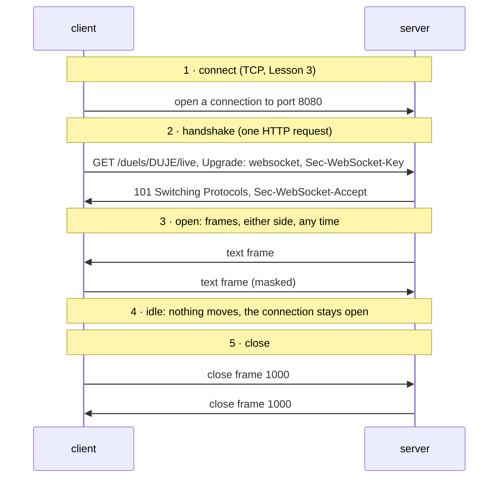
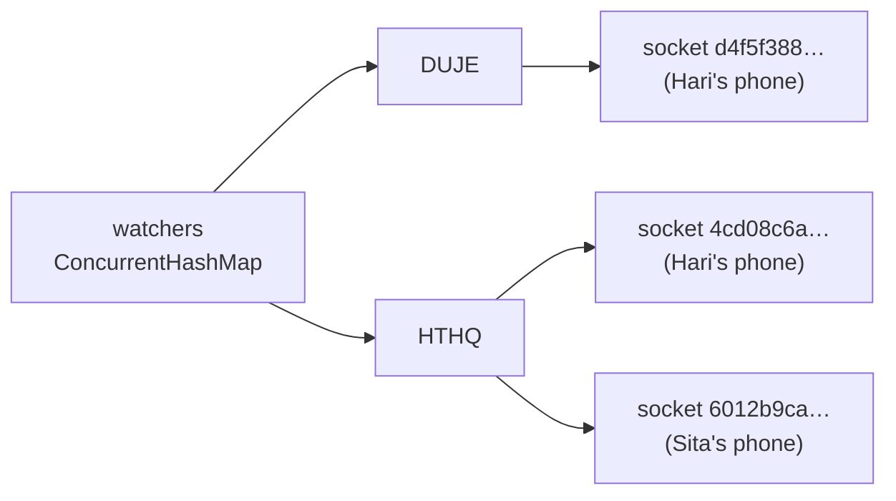
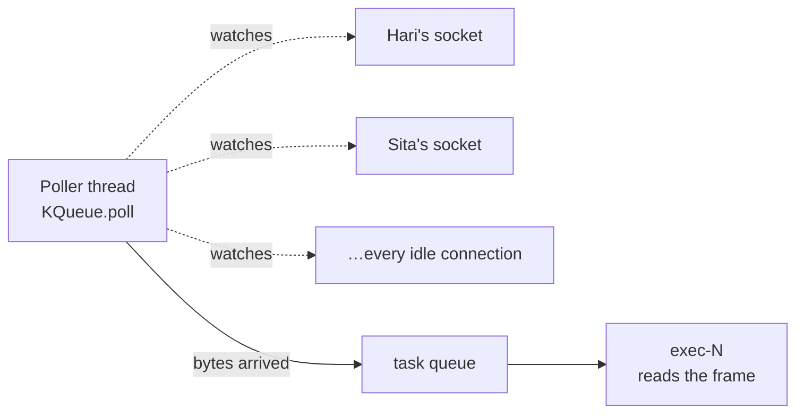
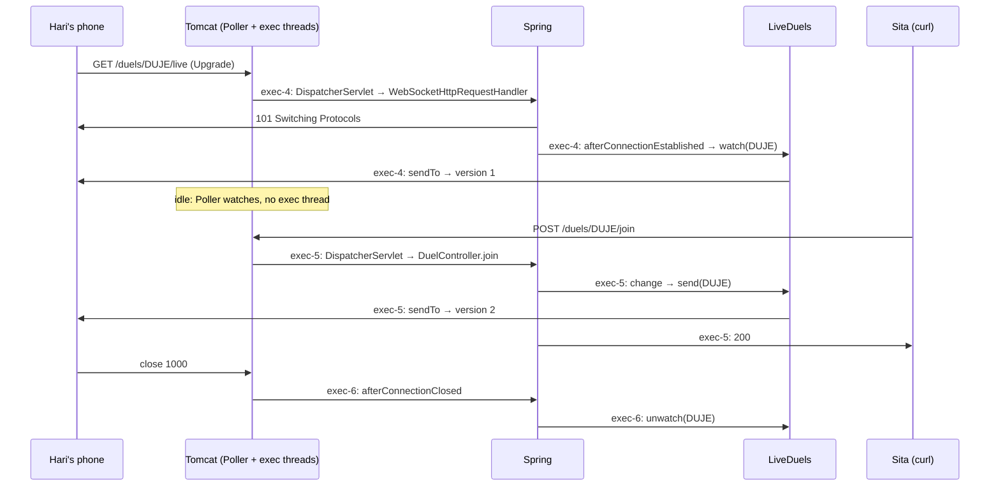

import Quiz from '../../../components/Quiz.astro';
import Think from '../../../components/Think.astro';
import { Aside } from '@astrojs/starlight/components';

<Aside type="tip" title="A subchapter of Lesson 25 · ≈35 min · reading and one experiment">
No new feature. This page follows **one socket** through its whole life and stops at every line of `LiveDuels`. Everything below was measured on the Lesson 25 server: the debug logs, the call chains (with a small `trace()` helper you can paste in), the raw bytes, and the threads while the socket sits idle.
</Aside>

## Predict first

<Think id="maths-l25a-predict" prompt="Hari's phone has a socket open on duel DUJE. Sita joins with a plain HTTP POST. The server pushes version 2 to Hari. Which thread writes those bytes into Hari's socket? (A thread that belongs to Hari's socket? Tomcat's Poller? Something else?)" revealLabel="Check">
**Sita's join request's own thread**, `http-nio-8080-exec-5`. No thread belongs to Hari's socket. The call chain at the end of this page goes all the way from Tomcat to `DuelController.join` to `LiveDuels.sendTo` on that one thread. Whoever changes the duel delivers the news.
</Think>

## The life of any WebSocket, in five stages

This is true of every WebSocket, whatever language or framework (Lesson 24 built each stage by hand):



| Stage | Hand-made (Lesson 24) | Spring (Lesson 25) |
|---|---|---|
| 1 · connect | `server.accept()` | Tomcat's Acceptor thread |
| 2 · handshake | read headers, `acceptFor`, write 101 | `WebSocketHttpRequestHandler` and Tomcat |
| 3 · frames | `sendText`, `readText` | `session.sendMessage(TextMessage)`, `handleTextMessage` |
| 4 · idle | one thread blocked in `read()` | the **Poller** thread watches it, no worker thread |
| 5 · close | `sendClose` | `afterConnectionClosed` |

You write only three things: what happens on open, what happens on close, and when to send. That's `DuelSocketHandler` and `LiveDuels`.

## Our case: the map in the middle

`LiveDuels` exists for one question: **when duel DUJE changes, which sockets do I write to?** Its whole state is one map:



Three functions keep it right: `watch` adds a socket when a phone opens one, `unwatch` removes it when the socket closes, and `send` reads it whenever a duel changes. Let's watch each happen, in order.

### The `trace()` helper

To see **how** we got into each function, this prints the current thread and the chain of calls that led there (Lesson 13's stack trace, without the exception):

```kotlin
// Prints which thread we're on and every function call that led here, newest first
fun trace(label: String) {
    val frames = Throwable().stackTrace.drop(1).map { "${it.className}.${it.methodName}" }
    println("[${Thread.currentThread().name}] $label\n" + frames.joinToString("\n") { "    at $it" })
}
```

I called it at the top of `afterConnectionEstablished` and `sendTo`, and ran the server with Spring's WebSocket debug logs on: `--logging.level.org.springframework.web.socket=DEBUG --logging.level.org.springframework.web.servlet.DispatcherServlet=DEBUG`. The phone was a 30-line Python script with no WebSocket library, so we see the raw bytes it receives. (Two runs: duel DUJE with the traces, then GQCG with the debug logs and the `kill -9`. Same code, same threads.)

## Stage 2 · The handshake is a normal request

```text
[exec-4] DispatcherServlet        : GET "/duels/GQCG/live", parameters={}
[exec-4] WebSocketHandlerMapping  : Mapped to …WebSocketHttpRequestHandler@3730f716
[exec-4] WebSocketHttpRequestHandler : GET /duels/GQCG/live
[exec-4] DispatcherServlet        : Completed 101 SWITCHING_PROTOCOLS
[exec-4] LoggingWebSocketHandlerDecorator : New StandardWebSocketSession[id=f0d7d219-…, uri=ws://localhost:8080/duels/GQCG/live]
```

The handshake goes through the **same `DispatcherServlet`** as `POST /duels`. The only difference is the handler mapping: `WebSocketConfig`'s `"/duels/*/live"` registered a `WebSocketHandlerMapping`, which sends this one path to `WebSocketHttpRequestHandler` instead of a `@RestController`. That handler checks the `Upgrade` headers, computes the accept key, and has Tomcat answer:

```text
HTTP/1.1 101
Upgrade: websocket
Connection: upgrade
Sec-WebSocket-Accept: s3pPLMBiTxaQ9kYGzzhZRbK+xOo=
Date: Mon, 23 Nov 2026 05:00:18 GMT
```

The Python phone sent the RFC's example key, so this is **exactly** the accept your `acceptFor` computed in Lesson 24. (No "Switching Protocols" after `101`: Tomcat never sends reason phrases, Lesson 11.)

## Stage 3a · Open: `afterConnectionEstablished`

```text
[http-nio-8080-exec-4] afterConnectionEstablished for DUJE
    at dev.hari.maths.DuelSocketHandler.afterConnectionEstablished
    at org.springframework.web.socket.handler.WebSocketHandlerDecorator.afterConnectionEstablished
    at org.springframework.web.socket.handler.LoggingWebSocketHandlerDecorator.afterConnectionEstablished
    at org.springframework.web.socket.handler.ExceptionWebSocketHandlerDecorator.afterConnectionEstablished
    at org.springframework.web.socket.adapter.standard.StandardWebSocketHandlerAdapter.onOpen
    at org.apache.tomcat.websocket.server.WsHttpUpgradeHandler.init
    at org.apache.coyote.AbstractProtocol$ConnectionHandler.process
    at org.apache.tomcat.util.net.NioEndpoint$SocketProcessor.doRun
    …
    at java.lang.Thread.run
session is a org.springframework.web.socket.adapter.standard.StandardWebSocketSession, wrapping org.apache.tomcat.websocket.WsSession
```

Read it bottom up, the way Lesson 13 taught:

1. A Tomcat worker thread (`exec-4`, the same one that handled the handshake) runs `NioEndpoint$SocketProcessor`: "this connection needs work".
2. `WsHttpUpgradeHandler.init`: Tomcat has **upgraded** the connection. From here on, Tomcat's WebSocket code owns it, not its HTTP code.
3. `StandardWebSocketHandlerAdapter.onOpen`: Spring's adapter. Tomcat speaks the Java standard WebSocket API (JSR-356), and Spring translates it into its own `WebSocketHandler` calls.
4. Two **decorators** wrap your handler. `ExceptionWebSocketHandlerDecorator` catches anything you throw and closes the socket with 1011 (the `NOPE` duel in Lesson 25). `LoggingWebSocketHandlerDecorator` writes those DEBUG lines.
5. Your `afterConnectionEstablished`.

And the `session` you get is two objects: Spring's `StandardWebSocketSession`, wrapping Tomcat's `WsSession`, the thing that actually owns the connection. That's what goes into the map.

## Stage 3b · `watch`, line by line

```kotlin
    fun watch(code: String, session: WebSocketSession) {
        val sessions = watchers.computeIfAbsent(code) { ConcurrentHashMap.newKeySet() }
        sessions.add(session)
        println("[${Thread.currentThread().name}] socket ${session.id} watches $code, ${sessions.size} watching")
    }
```

```text
[http-nio-8080-exec-4] socket d4f5f388-e634-40bc-9ec2-7b8c69b1d974 watches DUJE, 1 watching
```

- **`computeIfAbsent(code) { newKeySet() }`**: "give me DUJE's set, and if there isn't one, make it", as one atomic step (Lesson 21's `createOnce` used the same call). Why not the obvious way, `map[code] ?: newSet.also { map[code] = it }`? Because Hari and Sita often open their sockets at the same moment, and DUJE's set doesn't exist yet. I raced the two versions: two threads, each watching the same 100,000 brand-new duels at the same instant:

  ```text
  check, then put  : 241 of 100000 duels lost a watcher
  computeIfAbsent  : 0 of 100000 duels lost a watcher
  check, then put  : 476 of 100000 duels lost a watcher
  computeIfAbsent  : 0 of 100000 duels lost a watcher
  ```

  With check-then-put, both threads see "no set", both make one, and the second `put` replaces the first, **with the first phone's socket inside it**. That phone would never get a push. It's Lesson 19's lost update, on the watchers.
- **`ConcurrentHashMap.newKeySet()`**: "a new Set backed by a ConcurrentHashMap" (the Java docs). A plain `mutableSetOf()` would lose adds the same way Lesson 19's `mutableMapOf` lost entries, because `add` and `remove` come from different threads.
- **`session.id`**: a random UUID Spring gives each socket, handy for logs. It has nothing to do with the duel or the player.

## Stage 3c · `sendTo` on open

```kotlin
    fun sendTo(session: WebSocketSession, duel: Duel) {
        val message = TextMessage(jsonMapper.writeValueAsString(duel.toResponse()))
        if (session.isOpen) {
            session.sendMessage(message)
        }
    }
```

`afterConnectionEstablished` calls it straight away, still on `exec-4`, so the phone starts with the current duel. What the Python phone received:

```text
frame: 81 7e 00 8b → opcode 1, 139 bytes
{"code":"DUJE","playerName":"Hari","status":"WAITING","opponentName":null,"winner":null,"scores":{"Hari":0},"secondsLeft":null,"version":1}
```

- `duel.toResponse()`: the same `DuelResponse` that `GET /duels/DUJE` returns, so the phone has one parser for both.
- `jsonMapper.writeValueAsString(…)`: Jackson, the object Spring uses for every controller response, turns it into a `String` of JSON.
- `TextMessage(…)`: Spring's name for "a text frame's payload". Opcode 1.
- `sendMessage`: Tomcat writes the frame **on the calling thread**, right now. `81` = FIN + text. `7e` = 126: "the length is in the next 2 bytes". `00 8b` = 139. That's your Lesson 24 exercise, done by Tomcat.
- `if (session.isOpen)`: skip sockets that have closed but haven't been unwatched yet. It narrows the gap, but it doesn't close it: a socket can close **just after** the check. Then `sendMessage` throws, on whichever thread was sending. Lesson 26 is about exactly those connections.

## Stage 4 · Idle: who's holding the socket?

Hari's phone now waits. Nothing moves. I took a `jstack` (Lesson 11) of the server in that moment:

```text
"http-nio-8080-exec-1" … WAITING (parking)
	at java.util.concurrent.LinkedBlockingQueue.take
	at org.apache.tomcat.util.threads.TaskQueue.take
… the same for exec-2 to exec-10 …

"http-nio-8080-Poller" … RUNNABLE
	at sun.nio.ch.KQueue.poll(Native Method)
	…
	at org.apache.tomcat.util.net.NioEndpoint$Poller.run
```

All 10 worker threads are parked in `TaskQueue.take`: "give me work". Not one frame from `dev.hari.maths` in the whole dump. The open socket belongs to the **Poller**, a single thread that asks the operating system (`KQueue.poll`, macOS's tool for this) "tell me when any of these connections has bytes to read". It watches every idle connection at once, HTTP keep-alives and WebSockets alike. That's why Lesson 25's 20 sockets didn't slow down a 4-thread server.



## Stage 3d · The push: `send`, from someone else's request

Sita joins with `curl -X POST …/duels/DUJE/join`. Hari's phone receives:

```text
frame: 81 7e 00 94 → opcode 1, 148 bytes
{"code":"DUJE","playerName":"Hari","status":"PLAYING","opponentName":"Sita","winner":null,"scores":{"Hari":0,"Sita":0},"secondsLeft":59,"version":2}
```

And the trace in `sendTo`, on a different thread:

```text
[http-nio-8080-exec-5] sendTo d4f5f388-e634-40bc-9ec2-7b8c69b1d974: 148 bytes
    at dev.hari.maths.LiveDuels.sendTo
    at dev.hari.maths.LiveDuels.send
    at dev.hari.maths.DuelService.change
    at dev.hari.maths.DuelService.join
    at dev.hari.maths.DuelController.join
    …
    at org.springframework.web.servlet.DispatcherServlet.doDispatch
    …
    at org.apache.tomcat.websocket.server.WsFilter.doFilter
    …
    at org.apache.coyote.http11.Http11Processor.service
    …
    at java.lang.Thread.run
```

There's your prediction. `exec-5` is running **Sita's HTTP request**: `Http11Processor` (HTTP, not WebSocket) → `DispatcherServlet` → your `DuelController.join` → `DuelService.join` → `change` → `LiveDuels.send` → `sendTo` → Hari's socket. Hari's socket has no thread of its own. The thread that changed the duel writes the news into every watcher's socket, then goes back and finishes Sita's 200.

(`WsFilter` is Tomcat checking every HTTP request for "is this a WebSocket upgrade?". For Sita's POST, no, so it passes it on.)

`send` itself:

```kotlin
    fun send(duel: Duel) {
        for (session in watchers[duel.code].orEmpty()) {
            sendTo(session, duel)
        }
    }
```

- `watchers[duel.code]` is `null` when nobody has ever watched this duel, and `.orEmpty()` turns that into an empty set: no phones, no work.
- The `for` loop walks a set that other threads may change **while** it walks: a phone connecting, another closing. The Java docs promise this is fine. The iterator shows "the state of the hash table at some point at or since the creation of the iterator" and does "not throw ConcurrentModificationException". A plain `HashSet` would throw.
- One loop, one thread: with two watchers, Sita's request writes to Hari's socket, then to Sita's own socket, one after the other.

And Lesson 25 Step 3 sits right here. Hari's answer and Sita's answer, on two threads, can both reach `sendTo(haris socket)` at the same instant. That's why the finished version wraps `sendMessage` in `synchronized(session)`.

## Stage 5 · Close, both ways

**Politely.** The Python phone sent a (masked) close frame with 1000. Tomcat answered with its own, which arrived as `88 02 03 e8`: close, 2 bytes, status `0x03e8` = 1000. Then, on another worker:

```text
[http-nio-8080-exec-6] closed: CloseStatus[code=1000, reason=null]
[http-nio-8080-exec-6] socket d4f5f388-e634-40bc-9ec2-7b8c69b1d974 left DUJE
```

The Poller saw bytes arrive, a worker (`exec-6`) read the close frame, and Spring called `afterConnectionClosed` → `unwatch` → `watchers["DUJE"]?.remove(session)`. DUJE's set is empty again.

**Rudely.** A Node phone, killed with `kill -9`: no close frame, the process is just gone. The operating system still closes the TCP connection for it:

```text
[exec-5] LoggingWebSocketHandlerDecorator : Transport error in StandardWebSocketSession[id=f0d7d219-…]
java.io.EOFException
	at org.apache.tomcat.util.net.NioEndpoint$NioSocketWrapper.fillReadBuffer
	…
	at org.apache.tomcat.websocket.server.WsFrameServer.onDataAvailable
[exec-5] … closed with CloseStatus[code=1006, reason=null]
[http-nio-8080-exec-5] socket f0d7d219-… left GQCG
```

`EOFException`: Tomcat tried to read and found the end of the stream. Close code **1006**, "abnormal closure" (the same 1006 your hand-made server caused in Lesson 24). Either way, `afterConnectionClosed` runs and `unwatch` cleans up.

But both endings needed **something to arrive**: a close frame, or the OS saying the connection is gone. A phone that drives into a tunnel sends neither. Its socket just goes quiet, and the server can't tell "quiet" from "gone". That's Lesson 26.

## The whole flow, on one page



<Aside type="note" title="The thing to remember">
A WebSocket has five stages: connect, a one-request HTTP handshake (101), frames both ways, idle, close. In Spring the handshake goes through the same `DispatcherServlet` as your controllers, then Tomcat upgrades the connection and Spring calls `afterConnectionEstablished`. While it's idle, **no worker thread** holds the socket: the Poller watches it. A push is written by **whichever thread changed the duel**, usually another phone's HTTP request, so `LiveDuels` is shared state touched by many threads at once: `computeIfAbsent` and `newKeySet` keep it safe, and `synchronized(session)` keeps one writer per socket. A close, polite (1000) or abrupt (1006), only gets noticed if something arrives.
</Aside>

## Check yourself

<Quiz
  question="Which thread writes version 2 into Hari's socket?"
  options={[
    'The Poller thread watching sockets',
    "Sita's join request thread, exec-5",
    'A thread reserved for Hari',
  ]}
  answer={1}
>
The `sendTo` trace runs from `Http11Processor` through `DuelController.join` to `LiveDuels.sendTo`, all on `exec-5`. The Poller only notices incoming bytes, and no thread is reserved per socket.
</Quiz>

<Quiz
  question="Hari's phone is killed with no close frame. What does the server see?"
  options={[
    'An EOF, then close code 1006',
    'A close frame with code 1000',
    'Nothing, until the duel is finished',
  ]}
  answer={0}
>
The operating system closed the TCP connection, so Tomcat's next read hit `EOFException`, and Spring reported 1006. A phone in a tunnel is different: nothing arrives at all.
</Quiz>

<Quiz
  question="Why computeIfAbsent instead of check, then put?"
  options={[
    'It runs faster than two map calls',
    'Kotlin maps cannot hold a mutable set',
    'Two first watchers could make two sets',
  ]}
  answer={2}
>
Hari and Sita connecting to a new duel at once can both see "no set" and both create one, and the second replaces the first with its socket inside. 241 and 476 of 100,000 lost a watcher. `computeIfAbsent`: 0.
</Quiz>

## Your turn

<Think id="maths-l25a-once" prompt="With two phones watching DUJE, send calls sendTo twice, and sendTo turns the duel into JSON each time. The JSON is the same for both phones. How would you change send and sendTo so it's built once per change? Watch out for one field in DuelResponse." revealLabel="Check">
Build the `TextMessage` in `send`, once, and pass it in:

```kotlin
    fun send(duel: Duel) {
        val message = messageFor(duel)
        for (session in watchers[duel.code].orEmpty()) {
            sendTo(session, message)
        }
    }

    fun sendTo(session: WebSocketSession, message: TextMessage) {
        if (session.isOpen) {
            session.sendMessage(message)
        }
    }

    fun messageFor(duel: Duel) = TextMessage(jsonMapper.writeValueAsString(duel.toResponse()))
```

and the handler calls `liveDuels.sendTo(session, liveDuels.messageFor(duel))`. The field to watch is **`secondsLeft`**: `toResponse()` works it out from the clock. Built once, both phones get the same `secondsLeft` even if the second write happens a few milliseconds later. That's fine (it's whole seconds, and the phone counts down by itself between pushes), but it's the one field where "once" and "per phone" could differ.
</Think>

<Think id="maths-l25a-teachback" prompt="Explain to another Android developer, in 4–5 sentences, what happens on the server from Hari's phone opening ws://…/duels/DUJE/live to it receiving version 2 after Sita joins. Name the threads." revealLabel="Compare with a model answer">
The phone's handshake is an ordinary HTTP GET, handled on a Tomcat worker (exec-4) by the same `DispatcherServlet` as the controllers, but mapped to Spring's `WebSocketHttpRequestHandler`, which answers 101. Tomcat then upgrades the connection, and on that same thread Spring calls `afterConnectionEstablished`, which adds the socket to `LiveDuels`' map under DUJE and sends version 1. While nothing happens, no worker thread holds the socket: Tomcat's single Poller thread watches it with all the other idle connections. When Sita POSTs her join, her request's worker (exec-5) runs `DuelController.join` → `DuelService.change` → `LiveDuels.send`, which looks up DUJE's sockets and writes version 2 into Hari's socket itself, before returning Sita's 200. When the socket closes (1000, or 1006 if the phone just disappears), `afterConnectionClosed` removes it from the map.
</Think>

## Read alongside
- 📖 **Primary:** [Spring Framework: WebSocket API](https://docs.spring.io/spring-framework/reference/web/websocket/server.html), "WebSocketHandler" and "Deployment": what the handler mapping and `WebSocketHttpRequestHandler` do (15 min).
- [Java docs: `ConcurrentHashMap`](https://docs.oracle.com/en/java/javase/25/docs/api/java.base/java/util/concurrent/ConcurrentHashMap.html), the class description: what its iterators promise, and `newKeySet`.
- [Tomcat: the NIO connector](https://tomcat.apache.org/tomcat-11.0-doc/config/http.html#Connector_Comparison), the table of what's blocking and what isn't.

🙋 Ask me: "what if `sendMessage` is slow for one phone, does Sita's 200 wait?", "what does the Acceptor thread do?", "how would two servers share watchers?", "can I see the frames in Chrome DevTools?"

**Back to:** [Lesson 25](../0025-websockets-in-spring/) · **Next:** [Lesson 26: disconnects](../0026-disconnects/).
