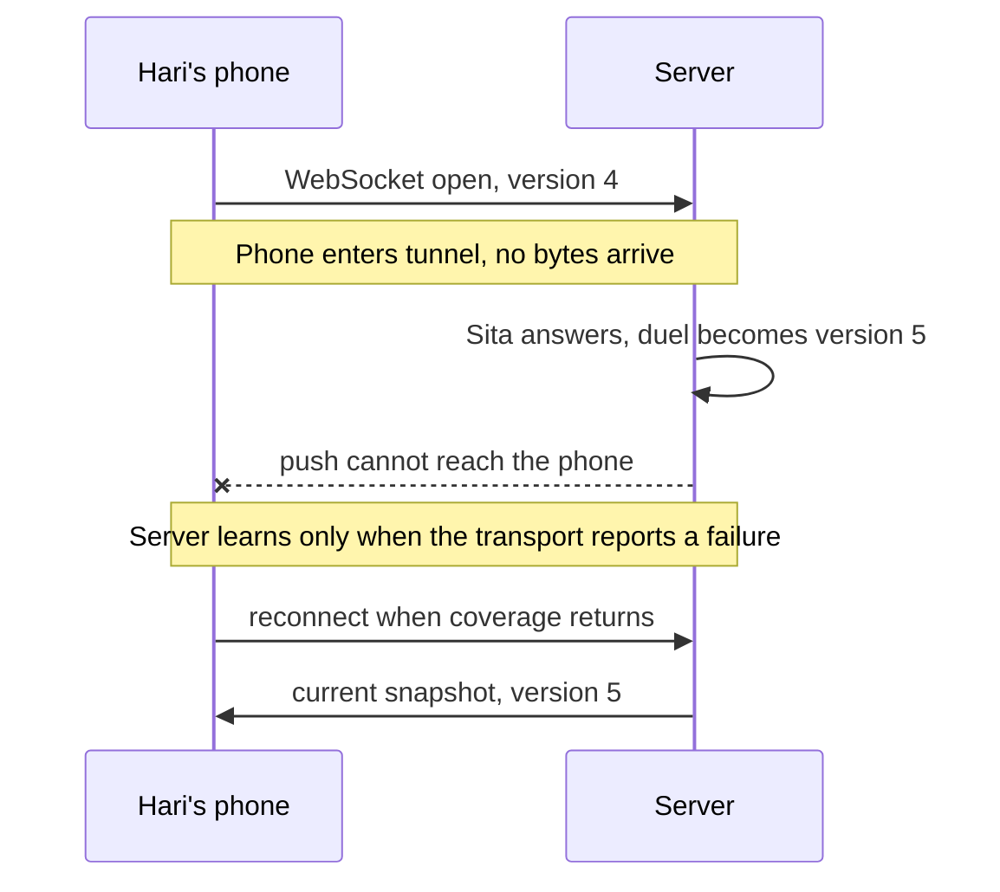

import Quiz from '../../../components/Quiz.astro';
import Think from '../../../components/Think.astro';
import { Aside } from '@astrojs/starlight/components';

<Aside type="tip" title="3 steps · ≈40 min · server code plus a phone-side sketch">
We have implemented through Lesson 25. In this lesson, you will update the server's watcher cleanup, make a failed push harmless to the HTTP request that changed the duel, and design the phone's heartbeat and reconnect loop. A reconnect gets the current `DuelResponse`; its version tells the phone whether it is newer than what it already has.
</Aside>

## The Lesson 25 route

Your HTTP endpoints use `/duels/{code}/...`, and the live socket uses `/duels/{code}/live`. The `WebSocketConfig` route must use the same plural prefix. We found the implementation was registered as `/duel/*/live` (singular) even though its comments and client examples used `/duels`; I corrected it to:

```kotlin
registry.addHandler(duelSocketHandler, "/duels/*/live")
```

This keeps the WebSocket path consistent with the rest of the API. It does not add reconnect behavior: that is what we build next.

## Predict first

<Think id="maths-l26-predict" prompt="Hari's phone is watching duel HTHQ. It drives into a tunnel. No close frame reaches the server. Then Sita answers, changing the duel from version 4 to version 5. What can the server know before it tries to send, and what should Hari do when coverage returns?" revealLabel="Check">
While no bytes arrive, the server cannot tell whether the route is broken or simply quiet. The answer's push may reveal the failure when the server writes. Hari's phone should reconnect when its WebSocket reports failure; the new connection receives the current snapshot, version 5.
</Think>

## Quiet is not closed

Lesson 25.1 watched a polite close (1000) and a phone process killed with `kill -9` (the operating system closed TCP and Tomcat observed an EOF). A phone entering a tunnel is different: the connection can go quiet without either close frame or EOF arriving at the server.



`session.isOpen` is only the server library's local view. It does not prove that a phone can currently receive bytes. In your `LiveDuels.sendTo`, there is a gap between checking `isOpen` and calling `sendMessage`; the connection can fail in that gap. Also, `sendMessage` can throw `IOException`.

## Step 1 · Keep a failed socket from breaking a duel update

Look at the current call chain:

```text
POST /duels/HTHQ/answers
  → DuelService.change saves the answer and advances the version
  → LiveDuels.send writes to each watching socket
  → controller returns the HTTP response
```

The database is not involved here; the answer is already saved in memory before the push. But if a write throws, the exception can escape `LiveDuels.send` and make the HTTP request fail after the answer was committed. Worse, the loop stops at the failed session, so another healthy watcher may not receive the push.

Change `sendTo` to return whether it sent successfully, catch the I/O failure around the write, and remove the failed socket. Keep the session lock: two HTTP threads can still push to one socket at once.

```kotlin
fun send(duel: Duel) {
    for (session in watchers[duel.code].orEmpty()) {
        sendTo(session, duel)
    }
}

fun sendTo(session: WebSocketSession, duel: Duel) {
    val message = TextMessage(jsonMapper.writeValueAsString(duel.toResponse()))
    synchronized(session) {
        if (!session.isOpen) {
            unwatch(duel.code, session)
            return
        }

        try {
            session.sendMessage(message)
        } catch (e: IOException) {
            println("[${Thread.currentThread().name}] socket ${session.id} failed: ${e.message}")
            unwatch(duel.code, session)
        }
    }
}
```

Add `import java.io.IOException`. The exception is handled per socket, so the loop can continue to the next watcher. The duel change remains successful even if one phone missed its push; the phone can recover by reconnecting and reading the current snapshot.

## Step 2 · Remove the empty watcher entry

Your current `unwatch` removes the session but leaves the duel code mapped to an empty set. Lesson 25 called this harmless. With many unique duel codes, those empty sets remain in memory until the process restarts. Remove the socket and remove the map entry when its set becomes empty:

```kotlin
fun unwatch(code: String, session: WebSocketSession) {
    watchers.computeIfPresent(code) { _, sessions ->
        sessions.remove(session)
        if (sessions.isEmpty()) null else sessions
    }
    println("[${Thread.currentThread().name}] socket ${session.id} left $code")
}
```

Returning `null` from `computeIfPresent` removes that key. Both normal `afterConnectionClosed` and the failed-send path should use this same `unwatch` function. If the close callback runs later too, removing a socket that is already absent is safe.

There is one concurrency detail: `watch` currently gets the set from `computeIfAbsent` and adds the socket afterward. If `watch` and the final `unwatch` overlap, `unwatch` could remove the map entry just before `watch` adds to the now-unreachable set. Move the add inside a per-key `compute` as well:

```kotlin
fun watch(code: String, session: WebSocketSession) {
    watchers.compute(code) { _, current ->
        val sessions = current ?: ConcurrentHashMap.newKeySet()
        sessions.add(session)
        sessions
    }
}
```

Now adding and removing watchers for the same duel are serialized by the map's per-key computation. This matters because Lesson 26 introduced removal of empty entries; the old `watch` was safe when entries were never removed, but the new cleanup changes that assumption.

## Step 3 · The phone detects trouble and reconnects

The server cannot notice a completely silent connection until something makes the transport report trouble. The phone can send WebSocket Ping frames periodically and expect Pong responses. OkHttp can do this with a ping interval:

```kotlin
val client = OkHttpClient.Builder()
    .pingInterval(20, TimeUnit.SECONDS)
    .build()
```

If the connection fails, OkHttp calls `onFailure`. The app should mark the live connection disconnected and schedule another connection. Don't reconnect in a tight loop: use exponential backoff with jitter, reset after a successful connection, and stop when the user leaves the duel.

```text
failure 1: wait about 1 second
failure 2: wait about 2 seconds
failure 3: wait about 4 seconds
failure 4: wait about 8 seconds (cap the delay and add random jitter)
```

The 20-second interval is an example setting for the phone. It is not a promise that every network, proxy, or server uses the same timeout. Ping/Pong detects a missing response after a deadline; it cannot prevent a later write from failing.

## Step 4 · Reconnect is also a fresh read

`afterConnectionEstablished` already does the important recovery step: it registers the new socket, calls `duelService.get(code)`, and sends the current duel. That means reconnecting fetches a complete snapshot without a new endpoint or a replay log.

Suppose the phone last displayed version 4 and missed version 5. On reconnect, it receives the current state, perhaps version 6. Apply the existing Lesson 22 rule: replace the phone's state only when the incoming version is greater.

```kotlin
_duel.update { shown ->
    if (shown == null || incoming.version > shown.version) incoming else shown
}
```

This also handles crossed messages. The server registers the socket before it reads the initial snapshot. A duel change can therefore send version 6 while the open callback is still preparing version 5; if version 5 arrives later, the client ignores it. A complete snapshot is enough because each message carries the whole display state. If these were partial changes such as “add one point”, missing a message could leave the client unable to reconstruct the current score.

## Run the failure experiment

Use the Lesson 25 `watch.mjs` phone. Open a duel and connect the watcher. Stop the phone process with `kill -9` so it cannot send a close frame. Then make one answer request while the socket is in the watcher set.

Observe three things:

1. The answer request still gets its normal success response because the answer was saved before the best-effort push.
2. The server logs the failed socket and removes it; it continues iterating other watchers.
3. When a phone reconnects, its opening message is the latest duel snapshot, with the latest version.

Do not expect a tunnel to be detected at the instant it starts. In this experiment the server discovers the failure when it next writes; Ping/Pong gives the phone another way to discover a dead path.

## Check yourself

<Quiz question="The answer is saved, then a socket write fails. What should the HTTP answer request report?" options={['Success; the push is best effort', 'Failure; the answer must roll back', 'Wait until the phone reconnects']} answer={0}>
The state change already completed. A disconnected watcher must not turn a committed answer into an HTTP error, and its failure must not stop pushes to other watchers.
</Quiz>

<Quiz question="Hari reconnects with version 4 saved; the server sends a complete version 7 snapshot. What should the app do?" options={['Replace its display with version 7', 'Ask for versions 5 and 6 first', 'Keep version 4 until Hari answers']} answer={0}>
The snapshot describes the current duel. Its version is newer, so it replaces stale local state directly.
</Quiz>

<Quiz question="Why can a version 5 snapshot arrive after version 6 on a new socket?" options={['The map sorts sockets randomly', 'The initial read and a push can cross', 'Ping frames reorder text messages']} answer={1}>
The socket is registered before the initial read. A concurrent duel change can push a newer snapshot while the open callback is still sending the initial one. The client's version check rejects the stale arrival.
</Quiz>

## Your turn

<Think id="maths-l26-design" prompt="Make the Lesson 25 server edits: catch IOException per session, call unwatch for failed or closed sockets, remove an empty watcher-set entry, and make watch atomic with that cleanup. What should your failure experiment prove about the saved answer and the other phone?" revealLabel="Compare">
A write failure is handled for that session and removed through `unwatch`; the loop proceeds to other sessions. Adding and removing under the same per-key map computation avoids losing a new watcher as the final old watcher leaves. The answer stays saved and the HTTP response succeeds, while a healthy watcher still receives the update.
</Think>

<Think id="maths-l26-teachback" prompt="Explain in 4–5 sentences how the app can recover after a WebSocket disappears. Include what detects the failure, how retry waits change, what the server sends after reconnect, and how versions prevent stale state." revealLabel="Compare">
Ping/Pong or a failed write helps a side discover that the path is gone, though neither detects every failure instantly. The phone retries with backoff and jitter instead of hammering the server. Opening a new socket already makes the server send a complete current duel snapshot. The app replaces its state only with a newer version. That lets it recover missed pushes without replaying every event.
</Think>

<Aside type="note" title="The thing to remember">
A WebSocket can look open while the path is gone. A write failure should evict only that watcher, not fail an answer that was already saved. The phone reconnects with backoff, gets a complete current snapshot, and uses the version to reject stale messages.
</Aside>

## Read alongside

- [Spring WebSocket API](https://docs.spring.io/spring-framework/reference/web/websocket/server.html): handlers and session sends.
- [OkHttp `WebSocketListener`](https://github.com/square/okhttp/blob/master/okhttp/src/commonJvmAndroid/kotlin/okhttp3/WebSocketListener.kt): failure and close callbacks.
- [OkHttp `pingInterval`](https://square.github.io/okhttp/5.x/okhttp/okhttp3/-ok-http-client/-builder/ping-interval.html): client heartbeat setting.

**Back to:** [Lesson 25](../0025-websockets-in-spring/) · [One socket, end to end](../0025a-one-socket-end-to-end/).
