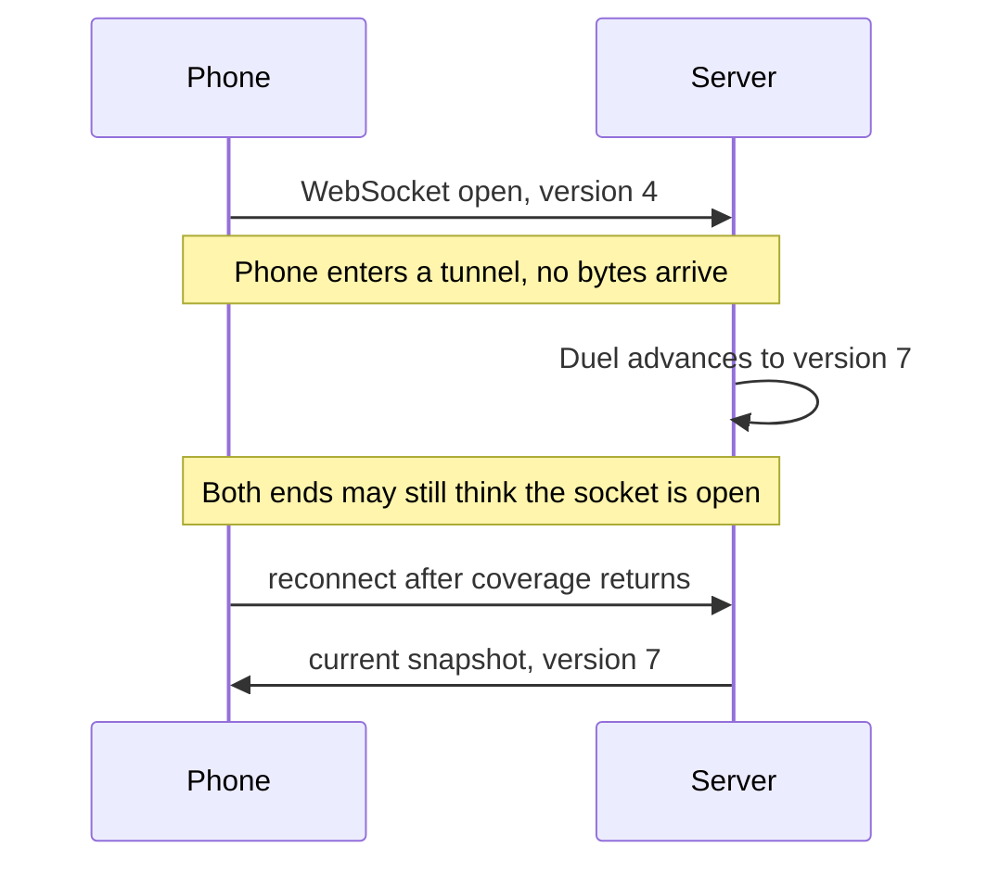
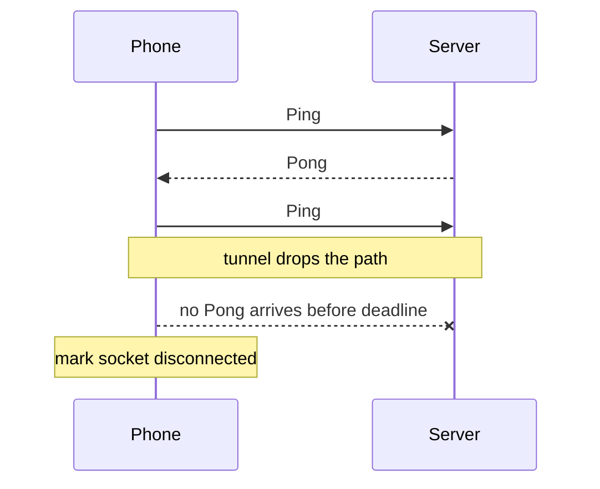

import Quiz from '../../../components/Quiz.astro';
import Think from '../../../components/Think.astro';
import { Aside } from '@astrojs/starlight/components';

<Aside type="tip" title="One question · ≈25 min · one experiment">
When a phone loses its network, how does it notice, reconnect, and recover the state it missed? The server already sends the current duel when a socket opens. We'll use that fact, and the version number from Lesson 22, to make reconnecting safe.
</Aside>

## Predict first

<Think id="maths-l26-predict" prompt="Hari's phone drives into a tunnel. No close frame reaches the server. The duel changes from version 4 to version 7. What can the server know while the connection is silent, and what should Hari do when coverage returns?" revealLabel="Check">
While it is silent, the server cannot distinguish a quiet but healthy connection from a broken path. Hari's phone should reconnect, then use the fresh snapshot the server sends on open. Version 7 replaces the stale version 4; the phone does not need to replay every missed push.
</Think>

## Quiet is not closed

Lesson 25.1 showed two detectable endings: a polite close frame (1000), or the operating system reporting a broken connection (often surfaced as 1006). A tunnel is different. The phone may lose the route without either side receiving bytes. TCP can keep both ends waiting because neither has proof that the other disappeared.



The `isOpen` property only tells whether the local WebSocket implementation considers the session open. It cannot prove that a remote phone is still reachable. A write can fail, and sometimes the failure is discovered only later.

## Heartbeats: ask whether the path still works

WebSocket has Ping and Pong control frames. One side sends Ping; the other should answer Pong. If the expected Pong does not arrive within a chosen interval, that side can close the connection and treat it as lost. This is a **heartbeat**: small traffic used to check whether a connection still works.



Ping/Pong is not a guarantee that the next message will succeed. It is a recent signal that the route worked. There is always a gap between the check and the next write, just as there was between `session.isOpen` and `sendMessage` in Lesson 25.1.

The server stack may also have idle timeouts. Tomcat or a proxy can close a connection that has been quiet too long. That can reclaim sockets, but it is not a recovery strategy: the phone still needs to reconnect. Exact timeout settings depend on the server and any proxy in front of it; don't guess a number and assume every network uses it.

## The phone reconnects

On Android, OkHttp's `WebSocketListener` reports `onFailure` and `onClosed`. The app can mark the live connection unavailable and try again. Don't spin in a tight loop: that would hammer the server and drain the battery. Use a delay that grows after each failure, with a little random variation called **jitter** so many phones do not retry together.

```text
attempt 1: wait about 1 second
attempt 2: wait about 2 seconds
attempt 3: wait about 4 seconds
attempt 4: wait about 8 seconds
...cap the wait, and add a small random amount each time
```

This is exponential backoff, the same idea as Lesson 21's retry delay. A successful connection resets the attempt count. Stop retrying when the user leaves the duel. A server close that says the duel is over should end the watch, not trigger endless reconnects.

## Catch up with a snapshot and version

Every push contains the duel's `version`. When a socket opens, `afterConnectionEstablished` calls `get(code)` and sends the **current** `DuelResponse`. So reconnecting is also a fresh read:

```text
before tunnel: phone has version 4, PLAYING
while away:    server moves through versions 5, 6, 7
after reconnect: server sends version 7, PLAYING
```

The client should accept a snapshot whose version is newer than its current one, replacing the displayed state. If an old socket callback arrives late with version 6 after version 7, ignore it. This is Lesson 22's ordering rule: a lower version must not overwrite a higher version.

```kotlin
if (incoming.version > current.version) {
    current = incoming
}
```

That is enough here because the server sends a complete duel snapshot, not a partial change. If messages were deltas such as “add one point”, missing one would make later messages insufficient to rebuild the state. A full snapshot makes the current version self-contained.

## A send can fail

`LiveDuels.send` runs after a duel changes. One watched session may have disappeared since the last check. A failed write should not prevent the server from trying the other watchers. Remove or close the failed session, and let that phone's reconnect fetch current state. Do not put the network write inside the duel's synchronized update: Lesson 20 established that slow work must happen after the lock is released.

The important recovery path is:

```text
server update → try each watcher independently
                    └─ write fails → discard that socket
phone detects loss → reconnect with backoff
server on open → send current snapshot and version
phone → accept only a newer version
```

No missed event replay is required for this game. The server's in-memory duel remains the source of truth while its process is alive; reconnecting asks that source for the latest state.

## Check yourself

<Quiz question="Why can a server not immediately know a phone is in a tunnel?" options={['The socket is encrypted', 'No bytes arrive to report failure', 'The HTTP request has already ended']} answer={1}>
Silence alone does not tell either side whether the connection is slow, idle, or broken. A heartbeat can detect a missing response after a deadline, but not instantly.
</Quiz>

<Quiz question="Hari reconnects with version 4 saved; the server sends version 7. What should the phone do?" options={['Replace its state with version 7', 'Replay versions 5 and 6 first', 'Keep version 4 until a new answer']} answer={0}>
The opening message is a complete current snapshot. Version 7 includes the current duel state, so the client can replace its stale copy directly.
</Quiz>

<Quiz question="A delayed callback delivers version 6 after version 7. What protects the screen?" options={['Retry the callback twice', 'Ignore snapshots below current version', 'Close every socket on a lower version']} answer={1}>
Versions let the client reject stale updates so old state cannot overwrite newer state.
</Quiz>

## Your turn

<Think id="maths-l26-design" prompt="Sketch the Android state you would keep for one live duel: current DuelResponse, connection state, and retry attempt. When would you reset the attempt count, stop retrying, and ignore an incoming message?" revealLabel="Compare">
One reasonable design keeps `currentDuel`, a connection state such as CONNECTING/CONNECTED/DISCONNECTED, and a retry attempt count. Reset the count after a successful open; stop when the user leaves or the duel is finished; accept a message only if its version is greater than the current one. On reconnect, use the server's opening snapshot as the resync.
</Think>

<Think id="maths-l26-teachback" prompt="Explain in 4–5 sentences why WebSocket reconnect is not enough by itself, and how heartbeat, backoff, and versioned snapshots work together." revealLabel="Compare">
A dead network path may be silent, so a heartbeat helps a side discover it after a timeout. The phone reconnects with increasing delays and jitter to avoid rapid or synchronized retries. When the new socket opens, the server sends the current duel snapshot. Its version lets the phone replace stale state and ignore delayed older messages. Since the snapshot is complete, the phone need not replay every push it missed.
</Think>

<Aside type="note" title="The thing to remember">
A WebSocket can look open while its path is gone. Heartbeats help detect that; backoff makes reconnect gentle; a fresh versioned snapshot makes it correct. The client accepts newer state and never lets an older message roll it backward.
</Aside>

**Back to:** [Lesson 25](../0025-websockets-in-spring/) · [One socket, end to end](../0025a-one-socket-end-to-end/) · **Next:** Cross Math's grid and checker.
