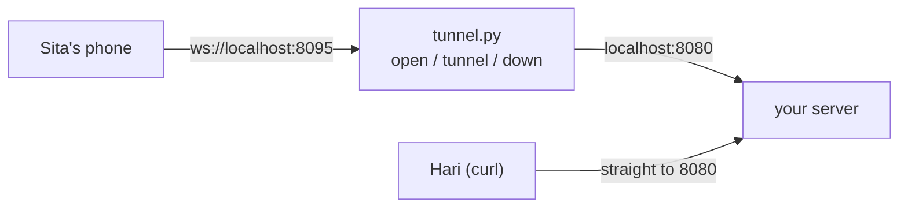
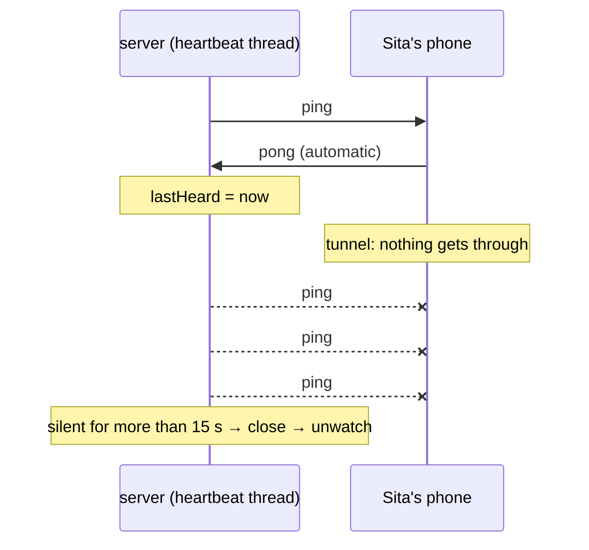
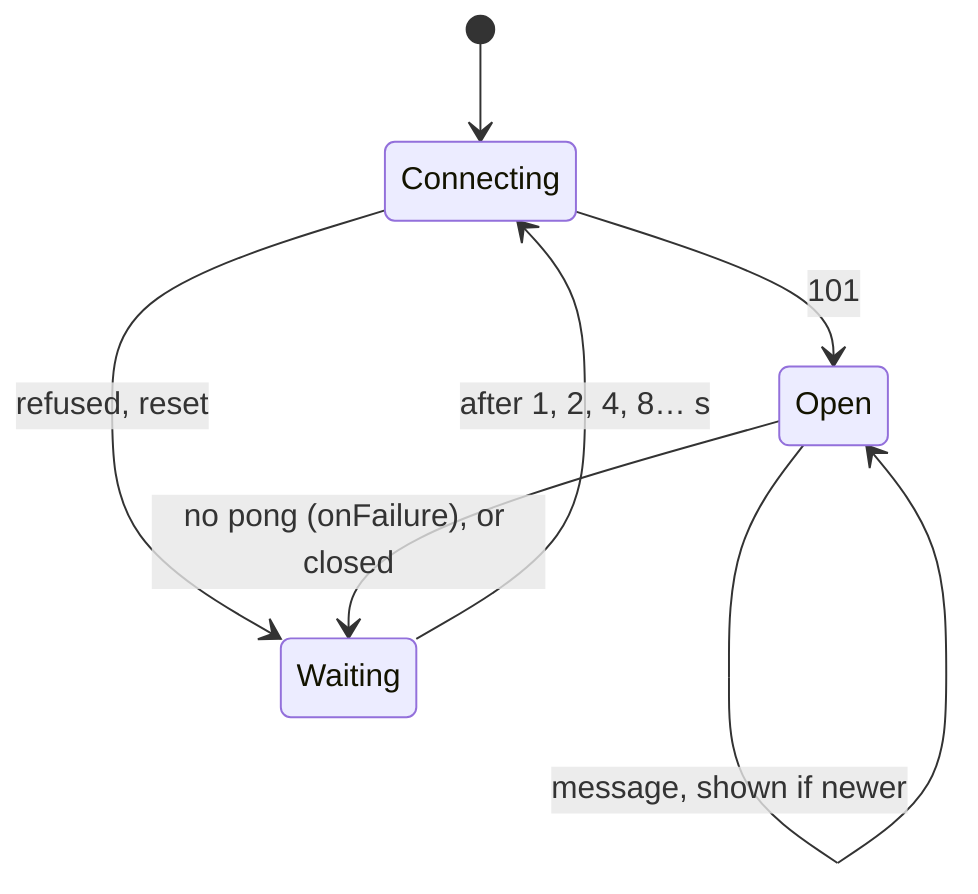

import Quiz from '../../../components/Quiz.astro';
import Think from '../../../components/Think.astro';
import { Aside } from '@astrojs/starlight/components';

<Aside type="tip" title="3 steps · ≈50 min · in your Spring app, plus a phone script">
**Step 1:** see a dead connection that nobody notices. **Step 2:** the server pings every phone and closes the silent ones. **Step 3:** the phone pings too, reconnects with backoff, and catches up. Win: Sita's phone goes through a tunnel and loses signal for 10 s. It reconnects by itself and jumps from version 2 to version 5, and the server forgets her old socket within 18 s.
</Aside>

## Recall (from memory)

<Think id="maths-l26-recall-1" prompt="Lesson 25.1: Hari's phone is killed with kill -9. How does the server find out, and what close code does Spring report?" revealLabel="Check">
The phone's operating system closes the TCP connection for it, so Tomcat's next read hits `EOFException`, and Spring reports **1006** and calls `afterConnectionClosed`. That only works because something **arrived**: the OS's goodbye. Today's phones send nothing at all.
</Think>

<Think id="maths-l26-recall-2" prompt="Lesson 22: Sita's phone shows version 2, and the next message it receives is version 5. What does it do, and what did it miss?" revealLabel="Check">
It shows version 5: it's newer than 2. It missed versions 3 and 4, but that doesn't matter, because every message is the **whole duel**, not "Hari +1". The newest message has everything. Step 3 depends on exactly this.
</Think>

## The connection nobody closed

Lesson 25.1 ended with two endings: a polite close (1000) and a crash the operating system reported (1006). A phone in a tunnel does neither. Its radio just stops. No close frame leaves the phone, and no TCP goodbye either: nothing leaves it at all. To the server, a socket in a tunnel looks exactly like a socket where nothing has happened yet.

To see it on your laptop, you need a network that can go quiet. `tunnel.py` (below; save it in `maths/scripts/`) sits between the phone and the server, on port 8095. It forwards to the server's port (change `8091` to `8080`) and does what you write into a file called `mode` next to it (`echo tunnel > mode`):

| `mode` | Like… | What it does |
|---|---|---|
| `open` | normal signal | passes bytes both ways |
| `tunnel` | a tunnel | stops passing bytes, closes nothing |
| `down` | no signal at all | breaks the phone's side, refuses new connections, and the server's side just goes quiet |



<details>
<summary><code>tunnel.py</code>: a pretend mobile network (Python, no libraries)</summary>

```python
# A pretend mobile network between the phones (port 8095) and the server (port 8091).
# Control it by writing a word into the file `mode` next to this script:
#   open    pass bytes both ways
#   tunnel  stop passing bytes, keep every connection open (nobody is told anything)
#   down    the phone loses its network: its side of each connection breaks, new connections are
#           refused, and the server's side just goes silent (nobody tells the server anything)
import asyncio, os, time
HERE = os.path.dirname(os.path.abspath(__file__)); MODE = os.path.join(HERE, "mode")
def mode():
    try: return open(MODE).read().strip()
    except OSError: return "open"
links = set(); t0 = time.time()
def log(msg): print(f"[network {time.time()-t0:5.1f}s] {msg}", flush=True)
async def pipe(reader, writer, to_server):
    try:
        while True:
            while mode() == "tunnel": await asyncio.sleep(0.05)
            data = await reader.read(65536)
            if not data or mode() == "down": break
            while mode() == "tunnel": await asyncio.sleep(0.05)
            writer.write(data); await writer.drain()
    except (ConnectionError, OSError): pass
    finally:
        if to_server and mode() == "down":
            await asyncio.sleep(3600)   # leave the server's side open and silent
        try: writer.close()
        except Exception: pass
async def handle(cr, cw):
    if mode() == "down": cw.close(); return
    sr, sw = await asyncio.open_connection("localhost", 8091)   # your server's port
    links.add((cw, sw)); log("phone connected")
    await asyncio.gather(pipe(cr, sw, True), pipe(sr, cw, False))
    links.discard((cw, sw))
async def watch_mode():
    last = mode()
    while True:
        await asyncio.sleep(0.05)
        m = mode()
        if m != last:
            log(f"mode: {m}")
            if m == "down":
                for cw, sw in list(links):
                    try: cw.transport.abort()
                    except Exception: pass
            last = m
async def main():
    server = await asyncio.start_server(handle, "localhost", 8095)
    log("listening on 8095 → 8091")
    await asyncio.gather(server.serve_forever(), watch_mode())
asyncio.run(main())
```

Run it with `python3 tunnel.py`. You don't need to understand every line: it reads from one side and writes to the other, and checks `mode` before each step.
</details>

For these runs I added one demo line to `sendTo`, after `sendMessage`, so the log says what the server **thinks** it delivered:

```kotlin
println("[${Thread.currentThread().name}] sent version ${duel.version} to socket ${session.id.take(8)}") // demo only
```

## Step 1 · Nobody notices

**A tunnel.** Sita's phone watches through the network. At 2 s it goes into a tunnel for 30 s, and Hari answers three questions:

```text
## duel CYTD: Sita's phone watches through the mobile network
## 2 s: Sita's phone enters a tunnel
## 6 s: Hari answers question 0
## 10 s: Hari answers question 1
## 14 s: Hari answers question 2
## 32 s: out of the tunnel
--- Sita's phone
Sita's phone 0.1s open
Sita's phone 0.1s version 2: PLAYING, scores {"Hari":0,"Sita":0}
Sita's phone 32.3s version 3: PLAYING, scores {"Hari":1,"Sita":0}
Sita's phone 32.4s version 4: PLAYING, scores {"Hari":2,"Sita":0}
Sita's phone 32.4s version 5: PLAYING, scores {"Hari":3,"Sita":0}
--- server
[http-nio-8080-exec-6] sent version 2 to socket 52504a56
[http-nio-8080-exec-9] sent version 3 to socket 52504a56
[http-nio-8080-exec-2] sent version 4 to socket 52504a56
[http-nio-8080-exec-6] sent version 5 to socket 52504a56
```

The server "sent" versions 3, 4 and 5 at 6, 10 and 14 s, and `sendMessage` returned normally each time. Sita's screen showed Hari 0 for **30 seconds**, then got all three in the same tenth of a second. `sendMessage` returning means "handed to the operating system", **not** "the phone has it". The bytes waited in buffers along the way. And the phone didn't know it was missing anything: from where it sits, a quiet duel and a tunnel look the same.

**No signal at all.** Same again, but at 2 s the phone loses its network completely (`down`):

```text
## duel OEJJ: Sita's phone watches through the mobile network
## 2 s: Sita's phone loses its network
## 5 s: Hari answers question 0
## 55 s: Hari answers question 1
--- Sita's phone
Sita's phone 0.0s open
Sita's phone 0.0s version 2: PLAYING, scores {"Hari":0,"Sita":0}
Sita's phone 2.0s closed, code 1006
--- server
[http-nio-8080-exec-3] socket b1855473-… watches OEJJ, 1 watching
[http-nio-8080-exec-3] sent version 2 to socket b1855473
[http-nio-8080-exec-6] sent version 3 to socket b1855473
[http-nio-8080-exec-9] sent version 4 to socket b1855473
```

This time the phone noticed at once (its own network broke, so its OS told it). The server did **not**. At 55 s, almost a minute later, it was still "sending" to a socket whose phone left at 2 s. No `left OEJJ` line, ever. The socket stays in `watchers`, and every change to the duel is written into a dead connection.

How long would it stay? The operating system does give up eventually, once its retransmissions go unanswered. Linux's documentation for `tcp_retries2`: "The default value of 15 yields a hypothetical timeout of 924.6 seconds". That's over **15 minutes**, far longer than a 60-second duel. It's no use to a game.

<Think id="maths-l26-predict" prompt="Neither side can tell 'quiet' from 'gone' by waiting. What could each side do to find out, without changing the game's messages? Hint: Lesson 24's frame table had more opcodes than text and close." revealLabel="Check">
**Ask.** RFC 6455 has a frame for exactly this, the **ping** (opcode 9), and §5.5.2 says: "Upon receipt of a Ping frame, an endpoint MUST send a Pong frame in response". So either side sends a ping now and then. A pong back means "still here". No pong for a while means "gone", whatever the reason: tunnel, lost signal, flat battery.

You don't write the pong yourself on either side. Tomcat, browsers and OkHttp all answer pings automatically. You only send the pings and watch the pongs.
</Think>

## Step 2 · The server's heartbeat

Every 5 seconds, the server pings every socket it's watching, and notes when each phone last answered. A socket silent for more than 15 seconds gets closed. Closing it runs `afterConnectionClosed`, and so `unwatch`, so the map cleans itself up.



### `LiveDuels`

Two settings at the top, next to the class:

```kotlin
// How often the server pings each phone, and how long a phone may stay silent
val PING_EVERY: Duration = Duration.ofSeconds(5)
val SILENCE_LIMIT: Duration = Duration.ofSeconds(15)
```

A second map, and the thread that runs the heartbeat. It's Lesson 25's `ScheduledExecutorService`, but `scheduleAtFixedRate`: "again and again", not "once, later".

```kotlin
    // socket id -> the last time that phone answered a ping
    private val lastHeard = ConcurrentHashMap<String, Instant>()

    // Its own thread, every PING_EVERY: ping everyone, drop the silent ones
    private val heartbeat = Executors.newSingleThreadScheduledExecutor()

    init {
        heartbeat.scheduleAtFixedRate({ checkAll() }, PING_EVERY.toMillis(), PING_EVERY.toMillis(), TimeUnit.MILLISECONDS)
    }
```

`watch` starts the clock and `unwatch` forgets it:

```kotlin {3,10}
        sessions.add(session)
        // in watch, after sessions.add(session):
        lastHeard[session.id] = Instant.now()

    …

        sessions?.remove(session)
        // in unwatch, after sessions?.remove(session):
        lastHeard.remove(session.id)
```

And two new functions:

```kotlin
    // The phone answered a ping: it's still there
    fun heard(session: WebSocketSession) {
        lastHeard[session.id] = Instant.now()
    }

    private fun checkAll() {
        val now = Instant.now()
        for ((code, sessions) in watchers) {
            for (session in sessions) {
                val heard = lastHeard[session.id] ?: now
                try {
                    if (Duration.between(heard, now) > SILENCE_LIMIT) {
                        println("[${Thread.currentThread().name}] socket ${session.id.take(8)} silent for ${Duration.between(heard, now).toSeconds()} s, closing")
                        session.close(CloseStatus.SESSION_NOT_RELIABLE)
                    } else {
                        synchronized(session) {
                            if (session.isOpen) {
                                session.sendMessage(PingMessage())
                            }
                        }
                    }
                } catch (e: Exception) {
                    // One broken socket must not stop the heartbeat for everyone else
                    println("[${Thread.currentThread().name}] socket ${session.id.take(8)}: ${e.message}, dropping it")
                    unwatch(code, session)
                }
            }
        }
    }
```

(Imports: `CloseStatus` and `PingMessage` from `org.springframework.web.socket`, plus `java.time.Duration`, `java.time.Instant`, `java.util.concurrent.Executors` and `java.util.concurrent.TimeUnit`.)

- **The ping is sent inside `synchronized(session)`**, the same lock as `sendTo`. The heartbeat thread is one more thread that writes to sockets, and Lesson 25 Step 3 showed what two writers at once do.
- **`try`/`catch` around each socket.** If code run by `scheduleAtFixedRate` throws, the Java docs say: "Subsequent executions are suppressed." One broken socket would **silently stop the heartbeat for every phone, forever**. Catching per socket keeps it alive.
- **`session.close(…)`** sends a close frame (which will never arrive) and closes the connection on the server's side. Spring then calls `afterConnectionClosed` → `unwatch`, as for any other close. `SESSION_NOT_RELIABLE` (4500) is Spring's own code for a session that "has become unreliable".
- `?: now` covers a socket that's just been added and hasn't been noted yet.

### `DuelSocketHandler`

Spring calls `handlePongMessage` for every pong:

```kotlin
    // Browsers and OkHttp answer every ping with a pong, by themselves
    override fun handlePongMessage(session: WebSocketSession, message: PongMessage) {
        liveDuels.heard(session)
    }
```

(`import org.springframework.web.socket.PongMessage`.)

**Commit:** `feat: ping every phone and close the silent ones`

### Rerun

The "no signal" run again:

```text
## duel BKFN: Sita's phone watches through the mobile network
## 2 s: Sita's phone loses its network
## 5 s: Hari answers question 0
## 55 s: Hari answers question 1
--- server
[http-nio-8080-exec-6] socket 7a839630-… watches BKFN, 1 watching
[http-nio-8080-exec-6] sent version 2 to socket 7a839630
[http-nio-8080-exec-9] sent version 3 to socket 7a839630
[pool-2-thread-1] socket 7a839630 silent for 19 s, closing
[pool-2-thread-1] socket 7a839630-… left BKFN
```

The network went at 2 s, and the heartbeat closed the socket **18 s later**. That's 15 s of allowed silence, counted from the last pong (up to 5 s before the network went), plus up to 5 s until the next check. Hari's answer at 55 s sent nothing, because nobody is watching. `left BKFN` runs on `pool-2-thread-1`, the heartbeat's thread: the close called `afterConnectionClosed` right there.

And a healthy phone, connected straight to the server for 40 s, answered every ping and was never dropped:

```text
Hari's phone 0.1s open
Hari's phone 0.1s version 2: PLAYING, scores {"Hari":0,"Sita":0}
Hari's phone 40.1s closed, code 1000
```

**Choosing the numbers.** A short `SILENCE_LIMIT` notices sooner, but drops phones on a bad but working connection. A long one wastes less, but keeps dead sockets around. 5 s and 15 s (three missed pings) fit a 60-second duel. A chat app might use 30 s and 90 s. A ping from the server is a 2-byte frame and the phone's pong is 6 (2 + the 4-byte mask, Lesson 24), so pinging every 5 s costs almost nothing.

## Step 3 · The phone notices, reconnects, catches up

The server is clean now, but Sita's phone is still in the tunnel, showing Hari 0. It needs the same trick from its side, and then it needs to come back.

This is the phone, written with OkHttp exactly as an Android app would (today's Android example), as a Kotlin script so you can run it on your laptop. `@file:DependsOn` downloads OkHttp the way Gradle would:

```kotlin
@file:DependsOn("com.squareup.okhttp3:okhttp:4.12.0")

import okhttp3.OkHttpClient
import okhttp3.Request
import okhttp3.Response
import okhttp3.WebSocket
import okhttp3.WebSocketListener
import java.util.concurrent.Executors
import java.util.concurrent.TimeUnit

// Sita's phone, the way an Android app would do it: OkHttp, a ping every 5 s, reconnect with backoff
val url = args[0]
val t0 = System.currentTimeMillis()
fun log(text: String) = println("%5.1fs  %s".format((System.currentTimeMillis() - t0) / 1000.0, text))

val client = OkHttpClient.Builder()
    .pingInterval(5, TimeUnit.SECONDS)   // no pong within 5 s → onFailure
    .build()
val retries = Executors.newSingleThreadScheduledExecutor()

var shownVersion = 0L                    // Lesson 22: only ever move forward
var nextWaitSeconds = 1L                 // 1, 2, 4, 8, 8, 8…

fun connect() {
    log("connecting…")
    client.newWebSocket(Request.Builder().url(url).build(), object : WebSocketListener() {
        override fun onOpen(webSocket: WebSocket, response: Response) {
            log("open (${response.code})")
            nextWaitSeconds = 1
        }

        override fun onMessage(webSocket: WebSocket, text: String) {
            val version = Regex("\"version\":(\\d+)").find(text)!!.groupValues[1].toLong()
            val scores = Regex("\"scores\":(\\{[^}]*\\})").find(text)!!.groupValues[1]
            if (version > shownVersion) {
                log("version $version → shown: $scores" + if (version > shownVersion + 1 && shownVersion > 0) "  (skipped ${shownVersion + 1}–${version - 1})" else "")
                shownVersion = version
            } else {
                log("version $version → ignored, showing $shownVersion")
            }
        }

        // The server said goodbye: say it back, then onClosed runs
        override fun onClosing(webSocket: WebSocket, code: Int, reason: String) {
            log("server closes: $code $reason")
            webSocket.close(1000, null)
        }

        override fun onFailure(webSocket: WebSocket, t: Throwable, response: Response?) {
            log("failure: ${t.javaClass.simpleName}: ${t.message}")
            reconnectLater()
        }

        override fun onClosed(webSocket: WebSocket, code: Int, reason: String) {
            log("closed $code")
            reconnectLater()
        }
    })
}

fun reconnectLater() {
    val wait = nextWaitSeconds
    nextWaitSeconds = minOf(wait * 2, 8)
    log("reconnecting in $wait s")
    retries.schedule({ connect() }, wait, TimeUnit.SECONDS)
}

connect()
Thread.sleep(args[1].toLong() * 1000)
log("done")
System.exit(0)
```

Three ideas in it:

- **`pingInterval(5, SECONDS)`**: OkHttp's docs: "If the server does not respond to each ping with a pong within `interval`, this client will assume that connectivity has been lost. When this happens on a web socket the connection is canceled and its listener is notified." It's the server's heartbeat, from the other end.
- **Reconnect with backoff.** Wait 1 s, then 2, 4, 8, and stay at 8. If the network is down for a minute, the phone doesn't hammer it (or the server) every second. A successful `onOpen` resets the wait to 1.
- **Catching up costs nothing new.** When the phone reconnects, the server's `afterConnectionEstablished` already sends the duel as it is now (Lesson 25). Together with Lesson 22's "only move forward" rule, that's the whole resync. No "what did I miss?" request. The newest duel **is** what you missed.

(`onClosing`: when the server closes, OkHttp tells you with `onClosing`, and the close only completes once you call `close` back. Leave it out and the socket hangs half-closed until a ping fails. I found that out by leaving it out.)



Run it against the server with the heartbeat, through the network script. Tunnel at 3 s, no signal at all from 14 s, signal back at 24 s. Hari answers at 5, 9 and 17 s:

```text
## duel EYLN
## 3 s: tunnel
## 5 s: Hari answers question 0
## 9 s: Hari answers question 1
## 14 s: no signal at all
## 17 s: Hari answers question 2
## 24 s: signal is back
--- Sita's phone (OkHttp)
  0.1s  connecting…
  0.2s  open (101)
  0.2s  version 2 → shown: {"Hari":0,"Sita":0}
 10.2s  failure: SocketTimeoutException: sent ping but didn't receive pong within 5000ms (after 0 successful ping/pongs)
 10.2s  reconnecting in 1 s
 11.2s  connecting…
 12.7s  failure: SocketException: Connection reset
 12.7s  reconnecting in 2 s
 14.7s  connecting…
 14.7s  failure: SocketException: Connection reset
 14.7s  reconnecting in 4 s
 18.7s  connecting…
 18.7s  failure: SocketException: Connection reset
 18.7s  reconnecting in 8 s
 26.7s  connecting…
 26.8s  open (101)
 26.8s  version 5 → shown: {"Hari":3,"Sita":0}  (skipped 3–4)
--- server
[http-nio-8080-exec-9] socket dbc26615-… watches EYLN, 1 watching
[http-nio-8080-exec-9] sent version 2 to socket dbc26615
[http-nio-8080-exec-2] sent version 3 to socket dbc26615
[http-nio-8080-exec-6] sent version 4 to socket dbc26615
[http-nio-8080-exec-1] sent version 5 to socket dbc26615
[pool-2-thread-1] socket dbc26615 silent for 18 s, closing
[pool-2-thread-1] socket dbc26615-… left EYLN
[http-nio-8080-exec-3] socket 32e4ab34-… watches EYLN, 1 watching
[http-nio-8080-exec-3] sent version 5 to socket 32e4ab34
```

(The phone's clock starts when its script does, about 1.5 s after the network script's: the JVM takes a moment to start.)

- **The phone noticed the tunnel** by itself: a ping went unanswered, so `onFailure`.
- **Backoff:** 1 s, 2 s, 4 s, 8 s. The 11.2 s attempt got through to the tunnel and was cut off when the signal died. The next two were refused straight away, like a phone with no signal.
- **The server forgot the old socket** (`dbc26615`) by itself, 18 s after its last pong.
- **Catching up:** the new socket (`32e4ab34`) got version 5 on connect. The phone jumped from 2 to 5 and showed Hari 3, the correct score, without ever seeing versions 3 and 4.

**Commit (in `scripts/`):** `feat: an OkHttp phone that reconnects and catches up`

<Aside type="caution" title="What this version leaves out">
1. **Answers sent during the outage.** Sita's taps while in the tunnel are HTTP POSTs, and Lesson 21's retries make resending them safe. The socket is only for news.
2. **Jitter.** If the server restarts, every phone reconnects at exactly 1 s, then 2 s… all together. Real apps add a random part to each wait, so they spread out.
3. **The app in the background.** Android may stop your app's network when it isn't on screen. That's an Android topic, not a server one.
</Aside>

<Aside type="note" title="The thing to remember">
A phone that loses signal sends **nothing**, so neither side is told, and the operating system may take 15 minutes to give up. `sendMessage` returning means "handed to the OS", not "delivered". The fix is a **heartbeat**: send a **ping** every few seconds, and the other side answers with a **pong** automatically. The server closes sockets silent for too long, which also unwatches them. The phone uses OkHttp's `pingInterval`, reconnects with **backoff** (1, 2, 4, 8 s), and catches up for free, because the server sends the whole duel on connect and the version tells the phone it's newer.
</Aside>

## Check yourself

<Quiz
  question="sendMessage returned without an error. What do you know?"
  options={[
    'The phone has received the message',
    'The phone showed the new score',
    'The OS accepted the bytes to send',
  ]}
  answer={2}
>
During the tunnel, versions 3, 4 and 5 were all "sent" and arrived 18 to 26 s later. Without a pong, the server can't tell delivered from stuck.
</Quiz>

<Quiz
  question="Who sends the pong when the server pings Sita's phone?"
  options={[
    'OkHttp does, by itself',
    'Your onMessage function must reply',
    'The server sends it to itself',
  ]}
  answer={0}
>
RFC 6455 says an endpoint MUST answer a ping with a pong. OkHttp, browsers and Tomcat all do it for you. You only send pings and watch for pongs.
</Quiz>

<Quiz
  question="After reconnecting, how does Sita's phone learn versions 3 and 4?"
  options={[
    'It asks the server to resend them',
    'It never does, version 5 is enough',
    'The server queued them for her',
  ]}
  answer={1}
>
Every message is the whole duel, so the newest one contains everything that happened. The phone skips straight from 2 to 5.
</Quiz>

## Your turn

<Think id="maths-l26-gone" prompt="Sita's phone is connected when the server restarts. Duels live in memory (Lesson 15), so her duel is gone. Her phone reconnects. What does the server do with the new socket, and what does today's phone do about it? Fix both sides." revealLabel="Check">
The new socket opens (101), then `duelService.get(code)` throws `DuelNotFoundException`, and Spring closes it with **1011** (Lesson 25). The phone sees "closed", reconnects, and `onOpen` resets the wait to 1 s. So:

```text
  0.1s  connecting…
  0.1s  open (101)
  0.1s  version 2 → shown: {"Hari":0,"Sita":0}
  2.4s  failure: EOFException: null
  2.4s  reconnecting in 1 s
  3.4s  connecting…
  3.4s  failure: IOException: unexpected end of stream on http://localhost:8095/...
  3.4s  reconnecting in 2 s
  5.4s  connecting…
  5.4s  open (101)
  5.5s  server closes: 1011
  5.5s  closed 1011
  5.5s  reconnecting in 1 s
  6.5s  connecting…
  6.5s  open (101)
  6.5s  server closes: 1011
  6.5s  closed 1011
  6.5s  reconnecting in 1 s
  …every second, until Sita closes the app
```

The phone can't tell "the duel is gone" from any other server error, because 1011 means "something went wrong". So say it precisely. RFC 6455 §7.4.2: "Status codes in the range 4000-4999 are reserved for private use", for "agreements between WebSocket applications". Pick **4404**, and make it part of your API.

Server, in `DuelSocketHandler`:

```kotlin
// Close code for "this duel doesn't exist": 4000–4999 are free for apps to define (RFC 6455, 7.4.2)
val DUEL_GONE = CloseStatus(4404, "DUEL_NOT_FOUND")
```

```kotlin {3-9}
    override fun afterConnectionEstablished(session: WebSocketSession) {
        val code = codeOf(session)
        liveDuels.watch(code, session)
        try {
            // Start the phone off with the duel as it is now
            liveDuels.sendTo(session, duelService.get(code))
        } catch (e: DuelNotFoundException) {
            // No such duel (a wrong code, or the server restarted): tell the phone not to come back
            session.close(DUEL_GONE)
        }
    }
```

Phone, in `onClosed`:

```kotlin {3-6}
        override fun onClosed(webSocket: WebSocket, code: Int, reason: String) {
            log("closed $code")
            if (code == 4404) {
                log("the duel is gone: stop, and tell Sita")
                return
            }
            reconnectLater()
        }
```

```text
  0.3s  version 2 → shown: {"Hari":0,"Sita":0}
  5.6s  failure: EOFException: null
  5.6s  reconnecting in 1 s
  6.6s  connecting…
  6.6s  failure: IOException: unexpected end of stream on http://localhost:8095/...
  6.6s  reconnecting in 2 s
  8.6s  connecting…
  8.7s  open (101)
  8.7s  server closes: 4404 DUEL_NOT_FOUND
  8.7s  closed 4404
  8.7s  the duel is gone: stop, and tell Sita
```

It still retried while the server was down (that's right, it might come back), and stopped the moment the server said the duel was gone.

**Commit:** `feat: tell the phone when its duel no longer exists`
</Think>

<Think id="maths-l26-teachback" prompt="Explain to another Android developer, in 4–5 sentences: why neither side notices a phone in a tunnel, how heartbeats fix it on the server and on the phone, how the phone reconnects, and why it doesn't need the messages it missed." revealLabel="Compare with a model answer">
A phone in a tunnel sends nothing, no close frame and no TCP goodbye, so the server keeps writing into the socket (`sendMessage` returns normally, because it only hands bytes to the OS) and the phone just sees a quiet duel. The OS would give up only after many minutes. So both sides send WebSocket pings, which the other side answers with pongs automatically: the server pings every 5 s and closes sockets that have been silent for 15 s, which also removes them from `watchers`, and the phone sets OkHttp's `pingInterval`, so a missing pong triggers `onFailure`. On failure the phone reconnects after 1, 2, 4, then 8 seconds. On connect the server sends the whole current duel, and because every message is the full state with a version, the phone jumps straight to the newest without needing the ones it missed.
</Think>

## Read alongside
- 📖 **Primary:** [RFC 6455 §5.5.2–5.5.3 (Ping, Pong) and §7.4 (status codes)](https://www.rfc-editor.org/rfc/rfc6455#section-5.5.2) (15 min).
- [OkHttp: `OkHttpClient.Builder.pingInterval`](https://github.com/square/okhttp/blob/parent-4.12.0/okhttp/src/main/kotlin/okhttp3/OkHttpClient.kt) and [`WebSocketListener`](https://github.com/square/okhttp/blob/parent-4.12.0/okhttp/src/main/kotlin/okhttp3/WebSocketListener.kt): `onClosing` vs `onClosed` vs `onFailure`.
- [Linux `ip-sysctl`: `tcp_retries2`](https://docs.kernel.org/networking/ip-sysctl.html): why the OS takes so long.
- [Java docs: `ScheduledExecutorService.scheduleAtFixedRate`](https://docs.oracle.com/en/java/javase/25/docs/api/java.base/java/util/concurrent/ScheduledExecutorService.html#scheduleAtFixedRate(java.lang.Runnable,long,long,java.util.concurrent.TimeUnit)): what happens if your task throws.

🙋 Ask me: "what's jitter, and how much?", "should the server ping, the phone, or both?", "how do push notifications reach a phone whose app is closed?", "what happens to the sockets during a deploy?"

**Next:** [Lesson 27: Phone to laptop](../0027-phone-to-laptop/). Your server works on `localhost`; a real phone is another machine. Which address does it type, and does the server accept it?
