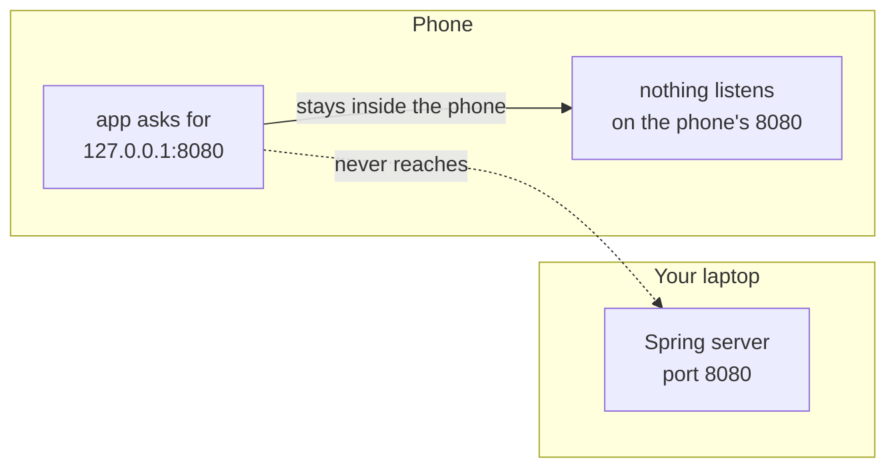
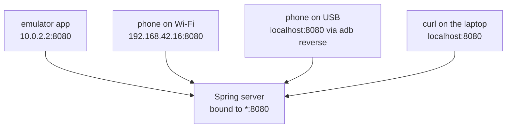

import Quiz from '../../../components/Quiz.astro';
import Think from '../../../components/Think.astro';
import { Aside } from '@astrojs/starlight/components';

<Aside type="tip" title="3 steps · ≈40 min · your Spring app, a phone or emulator">
**Step 1:** see how your server listens and reach it by the laptop's Wi-Fi address. **Step 2:** close it on purpose and see exactly how it fails. **Step 3:** the address your app types, and Android's cleartext rule. Win: your phone's browser shows `/health` from your laptop, over Wi-Fi.
</Aside>

## Recall (from memory)

<Think id="maths-l27-recall-1" prompt="Lesson 2: what does 127.0.0.1 mean, and what does a port pick?" revealLabel="Check">
`127.0.0.1` means **this machine**, whichever machine you're on. A port picks **which process** on that machine. An address plus a port is one door.
</Think>

<Think id="maths-l27-recall-2" prompt="Lesson 26: your phone app is on a different machine than the server, and reconnects after a tunnel. What does it need to know to open the socket?" revealLabel="Check">
The server's **address and port**, and the path: `ws://<address>:8080/duels/ABCD/live`. Up to now that address has always been `localhost`. Today's lesson is about what it must be instead.
</Think>

## Why `localhost` stops working

Everything so far ran on one machine: the server, `curl`, the Node "phones". `localhost` always meant "this machine", so it always worked.

A real phone is a **different machine**. If the phone's app says `localhost`, it means *the phone*, where nothing listens on port 8080.



So the phone needs the laptop's address **on the network they share** (your Wi-Fi). And the server must be willing to answer on it. Two questions, then:

1. Which address does the phone type?
2. Does the server accept connections arriving on that address?

Question 2 first, because it's about code you already run.

## Step 1: how does your server listen?

A listening socket is bound to an **address** as well as a port. Two choices matter:

| Bound to | Written as | Accepts connections that arrive… |
|---|---|---|
| every address of this machine | `*:8080` (0.0.0.0) | on `127.0.0.1` **and** on the Wi-Fi address |
| the loopback address only | `127.0.0.1:8080` | only from this machine |

Start your app, then ask the operating system what it is bound to (`lsof` lists open sockets; `-sTCP:LISTEN` keeps the listening ones):

```bash
lsof -nP -iTCP:8080 -sTCP:LISTEN
```

I ran my copy on port 8095 (8080 was busy); the real output, trimmed to the interesting columns:

```text
java *:8095 (LISTEN)
```

`*` means every address: Spring Boot's default. Now your laptop's address on the Wi-Fi (macOS; on Linux try `hostname -I`):

```bash
ipconfig getifaddr en0
```

```text
192.168.42.16
```

Yours will differ. Ask the server through that address, not through `localhost`:

```bash
curl -s -o /dev/null -w '%{http_code}\n' localhost:8095/health
curl -s -o /dev/null -w '%{http_code}\n' 192.168.42.16:8095/health
```

```text
200
200
```

Both work. The second request left through the Wi-Fi address and arrived on it, which is the path a phone's request takes, minus the radio. Now the WebSocket from Lesson 25, through the same address (the Node `WebSocket` from Lesson 24, a duel `UCFG` I had just created):

```text
LAN ws got: {"code":"UCFG","playerName":"Hari","status":"WAITING","opponentName":n
```

The server already pushes to anything that can reach it. Nothing to change, **if** it's bound to `*`.

<Aside type="caution" title="This is still your laptop talking to itself">
The proof above is strong, but a request from the laptop to its own Wi-Fi address may never leave the machine. The real proof is **another device**: open `http://<your address>:8080/health` in your phone's browser (on the same Wi-Fi) and look for whatever `/health` returns for you. That's this lesson's win, and I couldn't run it for you.
</Aside>

<Think id="maths-l27-predict" prompt="Before Step 2: you tell Spring to bind only to 127.0.0.1. Then you run the second curl (to 192.168.42.16:8095). Does it hang, answer 404, or fail instantly? And which of the three could look like 'the server is slow'?" revealLabel="Check">
It fails **instantly** with `curl: (7) Failed to connect`: the operating system refuses a connection to an address nothing is listening on (Lesson 21: curl (7) means it never arrived). It never hangs and never answers 404, since no HTTP happens at all. A **hang** is what a firewall or a different Wi-Fi network looks like: packets disappear and nobody answers.
</Think>

## Step 2: close it on purpose

Spring Boot has a property for the bound address, `server.address`. Give it on the command line:

```bash
java -jar build/libs/app-0.0.1-SNAPSHOT.jar --server.port=8095 --server.address=127.0.0.1
```

```text
java 127.0.0.1:8095 (LISTEN)
localhost:
200
LAN IP:
000
curl exit 7
```

(`000` is curl's "no HTTP status", and the exit code 7 is the failure from the Think box.) A phone would see this exact failure. To a beginner it looks like "my server is down", yet the server is fine, just bound to the wrong door.

There's more than one place to set it. The same value as an environment variable works too:

```bash
SERVER_ADDRESS=127.0.0.1 java -jar build/libs/app-0.0.1-SNAPSHOT.jar --server.port=8095
```

```text
java 127.0.0.1:8095 (LISTEN)
```

And when both are given, the command line wins. I set the variable to `127.0.0.1` and the flag to `--server.address=0.0.0.0`:

```text
java *:8095 (LISTEN)
```

That's Spring's [externalized configuration](https://docs.spring.io/spring-boot/reference/features/external-config.html): the same setting can come from `application.properties`, an environment variable, or a command-line argument, and the more specific, more local one wins. It's the reason a deploy can change the port without rebuilding.

<Aside type="note" title="Why a default of everything?">
For development it's convenient, and the cost is that **anyone on the same Wi-Fi can call your server**, and there are no accounts (Lesson 1: the server decides, but today it doesn't check *who* is asking). On a coffee-shop Wi-Fi, bind to `127.0.0.1` when you're not testing a phone. The "Not in this project" list says logins come in the 100-session course.
</Aside>

## Step 3: what the app types

Different devices need different addresses for the **same** server:

| Where the app runs | The server is at | Why |
|---|---|---|
| Android emulator | `10.0.2.2:8080` | the emulator's [special alias for your computer's loopback interface](https://developer.android.com/studio/run/emulator-networking-address) |
| Real phone, same Wi-Fi | `192.168.42.16:8080` (your laptop's address) | the laptop is a machine on the Wi-Fi |
| Real phone, USB cable | `localhost:8080` after `adb reverse tcp:8080 tcp:8080` | adb forwards the phone's port to the laptop's (see the [WebView guide](https://developer.android.com/develop/ui/views/layout/webapps/access-local-server) on `adb reverse`) |
| Your laptop's browser or `curl` | `localhost:8080` | same machine |



Two things that bite:

- **The Wi-Fi address changes.** Your router hands it out for a while (DHCP), and tomorrow it can differ. When the phone suddenly fails, check `ipconfig getifaddr en0` first.
- **The phone must be on the same network.** `192.168.x.x` is a *private* address range ([RFC 1918](https://www.rfc-editor.org/rfc/rfc1918)), reserved for use inside a home or office network, and not routable on the public internet. A phone on mobile data can't reach it, and some guest Wi-Fi networks stop devices from talking to each other, which looks like the hang from the Think box.

Put the address in **one place** in your app, as one base URL, and derive the socket URL from it:

```kotlin
const val BASE_URL = "http://192.168.42.16:8080"          // the only line you change
val SOCKET_URL = BASE_URL.replaceFirst("http", "ws")      // ws://192.168.42.16:8080
// live socket for a duel: "$SOCKET_URL/duels/$code/live"
```

### Android's cleartext rule

Our server speaks plain `http://` and `ws://`, with no TLS. That's called **cleartext**. For apps that target Android 9 (API 28) or higher, cleartext is **blocked by default**, so Retrofit and OkHttp fail before sending a byte. Android's [network security configuration](https://developer.android.com/privacy-and-security/security-config) lets you opt in. For development only, in `res/xml/network_security_config.xml`:

```xml
<?xml version="1.0" encoding="utf-8"?>
<network-security-config>
    <base-config cleartextTrafficPermitted="true">
    </base-config>
</network-security-config>
```

and point to it in `AndroidManifest.xml`: `<application android:networkSecurityConfig="@xml/network_security_config" …>`. The docs themselves say this insecure configuration "should be avoided whenever possible": it's for your laptop on your Wi-Fi, not for a published app. Putting it in the **debug** source set only keeps it out of a release build.

<Quiz
  question="Your phone's browser can't open the laptop's /health at all. What do you check first?"
  options={[
    'Whether Spring needs more threads',
    'Whether both are on Wi-Fi',
    'Whether the version number changed',
  ]}
  answer={1}
>
No request reached Spring, so threads and versions are irrelevant. Same network, the laptop's current address, and the bind address come first.
</Quiz>

<Quiz
  question="The emulator app calls http://localhost:8080. Where does the request go?"
  options={[
    'Back into the emulator',
    'Out to your laptop',
    'Out to the router',
  ]}
  answer={0}
>
Inside the emulator, `localhost` is the emulator. To reach your laptop use `10.0.2.2`.
</Quiz>

<Quiz
  question="curl exits with 7 against the laptop's Wi-Fi address. What happened?"
  options={[
    'Packets vanished and nobody answered',
    'The server answered with an error',
    'Nothing listened on that address',
  ]}
  answer={2}
>
The OS refused instantly: the server is bound to `127.0.0.1` only. Packets that vanish look like a hang, not an instant error.
</Quiz>

## Your turn

<Think id="maths-l27-device" prompt="Do the real test and report: (1) your laptop's Wi-Fi address, (2) the lsof line for your server, (3) what your phone's browser shows for http://<address>:8080/health, (4) the same test with --server.address=127.0.0.1. What does the phone's browser say? Hang or instant error?" revealLabel="What you should see">
(3) the same text `curl` gets. (4) An error page, usually immediately: "can't connect" or "refused", because nothing listens on the Wi-Fi address. If instead the browser spins for a long time in (3), look at the laptop's **firewall** (macOS may have asked to allow incoming connections for `java`) and at whether the phone is on the same Wi-Fi. Don't change code for this.
</Think>

<Think id="maths-l27-mobile" prompt="Your friend lives in another city and wants to play on mobile data. Why won't http://192.168.42.16:8080 work for them, and what would have to change? (Hint: this is exactly what 'deploying to the internet' means.)" revealLabel="Check">
`192.168.42.16` is a private address: it only means something inside your home network (RFC 1918). Your friend's phone would send the request to **their own** network or nowhere. To play across the internet the server needs a **public address** that routes to it, which is deploying: a machine in a data centre, or forwarding a port on your router, plus HTTPS and logins. All of that is in the "Not in this project" list for a reason. For this course, the same Wi-Fi is enough.
</Think>

<Think id="maths-l27-teachback" prompt="Explain to another Android developer, in 3–4 sentences: why localhost fails from a phone, what the server's bind address changes, and what address you'd type in an emulator and on a real phone." revealLabel="Compare with a model answer">
On a phone, `localhost` means the phone itself, where no server listens. A server binds to an address as well as a port: bound to `*` it accepts connections arriving on any of the machine's addresses including the Wi-Fi one, while bound to `127.0.0.1` it accepts only the same machine, and everyone else gets an instant connection refused. In the emulator you type `10.0.2.2:8080` (its alias for the laptop), and on a real phone on the same Wi-Fi you type the laptop's current Wi-Fi address. For plain `http://` and `ws://`, the app also has to opt in to cleartext traffic, since Android 9 blocks it by default.
</Think>

## Read alongside
- [Android: Network address space](https://developer.android.com/studio/run/emulator-networking-address): the special `10.0.2.x` addresses in the emulator.
- [Android: network security configuration](https://developer.android.com/privacy-and-security/security-config): the cleartext opt-in.
- [Spring Boot: externalized configuration](https://docs.spring.io/spring-boot/reference/features/external-config.html): why the command line beats the environment.
- 📖 **Primary:** [RFC 1918: Address Allocation for Private Internets](https://www.rfc-editor.org/rfc/rfc1918) §3 (5 min).

🙋 Ask me: "what is 0.0.0.0 exactly?", "how does the phone find the laptop by name instead of address?", "what's a firewall actually blocking?", "what changes with HTTPS?"

**Next:** [Lesson 28: the API contract](../0028-api-contract/). Every endpoint, message and error code on one page, so the phone app (built with AI) matches your server exactly.
