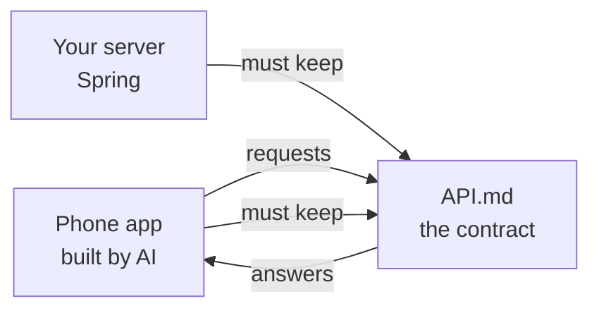
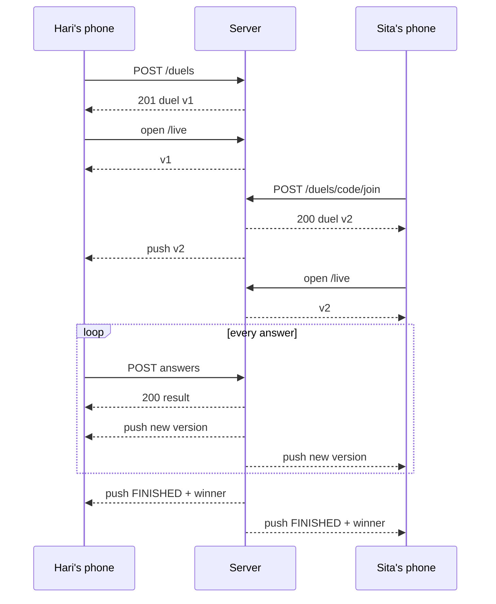

import Quiz from '../../../components/Quiz.astro';
import Think from '../../../components/Think.astro';
import { Aside } from '@astrojs/starlight/components';

<Aside type="tip" title="3 steps · ≈45 min · API.md and a script, no new server code">
**Step 1:** write the contract from what your server really sends. **Step 2:** play a whole duel using only the contract. **Step 3:** hand it to the app, with the five rules every phone must follow. Win: two scripted phones finish a duel using nothing but `API.md`, and the page you give the AI describes your server exactly.
</Aside>

## Recall (from memory)

<Think id="maths-l28-recall-1" prompt="Lesson 22: a phone receives version 6, then version 5. What does it show, and why can't the phone work out the order any other way?" revealLabel="Check">
It shows version 6 and **ignores** 5: the rule is "only show a version greater than the one on screen". Nothing else tells the phone the order, since the network can deliver messages in any order, and scores can go down as well as up in other games (a good point from your Lesson 22 answer).
</Think>

<Think id="maths-l28-recall-2" prompt="Lesson 21: the phone's answer request times out. What does it do, and why is that safe?" revealLabel="Check">
It **sends the same request again**. A timeout means "I don't know" (the server may have saved it). The server remembers each player's answers per question, so a repeat of the same answer returns the saved result and counts nothing twice.
</Think>

## Why a contract

You'll have the phone app built by an AI, from a reference you give it. That app and your server will never share code. They meet only through **messages**: URLs, JSON, status codes, close codes. If the app guesses one name, one status code or one rule wrong, the game breaks and neither side shows an error that says "the other side is wrong".

A **contract** is that meeting written down, so both sides can be checked against the same page.



Two properties make a contract good: it is **complete** (everything a phone needs, nothing it must guess) and it is **true** (every line was checked against the running server). We'll write it from the server's real traffic, then prove it.

## Step 1: write it from real traffic

Take a running server and walk the game with `curl`. Every response below is real (port 8095 on my copy).

```bash
curl -i -X POST localhost:8095/duels -H 'content-type: application/json' -d '{"playerName":"Hari"}'
```

```text
HTTP/1.1 201
Content-Type: application/json

{"code":"JHVE","playerName":"Hari","status":"WAITING","opponentName":null,"winner":null,"scores":{"Hari":0},"secondsLeft":null,"version":1}
```

The second player joins, then asks for the questions:

```text
POST /duels/JHVE/join {"playerName":"Sita"}
200 {"code":"JHVE","playerName":"Hari","status":"PLAYING","opponentName":"Sita","winner":null,"scores":{"Hari":0,"Sita":0},"secondsLeft":59,"version":2}

GET /duels/JHVE/questions
200 [{"index":0,"text":"5 x 3"},{"index":1,"text":"12 x 9"},{"index":2,"text":"5 x 10"},{"index":3,"text":"12 x 8"},{"index":4,"text":"6 x 11"}]

POST /duels/JHVE/answers {"playerName":"Hari","questionIndex":0,"answer":1}
200 {"code":"JHVE","answer":1,"correct":false,"status":"PLAYING","winner":null,"questionIndex":0,"score":0,"version":3}
```

And the ways it refuses, which a phone must handle as carefully as the successes:

```text
Hari answers question 0 again with 2   409 {"error":"ALREADY_ANSWERED","message":"Hari already answered question 0 with 1"}
Hari answers question 3 (he is on 1)   409 {"error":"WRONG_QUESTION","message":"Hari is on question 1, not 3"}
Zen, a stranger, answers               403 {"error":"NOT_IN_DUEL","message":"Zen is not in duel JHVE"}
Zen joins, the duel is already full    409 {"error":"DUEL_NOT_WAITING","message":"Duel JHVE is PLAYING, so nobody can join it"}
GET /duels/NOPE                        404 {"error":"DUEL_NOT_FOUND","message":"No duel with code NOPE"}
POST /duels with {"name":"x"}          400 {"error":"BAD_BODY","message":"The body is not the JSON this endpoint expects"}
```

That's all the server does. Now the contract is just these pieces in a table, written for a reader who has never seen your code. It lives at the root of your repo as **`maths/API.md`** (I've written it, committed it and pushed it), and has five parts:

| Part | Holds | Where it came from |
|---|---|---|
| **The duel** | the one JSON shape, field by field | `DuelResponse` (Lesson 12–22) |
| **Endpoints** | five calls: create, join, get, questions, answer | `DuelController` |
| **Errors** | one shape, nine `error` names with their status | `ErrorHandler`, the 409s from Lesson 16–21 |
| **The live socket** | the path, what arrives, ping, reconnect, close codes | Lessons 25–26 |
| **A whole game** | the calls in order | the transcript above |

<Aside type="note" title="Two things the contract must say out loud">
**Things the phone can't see in the code:** the two players must use **different names** (the server doesn't check), and `POST /duels` accepts an `Idempotency-Key` (Lesson 21). A contract that leaves these out is incomplete, even if every status code is right.
</Aside>

<Think id="maths-l28-predict" prompt="List what the contract must tell a phone about the 'create duel' button that the endpoint table alone doesn't. (Think: the button is tapped on a bad network.)" revealLabel="Check">
That a retry can create a **second duel** unless the phone sends an `Idempotency-Key` header, one new random key per tap, **reused for retries of that tap** only (Lesson 21). The table says `POST /duels`; the *rule* about the key is what prevents orphan duels.
</Think>

## Step 2: prove it by playing

A contract is only as good as its last check. Rather than trust my reading, I wrote a script, `scripts/play.mjs`, that plays a whole duel **using only what the contract says**: two phones, HTTP for actions, a socket each for what they see. It's in your repo too.

```bash
node scripts/play.mjs localhost:8095
```

The real output (trimmed to the interesting lines):

```text
  1.0s  Hari  created duel STHF
  1.2s  Hari  sees v1 WAITING scores {"Hari":0}
  1.4s  Hari  sees v2 PLAYING scores {"Hari":0,"Sita":0} (59 s left)
  1.4s  Sita  joined
  1.4s  Sita  sees v2 PLAYING scores {"Hari":0,"Sita":0} (59 s left)
  1.4s  Sita  got 5 questions: 10 x 4, 2 x 12, 8 x 7, 6 x 7, 6 x 3
  1.4s  Hari  sees v3 PLAYING scores {"Hari":1,"Sita":0} (59 s left)
  …
  1.5s  Hari  sees v11 PLAYING scores {"Hari":5,"Sita":2} (59 s left)
  1.5s  Sita  sees v11 PLAYING scores {"Hari":5,"Sita":2} (59 s left)
  1.5s  Hari  sees v12 FINISHED scores {"Hari":5,"Sita":3} winner Hari
  1.5s  Sita  sees v12 FINISHED scores {"Hari":5,"Sita":3} winner Hari
```

Twelve versions, from `WAITING` to `FINISHED`, and both phones saw every one **at the same moment**: the push from Lesson 25 working over the contract. Hari answered everything right (5), Sita got every other question wrong (3).

Read the script in 5 minutes. Notice what it **doesn't** know: nothing about `Duel`, `LiveDuels`, threads, locks. A phone doesn't need them; they're the reason the contract can be short.



## Step 3: hand it to the app

The AI-built app will need the contract, plus the rules a phone follows. Every rule below came from a lesson: they are what your server **assumes** the phone does.

| # | The phone must… | Because | Lesson |
|---|---|---|---|
| 1 | show a duel only if its `version` is **higher** than the one on screen | responses and pushes can arrive out of order | 22 |
| 2 | retry a timed-out answer with the **same body** | a timeout means "I don't know", and a repeat is safe | 21 |
| 3 | send a fresh `Idempotency-Key` per "Create" tap, same key for its retries | otherwise a retry makes a second duel | 21 |
| 4 | reconnect the socket after 1, 2, 4, 8 s, **ping every 5 s**, and **stop on 4404** | tunnels, and duels that are gone | 26 |
| 5 | use `http://` and `ws://` with the cleartext opt-in and **one** base URL | Android blocks cleartext by default | 27 |

And the one Android example: the contract maps almost line for line to Retrofit. The classes below come from the JSON in the table, with nothing invented:

```kotlin
data class Duel(
    val code: String, val playerName: String, val status: String,
    val opponentName: String?, val winner: String?,
    val scores: Map<String, Int>, val secondsLeft: Long?, val version: Long,
)
data class AnswerBody(val playerName: String, val questionIndex: Int, val answer: Int)
data class AnswerResult(val code: String, val answer: Int, val correct: Boolean,
    val status: String, val winner: String?, val questionIndex: Int, val score: Int, val version: Long)
data class Question(val index: Int, val text: String)

interface DuelApi {
    @POST("duels") suspend fun create(@Header("Idempotency-Key") key: String, @Body body: Map<String, String>): Duel
    @POST("duels/{code}/join") suspend fun join(@Path("code") code: String, @Body body: Map<String, String>): Duel
    @GET("duels/{code}") suspend fun get(@Path("code") code: String): Duel
    @GET("duels/{code}/questions") suspend fun questions(@Path("code") code: String): List<Question>
    @POST("duels/{code}/answers") suspend fun answer(@Path("code") code: String, @Body body: AnswerBody): AnswerResult
}
```

The app you're building is Compose Multiplatform, and it may use another HTTP client than Retrofit. That's fine: the contract is the **same**, only the library changes.

<Aside type="caution" title="What the contract can't promise">
Contracts catch *shape* errors. They can't catch "the app shows the wrong thing", "the timer drifts" or "the phone ignores rule 1". Those are caught by the last check: **two real phones, one real duel**. Run it before calling anything finished.
</Aside>

<Quiz
  question="The phone gets 'WRONG_QUESTION'. What does it mean for the app?"
  options={[
    'The server crashed, so retry',
    'The phone skipped a question',
    'The answer was simply incorrect',
  ]}
  answer={1}
>
`questionIndex` wasn't the player's next question. A **wrong answer** is a normal `200` with `correct: false`; it is never an error.
</Quiz>

<Quiz
  question="Which message tells the phone to stop reconnecting its socket?"
  options={[
    'Close code 4404, duel gone',
    'Close code 1006, abnormal close',
    'Close code 4500, silent socket',
  ]}
  answer={0}
>
1006 and 4500 mean "the connection broke, try again". 4404 means "the duel doesn't exist": retrying can't help.
</Quiz>

<Quiz
  question="Why is there no 'order' field besides version on messages?"
  options={[
    'Messages always arrive in perfect order',
    'The phone sorts them by time',
    'Every message is the whole duel',
  ]}
  answer={2}
>
The newest version has everything, so the phone can skip or ignore any message without losing state. If messages were deltas (+1 point), order would matter.
</Quiz>

## Your turn

<Think id="maths-l28-play" prompt="Run `node scripts/play.mjs localhost:8080` against YOUR running server, then change one line in the script to break the contract on purpose (for example send answers out of order: questionIndex 2 first). What does the script print, and which contract row does that match?" revealLabel="Check">
It stops with `409 WRONG_QUESTION: Hari is on question 0, not 2`. The `call` function turns any non-2xx into an error that prints the `error` name and `message`, which match the **Errors** table. The point: a phone that breaks a rule gets a precise, named answer, not a crash.
</Think>

<Think id="maths-l28-reference" prompt="Send me your Compose Multiplatform reference, then tell me: what in your reference would break one of the five rules? (For example, an HTTP client that retries by itself, or code that overwrites the screen with every response.)" revealLabel="Why this question">
Reference apps are often written against a **fake** server that always answers instantly and in order. That's how rules 1–3 get broken without anyone noticing. Once the app exists, we check it against these five rules one at a time, on two real devices.
</Think>

<Think id="maths-l28-teachback" prompt="Explain to a teammate who'll build the phone app, in 4–5 sentences: what the contract is for, the one rule for showing a duel, what to do after a timeout, and when the socket must stop reconnecting." revealLabel="Compare with a model answer">
The contract is the one page where the app and the server meet: every endpoint, message and error, so neither side has to guess, and it's only trustworthy because a script played a whole duel through it. The phone shows a duel only if its `version` is higher than the one it shows, which makes late or repeated messages harmless. After a timeout the phone sends the same request again, since the server saves each player's answers and returns the saved result instead of counting twice (and `Create` carries a reused `Idempotency-Key`). The live socket reconnects after 1, 2, 4, then 8 seconds, pinging every 5, and catches up from the first message, which is the whole duel; it stops only on close code 4404, because that duel no longer exists.
</Think>

## Read alongside
- 📖 **Primary:** [RFC 9110 §9.2.2 Idempotent Methods](https://www.rfc-editor.org/rfc/rfc9110#section-9.2.2): why a retry of a POST needs help (10 min).
- [IETF draft: The Idempotency-Key HTTP Header Field](https://datatracker.ietf.org/doc/draft-ietf-httpapi-idempotency-key-header/): the header `POST /duels` accepts.
- [RFC 6455 §7.4: WebSocket close codes](https://www.rfc-editor.org/rfc/rfc6455#section-7.4): 1000, 1006, and the private 4000–4999 range our 4404 and 4500 use.
- [OpenAPI Specification](https://spec.openapis.org/oas/latest.html): the standard, machine-readable format of a contract like ours (not needed for this course).

🙋 Ask me: "what does OpenAPI add over an `API.md`?", "how do I version an API when the app is already installed?", "what would a contract for the WebSocket messages look like, formally?", "check my CMP reference against the five rules".

**Next:** Lesson 29: own it. Rebuild the core of the server from memory, then run two phones against it.
