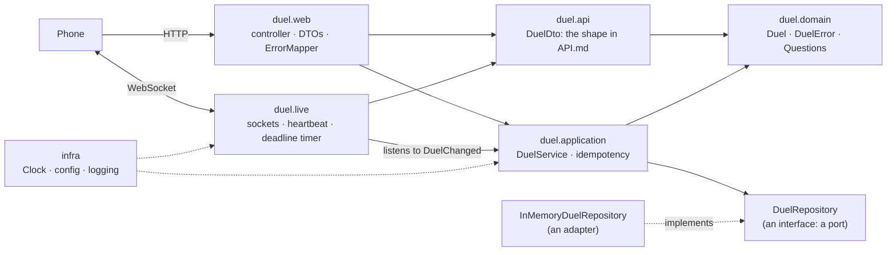
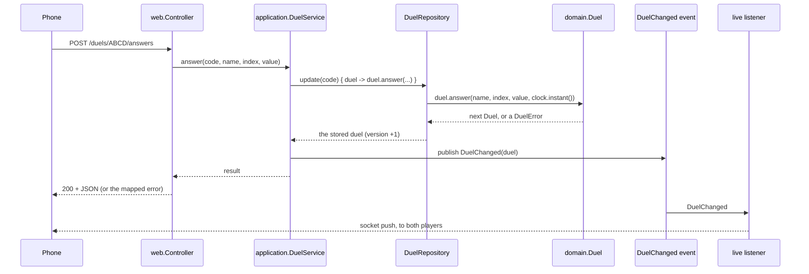
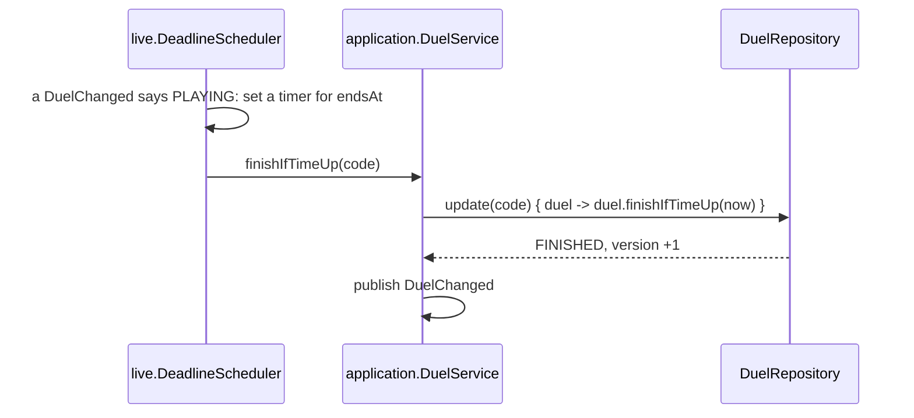
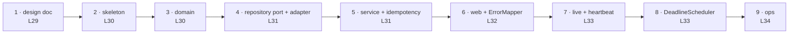

import Quiz from '../../../components/Quiz.astro';
import Think from '../../../components/Think.astro';
import { Aside } from '@astrojs/starlight/components';

<Aside type="tip" title="6 steps · ≈50 min · no Kotlin yet, one commit: docs/DESIGN.md">
First an audit of v1 with real numbers. **Step 1:** a second checkout, `maths-v2`. **Step 2:** requirements and the boundaries. **Step 3:** the domain and its errors. **Step 4:** the two flows that change a duel. **Step 5:** every failure and its module. **Step 6:** the commit plan. Win: a one-page design you wrote, and a worktree where v1 and v2 run side by side.
</Aside>

## Recall (from memory)

<Think id="maths-l29-recall-1" prompt="Lesson 26: which close code means 'the duel does not exist, stop reconnecting', and which means 'the server dropped a silent connection, reconnect'?" revealLabel="Check">
**4404** `DUEL_NOT_FOUND` means stop: retrying can't help. **4500** means the server dropped a silent connection (`SESSION_NOT_RELIABLE`): reconnect after the backoff.
</Think>

<Think id="maths-l29-recall-2" prompt="Lesson 20: why does `repository.update(code) { … }` use `ConcurrentHashMap.compute` instead of find, change, save?" revealLabel="Check">
find, change, save is **read → check → write** in three steps, so two threads can read the same duel and the later write erases the earlier one (Lesson 19's lost answer). `compute` runs the lambda for that key as **one step**: nobody else changes it in between.
</Think>

## Why design first

In Lessons 15–28 you built a backend by adding one concern per lesson. Each step was right. The result is that one class, `DuelService`, now carries everything. Count it in v1:

```bash
cd app/src/main/kotlin/dev/hari/maths
wc -l *.kt | sort -n | tail -4
```

```text
      80 ErrorHandler.kt
     114 LiveDuels.kt
     143 DuelController.kt
     190 DuelService.kt
```

How many different reasons does `DuelService` have to change? Search it for each concern (counts of matching lines, real):

```bash
for k in "DuelConflictException\|NotInDuelException\|DuelNotFound" "Instant.now\|DUEL_LENGTH" "liveDuels\|timer" "createOnce\|requestKey\|earlier" "version" "println" "randomCode\|Random"; do
  printf "%-60s %s\n" "$k" "$(grep -c "$k" DuelService.kt)"
done
```

```text
DuelConflictException\|NotInDuelException\|DuelNotFound      6
Instant.now\|DUEL_LENGTH                                     3
liveDuels\|timer                                             4
createOnce\|requestKey\|earlier                              8
version                                                      2
println                                                      3
randomCode\|Random                                           4
```

| Concern in `DuelService` | Why it will change |
|---|---|
| game rules (join, answer, finish) | a new rule |
| errors as strings (`"WRONG_QUESTION"`) | a typo compiles |
| time (`Instant.now()`) | can't be faked |
| sockets (`liveDuels`) and the timer thread | a new way to push |
| idempotency | keys that expire |
| logging with `println` | structured logs |
| code generation | a new code format |

Seven reasons in one file. Two of them hurt you directly:

- **Time can't be faked.** `Instant.now()` is hard-coded, so every deadline check in Lessons 18, 21 and 23 needed a **real 61-second wait**.
- **The service knows about sockets.** `DuelService` takes `LiveDuels` as a constructor argument. A rule class that must know who is watching can't be read or changed alone.

A **design** is the answer to "what goes where, and who may know about whom", written before the code so the code has somewhere to go.

<Aside type="note" title="You already do this on Android">
Your domain module doesn't import `android.*`; screens depend on it, never the other way round. v2 applies the same rule to a server: the game rules import nothing from Spring.
</Aside>

## Step 1: a second checkout

v1 stays exactly as it is. v2 is built next to it so the **same** `API.md`, `play.mjs` and phone app can be pointed at either. A git **worktree** is a second folder with a different branch checked out, sharing one `.git`. Real output, on a scratch copy of your repo:

```bash
cd ~/code/personal/maths
git worktree add ../maths-v2 -b v2
git worktree list
git branch
```

```text
.../maths      dbf7aa9 [main]
.../maths-v2   dbf7aa9 [v2]
* main
+ v2
```

The `+` means "checked out in another worktree". Both folders start from the same commit; from now on they diverge. Your untracked `client/` stays in `maths/` only, which is what we want.

Open `maths-v2` as a second project in IntelliJ. When you run v2, give it its own port so both run at once:

```bash
cd ~/code/personal/maths-v2
./gradlew bootRun --args='--server.port=8081'
```

Until the code exists this just runs the copied v1. It's the test that the folder works.

<Think id="maths-l29-predict" prompt="You run v1 on 8080 and v2 on 8081, and point the phone app at 8081. A friend asks: 'why not just a branch, and switch with git checkout?' Give two things the worktree lets you do that a branch alone doesn't." revealLabel="Check">
(1) **Run both at the same time**, and compare their answers to the same `play.mjs` line by line. (2) **Keep v1 untouched** and running while you build: no half-finished files in the way, no rebuild when you switch. A branch gives you one working folder, so you'd stop one server to start the other.
</Think>

## Step 2: requirements and boundaries

Functional requirements are **`API.md`, unchanged**: that is the contract with the phone app from Lesson 28. v2 changes everything behind it and nothing in front of it.

Non-functional requirements, each one a Lesson you've lived:

| Requirement | Came from | Test (by running) |
|---|---|---|
| two players at once never lose an answer | Lesson 19 | 1000 simultaneous join pairs → 0 doubles |
| a retry never double-counts | Lesson 21 | `curl --max-time 1`, repeat → same result |
| old messages never overwrite new ones | Lesson 22 | versions only go up |
| a push can't be blocked by another push | Lesson 25 | 300 duels answered at once → all 600 delivered |
| a silent phone is dropped | Lesson 26 | network cut → closed within `SILENCE_LIMIT + PING_EVERY` |
| the duel ends at 60 s without a request | Lesson 25 exercise | v3 FINISHED pushed at 60 s |
| settings change without rebuilding | Lesson 27 | `SERVER_PORT=8081` |
| it runs in a container and tells you if it's alive | new | `docker run`, `GET /health` |

**Non-goals** (on purpose, so they don't sneak in): a database, accounts, rate limits, more than one server process, removing old duels, and automated tests, which you've chosen to leave for later. The design only has to **not block** a database later.

<Aside type="caution" title="An assumption, stated plainly">
One JVM, duels in memory, a few thousand live duels at most. That is a guess about the load, not a measurement. It's why one process is a legitimate design here, and it's the first sentence to revisit if the game gets popular.
</Aside>

Now the shape. Arrows mean "knows about". Nothing points out of the domain.



Two words you'll use from here on:

- A **port** is an interface that the inside defines for something it needs (`DuelRepository`: "find a duel, update it atomically"). The inside never says how.
- An **adapter** is code that plugs a port into a real thing: `InMemoryDuelRepository` plugs it into a `ConcurrentHashMap`. Controllers and the socket handler are adapters too: they plug HTTP and WebSocket into the service. Alistair Cockburn named the idea **hexagonal architecture**: the application in the middle, adapters around it.

The rule that makes it real, as a table you can check:

| Package | May import | May **not** import |
|---|---|---|
| `duel.domain` | Kotlin, `java.time` | Spring, Jackson, sockets, every other package |
| `duel.application` | `duel.domain`, Spring's `@Service` and events | `duel.web`, `duel.live`, any HTTP or WebSocket class |
| `duel.api` | `duel.domain` | everything else (it is the one JSON shape that HTTP **and** WebSocket share) |
| `duel.web` | `duel.application`, `duel.domain`, `duel.api`, Spring Web | `duel.live` |
| `duel.live` | `duel.application` (events and service), `duel.domain`, `duel.api`, Spring WebSocket | `duel.web` |
| `infra` | everything it configures | (it only wires) |

You can check the first rule with one command, no test framework. In v2, when it holds, this prints nothing:

```bash
grep -rn "import org.springframework" app/src/main/kotlin/dev/hari/maths/duel/domain
```

In **v1** the same question over the whole app gives (real, number of Spring imports per file):

```text
Duel.kt:0                 DuelController.kt:8     DuelRepository.kt:1    DuelService.kt:1
DuelSocketHandler.kt:5    ErrorHandler.kt:7       LiveDuels.kt:5         WebSocketConfig.kt:4
```

`Duel.kt` is already clean, which is why Lesson 30 will be a copy-and-improve, not a rewrite.

Where everything from v1 goes:

| v1 | v2 home |
|---|---|
| `Duel`, `DuelStatus`, `Questions.kt` | `domain` |
| rules inside `answer`, `join`, `finish`, `finishIfTimeUp` | `domain`, as functions **on** `Duel` |
| `DuelConflictException`, `NotInDuelException`, `DuelNotFoundException` | gone: `DuelError` (a sealed type) in `domain` |
| `version` bump inside `repository.update` | `domain` (the duel bumps itself) |
| `DuelRepository` (class) | `application`: the interface; `infra`: `InMemoryDuelRepository` |
| `createdByKey` | `application`: an `IdempotencyStore`, with expiry |
| `change()`, `create`, `join` orchestration | `application.DuelService` |
| `LiveDuels`, `DuelSocketHandler`, ping/silence | `live` |
| `timer.schedule({ get(code) }, …)` | `live.DeadlineScheduler` |
| `ErrorHandler` | `web.ErrorMapper` |
| `DuelResponse` + `toResponse()` | `api`: `DuelDto` (so sockets don't import `web`) |
| `DUEL_LENGTH`, `PING_EVERY`, `SILENCE_LIMIT` constants | `infra`: `@ConfigurationProperties` |

## Step 3: the domain, as a sketch

The domain's job: **given a duel and an event, return the next duel, or say why not.** Today your rules do that by *throwing*, and the controller's `@RestControllerAdvice` catches them far away. In v2 the rules **return** their refusals:

```kotlin
sealed interface DuelError {
    data class NotWaiting(val code: String, val status: DuelStatus) : DuelError
    data class NotPlaying(val code: String, val status: DuelStatus) : DuelError
    data class NotInDuel(val code: String, val playerName: String) : DuelError
    data class AlreadyAnswered(val playerName: String, val questionIndex: Int, val earlier: Int) : DuelError
    data class WrongQuestion(val playerName: String, val expected: Int, val got: Int) : DuelError
    data class NoQuestionsLeft(val playerName: String) : DuelError
    data class DuelNotFound(val code: String) : DuelError
}
```

This is nearly the final code, but don't type it yet: Lesson 30 builds it. Each case carries what its message will need. A `sealed interface` lists every case in one place; a `when` over it must handle them all, and the compiler tells you if you forget one. With a string like `"WRONG_QUESTION"` nothing tells you.

`DuelNotFound` is in the list so that one type covers every refusal, but the domain never makes it: the **repository** returns "nothing found", and the **service** turns that into this error. Two errors from `API.md` aren't `DuelError`s at all:

| `API.md` error | Where it's born | Why |
|---|---|---|
| `BAD_BODY` (400), `NOT_JSON` (415) | `web` | the JSON never became a request; the game wasn't asked |
| `DUEL_NOT_FOUND` (404) | `application` | the repository found nothing |
| the other six cases | `domain` | a rule refused |

One place, `web.ErrorMapper`, turns each into the `API.md` error shape: **one table**, so a status code can't drift between endpoints. Socket close codes (4404, 4500) are mapped in `live` the same way.

Time and randomness come **in**, they aren't reached for. Real output of why that matters, run in a scratch script (no server):

```kotlin
val clock = Clock.fixed(startedAt.plusSeconds(second), ZoneOffset.UTC)   // a clock that says exactly this
```

```text
at +0s  timeUp=false
at +59s  timeUp=false
at +60s  timeUp=true
at +3600s  timeUp=true
took 28 ms, not 60 s
```

`java.time.Clock` is the standard way: production gets `Clock.systemUTC()`, a script gets `Clock.fixed(…)`. A duel's deadline decision now takes 28 ms to *check* at any moment you like, instead of a 61 s wait. You still do the checking by running (no test framework); you're just no longer waiting.

<Think id="maths-l29-time" prompt="v1's `isTimeUp(now: Instant)` already takes `now` as a parameter (Lesson 18). So why did the service still need `Instant.now()` and a real wait? What exactly does a `Clock` change?" revealLabel="Check">
The **domain** was already clean: it took `now` as a parameter. The *service* produced it with `Instant.now()`, the hard-coded call you can't move. Injecting a `Clock` into the service (and the scheduler) moves **who decides what "now" is** to one bean you can replace, so any script or run can say "it's 10:01:00" without waiting.
</Think>

## Step 4: two flows that change a duel

Every change to a duel, from any caller, goes down the **same** path. Two callers in v2: a request, and the deadline.



And the deadline:



Three things differ from v1:

1. The service **doesn't call** `liveDuels.send`. It publishes `DuelChanged`, a **domain event**: a plain object meaning "this happened". Whoever listens (the live adapter) reacts. Nobody has to know who.
2. The repository stays dumb and atomic: it runs a function on the stored duel and keeps the result. The **version bump** lives in the domain: the duel's own function does `copy(version = version + 1)`.
3. A request and the scheduler call the **same** `finishIfTimeUp`, so the lazy finish (Lesson 18) and the timed finish (Lesson 25) are one rule, not two.

Spring's own mechanism for events is `ApplicationEventPublisher`; Lesson 31 shows it.

## Step 5: failures, and which module kills each

Every lesson from 19 to 26 was one failure. Write them as a table so none is forgotten:

| Failure | Lesson | Killed by | In module |
|---|---|---|---|
| two threads, one duel, a lost update | 19–20 | `update` is atomic (`compute`) | repository adapter |
| a timeout, then a retry | 21 | same answer → same result; `Idempotency-Key` | domain + application |
| keys remembered forever | 21 caution | a store that forgets after `idempotency-ttl` | application |
| a slow response overtakes a fast one | 22 | `version` only goes up; phone ignores older | domain |
| two pushes to one socket at once | 25 | one lock per socket when sending | live |
| a silent phone, forever in the watchers map | 26 | ping every `PING_EVERY`, drop after `SILENCE_LIMIT` | live |
| nothing runs at 60 s | 25 | a timer per PLAYING duel fires `finishIfTimeUp` | live |
| a broken socket turns a stored answer into a 500 | 25 | `sendTo` catches everything | live |
| a reconnect to a duel that's gone loops forever | 26 | close 4404, the phone stops | live + web |
| "now" that can't be faked | 18 | an injected `Clock` | infra |
| a rule that throws deep in the stack | 13, 16 | rules **return** `DuelError` | domain |

Settings go in one place. A `@ConfigurationProperties` class (built in Lesson 30) reads these, and the Spring `application.properties` plus environment variables set them:

| Property | Default | Environment variable |
|---|---|---|
| `duel.length` | 60 s | `DUEL_LENGTH` |
| `duel.live.ping-every` | 5 s | `DUEL_LIVE_PING_EVERY` |
| `duel.live.silence-limit` | 15 s | `DUEL_LIVE_SILENCE_LIMIT` |
| `duel.idempotency-ttl` | 10 min | `DUEL_IDEMPOTENCY_TTL` |

(The environment-variable form is Spring's *relaxed binding*: dots and dashes become underscores, capitals. You saw `SERVER_ADDRESS` do exactly this in Lesson 27.)

<Think id="maths-l29-where" prompt="Where does each belong in v2, and why? (a) the check 'the player answered all 5 questions'; (b) turning `NotInDuel` into HTTP 403; (c) pinging every 5 s; (d) storing the `Idempotency-Key`; (e) `Clock.systemUTC()`. Name the package for each." revealLabel="Check">
(a) **domain**: it's a game rule and returns `NoQuestionsLeft`. (b) **web**, in `ErrorMapper`: status codes are an HTTP idea. (c) **live**: a socket concern. (d) **application**: it decides *whether to run the same request twice*, which is neither a game rule nor storage. (e) **infra**: the one place that chooses real time; everyone else is handed a `Clock`.
</Think>

## Step 6: the commit plan

Nine commits, each compiles and runs, each is one reviewable idea. The lessons from 30 to 34 give you the code for each.



| # | Commit | Check by running |
|---|---|---|
| 1 | `docs: design for v2` | none, you wrote it |
| 2 | `chore: v2 skeleton, Clock bean, scheduler, properties` | app starts on 8081 |
| 3 | `domain: Duel as a pure state machine with sealed results` | a scratch script plays a duel through the domain |
| 4 | `app: DuelRepository port and in-memory adapter` | a scratch script, 1000 concurrent updates |
| 5 | `app: DuelService with idempotent answers and key expiry` | a scratch script with a clock you move by hand |
| 6 | `web: controller, DTOs and ErrorMapper` | one scripted sequence sent to v1 and v2, answers compared |
| 7 | `live: socket registry, handler, heartbeat and DuelChanged listener` | two phones, a network cut |
| 8 | `live: DeadlineScheduler pushes FINISHED at the deadline` | a silent duel, FINISHED pushed at the deadline; `play.mjs` |
| 9 | `ops: configuration, logs, health, Dockerfile and runbook` | `docker run`, `play.mjs`, the Compose app |

Commit 6 is the first time the app is **usable** again; 7 and 8 bring back the live part. That order is deliberate: after commit 6, v2 can already be played over HTTP, exactly like Lesson 23's polling phone. (`play.mjs` needs the sockets, so it joins in at commit 7.)

<Quiz
  question="Which package may import Spring's web classes?"
  options={[
    'duel.web, which adapts HTTP',
    'duel.domain, for DTO types',
    'duel.application, for HTTP statuses',
  ]}
  answer={0}
>
Only the adapters import the technology they adapt. The domain and application know nothing about HTTP, so they work unchanged whether a request comes from a controller, a socket or a script.
</Quiz>

<Quiz
  question="Why does the service publish DuelChanged instead of calling the socket code?"
  options={[
    'It makes pushes much faster',
    'It stops pushes from failing',
    'The service ignores sockets entirely',
  ]}
  answer={2}
>
Publishing is the same speed and doesn't prevent failures. What it buys is **direction**: the service doesn't import `live`, so you can change, test or remove the socket side without touching the rules.
</Quiz>

<Quiz
  question="Where does the version bump belong in v2?"
  options={[
    'In the repository, on every save',
    'In the duel, on every change',
    'In the controller, once per response',
  ]}
  answer={1}
>
A version is part of **what the duel is**, so the duel bumps it in the same step as the change. In v1 the repository did it, which meant a different storage would have to remember to.
</Quiz>

## Your turn: write DESIGN.md (commit 1)

In `~/code/personal/maths-v2`, create `docs/DESIGN.md` with these headings, in **your own words** (a few lines each; copy the tables):

1. **Goal**: one paragraph. What v2 is for, and that `API.md` doesn't change.
2. **Requirements and non-goals**: the table from Step 2.
3. **Boundaries**: the diagram, and the package rule table.
4. **Domain and errors**: the `DuelError` list and who maps each.
5. **Flows**: the two sequence diagrams.
6. **Failures**: the table from Step 5.
7. **Configuration**: the properties table.
8. **Commit plan**: the table from Step 6.

```text
Commit: docs: design for v2
```

Then run it to check the worktree:

```bash
cd ~/code/personal/maths-v2 && git add docs && git commit -m "docs: design for v2" && git log --oneline -1 && git branch --show-current
```

Don't push `v2` yet. We'll do that when you ask.

<Think id="maths-l29-change" prompt="A new rule arrives: a player may take back (undo) their last answer within 3 seconds. Using your design only, list every package that changes, and say which ones do NOT. What does that tell you about the design?" revealLabel="Check">
**Changes:** `domain` (a new operation, maybe a new `DuelError` for 'too late'), `application` (a method that calls it through `update`), `web` (an endpoint and its error mapping), and `API.md`. If the phone must see it, `live` needs **no change at all**: the service publishes `DuelChanged` like for every other change. `infra` changes only if the 3 seconds become a property. A design where a new rule touches exactly the layers that logically own it, and the socket code is not one of them, is the one working.
</Think>

<Think id="maths-l29-teachback" prompt="In 4–5 sentences, explain the v2 design to a teammate: what the domain does and refuses to know, what a port and an adapter are, why the service publishes an event, and why the clock is injected." revealLabel="Compare with a model answer">
The domain is the game's rules as pure functions on an immutable duel: given a duel and an event it returns the next duel (with its version bumped) or a `DuelError`, and it knows nothing about Spring, JSON, HTTP or sockets. A port is an interface the inside defines for something it needs, like the repository, and an adapter plugs it into a real thing, like a `ConcurrentHashMap` or a WebSocket handler; the adapters sit around the application and only point inward. After a successful update the service publishes a `DuelChanged` event, so the socket adapter reacts without the service importing it, and a new way to push changes nothing in the rules. The clock is injected so there is one bean that decides what "now" is, which means a deadline can be checked at any moment without a 60-second wait.
</Think>

## Read alongside
- 📖 **Primary:** [Alistair Cockburn, "Hexagonal architecture"](https://alistair.cockburn.us/hexagonal-architecture/): the original statement of ports and adapters (15 min).
- [Kotlin docs: Sealed classes and interfaces](https://kotlinlang.org/docs/sealed-classes.html): exhaustive `when`, which Lesson 30 uses.
- [Java `Clock`](https://docs.oracle.com/en/java/javase/25/docs/api/java.base/java/time/Clock.html): `systemUTC()`, `fixed(…)`, `offset(…)`.
- [Spring Framework: Standard and Custom Events](https://docs.spring.io/spring-framework/reference/core/beans/context-introduction.html#context-functionality-events): what Lesson 31 builds on.
- [`git worktree`](https://git-scm.com/docs/git-worktree): the second folder.

🙋 Ask me: "why not just use the Spring `@Transactional` instead of `compute`?", "is this really hexagonal, or just layered?", "what would change if the repository were Postgres?", "review my DESIGN.md".

**Next:** Lesson 30: the skeleton and the pure domain, the first code of v2.
