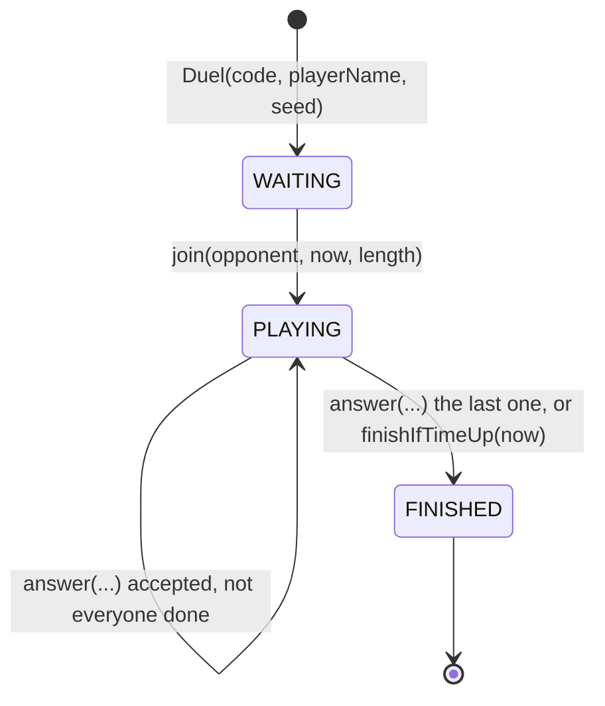

import Quiz from '../../../components/Quiz.astro';
import Think from '../../../components/Think.astro';
import { Aside } from '@astrojs/starlight/components';

<Aside type="tip" title="2 steps · ≈60 min · commits 2 and 3">
**Step 1:** a clean v2 tree: settings, a `Clock`, a scheduler. **Step 2:** the `Duel`, as a pure state machine. Win: v2 starts on port 8081, and a scratch script plays a complete duel, including the deadline, in a few milliseconds.
</Aside>

## Recall (from memory)

<Think id="maths-l30-recall-1" prompt="Lesson 29: which things may the package duel.domain import, and name two it may never import." revealLabel="Check">
Only Kotlin and `java.time`. Never Spring, Jackson (JSON), sockets, or any other package of ours (`application`, `web`, `live`, `api`, `infra`).
</Think>

<Think id="maths-l30-recall-2" prompt="Lesson 22: in v1, which class adds 1 to a duel's version, and where does v2 move that, and why?" revealLabel="Check">
In v1 the **repository** did it (`next.copy(version = duel.version + 1)` inside `update`). In v2 the **duel** does it, in the same step as the change, because a version is part of what a duel *is*: a different storage (a database) should not have to remember to bump it.
</Think>

## Step 1: a clean tree

You're in `~/code/personal/maths-v2`, on branch `v2`, with your `docs/DESIGN.md` committed. v2 shares nothing with v1's code, so first remove v1's source files from this branch. (They stay untouched in `main`, and git remembers them here too.)

```bash
cd app/src/main/kotlin/dev/hari/maths
git rm DuelController.kt DuelNotFoundException.kt DuelSocketHandler.kt DuelService.kt \
  NotInDuelException.kt HealthController.kt DuelConflictException.kt WebSocketConfig.kt \
  ErrorHandler.kt LiveDuels.kt Questions.kt QuestionController.kt Duel.kt DuelRepository.kt
mkdir infra
```

Only `AppApplication.kt` stays. Add the `@ConfigurationPropertiesScan` annotation (and its import) to it:

```kotlin
// app/src/main/kotlin/dev/hari/maths/AppApplication.kt
package dev.hari.maths

import org.springframework.boot.autoconfigure.SpringBootApplication
import org.springframework.boot.context.properties.ConfigurationPropertiesScan
import org.springframework.boot.runApplication

@SpringBootApplication
@ConfigurationPropertiesScan
class AppApplication

fun main(args: Array<String>) {
	runApplication<AppApplication>(*args)
}
```

`@ConfigurationPropertiesScan` tells Spring to look for classes marked `@ConfigurationProperties` and build them from settings. Here is one, `infra/DuelProperties.kt`:

```kotlin
// app/src/main/kotlin/dev/hari/maths/infra/DuelProperties.kt
package dev.hari.maths.infra

import org.springframework.boot.context.properties.ConfigurationProperties
import java.time.Duration

// Every setting of the game in one place. application.properties or an
// environment variable (DUEL_LENGTH=20s) overrides a default.
@ConfigurationProperties("duel")
data class DuelProperties(
    // How long a duel lasts, from the moment the second player joins
    val length: Duration = Duration.ofSeconds(60),
    // How long an Idempotency-Key is remembered
    val idempotencyTtl: Duration = Duration.ofMinutes(10),
    val live: Live = Live(),
) {
    data class Live(
        // How often the server pings each phone
        val pingEvery: Duration = Duration.ofSeconds(5),
        // How long a phone may stay silent before it is dropped
        val silenceLimit: Duration = Duration.ofSeconds(15),
    )
}
```

How it works: Spring reads `duel.length`, `duel.live.ping-every`, … from `application.properties`, from environment variables (`DUEL_LENGTH=20s`) and from the command line, and builds this data class. A setting nobody gave stays the default you wrote. `Duration` understands `20s`, `5m`, `500ms`. Nobody else in the code will ever write `Duration.ofSeconds(60)` again.

Then `infra/InfraConfig.kt`, the two things everyone needs and nobody should make for themselves:

```kotlin
// app/src/main/kotlin/dev/hari/maths/infra/InfraConfig.kt
package dev.hari.maths.infra

import org.springframework.context.annotation.Bean
import org.springframework.context.annotation.Configuration
import java.time.Clock
import java.util.concurrent.Executors
import java.util.concurrent.ScheduledExecutorService

// The two things everyone needs and nobody should create for themselves:
// the time, and a few threads that run things later.
@Configuration
class InfraConfig {

    // Every "now" in the app comes from this bean
    @Bean
    fun clock(): Clock = Clock.systemUTC()

    // Deadlines, pings and clean-ups run here. Spring shuts it down when the app stops.
    @Bean
    fun scheduler(): ScheduledExecutorService =
        Executors.newScheduledThreadPool(2, Thread.ofPlatform().name("duel-timer-", 1).daemon().factory())
}
```

- `Clock.systemUTC()` is the real clock. Everything that needs "now" will be **given** this bean. In a scratch script we'll give the domain a different one.
- The scheduler is a pool of two threads that run things later (deadlines, pings, clean-ups). `Thread.ofPlatform().name("duel-timer-", 1)` names them `duel-timer-1`, `duel-timer-2`, so a log line tells you who ran it. `daemon()` lets the app exit even if a timer is waiting. Because it's a bean, Spring shuts it down when the app stops. In v1, `LiveDuels` and `DuelService` each started their own executor.

And replace `application.properties` with one line:

```properties
spring.application.name=maths
```

Run it. I used port 8091 on my machine; you use 8081.

```bash
cd ~/code/personal/maths-v2/app
./gradlew bootRun --args='--server.port=8081'
```

```text
INFO 1522 --- [maths] [main] o.s.boot.tomcat.TomcatWebServer          : Tomcat started on port 8091 (http) with context path '/'
INFO 1522 --- [maths] [main] dev.hari.maths.AppApplicationKt          : Started AppApplicationKt in 1.257 seconds (process running for 1.462)
```

```bash
curl -s -o /dev/null -w "GET /duels/ABCD -> %{http_code}\n" localhost:8081/duels/ABCD
```

```text
GET /duels/ABCD -> 404
```

An app with no controllers: Spring's own 404. Stop it (Ctrl+C).

```text
Commit: chore: v2 skeleton, Clock bean, scheduler, properties
```

<Think id="maths-l30-clock" prompt="Why make Clock a bean instead of calling Clock.systemUTC() wherever it's needed?" revealLabel="Check">
Because then **one place** chooses what time is. Production's bean is the system clock; a scratch script (below) passes a clock you set by hand. If every class called `Clock.systemUTC()` itself, none of them could be given a different one. It's the same reason `DuelService` takes a `DuelRepository`: it's handed what it needs.
</Think>

## Step 2: the domain

The domain is the game's rules, and nothing else. Three ideas shape it:

1. **Immutable**: a `Duel` is a `data class` of `val`s. A rule never changes a duel; it returns the next one.
2. **Rules return, they don't throw**: the result is an `Outcome`, either `Ok(value)` or `Rejected(error)`.
3. **No clock inside**: every rule that needs time gets `now` as a parameter.



Create the package `duel/domain` and these four files.

`Questions.kt` is v1's file, with the constant renamed `QUESTIONS_PER_DUEL`:

```kotlin
// app/src/main/kotlin/dev/hari/maths/duel/domain/Questions.kt
package dev.hari.maths.duel.domain

import kotlin.random.Random

// One multiplication question
data class Question(val a: Int, val b: Int) {
    val text get() = "$a x $b"
    val answer get() = a * b
}

const val QUESTIONS_PER_DUEL = 5

// The same seed always gives the same questions, in the same order
fun questionsFor(seed: Long): List<Question> {
    val random = Random(seed)
    return List(QUESTIONS_PER_DUEL) {
        Question(random.nextInt(2, 13), random.nextInt(2, 13))
    }
}
```

`Outcome.kt`: the result of a rule.

```kotlin
// app/src/main/kotlin/dev/hari/maths/duel/domain/Outcome.kt
package dev.hari.maths.duel.domain

// What a rule gives back: the new value, or the reason it said no.
// Rules return this instead of throwing, so a caller can't forget the "no".
sealed interface Outcome<out T> {
    data class Ok<out T>(val value: T) : Outcome<T>
    data class Rejected(val error: DuelError) : Outcome<Nothing>
}
```

`sealed interface` means: these are **all** the cases, and no other file can add one. `Rejected` is an `Outcome<Nothing>`, so one refusal fits any `Outcome<T>`.

`DuelError.kt`: every way the game says no. Each case carries what its message will need, so the error is data, not text.

```kotlin
// app/src/main/kotlin/dev/hari/maths/duel/domain/DuelError.kt
package dev.hari.maths.duel.domain

// Every way the game says no. Each case carries what a message needs.
// Turning one into HTTP is not the domain's job (see web/ErrorMapper).
sealed interface DuelError {
    data class DuelNotFound(val code: String) : DuelError
    data class NotWaiting(val code: String, val status: DuelStatus) : DuelError
    data class NotPlaying(val code: String, val status: DuelStatus) : DuelError
    data class NotInDuel(val code: String, val playerName: String) : DuelError
    data class AlreadyAnswered(val playerName: String, val questionIndex: Int, val earlier: Int) : DuelError
    data class WrongQuestion(val playerName: String, val expected: Int, val got: Int) : DuelError
    data class NoQuestionsLeft(val playerName: String) : DuelError
}
```

`Duel.kt`, the heart:

```kotlin
// app/src/main/kotlin/dev/hari/maths/duel/domain/Duel.kt
package dev.hari.maths.duel.domain

import java.time.Duration
import java.time.Instant

enum class DuelStatus {
    WAITING,
    PLAYING,
    FINISHED
}

// What an accepted answer gives back: the duel after it, and whether it was right
data class AnswerResult(val duel: Duel, val correct: Boolean)

// A duel, as the game sees it: immutable, no Spring, no JSON, no clock.
// Every rule gets "now" as a parameter and returns the next duel (or a reason).
data class Duel(
    val code: String,
    val playerName: String,
    val seed: Long,

    val status: DuelStatus = DuelStatus.WAITING,
    val opponentName: String? = null,
    val winner: String? = null,
    val answers: Map<String, List<Int>> = mapOf(playerName to emptyList()),

    val endsAt: Instant? = null,
    // Goes up by one every time the duel changes
    val version: Long = 1,
) {
    val questions get() = questionsFor(seed)

    fun score(player: String): Int {
        val given = answers[player] ?: return 0
        return given.zip(questions).count { (answer, question) -> answer == question.answer }
    }

    fun scores(): Map<String, Int> = answers.keys.associateWith { score(it) }

    fun isTimeUp(now: Instant): Boolean {
        val end = endsAt ?: return false
        return !now.isBefore(end)
    }

    fun join(opponent: String, now: Instant, length: Duration): Outcome<Duel> {
        // A retry of a join that already worked: same duel, nothing changes
        if (status == DuelStatus.PLAYING && opponent == opponentName) {
            return Outcome.Ok(this)
        }
        if (status != DuelStatus.WAITING) {
            return Outcome.Rejected(DuelError.NotWaiting(code, status))
        }
        val joined = copy(
            status = DuelStatus.PLAYING,
            opponentName = opponent,
            answers = answers + (opponent to emptyList()),
            endsAt = now.plus(length),
        )
        return Outcome.Ok(joined.bumped())
    }

    fun answer(player: String, questionIndex: Int, value: Int): Outcome<AnswerResult> {
        val given = answers[player]

        // A retry of an answer that was already saved: same result, nothing changes
        val earlier = given?.getOrNull(questionIndex)
        if (earlier != null) {
            if (earlier != value) {
                return Outcome.Rejected(DuelError.AlreadyAnswered(player, questionIndex, earlier))
            }
            return Outcome.Ok(AnswerResult(this, earlier == questions[questionIndex].answer))
        }

        if (status != DuelStatus.PLAYING) {
            return Outcome.Rejected(DuelError.NotPlaying(code, status))
        }
        if (given == null) {
            return Outcome.Rejected(DuelError.NotInDuel(code, player))
        }
        if (given.size == QUESTIONS_PER_DUEL) {
            return Outcome.Rejected(DuelError.NoQuestionsLeft(player))
        }
        if (questionIndex != given.size) {
            return Outcome.Rejected(DuelError.WrongQuestion(player, expected = given.size, got = questionIndex))
        }

        val correct = value == questions[questionIndex].answer
        val next = copy(answers = answers + (player to given + value))
        val bothDone = next.answers.values.all { it.size == QUESTIONS_PER_DUEL }
        val settled = if (bothDone) next.finished() else next
        return Outcome.Ok(AnswerResult(settled.bumped(), correct))
    }

    // Time passing is also a change: a PLAYING duel whose time is up becomes FINISHED
    fun finishIfTimeUp(now: Instant): Duel {
        if (status == DuelStatus.PLAYING && isTimeUp(now)) {
            return finished().bumped()
        }
        return this
    }

    // The higher score wins, a tie has no winner
    private fun finished(): Duel {
        val mine = score(playerName)
        val theirs = score(opponentName!!)
        val winner = when {
            mine > theirs -> playerName
            theirs > mine -> opponentName
            else -> null
        }
        return copy(status = DuelStatus.FINISHED, winner = winner)
    }

    private fun bumped(): Duel = copy(version = version + 1)
}
```

Read it in this order.

**`join`** is the only way into `PLAYING`: it stores the deadline (`endsAt = now + length`), adds the opponent's empty answer list, and bumps the version. A retry of a join that already worked (same name, already `PLAYING`) returns the same duel without bumping, which is the Lesson 21 exercise built in from the start.

**`answer`** has seven exits. The order matters:

| # | Check | Result | Why this position |
|---|---|---|---|
| 1 | this player already answered this question with the same value | `Ok`, the saved result, **no bump** | a retry must work even after the duel finished: a timeout is exactly when a phone retries |
| 2 | same question, a different value | `AlreadyAnswered` | (still before the status check, same reason) |
| 3 | status is not `PLAYING` | `NotPlaying` | |
| 4 | player not in the duel | `NotInDuel` | |
| 5 | all 5 answered | `NoQuestionsLeft` | |
| 6 | not the player's next question | `WrongQuestion` | |
| 7 | otherwise | `Ok`, new duel, version + 1 | and finish if both players are done |

**`finishIfTimeUp(now)`** is the deadline as a rule: if the duel is `PLAYING` and `now` is at or past `endsAt`, it becomes `FINISHED`. Otherwise it returns `this`. Nothing in the domain waits; it only answers "given this `now`, what is the duel?".

**Version.** `bumped()` is called **once** per accepted change (`finished().bumped()`, never two bumps), and never for a refusal or a retry. So "the version went up" and "the duel changed" mean the same thing, which Lesson 31's service will use to decide whether to announce.

### Check it by running

No Spring, no server. Compile the domain alone into a jar, and play with it from a scratch script that lives **outside** the repo (for example `~/scratch/`):

```bash
cd ~/code/personal/maths-v2
kotlinc app/src/main/kotlin/dev/hari/maths/duel/domain/*.kt -d ~/scratch/domain.jar
grep -rn "import org.springframework" app/src/main/kotlin/dev/hari/maths/duel/domain   # prints nothing
```

The second command is the Lesson 29 rule: no output means the domain imports no Spring. Now the script:

<details>
<summary>~/scratch/domain-demo.main.kts</summary>

```kotlin

import dev.hari.maths.duel.domain.Outcome
import dev.hari.maths.duel.domain.AnswerResult
import dev.hari.maths.duel.domain.Duel
import java.time.Duration
import java.time.Instant

val start = Instant.parse("2026-11-24T10:00:00Z")
val length = Duration.ofSeconds(60)

fun show(label: String, outcome: Outcome<Any>) = println("%-34s %s".format(label, when (outcome) {
    is Outcome.Ok -> when (val v = outcome.value) {
        is AnswerResult -> "Ok correct=${v.correct} v${v.duel.version} ${v.duel.status} ${v.duel.scores()}"
        is Duel -> "Ok v${v.version} ${v.status} ${v.scores()}"
        else -> "Ok"
    }
    is Outcome.Rejected -> "Rejected ${outcome.error}"
}))

val created = Duel(code = "ABCD", playerName = "Hari", seed = 7)
println("questions: ${created.questions.map { "${it.text}=${it.answer}" }}")
println("%-34s v${created.version} ${created.status}".format("created"))

val joinedOutcome = created.join("Sita", start, length)
show("Sita joins at 10:00:00", joinedOutcome)
var duel = (joinedOutcome as Outcome.Ok).value
println("%-34s %s".format("endsAt", duel.endsAt))

show("Zen joins", duel.join("Zen", start, length))
show("Sita joins again (retry)", duel.join("Sita", start, length))

val q = duel.questions
fun answer(who: String, index: Int, value: Int, label: String) {
    val out = duel.answer(who, index, value)
    show(label, out)
    if (out is Outcome.Ok) duel = out.value.duel
}
answer("Hari", 0, q[0].answer, "Hari answers 0 right")
answer("Hari", 0, q[0].answer, "Hari repeats the same answer")
answer("Hari", 0, 1, "Hari answers 0 with another value")
answer("Hari", 3, 1, "Hari jumps to question 3")
answer("Zen", 0, 1, "Zen (a stranger) answers")
answer("Sita", 0, q[0].answer + 1, "Sita answers 0 wrong")

println("%-34s %s".format("time up at 10:00:59?", duel.finishIfTimeUp(start.plusSeconds(59)).status))
val late = duel.finishIfTimeUp(start.plusSeconds(60))
println("%-34s v${late.version} ${late.status} winner=${late.winner}".format("time up at 10:01:00?"))
show("Hari answers after the deadline", late.answer("Hari", 1, 1))
```

</details>

```bash
cd ~/scratch && kotlin -cp domain.jar domain-demo.main.kts
```

(My seed 7 gives the questions below; yours will match, because a seed always gives the same questions.)

```text
questions: [7 x 9=63, 7 x 3=21, 5 x 7=35, 2 x 4=8, 4 x 8=32]
created                            v1 WAITING
Sita joins at 10:00:00             Ok v2 PLAYING {Hari=0, Sita=0}
endsAt                             2026-11-24T10:01:00Z
Zen joins                          Rejected NotWaiting(code=ABCD, status=PLAYING)
Sita joins again (retry)           Ok v2 PLAYING {Hari=0, Sita=0}
Hari answers 0 right               Ok correct=true v3 PLAYING {Hari=1, Sita=0}
Hari repeats the same answer       Ok correct=true v3 PLAYING {Hari=1, Sita=0}
Hari answers 0 with another value  Rejected AlreadyAnswered(playerName=Hari, questionIndex=0, earlier=63)
Hari jumps to question 3           Rejected WrongQuestion(playerName=Hari, expected=1, got=3)
Zen (a stranger) answers           Rejected NotInDuel(code=ABCD, playerName=Zen)
Sita answers 0 wrong               Ok correct=false v4 PLAYING {Hari=1, Sita=0}
time up at 10:00:59?               PLAYING
time up at 10:01:00?               v5 FINISHED winner=Hari
Hari answers after the deadline    Rejected NotPlaying(code=ABCD, status=FINISHED)
```

Read what happened: Sita joins and the version goes 1 → 2; Zen is refused; Sita's repeated join is accepted with no new version; Hari's repeated answer keeps v3; a different value, a jump to question 3 and a stranger are each refused with a named reason; at `+59 s` the duel is still `PLAYING`, at `+60 s` it's `FINISHED` with Hari as winner. The whole deadline took no waiting, because the script **said** what time it was.

```text
Commit: domain: Duel as a pure state machine with sealed results
```

<Think id="maths-l30-predict" prompt="Before running anything: what does each of these return on a PLAYING duel where Hari has answered nothing yet? (a) answer(&quot;Hari&quot;, -1, 5)  (b) answer(&quot;Hari&quot;, 99, 5)  (c) the creator answering while the duel is still WAITING. Then, after the duel is FINISHED by time: (d) Hari repeats his saved answer to question 0, (e) Hari answers question 1." revealLabel="Check">
```text
index -1:  Rejected(error=WrongQuestion(playerName=Hari, expected=0, got=-1))
index 99:  Rejected(error=WrongQuestion(playerName=Hari, expected=0, got=99))
creator answers while WAITING:  Rejected(error=NotPlaying(code=ABCD, status=WAITING))
finished by time: FINISHED v4
Hari retries question 0 after FINISHED:  Ok correct=true v4
Hari answers question 1 after FINISHED:  Rejected(error=NotPlaying(code=ABCD, status=FINISHED))
```

(a) and (b): the check "is it the player's next question?" catches any other index, so the answer is `WrongQuestion(expected = 0)`, never a crash on `questions[-1]`; this works because the retry check only reads `getOrNull(index)`. (c) `NotPlaying(WAITING)`. (d) **Accepted**, the version doesn't move: retries survive the end of the duel. (e) `NotPlaying(FINISHED)`.
</Think>

<Quiz
  question="A rule says no. In v2, what does the domain do?"
  options={[
    'Throws an exception for the controller',
    'Returns a Rejected with a DuelError',
    'Logs it, returns the old duel',
  ]}
  answer={1}
>
It **returns** the refusal as data. The caller must look at it (a `when` over `Outcome`), instead of an exception travelling up the stack to a handler far away.
</Quiz>

<Quiz
  question="Why does finishIfTimeUp take now as a parameter?"
  options={[
    'Kotlin forbids clocks in data classes',
    'Instant.now() cannot run inside data classes',
    'The caller decides what "now" is',
  ]}
  answer={2}
>
Nothing forbids it: the *design* does. A duel that reads its own clock can only be tested by waiting. A duel handed `now` can be asked about 10:00:59 and 10:01:00 back to back.
</Quiz>

<Quiz
  question="When does a duel's version go up?"
  options={[
    'On every accepted change only',
    'On every call, even refusals',
    'Once per second while playing',
  ]}
  answer={0}
>
Refusals and retries return the same duel with the same version, so a phone that sees a new version knows something really changed.
</Quiz>

## Your turn

<Think id="maths-l30-exercise" prompt="Write the domain part of one new rule: 'a player cannot answer faster than one answer per second'. You have no clock inside the duel. List (1) what the Duel must remember, (2) what the answer function needs as a new parameter, (3) the new DuelError case. Don't write the web part." revealLabel="Check">
(1) **When the player last answered**: a map `lastAnswerAt: Map<String, Instant>` on `Duel`, set whenever an answer is accepted. (2) `now: Instant`, passed in by the caller, like `join` does. (3) `data class TooFast(val playerName: String) : DuelError`. Nothing about HTTP, sockets or a database has to be touched yet, which is the point: the rule lives in one file.
</Think>

<Think id="maths-l30-teachback" prompt="In 4–5 sentences: what is an Outcome, why are the rules immutable functions, and how does the domain know what time it is?" revealLabel="Compare with a model answer">
An `Outcome` is either `Ok` with the new value or `Rejected` with a `DuelError`, so every refusal is data the caller must handle rather than an exception that travels up. A `Duel` is an immutable data class and each rule returns the next duel, which means nothing can change a duel behind your back and the version can be bumped in exactly one place. The domain never reads a clock: `join` and `finishIfTimeUp` are handed `now`, so the caller decides what time it is, and a scratch script can move from 10:00:59 to 10:01:00 without waiting. Because it imports nothing but Kotlin and `java.time`, it can be compiled and played with on its own.
</Think>

## Read alongside
- 📖 **Primary:** [Kotlin docs: Sealed classes and interfaces](https://kotlinlang.org/docs/sealed-classes.html): exhaustive `when` (10 min).
- [Spring Boot: Externalized configuration](https://docs.spring.io/spring-boot/reference/features/external-config.html): where `duel.length` can come from, and who wins.
- [Java `Clock`](https://docs.oracle.com/en/java/javase/25/docs/api/java.base/java/time/Clock.html) and [`Thread.ofPlatform()`](https://docs.oracle.com/en/java/javase/25/docs/api/java.base/java/lang/Thread.html#ofPlatform()).

🙋 Ask me: "why `data object` vs `data class` for errors?", "what's the difference between `Outcome` and Kotlin's `Result`?", "show me my domain code reviewed", "why `copy` and not a mutable field?".

**Next:** Lesson 31: the application layer: a repository **port**, idempotency with expiry, and the `DuelChanged` event.
