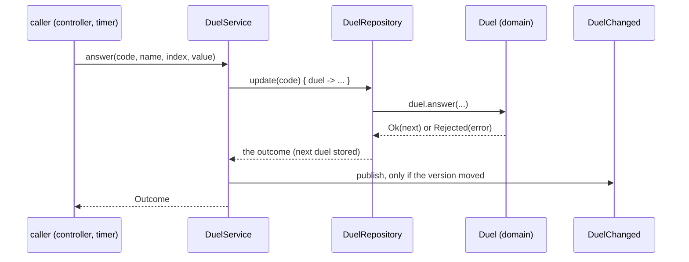

import Quiz from '../../../components/Quiz.astro';
import Think from '../../../components/Think.astro';
import { Aside } from '@astrojs/starlight/components';

<Aside type="tip" title="2 steps · ≈60 min · commits 4 and 5">
**Step 1:** the repository port and its in-memory adapter. **Step 2:** the `DuelChanged` event, the idempotency store and the `DuelService`. Win: a scratch script creates, joins, answers, retries and lets time pass, and the service announces exactly the changes that happened.
</Aside>

## Recall (from memory)

<Think id="maths-l31-recall-1" prompt="Lesson 30: name two situations where a duel's version must NOT go up." revealLabel="Check">
A **refused** rule (it returns `Rejected`, the duel is unchanged) and a **retry** of something already saved (same answer again, same join again). The version goes up only when the duel really changed.
</Think>

<Think id="maths-l31-recall-2" prompt="Lesson 20: why does the repository's update run your change inside ConcurrentHashMap.compute, and what was the caution about the lambda you give it?" revealLabel="Check">
`compute` makes read, decide and write **one step** for that key, so two threads can't both read the old duel. The caution: the lambda should be **short and pure**: no waiting, no I/O, nothing that calls back into the same duel, because every other request for that duel waits while it runs.
</Think>

## Where we are

The domain knows the rules. The outside world (HTTP, sockets) comes later. Between them is the **application layer**: it never decides a rule and never speaks HTTP; it only does the same four things for every use case:



Load, apply a rule, store, announce. Each step is one class, and you'll write them in that order.

## Step 1: the port and the adapter

A **port** is an interface the inside defines for something it needs. `DuelRepository` says what the service needs from "wherever duels are kept", and nothing about how:

```kotlin
// app/src/main/kotlin/dev/hari/maths/duel/application/DuelRepository.kt
package dev.hari.maths.duel.application

import dev.hari.maths.duel.domain.Duel

// A PORT: what the application needs from "somewhere duels are kept".
// It says nothing about how. A map, a file or a database can plug in.
interface DuelRepository {

    // Adds a new duel only if no duel has its code yet. true = added.
    fun insert(duel: Duel): Boolean

    fun find(code: String): Duel?

    // READ -> decide -> WRITE as one step: nobody else touches this duel in between.
    // `change` gets the stored duel and returns the duel to keep plus a result for the caller.
    // Returns that result, or null if there is no such duel.
    fun <R : Any> update(code: String, change: (Duel) -> Pair<Duel, R>): R?
}
```

The one subtle function is `update`. It lends the stored duel to `change` and keeps what `change` returns: the **new duel to store**, and a **result** for the caller (here, an `Outcome`). `R : Any` means the result is never null, so `null` can mean "there is no such duel".

The **adapter** plugs the port into a `ConcurrentHashMap`. It lives in `infra/`, because it is a choice about technology, not a rule of the game:

```kotlin
// app/src/main/kotlin/dev/hari/maths/infra/InMemoryDuelRepository.kt
package dev.hari.maths.infra

import dev.hari.maths.duel.application.DuelRepository
import dev.hari.maths.duel.domain.Duel
import org.springframework.stereotype.Repository
import java.util.concurrent.ConcurrentHashMap

// An ADAPTER: the port, plugged into this process's memory. Gone when the process stops.
@Repository
class InMemoryDuelRepository : DuelRepository {

    // A map that many threads can use at once
    private val duels = ConcurrentHashMap<String, Duel>()

    override fun insert(duel: Duel): Boolean = duels.putIfAbsent(duel.code, duel) == null

    override fun find(code: String): Duel? = duels[code]

    // compute runs the lambda for this key as one step; if it throws, the stored duel is unchanged
    override fun <R : Any> update(code: String, change: (Duel) -> Pair<Duel, R>): R? {
        var result: R? = null
        duels.computeIfPresent(code) { _, current ->
            val (next, answer) = change(current)
            result = answer
            next
        }
        return result
    }
}
```

Compare with v1's `update`: no `DuelNotFoundException`, no version bump, no `next == duel` check. All of that moved: "not found" is a `null` the service turns into an error, and the version belongs to the duel. What stays is the one thing only a repository can promise: **the three steps are atomic**.

### Check it by running

First compile (`./gradlew -q compileKotlin`). The class files are in `app/build/classes/kotlin/main`, and a scratch script can use them directly:

<details>
<summary>~/scratch/repo-demo.main.kts</summary>

```kotlin
import dev.hari.maths.duel.domain.Duel
import dev.hari.maths.duel.domain.DuelStatus
import dev.hari.maths.duel.domain.Outcome
import dev.hari.maths.infra.InMemoryDuelRepository
import java.time.Duration
import java.time.Instant
import java.util.concurrent.CountDownLatch
import kotlin.concurrent.thread

val repo = InMemoryDuelRepository()
val now = Instant.parse("2026-11-24T10:00:00Z")

// 1. Four threads, 25,000 updates each, all on one duel
repo.insert(Duel(code = "AAAA", playerName = "Hari", seed = 1))
val workers = List(4) { thread { repeat(25_000) { repo.update("AAAA") { d -> d.copy(version = d.version + 1) to Unit } } } }
workers.forEach { it.join() }
println("version after 100,000 updates: ${repo.find("AAAA")!!.version} (expected 100001)")

// 2. 1000 duels; for each, two threads join at the same instant
var bothJoined = 0
repeat(1000) { i ->
    val code = "D%03d".format(i)
    repo.insert(Duel(code = code, playerName = "Hari", seed = i.toLong()))
    val gate = CountDownLatch(1)
    val oks = java.util.concurrent.atomic.AtomicInteger()
    val joiners = listOf("Sita", "Zen").map { name ->
        thread {
            gate.await()
            repo.update(code) { d ->
                when (val out = d.join(name, now, Duration.ofSeconds(60))) {
                    is Outcome.Ok -> out.value to true.also { oks.incrementAndGet() }
                    is Outcome.Rejected -> d to false
                }
            }
        }
    }
    gate.countDown()
    joiners.forEach { it.join() }
    if (oks.get() == 2) bothJoined++
}
println("duels where both joiners were accepted: $bothJoined of 1000")

println("insert same code twice: ${repo.insert(Duel(code = "AAAA", playerName = "X", seed = 1))}")
println("update of a missing duel: ${repo.update("ZZZZ") { d -> d to 1 }}")
```

</details>

```bash
cd ~/code/personal/maths-v2/app && ./gradlew -q compileKotlin
cd ~/scratch && kotlin -cp ~/code/personal/maths-v2/app/build/classes/kotlin/main repo-demo.main.kts
```

```text
version after 100,000 updates: 100001 (expected 100001)
duels where both joiners were accepted: 0 of 1000
insert same code twice: false
update of a missing duel: null
```

Four threads made 100,000 updates to one duel and none was lost (100001 = the first version + 100,000). 1000 duels each had two players trying to join at the same instant, and in **zero** was both accepted: exactly the Lesson 20 test, now on a repository that knows nothing about joining. An insert of a taken code is refused, and an update of a missing duel returns `null`.

```text
Commit: app: DuelRepository port and in-memory adapter
```

<Think id="maths-l31-port" prompt="Name one thing you could do later because DuelService depends on the DuelRepository interface and not on the map, and one thing that would be wrong to put in the interface." revealLabel="Check">
You could write a second adapter (a database) and switch to it by changing which bean Spring creates, without touching the service or the domain. Wrong in the interface: anything that mentions the technology, like a `ConcurrentHashMap`, a SQL query or a transaction object, because then the "port" is really a description of one adapter.
</Think>

## Step 2: events, idempotency, the service

### The event

Once a duel has been stored in a new version, someone may care: the live adapter (Lesson 33) pushes it to the phones, a timer (Lesson 33) sets a deadline. The service shouldn't know them. It announces **what happened** and goes on:

```kotlin
// app/src/main/kotlin/dev/hari/maths/duel/application/DuelChanged.kt
package dev.hari.maths.duel.application

import dev.hari.maths.duel.domain.Duel

// "This happened": a duel was stored in a new version.
// The service publishes it; whoever cares (sockets, the deadline timer) listens.
data class DuelChanged(val duel: Duel)
```

Spring has this built in: `ApplicationEventPublisher.publishEvent(x)` delivers `x` to every method marked `@EventListener` that takes that type. By default it's **synchronous**: the listeners run on the publisher's own thread, before `publishEvent` returns. Remember that; Lesson 33 uses it.

### Idempotency, with an end

v1 kept every `Idempotency-Key` forever. v2 remembers a key for `duel.idempotency-ttl` (10 minutes by default) and sweeps old ones:

```kotlin
// app/src/main/kotlin/dev/hari/maths/duel/application/IdempotencyStore.kt
package dev.hari.maths.duel.application

import dev.hari.maths.infra.DuelProperties
import org.slf4j.LoggerFactory
import org.springframework.stereotype.Component
import java.time.Clock
import java.time.Duration
import java.time.Instant
import java.util.concurrent.ConcurrentHashMap
import java.util.concurrent.ScheduledExecutorService
import java.util.concurrent.TimeUnit

// Remembers which duel an Idempotency-Key created, for a while.
// A retry with the same key gets the same duel instead of a second one.
@Component
class IdempotencyStore(
    private val clock: Clock,
    private val properties: DuelProperties,
    scheduler: ScheduledExecutorService,
) {
    private val log = LoggerFactory.getLogger(javaClass)

    private data class Entry(val code: String, val storedAt: Instant)

    private val entries = ConcurrentHashMap<String, Entry>()

    init {
        // Without this, keys nobody ever retries would pile up
        val every = properties.idempotencyTtl.toMillis()
        scheduler.scheduleWithFixedDelay({ sweep() }, every, every, TimeUnit.MILLISECONDS)
    }

    // Runs `create` only if the key is new or has expired. compute makes the check and the write one step.
    fun codeFor(key: String, create: () -> String): String {
        val now = clock.instant()
        val entry = entries.compute(key) { _, current ->
            if (current != null && !expired(current, now)) current else Entry(create(), now)
        }!!
        return entry.code
    }

    private fun expired(entry: Entry, now: Instant) =
        Duration.between(entry.storedAt, now) >= properties.idempotencyTtl

    private fun sweep() {
        val now = clock.instant()
        val before = entries.size
        entries.values.removeIf { expired(it, now) }
        log.atInfo().addKeyValue("removed", before - entries.size).log("idempotency keys swept")
    }
}
```

- `entries.compute(key)` is the same atomic step as the repository's: the check ("is there a fresh entry?") and the write ("else create") can't be split by another thread.
- The store keeps a **code**, not a duel, so a retry reads the *current* duel, not a stale snapshot (the v1 caution from Lesson 21).
- `scheduler` is the bean from Lesson 30. It's a constructor parameter that isn't a property (no `private val`), because only `init` needs it.
- `log.atInfo().addKeyValue("removed", n).log(...)` is SLF4J's way of attaching named fields to a log line; Lesson 34 shows what they become.

### The service

```kotlin
// app/src/main/kotlin/dev/hari/maths/duel/application/DuelService.kt
package dev.hari.maths.duel.application

import dev.hari.maths.duel.domain.AnswerResult
import dev.hari.maths.duel.domain.Duel
import dev.hari.maths.duel.domain.DuelError
import dev.hari.maths.duel.domain.Outcome
import dev.hari.maths.infra.DuelProperties
import org.slf4j.LoggerFactory
import org.springframework.context.ApplicationEventPublisher
import org.springframework.stereotype.Service
import java.time.Clock
import java.time.Instant
import kotlin.random.Random

// The use cases. It decides nothing about the rules (the Duel does) and
// knows nothing about HTTP or sockets: it loads, applies a rule, stores, announces.
@Service
class DuelService(
    private val repository: DuelRepository,
    private val idempotency: IdempotencyStore,
    private val events: ApplicationEventPublisher,
    private val clock: Clock,
    private val properties: DuelProperties,
) {
    private val log = LoggerFactory.getLogger(javaClass)

    fun create(playerName: String, requestKey: String?): Duel {
        if (requestKey == null) {
            return newDuel(playerName)
        }
        val code = idempotency.codeFor(requestKey) { newDuel(playerName).code }
        return checkNotNull(repository.find(code)) { "duel $code was created but is gone" }
    }

    // Asking is also a use case: time may have run out since the last change
    fun get(code: String): Outcome<Duel> = change(code) { duel, now ->
        val current = duel.finishIfTimeUp(now)
        current to Outcome.Ok(current)
    }

    fun join(code: String, playerName: String): Outcome<Duel> = change(code) { duel, now ->
        val outcome = duel.join(playerName, now, properties.length)
        when (outcome) {
            is Outcome.Ok -> outcome.value to outcome
            is Outcome.Rejected -> duel to outcome
        }
    }

    fun answer(code: String, playerName: String, questionIndex: Int, value: Int): Outcome<AnswerResult> =
        change(code) { duel, now ->
            // time passes before every action; if it ran out, this answer finds a FINISHED duel
            val current = duel.finishIfTimeUp(now)
            when (val outcome = current.answer(playerName, questionIndex, value)) {
                is Outcome.Ok -> outcome.value.duel to outcome
                is Outcome.Rejected -> current to outcome
            }
        }

    private fun newDuel(playerName: String): Duel {
        while (true) {
            val duel = Duel(code = randomCode(), playerName = playerName, seed = Random.nextLong())
            if (repository.insert(duel)) {
                log.atInfo().addKeyValue("duel", duel.code).addKeyValue("seed", duel.seed).log("duel created")
                return duel
            }
        }
    }

    // Four random letters
    private fun randomCode(): String = (1..4).map { ('A'..'Z').random() }.joinToString("")

    // Every change goes through here: load, apply the rule, store, announce.
    // The rule returns the duel to keep plus what to tell the caller.
    private fun <T> change(
        code: String,
        rule: (Duel, Instant) -> Pair<Duel, Outcome<T>>,
    ): Outcome<T> {
        val now = clock.instant()
        var changed: Duel? = null

        val outcome = repository.update(code) { duel ->
            val (next, outcome) = rule(duel, now)
            if (next.version != duel.version) {
                changed = next
            }
            next to outcome
        } ?: return Outcome.Rejected(DuelError.DuelNotFound(code))

        // After the update, outside it: listeners never run while a duel is being changed
        changed?.let { events.publishEvent(DuelChanged(it)) }
        return outcome
    }
}
```

Read it from the bottom up.

**`change(code, rule)`** is the engine; every use case goes through it. It takes the time **once** (`clock.instant()`), runs the `rule` inside `repository.update`, remembers whether the version moved, and only **after** `update` has returned does it publish `DuelChanged`. Two reasons for "after":

1. A listener must never run while a duel is locked. Every other request for that duel would wait for it (the Lesson 20 caution).
2. Nothing is announced unless the new version is really stored.

The rule returns a pair: the duel to keep (it may be *changed* even when the caller is told no, see below) and the `Outcome` for the caller. A missing duel makes `update` return `null`, and the service turns that into `Rejected(DuelNotFound)`.

**`answer`** applies `finishIfTimeUp(now)` **first**, then the answer. If time ran out, the duel is stored as `FINISHED` (an event is published, so phones learn it) and the answer is refused with `NotPlaying(FINISHED)`. One atomic step does both.

**`get`** is a use case too: asking is also when a time-up duel gets finished (Lesson 18's lazy finish), and the same `change` publishes it.

**`create`** has no `Outcome`: nothing can go wrong. With an `Idempotency-Key`, it asks the store, which only calls `newDuel` for a new or expired key.

### Check it by running

The service needs a clock you can move, and an event publisher that records what it hears. Both are a few lines in a script:

<details>
<summary>~/scratch/service-demo.main.kts</summary>

```kotlin
import dev.hari.maths.duel.application.DuelChanged
import dev.hari.maths.duel.application.DuelService
import dev.hari.maths.duel.application.IdempotencyStore
import dev.hari.maths.duel.domain.Outcome
import dev.hari.maths.infra.DuelProperties
import dev.hari.maths.infra.InMemoryDuelRepository
import org.springframework.context.ApplicationEventPublisher
import java.time.Clock
import java.time.Duration
import java.time.Instant
import java.time.ZoneOffset
import java.util.concurrent.Executors

// A clock we move by hand
class HandClock(var now: Instant) : Clock() {
    override fun instant() = now
    override fun getZone() = ZoneOffset.UTC
    override fun withZone(zone: java.time.ZoneId) = this
}

val clock = HandClock(Instant.parse("2026-11-24T10:00:00Z"))
val heard = mutableListOf<String>()
val publisher = object : ApplicationEventPublisher {
    override fun publishEvent(event: Any) {
        if (event is DuelChanged) heard += "v${event.duel.version} ${event.duel.status}"
    }
}
val props = DuelProperties()
val service = DuelService(InMemoryDuelRepository(), IdempotencyStore(clock, props, Executors.newScheduledThreadPool(1)), publisher, clock, props)

fun at(label: String) = println("--- $label (${clock.now.toString().substring(11, 19)})")

at("create with a key, twice")
val first = service.create("Hari", "tap-1")
val retry = service.create("Hari", "tap-1")
println("same duel: ${first.code} == ${retry.code} -> ${first.code == retry.code}")
println("without a key: ${service.create("Hari", null).code} is another duel")

clock.now = clock.now.plus(Duration.ofMinutes(11))
at("11 minutes later, the same key")
println("key expired, new duel: ${service.create("Hari", "tap-1").code != first.code}")

val code = first.code
at("join, answer, retry the answer")
service.join(code, "Sita")
val q = (service.get(code) as Outcome.Ok).value.questions
println("answer 0 correct: ${(service.answer(code, "Hari", 0, q[0].answer) as Outcome.Ok).value.correct}")
println("same again: ${(service.answer(code, "Hari", 0, q[0].answer) as Outcome.Ok).value.duel.version} (version did not move)")
println("other value: ${(service.answer(code, "Hari", 0, 1) as Outcome.Rejected).error}")
println("unknown duel: ${(service.get("ZZZZ") as Outcome.Rejected).error}")

clock.now = clock.now.plus(Duration.ofSeconds(61))
at("61 seconds pass, then Sita answers")
println("Sita late: ${(service.answer(code, "Sita", 0, 1) as Outcome.Rejected).error}")
println("duel now: ${(service.get(code) as Outcome.Ok).value.let { "v${it.version} ${it.status} winner=${it.winner}" }}")

println("events heard: $heard")
kotlin.system.exitProcess(0)
```

</details>

The script needs Spring's jars on the class path (the interface `ApplicationEventPublisher`, the logging API). Collect them from Gradle's cache:

```bash
CP=$(find ~/.gradle/caches/modules-2 -name 'spring-context-7*.jar' -o -name 'spring-core-7*.jar' \
  -o -name 'spring-beans-7*.jar' -o -name 'slf4j-api-2.0.20.jar' | grep -v sources | tr '\n' ':')
cd ~/scratch && kotlin -cp "$HOME/code/personal/maths-v2/app/build/classes/kotlin/main:$CP" service-demo.main.kts
```

```text
--- create with a key, twice (10:00:00)
same duel: SJQN == SJQN -> true
without a key: BEYG is another duel
--- 11 minutes later, the same key (10:11:00)
key expired, new duel: true
--- join, answer, retry the answer (10:11:00)
answer 0 correct: true
same again: 3 (version did not move)
other value: AlreadyAnswered(playerName=Hari, questionIndex=0, earlier=81)
unknown duel: DuelNotFound(code=ZZZZ)
--- 61 seconds pass, then Sita answers (10:12:01)
Sita late: NotPlaying(code=SJQN, status=FINISHED)
duel now: v4 FINISHED winner=Hari
events heard: [v2 PLAYING, v3 PLAYING, v4 FINISHED]
```

What it shows, line by line:

- Same key twice → the **same** duel; no key → another duel.
- Eleven minutes later (the clock moved by hand), the same key makes a **new** duel: the key expired.
- A repeated answer keeps version 3. A different value is refused with the saved answer in the error. An unknown code is `DuelNotFound`.
- After 61 seconds, Sita's answer finds a `FINISHED` duel and is refused, and the duel (which *this* request finished) has Hari as winner.
- **Events heard**: `v2 PLAYING`, `v3 PLAYING`, `v4 FINISHED`: exactly the three changes, none for the retry, none for the refusals.

Race: 200 threads, one key, at once:

```text
200 requests, one key: duels created = 1, distinct codes returned = 1
```

```text
Commit: app: DuelService with idempotent answers and key expiry
```

<Think id="maths-l31-predict" prompt="In the service demo, Sita's late answer is refused, yet the duel is stored as FINISHED and an event 'v4 FINISHED' is published. Why should a refused request still change the duel? And what would a phone that only learns about changes from events see if the service skipped that?" revealLabel="Check">
The duel really **had** changed: time ran out. The refusal is about *Sita's answer*; the finishing is about *the clock*. If the service threw the finished duel away, the duel would stay `PLAYING` in storage until someone happened to ask again, and the phones would never be told at the moment their time ended. Storing it, and announcing it, makes the first request after the deadline (or the timer in Lesson 33) the one that settles it.
</Think>

<Quiz
  question="What does the service depend on for storage?"
  options={[
    'The ConcurrentHashMap class directly',
    'The Duel class itself',
    'The DuelRepository interface only',
  ]}
  answer={2}
>
Only the port. The map lives behind the adapter in `infra`, and the service can't even see it.
</Quiz>

<Quiz
  question="Why does the service publish DuelChanged after the update returns?"
  options={[
    'Events cannot be published inside lambdas',
    'Listeners must not run under lock',
    'Spring would ignore any earlier event',
  ]}
  answer={1}
>
While `update` runs, that duel is locked: a slow listener (a socket push) would make every other request for the duel wait. Publishing after releases the lock first. Nothing stops you from publishing inside a lambda; it's just a bad idea.
</Quiz>

<Quiz
  question="The same Idempotency-Key arrives after 11 minutes (ttl 10 m). What happens?"
  options={[
    'A second duel is created',
    'The first duel is returned',
    'A 409 error is returned',
  ]}
  answer={0}
>
The entry is older than `idempotency-ttl`, so `compute` replaces it and `create` runs again. The key protected a retry for ten minutes; an eleven-minute-late request is, as far as the server can tell, a new tap.
</Quiz>

## Your turn

<Think id="maths-l31-exercise" prompt="Two threads call service.join(code, 'Sita') for the SAME duel with the same name at the same instant (a phone that retried quickly). Using only what you've seen, say how many DuelChanged events are published, and why." revealLabel="Check">
**One.** `update` is atomic, so one thread joins (version 1 → 2) and the other runs second, finds the duel already `PLAYING` with the same opponent, and gets the Lesson 30 *retry* rule: `Ok(this)`, same version. The service only publishes when `next.version != duel.version`, so only the first thread announces anything.
</Think>

<Think id="maths-l31-teachback" prompt="In 4–5 sentences: what is a port and an adapter in this code, what does change() do, why is the event published after update, and why does the idempotency store keep a code instead of a duel?" revealLabel="Compare with a model answer">
A port is `DuelRepository`, an interface the service defines for what it needs, and the adapter is `InMemoryDuelRepository`, which plugs it into a `ConcurrentHashMap`. `change()` takes the time once, runs a rule inside the atomic `update`, remembers whether the version moved, and only then publishes `DuelChanged`, so no listener runs while a duel is locked and nothing is announced that wasn't stored. The idempotency store keeps the code a key created and forgets it after the TTL, and because it stores a code a retry reads the current duel instead of a stale snapshot. Together these mean the service never mentions HTTP, sockets or a map.
</Think>

## Read alongside
- 📖 **Primary:** [Spring Framework: Standard and Custom Events](https://docs.spring.io/spring-framework/reference/core/beans/context-introduction.html#context-functionality-events): `publishEvent`, `@EventListener`, and that delivery is synchronous (10 min).
- [`ConcurrentHashMap.compute`](https://docs.oracle.com/en/java/javase/25/docs/api/java.base/java/util/concurrent/ConcurrentHashMap.html#compute(K,java.util.function.BiFunction)): the "must be short and brief" note on the mapping function.
- [SLF4J fluent logging API](https://www.slf4j.org/manual.html#fluent): `addKeyValue`.

🙋 Ask me: "why `R : Any` in `update`?", "what if two services shared one store?", "why not make `change` public?", "review my DuelService".

**Next:** Lesson 32: the HTTP adapter: the shared `DuelDto`, one `ErrorMapper`, and a controller that is three lines per endpoint.
