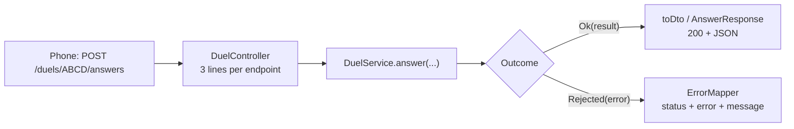

import Quiz from '../../../components/Quiz.astro';
import Think from '../../../components/Think.astro';
import { Aside } from '@astrojs/starlight/components';

<Aside type="tip" title="3 steps · ≈45 min · commit 6">
**Step 1:** the `DuelDto` both HTTP and sockets will share. **Step 2:** `ErrorMapper`, the one table of errors. **Step 3:** the controller. Win: one scripted sequence sent to v1 (8080) and v2 (8081) gets the same answers, so the phone app can't tell them apart.
</Aside>

## Recall (from memory)

<Think id="maths-l32-recall-1" prompt="Lesson 13: in v1, what was an @RestControllerAdvice for, and what did a thrown DuelNotFoundException turn into?" revealLabel="Check">
It's a class whose `@ExceptionHandler` methods catch exceptions thrown anywhere in a controller call and turn them into responses. `DuelNotFoundException` became **404** with the body `{"error":"DUEL_NOT_FOUND","message":"…"}`.
</Think>

<Think id="maths-l32-recall-2" prompt="Lesson 21: which two errors does API.md say a phone must treat as normal parts of a retry, and why?" revealLabel="Check">
A repeated **identical** answer is *not* an error at all (it returns the saved result, status 200). A **different** answer to an answered question is `409 ALREADY_ANSWERED`. And a request that timed out must be retried with the same body: the server may already have saved it.
</Think>

## What an adapter is for

The adapter's whole job is translation, in both directions: **bytes in** (HTTP request → call on the service) and **bytes out** (an `Outcome` → status code and JSON). It decides nothing about the game. Three files, in `duel/api` and `duel/web`.



## Step 1: one shape for the duel

`API.md` says the duel has **one** shape, in every HTTP response and every WebSocket message. So that shape can't live in the HTTP package (the socket code isn't allowed to import `web`), nor in the domain (the domain has no JSON and no `secondsLeft`). It gets its own small package, `duel/api`:

```kotlin
// app/src/main/kotlin/dev/hari/maths/duel/api/DuelDto.kt
package dev.hari.maths.duel.api

import dev.hari.maths.duel.domain.Duel
import dev.hari.maths.duel.domain.DuelStatus
import java.time.Duration
import java.time.Instant

// The duel as API.md describes it. HTTP responses and WebSocket messages share it.
data class DuelDto(
    val code: String,
    val playerName: String,
    val status: DuelStatus,
    val opponentName: String?,
    val winner: String?,
    val scores: Map<String, Int>,
    val secondsLeft: Long?,
    val version: Long,
)

// Domain -> wire, in one place. `now` is a parameter: the clock stays outside.
fun Duel.toDto(now: Instant) = DuelDto(
    code = code,
    playerName = playerName,
    status = status,
    opponentName = opponentName,
    winner = winner,
    scores = scores(),
    secondsLeft = if (status == DuelStatus.PLAYING) {
        Duration.between(now, endsAt).toSeconds().coerceAtLeast(0)
    } else null,
    version = version,
)
```

`secondsLeft` is *derived*: it depends on the time of the request, so `toDto` receives `now`. v1 called `Instant.now()` inside `toResponse()`; here the controller (and later the socket code) hands over `clock.instant()`.

## Step 2: one table of errors

```kotlin
// app/src/main/kotlin/dev/hari/maths/duel/web/ErrorMapper.kt
package dev.hari.maths.duel.web

import dev.hari.maths.duel.domain.DuelError
import dev.hari.maths.duel.domain.Outcome
import dev.hari.maths.duel.domain.QUESTIONS_PER_DUEL
import org.slf4j.LoggerFactory
import org.springframework.http.HttpStatus
import org.springframework.http.ResponseEntity
import org.springframework.http.converter.HttpMessageNotReadableException
import org.springframework.web.HttpMediaTypeNotSupportedException
import org.springframework.web.bind.annotation.ExceptionHandler
import org.springframework.web.bind.annotation.RestControllerAdvice

// Every error the phone gets has this one shape (API.md, "Errors")
data class ErrorBody(val error: String, val message: String)

// THE table: a DuelError -> status, error name, message. `when` over a sealed
// type must cover every case, so a new DuelError doesn't compile until it is here.
fun DuelError.toResponse(): ResponseEntity<Any> {
    val (status, body) = when (this) {
        is DuelError.DuelNotFound ->
            HttpStatus.NOT_FOUND to ErrorBody("DUEL_NOT_FOUND", "No duel with code $code")
        is DuelError.NotWaiting ->
            HttpStatus.CONFLICT to ErrorBody("DUEL_NOT_WAITING", "Duel $code is $status, so nobody can join it")
        is DuelError.NotPlaying ->
            HttpStatus.CONFLICT to ErrorBody("DUEL_NOT_PLAYING", "Duel $code is $status, so it takes no answers")
        is DuelError.NotInDuel ->
            HttpStatus.FORBIDDEN to ErrorBody("NOT_IN_DUEL", "$playerName is not in duel $code")
        is DuelError.AlreadyAnswered ->
            HttpStatus.CONFLICT to ErrorBody("ALREADY_ANSWERED", "$playerName already answered question $questionIndex with $earlier")
        is DuelError.WrongQuestion ->
            HttpStatus.CONFLICT to ErrorBody("WRONG_QUESTION", "$playerName is on question $expected, not $got")
        is DuelError.NoQuestionsLeft ->
            HttpStatus.CONFLICT to ErrorBody("NO_QUESTIONS_LEFT", "$playerName has answered all $QUESTIONS_PER_DUEL questions")
    }
    return ResponseEntity.status(status).body(body)
}

// Ok -> the success response; Rejected -> the mapped error. Controllers use only this.
fun <T> Outcome<T>.toResponse(
    success: HttpStatus = HttpStatus.OK,
    body: (T) -> Any,
): ResponseEntity<Any> = when (this) {
    is Outcome.Ok -> ResponseEntity.status(success).body(body(value))
    is Outcome.Rejected -> error.toResponse()
}

// Errors that happen before the game is asked: the JSON never became a request
@RestControllerAdvice
class ErrorMapper {
    private val log = LoggerFactory.getLogger(javaClass)

    @ExceptionHandler(HttpMessageNotReadableException::class)
    fun badBody(e: HttpMessageNotReadableException): ResponseEntity<ErrorBody> {
        log.atWarn().addKeyValue("reason", e.message).log("bad body")
        return ResponseEntity
            .status(HttpStatus.BAD_REQUEST)
            .body(ErrorBody("BAD_BODY", "The body is not the JSON this endpoint expects"))
    }

    @ExceptionHandler(HttpMediaTypeNotSupportedException::class)
    fun notJson(e: HttpMediaTypeNotSupportedException): ResponseEntity<ErrorBody> {
        log.atWarn().addKeyValue("reason", e.message).log("not json")
        return ResponseEntity
            .status(HttpStatus.UNSUPPORTED_MEDIA_TYPE)
            .body(ErrorBody("NOT_JSON", "Send Content-Type: application/json"))
    }
}
```

Three things to notice.

**The table** is `DuelError.toResponse()`: a `when` over the sealed type. Because `DuelError` is sealed, `when` must cover **every** case. Prove it: add a new case (as in the Lesson 35 exercise), change nothing else, and compile:

```text
e: duel/web/ErrorMapper.kt:20:26 'when' expression must be exhaustive. Add the 'is SameName' branch or an 'else' branch.
```

The build refuses until the mapper handles the new error. In v1, a new error was a new exception class and nothing connected it to its handler; it would simply become a 500.

**`Outcome<T>.toResponse(...)`** is the other half: `Ok` → the success response, `Rejected` → the error. Every controller function ends with it, so no controller can forget to map an error.

**`ErrorMapper`** (the `@RestControllerAdvice`) is only for errors that happen **before** the game is asked: the JSON never became a request (`400 BAD_BODY`), or the `Content-Type` wasn't JSON (`415 NOT_JSON`). Those are `API.md` rows too, but no `DuelError` exists for them, because the game wasn't involved.

## Step 3: the controller

```kotlin
// app/src/main/kotlin/dev/hari/maths/duel/web/DuelController.kt
package dev.hari.maths.duel.web

import dev.hari.maths.duel.api.toDto
import dev.hari.maths.duel.application.DuelService
import dev.hari.maths.duel.domain.DuelStatus
import org.springframework.http.HttpStatus
import org.springframework.http.ResponseEntity
import org.springframework.web.bind.annotation.GetMapping
import org.springframework.web.bind.annotation.PathVariable
import org.springframework.web.bind.annotation.PostMapping
import org.springframework.web.bind.annotation.RequestBody
import org.springframework.web.bind.annotation.RequestHeader
import org.springframework.web.bind.annotation.RestController
import java.time.Clock

// What the phone sends and gets back, besides the duel itself
data class DuelRequest(val playerName: String)
data class JoinRequest(val playerName: String)
data class AnswerRequest(val playerName: String, val questionIndex: Int, val answer: Int)

data class AnswerResponse(
    val code: String,
    val answer: Int,
    val correct: Boolean,
    val status: DuelStatus,
    val winner: String?,
    val questionIndex: Int,
    val score: Int,
    val version: Long,
)

// A question as the phone sees it: no answer
data class QuestionDto(val index: Int, val text: String)

// A controller does three things: request in, service call, response out.
@RestController
class DuelController(
    private val duelService: DuelService,
    private val clock: Clock,
) {

    @PostMapping("/duels")
    fun create(
        @RequestHeader("Idempotency-Key", required = false) requestKey: String?,
        @RequestBody request: DuelRequest,
    ): ResponseEntity<Any> {
        val duel = duelService.create(request.playerName, requestKey)
        return ResponseEntity.status(HttpStatus.CREATED).body(duel.toDto(clock.instant()))
    }

    @GetMapping("/duels/{code}")
    fun get(@PathVariable code: String): ResponseEntity<Any> =
        duelService.get(code).toResponse { it.toDto(clock.instant()) }

    @PostMapping("/duels/{code}/join")
    fun join(@PathVariable code: String, @RequestBody request: JoinRequest): ResponseEntity<Any> =
        duelService.join(code, request.playerName).toResponse { it.toDto(clock.instant()) }

    @GetMapping("/duels/{code}/questions")
    fun questions(@PathVariable code: String): ResponseEntity<Any> =
        duelService.get(code).toResponse { duel ->
            duel.questions.mapIndexed { index, question -> QuestionDto(index, question.text) }
        }

    @PostMapping("/duels/{code}/answers")
    fun answer(@PathVariable code: String, @RequestBody request: AnswerRequest): ResponseEntity<Any> =
        duelService.answer(code, request.playerName, request.questionIndex, request.answer).toResponse { result ->
            AnswerResponse(
                code = result.duel.code,
                answer = request.answer,
                correct = result.correct,
                status = result.duel.status,
                winner = result.duel.winner,
                questionIndex = request.questionIndex,
                score = result.duel.score(request.playerName),
                version = result.duel.version,
            )
        }
}
```

The shape of every function: **request in, service call, response out**. Look at what it no longer contains compared to v1: no `if`, no exception handling, no time, no version. `create` is the one function that doesn't call `toResponse`: `DuelService.create` returns a `Duel`, not an `Outcome`, because a create can't be refused, so there's nothing to map.

Check that it compiles and the app starts on 8081, then run the proof.

## Check it by running: one script, v1 and v2

Start v1 on 8080 (from your `maths` folder, as before) and v2 on 8081 (from `maths-v2`). The script sends one scripted sequence to the server it's given, replaces the duel code with `CODE`, and prints each status and body:

<details>
<summary>~/scratch/parity.py</summary>

```python
import json, re, sys, urllib.request
base = sys.argv[1]
def call(method, path, body=None, headers=None, raw=None):
    data = raw if raw is not None else (json.dumps(body).encode() if body is not None else None)
    h = {"content-type": "application/json"} if headers is None else headers
    req = urllib.request.Request(base + path, data=data, method=method, headers=h)
    try:
        r = urllib.request.urlopen(req); return r.status, r.read().decode()
    except urllib.error.HTTPError as e:
        return e.code, e.read().decode()
out = []
def rec(label, res, code=None):
    status, text = res
    if code: text = text.replace(code, "CODE")
    text = re.sub(r"earlier=\d+| with \d+\"", "X", text)
    out.append(f"{label:40} {status} {text}")
s, t = call("POST", "/duels", {"playerName": "Hari"}); code = json.loads(t)["code"]; rec("create", (s, t), code)
rec("get", call("GET", f"/duels/{code}"), code)
rec("answer before join", call("POST", f"/duels/{code}/answers", {"playerName":"Hari","questionIndex":0,"answer":1}), code)
rec("join Sita", call("POST", f"/duels/{code}/join", {"playerName":"Sita"}), code)
rec("join Zen (full)", call("POST", f"/duels/{code}/join", {"playerName":"Zen"}), code)
qs = json.loads(call("GET", f"/duels/{code}/questions")[1]); out.append("questions: " + str(len(qs)) + " " + str(sorted(qs[0].keys())))
sol = lambda t: eval(t.replace("x","*"))
rec("Hari 0 wrong", call("POST", f"/duels/{code}/answers", {"playerName":"Hari","questionIndex":0,"answer":1}), code)
rec("Hari 0 again same", call("POST", f"/duels/{code}/answers", {"playerName":"Hari","questionIndex":0,"answer":1}), code)
rec("Hari 0 other value", call("POST", f"/duels/{code}/answers", {"playerName":"Hari","questionIndex":0,"answer":2}), code)
rec("Hari jumps to 3", call("POST", f"/duels/{code}/answers", {"playerName":"Hari","questionIndex":3,"answer":1}), code)
rec("Zen answers", call("POST", f"/duels/{code}/answers", {"playerName":"Zen","questionIndex":0,"answer":1}), code)
for i in range(1,5): call("POST", f"/duels/{code}/answers", {"playerName":"Hari","questionIndex":i,"answer":sol(qs[i]["text"])})
rec("Hari 6th", call("POST", f"/duels/{code}/answers", {"playerName":"Hari","questionIndex":5,"answer":1}), code)
for i in range(0,5): last = call("POST", f"/duels/{code}/answers", {"playerName":"Sita","questionIndex":i,"answer":sol(qs[i]["text"])})
rec("Sita last answer", last, code)
rec("get finished", call("GET", f"/duels/{code}"), code)
rec("answer after finish", call("POST", f"/duels/{code}/answers", {"playerName":"Hari","questionIndex":5,"answer":1}), code)
rec("unknown duel", call("GET", "/duels/NOPE"))
rec("bad body", call("POST", "/duels", {"name":"x"}))
rec("not json", call("POST", "/duels", headers={"content-type":"text/plain"}, raw=b"hi"))
k1 = call("POST", "/duels", {"playerName":"Hari"}, headers={"content-type":"application/json","Idempotency-Key":"k"+str(id(out))}); 
k2 = call("POST", "/duels", {"playerName":"Hari"}, headers={"content-type":"application/json","Idempotency-Key":"k"+str(id(out))})
out.append("same key -> same code: " + str(json.loads(k1[1])["code"] == json.loads(k2[1])["code"]))
print("\n".join(out))
```

</details>

```bash
python3 parity.py http://localhost:8080 > parity-v1.txt
python3 parity.py http://localhost:8081 > parity-v2.txt
diff parity-v1.txt parity-v2.txt
```

v2's side, every line (the requests are in the left column):

```text
create                                   201 {"code":"CODE","playerName":"Hari","status":"WAITING","opponentName":null,"winner":null,"scores":{"Hari":0},"secondsLeft":null,"version":1}
get                                      200 {"code":"CODE","playerName":"Hari","status":"WAITING","opponentName":null,"winner":null,"scores":{"Hari":0},"secondsLeft":null,"version":1}
answer before join                       409 {"error":"DUEL_NOT_PLAYING","message":"Duel CODE is WAITING, so it takes no answers"}
join Sita                                200 {"code":"CODE","playerName":"Hari","status":"PLAYING","opponentName":"Sita","winner":null,"scores":{"Hari":0,"Sita":0},"secondsLeft":59,"version":2}
join Zen (full)                          409 {"error":"DUEL_NOT_WAITING","message":"Duel CODE is PLAYING, so nobody can join it"}
questions: 5 ['index', 'text']
Hari 0 wrong                             200 {"code":"CODE","answer":1,"correct":false,"status":"PLAYING","winner":null,"questionIndex":0,"score":0,"version":3}
Hari 0 again same                        200 {"code":"CODE","answer":1,"correct":false,"status":"PLAYING","winner":null,"questionIndex":0,"score":0,"version":3}
Hari 0 other value                       409 {"error":"ALREADY_ANSWERED","message":"Hari already answered question 0X}
Hari jumps to 3                          409 {"error":"WRONG_QUESTION","message":"Hari is on question 1, not 3"}
Zen answers                              403 {"error":"NOT_IN_DUEL","message":"Zen is not in duel CODE"}
Hari 6th                                 409 {"error":"NO_QUESTIONS_LEFT","message":"Hari has answered all 5 questions"}
Sita last answer                         200 {"code":"CODE","answer":32,"correct":true,"status":"FINISHED","winner":"Sita","questionIndex":4,"score":5,"version":12}
get finished                             200 {"code":"CODE","playerName":"Hari","status":"FINISHED","opponentName":"Sita","winner":"Sita","scores":{"Hari":4,"Sita":5},"secondsLeft":null,"version":12}
answer after finish                      409 {"error":"DUEL_NOT_PLAYING","message":"Duel CODE is FINISHED, so it takes no answers"}
unknown duel                             404 {"error":"DUEL_NOT_FOUND","message":"No duel with code NOPE"}
bad body                                 400 {"error":"BAD_BODY","message":"The body is not the JSON this endpoint expects"}
not json                                 415 {"error":"NOT_JSON","message":"Send Content-Type: application/json"}
same key -> same code: True
```

And the diff:

```text
$ diff parity-v1.txt parity-v2.txt
13c13
< Sita last answer   200 {"code":"CODE","answer":60,"correct":true,"status":"FINISHED","winner":"Sita","questionIndex":4,"score":5,"version":12}
---
> Sita last answer   200 {"code":"CODE","answer":32,"correct":true,"status":"FINISHED","winner":"Sita","questionIndex":4,"score":5,"version":12}
```

One line differs, and only because each duel's questions are random: the **correct answer** to the last question is a different number. Everything else is identical: every status, every `error` name, every message, every version. That is what "the contract didn't change" looks like. (The 404 for a missing duel, the 409s, 403 and the idempotent retry are all in the list.)

```text
Commit: web: controller, DTOs and ErrorMapper
```

<Think id="maths-l32-predict" prompt="The script's last two lines send the same Idempotency-Key twice and print whether the codes match. In v1 that was Lesson 21's Step 3. What is different about WHERE the key is stored in v2, and what does a retry return now?" revealLabel="Check">
v1 stored the **duel** (the creation snapshot) in the repository. v2 stores the **code** in an `IdempotencyStore` and a retry looks the duel up again: it returns the *current* duel, with its current version, not the old snapshot. Both print `True`. The difference matters only if the duel changed between the tap and the retry: then v2's answer is the newer one, which is what the version rule wants.
</Think>

<Quiz
  question="Where is a DuelError turned into an HTTP status?"
  options={[
    'Each controller function itself',
    'The ErrorMapper file only',
    'The Duel class itself',
  ]}
  answer={1}
>
One `when`, in one file. The domain doesn't know HTTP exists, and the controller functions only call `toResponse`.
</Quiz>

<Quiz
  question="You add a new DuelError case. What does the compiler do?"
  options={[
    'Silently returns a 500 error',
    'Warns but still builds it',
    'Refuses until ErrorMapper handles it',
  ]}
  answer={2}
>
`when` over a sealed type has to be exhaustive. That is the whole reason errors are a sealed type and not strings.
</Quiz>

<Quiz
  question="Why does DuelDto live in its own api package?"
  options={[
    'HTTP and WebSocket share one shape',
    'Spring requires DTOs in api packages',
    'It makes every JSON message smaller',
  ]}
  answer={0}
>
`API.md` promises the same shape for HTTP responses and socket messages. `live` isn't allowed to import `web`, so the shared shape needs a home both may import.
</Quiz>

## Your turn

<Think id="maths-l32-exercise" prompt="Send a POST to /duels/ABCD/answers with the body {&quot;playerName&quot;:&quot;Hari&quot;} (no questionIndex, no answer). Which status and error name do you predict, which code produces it, and does the game (the domain) ever see this request?" revealLabel="Check">
`400 BAD_BODY`. Jackson can't build `AnswerRequest` (its Kotlin constructor needs three values), Spring throws `HttpMessageNotReadableException` **before** the controller function runs, and `ErrorMapper.badBody` handles it. The domain never sees the request: it is refused at the door, which is why `BAD_BODY` has no `DuelError` case.
</Think>

<Think id="maths-l32-teachback" prompt="In 4–5 sentences: what does the HTTP adapter do and not do, why is the error table one `when` over a sealed type, and why is DuelDto in its own package?" revealLabel="Compare with a model answer">
The adapter only translates: a request becomes a call on the service, and an `Outcome` becomes a status code and JSON, with no game logic, clock or version in the controller. Every refusal is a `DuelError`, and a single `when` in `ErrorMapper` turns each into the `API.md` status, error name and message; because the type is sealed, the code won't compile if a new error isn't mapped. Errors that happen before the game is asked, like bad JSON, are handled by the `@RestControllerAdvice` part. `DuelDto` sits in `duel.api` because HTTP and WebSocket must send the same shape and `live` may not import `web`.
</Think>

## Read alongside
- 📖 **Primary:** [Spring Framework: Controller Advice](https://docs.spring.io/spring-framework/reference/web/webmvc/mvc-controller/ann-advice.html): what `@RestControllerAdvice` does (5 min).
- [RFC 9110 §15.5.10: 409 Conflict](https://www.rfc-editor.org/rfc/rfc9110#section-15.5.10) and [§15.5.4: 403 Forbidden](https://www.rfc-editor.org/rfc/rfc9110#section-15.5.4): the two statuses most of our errors use.
- [RFC 9457: Problem Details for HTTP APIs](https://www.rfc-editor.org/rfc/rfc9457): the standard error format we deliberately don't use, because `API.md` is already the contract.

🙋 Ask me: "why a `ResponseEntity<Any>` and not a generic?", "would a `ProblemDetail` be better?", "what's `@PathVariable code` without a name?", "review my ErrorMapper".

**Next:** Lesson 33: the live adapter: sockets, the heartbeat, `DuelChanged` and the deadline timer.
