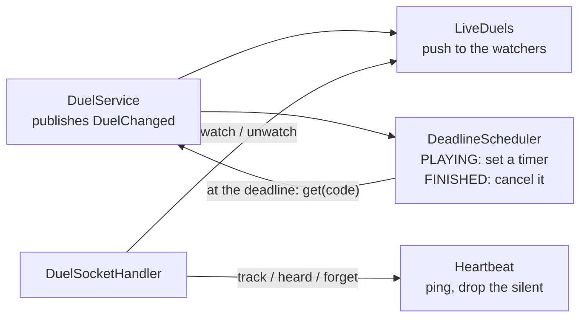

import Quiz from '../../../components/Quiz.astro';
import Think from '../../../components/Think.astro';
import { Aside } from '@astrojs/starlight/components';

<Aside type="tip" title="2 steps · ≈70 min · commits 7 and 8">
**Step 1:** the socket registry, handler, heartbeat and the `DuelChanged` listener. **Step 2:** the `DeadlineScheduler`. Win: `play.mjs` runs on v2; a phone whose network is cut is dropped; 600 simultaneous answers deliver 1,200 pushes; and a duel nobody answers is pushed FINISHED at its deadline.
</Aside>

## Recall (from memory)

<Think id="maths-l33-recall-1" prompt="Lesson 26: why does the server need its OWN ping to find out a phone's network died? What does a TCP connection tell the server when a phone just disappears?" revealLabel="Check">
Nothing. A cut network produces no error and no close on the server's side: the connection simply goes silent (Linux would keep it for ~15 minutes). Only a message that **must be answered** (a ping, answered by a pong) lets the server notice the silence and decide to drop it.
</Think>

<Think id="maths-l33-recall-2" prompt="Lesson 25: why must sends to one WebSocket session be inside synchronized(session)?" revealLabel="Check">
Spring's session allows one `sendMessage` at a time. Two threads sending to the same socket at once threw `TEXT_PARTIAL_WRITING` (212 of 600 answers became 500s in the lesson's burst). A lock **per socket** serialises them without slowing other sockets.
</Think>

## One event, three listeners

In Lesson 31 the service learnt to say "this duel changed" and nothing else. The live side is everything that reacts:



| Class | One job | Knows about |
|---|---|---|
| `LiveDuels` | which sockets watch which duel; send a duel to them | sessions, JSON |
| `Heartbeat` | ping every socket; close the ones that went silent | sessions, time |
| `DuelSocketHandler` | what happens when a phone connects, closes, answers a ping | the three above + the service |
| `WebSocketConfig` | the path `/duels/*/live` | the handler |
| `DeadlineScheduler` | one timer per PLAYING duel | the service, the clock |

In v1 `LiveDuels` did the first two jobs and the service did the fifth.

## Step 1: sockets and heartbeat

Create the package `duel/live`.

```kotlin
// app/src/main/kotlin/dev/hari/maths/duel/live/LiveDuels.kt
package dev.hari.maths.duel.live

import dev.hari.maths.duel.api.toDto
import dev.hari.maths.duel.application.DuelChanged
import dev.hari.maths.duel.domain.Duel
import org.slf4j.LoggerFactory
import org.springframework.context.event.EventListener
import org.springframework.stereotype.Component
import org.springframework.web.socket.CloseStatus
import org.springframework.web.socket.TextMessage
import org.springframework.web.socket.WebSocketSession
import tools.jackson.databind.json.JsonMapper
import java.time.Clock
import java.util.concurrent.ConcurrentHashMap

// Which phones are watching which duel, and how to tell them.
//
//   phone connects ──► watch   ──► sendTo (the duel as it is now)
//   phone closes   ──► unwatch
//   DuelChanged    ──► every socket watching that duel ──► sendTo
@Component
class LiveDuels(
    private val jsonMapper: JsonMapper,
    private val clock: Clock,
) {
    private val log = LoggerFactory.getLogger(javaClass)

    // duel code -> the open sockets watching it
    private val watchers = ConcurrentHashMap<String, MutableSet<WebSocketSession>>()

    fun watch(code: String, session: WebSocketSession) {
        val sessions = watchers.computeIfAbsent(code) { ConcurrentHashMap.newKeySet() }
        sessions.add(session)
        log.atInfo().addKeyValue("duel", code).addKeyValue("socket", session.id).addKeyValue("watching", sessions.size).log("socket watches")
    }

    fun unwatch(code: String, session: WebSocketSession) {
        watchers[code]?.remove(session)
        log.atInfo().addKeyValue("duel", code).addKeyValue("socket", session.id).log("socket left")
    }

    // The service published this after storing a new version
    @EventListener
    fun on(event: DuelChanged) {
        for (session in watchers[event.duel.code].orEmpty()) {
            sendTo(session, event.duel)
        }
    }

    // Never throws: this runs inside the request that changed the duel, and a
    // broken socket must not turn a stored answer into an error for the player.
    fun sendTo(session: WebSocketSession, duel: Duel) {
        try {
            val message = TextMessage(jsonMapper.writeValueAsString(duel.toDto(clock.instant())))
            // One message at a time per socket: Spring's sessions don't allow two threads at once
            synchronized(session) {
                if (session.isOpen) {
                    session.sendMessage(message)
                }
            }
        } catch (e: Exception) {
            log.atWarn().addKeyValue("duel", duel.code).addKeyValue("socket", session.id).addKeyValue("reason", e.message).log("push failed, closing socket")
            runCatching { session.close(CloseStatus.SERVER_ERROR) }
        }
    }
}

// "/duels/ABCD/live" -> "ABCD"
fun WebSocketSession.duelCode(): String = uri!!.path.split("/")[2]
```

Three things here are new compared to v1.

1. **`@EventListener fun on(event: DuelChanged)`** replaces the service calling `liveDuels.send`. Because Spring delivers events **synchronously**, `on` runs on the *request thread* that changed the duel, before the controller returns. So the push is still instant, but it also means a bug in `sendTo` would break the request.
2. **`sendTo` never throws.** Everything is inside `try`/`catch`; a socket that fails is logged and closed. This is the bug found in the review of your Wordle repo (a slow opponent's socket turning a stored guess into a 500). Real run: I made `sendMessage` throw on purpose after version 2, then answered:

```text
== with the try/catch in sendTo (the real code)
answer -> 200 {"code":"XFPY","answer":22,"correct":true,"status":"PLAYING","winner":null,"questionIndex":0,"score":1,"versio…
stored: Hari's score 1, version 3
12:06:33.196 WARN  [http-nio-8091-exec-5] LiveDuels        push failed, closing socket duel="XFPY" socket="51625b1a-12b9-4583-90e3-8f95d6187f52" reason="boom: the socket is broken"

== the same failure, with the try/catch removed
answer -> 500 {"timestamp":"2026-11-24T06:21:38.948Z","status":500,"error":"Internal Server Error","path":"/duels/TEVU/answe…
stored: Hari's score 1, version 3
```

   Without the `try`/`catch` the player gets a 500 **for an answer that was stored** (score 1, version 3): their retry would then be an idempotent success, but the phone has already shown an error. With it, the answer is a 200, the failure is a WARN line, and the broken socket is closed.
3. **`session.duelCode()`**, a one-line extension, replaces the `codeOf` helper that was private to the handler.

Next, the heartbeat:

```kotlin
// app/src/main/kotlin/dev/hari/maths/duel/live/Heartbeat.kt
package dev.hari.maths.duel.live

import dev.hari.maths.infra.DuelProperties
import org.slf4j.LoggerFactory
import org.springframework.stereotype.Component
import org.springframework.web.socket.CloseStatus
import org.springframework.web.socket.PingMessage
import org.springframework.web.socket.WebSocketSession
import java.time.Clock
import java.time.Duration
import java.time.Instant
import java.util.concurrent.ConcurrentHashMap
import java.util.concurrent.ScheduledExecutorService
import java.util.concurrent.TimeUnit

// Pings every phone every `pingEvery`; a phone that stays silent for `silenceLimit` is dropped.
// A cut network produces no error on the server: this is the only way it finds out.
@Component
class Heartbeat(
    private val clock: Clock,
    private val properties: DuelProperties,
    scheduler: ScheduledExecutorService,
) {
    private val log = LoggerFactory.getLogger(javaClass)

    private class Tracked(val session: WebSocketSession, @Volatile var lastHeard: Instant)

    // socket id -> the socket and the last time that phone answered a ping
    private val tracked = ConcurrentHashMap<String, Tracked>()

    init {
        val every = properties.live.pingEvery.toMillis()
        scheduler.scheduleAtFixedRate({ checkAll() }, every, every, TimeUnit.MILLISECONDS)
    }

    fun track(session: WebSocketSession) {
        tracked[session.id] = Tracked(session, clock.instant())
    }

    // The phone answered a ping: it is still there
    fun heard(session: WebSocketSession) {
        tracked[session.id]?.lastHeard = clock.instant()
    }

    fun forget(session: WebSocketSession) {
        tracked.remove(session.id)
    }

    private fun checkAll() {
        val now = clock.instant()
        for (entry in tracked.values) {
            val session = entry.session
            try {
                val silent = Duration.between(entry.lastHeard, now)
                if (silent > properties.live.silenceLimit) {
                    log.atInfo().addKeyValue("socket", session.id).addKeyValue("silentSeconds", silent.toSeconds()).log("socket silent, closing")
                    session.close(CloseStatus.SESSION_NOT_RELIABLE)
                } else {
                    synchronized(session) {
                        if (session.isOpen) {
                            session.sendMessage(PingMessage())
                        }
                    }
                }
            } catch (e: Exception) {
                // One broken socket must not stop the heartbeat for everyone else
                log.atWarn().addKeyValue("socket", session.id).addKeyValue("reason", e.message).log("heartbeat failed, dropping socket")
                tracked.remove(session.id)
            }
        }
    }
}
```

It reads its two times from `DuelProperties` (Lesson 30) and uses the shared scheduler, not a private executor. `lastHeard` is `@Volatile`: the pong arrives on one thread and the check runs on another, and `@Volatile` makes the new value visible. The `try`/`catch` per socket is the same lesson as Lesson 26: one broken socket must not stop the check for everyone else.

The handler, and the config that gives it a path:

```kotlin
// app/src/main/kotlin/dev/hari/maths/duel/live/DuelSocketHandler.kt
package dev.hari.maths.duel.live

import dev.hari.maths.duel.application.DuelService
import dev.hari.maths.duel.domain.Outcome
import org.springframework.stereotype.Component
import org.springframework.web.socket.CloseStatus
import org.springframework.web.socket.PongMessage
import org.springframework.web.socket.WebSocketSession
import org.springframework.web.socket.handler.TextWebSocketHandler

// Private close code (4000-4999 is ours to use): this duel doesn't exist, don't reconnect
val DUEL_GONE = CloseStatus(4404, "DUEL_NOT_FOUND")

// A phone's live connection to one duel: ws://host/duels/{code}/live
@Component
class DuelSocketHandler(
    private val duelService: DuelService,
    private val liveDuels: LiveDuels,
    private val heartbeat: Heartbeat,
) : TextWebSocketHandler() {

    override fun afterConnectionEstablished(session: WebSocketSession) {
        val code = session.duelCode()
        // Watch BEFORE reading the duel, so a change in between is pushed, not missed
        liveDuels.watch(code, session)
        heartbeat.track(session)

        when (val outcome = duelService.get(code)) {
            is Outcome.Ok -> liveDuels.sendTo(session, outcome.value)
            is Outcome.Rejected -> session.close(DUEL_GONE)
        }
    }

    override fun afterConnectionClosed(session: WebSocketSession, status: CloseStatus) {
        liveDuels.unwatch(session.duelCode(), session)
        heartbeat.forget(session)
    }

    // Browsers and OkHttp answer every ping with a pong, by themselves
    override fun handlePongMessage(session: WebSocketSession, message: PongMessage) {
        heartbeat.heard(session)
    }
}
```

```kotlin
// app/src/main/kotlin/dev/hari/maths/duel/live/WebSocketConfig.kt
package dev.hari.maths.duel.live

import org.springframework.context.annotation.Configuration
import org.springframework.web.socket.config.annotation.EnableWebSocket
import org.springframework.web.socket.config.annotation.WebSocketConfigurer
import org.springframework.web.socket.config.annotation.WebSocketHandlerRegistry

// Which WebSocket paths exist, and who handles them
@Configuration
@EnableWebSocket
class WebSocketConfig(private val handler: DuelSocketHandler) : WebSocketConfigurer {
    override fun registerWebSocketHandlers(registry: WebSocketHandlerRegistry) {
        registry.addHandler(handler, "/duels/*/live")
    }
}
```

Read `afterConnectionEstablished` closely. It watches **before** it reads the duel. If it read first, a change between the read and the watch would reach the phone's socket never; watching first means at worst the phone gets a version twice, and the version rule (Lesson 22) ignores the repeat. An unknown code is `Outcome.Rejected`, so it closes with `4404`, and `afterConnectionClosed` then unwatches it.

Compile and start v2, then check each claim.

### Check 1: the whole duel through the sockets

```bash
node scripts/play.mjs localhost:8081
```

```text
  0.2s  Hari  created duel SDWX
  0.3s  Hari  sees v1 WAITING scores {"Hari":0}
  0.6s  Hari  sees v2 PLAYING scores {"Hari":0,"Sita":0} (59 s left)
  0.6s  Sita  joined
  0.6s  Sita  sees v2 PLAYING scores {"Hari":0,"Sita":0} (59 s left)
  0.6s  Sita  got 5 questions: 5 x 5, 10 x 7, 12 x 5, 7 x 4, 3 x 9
  0.6s  Hari  sees v3 PLAYING scores {"Hari":1,"Sita":0} (59 s left)
  0.6s  Sita  sees v3 PLAYING scores {"Hari":1,"Sita":0} (59 s left)
  0.6s  Hari  sees v4 PLAYING scores {"Hari":1,"Sita":1} (59 s left)
  0.6s  Sita  sees v4 PLAYING scores {"Hari":1,"Sita":1} (59 s left)
  0.6s  Hari  sees v5 PLAYING scores {"Hari":2,"Sita":1} (59 s left)
  0.6s  Sita  sees v5 PLAYING scores {"Hari":2,"Sita":1} (59 s left)
  0.7s  Hari  sees v12 FINISHED scores {"Hari":5,"Sita":3} winner Hari
  0.7s  Sita  sees v12 FINISHED scores {"Hari":5,"Sita":3} winner Hari
  1.2s  both  done
```

(The middle versions v6 to v11 are cut.) Both phones see every version from v1 to v12 once, in order. Running the same script on v1 produced the same twelve versions.

### Check 2: a phone whose network dies

`scripts/tunnel.py` (Lesson 26) sits between a phone and the server. Point its upstream at 8081, connect a phone to the tunnel's port, then write `down` in its `mode` file:

```text
phone (through the pretend network, which cuts at 3 s):
  0.2s created YWXG
  0.2s socket open
  0.2s message v1
  3.0s phone side closed code 1006

server log:
11:50:18.836 INFO  [http-nio-8091-exec-5] LiveDuels        socket watches duel="YWXG" socket="2278de94-f1d1-4fc2-a535-159a08227bc5" watching="1"
11:50:40.800 INFO  [duel-timer-1] Heartbeat        socket silent, closing socket="2278de94-f1d1-4fc2-a535-159a08227bc5" silentSeconds="19"
11:50:40.813 INFO  [duel-timer-1] LiveDuels        socket left duel="YWXG" socket="2278de94-f1d1-4fc2-a535-159a08227bc5"
```

The phone gives up at 3 s (1006). The server hears nothing, and after `silenceLimit` (15 s) plus up to one `pingEvery` (5 s) its heartbeat closes the socket (`silentSeconds=19`) and the handler unwatches it. The log line is made by thread `duel-timer-1`: the shared scheduler from Lesson 30.

### Check 3: 600 answers at once

300 duels, two sockets each, then all 600 answers sent at the same instant:

```text
600 simultaneous answers: 600 x 200, 0 other, in 803 ms
messages on connect: 600 (expected 600)
messages from the answers: 1200 (expected 1200)
first 50 duels with both scores counted: 50 of 50, version 4: 50
```

No 500 (that was Lesson 25's `TEXT_PARTIAL_WRITING`), every answer counted, and 1,200 pushes delivered (each answer reaches two sockets).

### Check 4: a duel that doesn't exist

```text
phone:
57 ms  open
61 ms  closed code 4404 reason DUEL_NOT_FOUND

server log:
12:12:01.494 INFO  [http-nio-8091-exec-1] LiveDuels        socket watches duel="NOPE" socket="ce26ed6f-5fc5-455f-aa5b-f6ec8d4330ce" watching="1"
12:12:01.496 INFO  [http-nio-8091-exec-1] LiveDuels        socket left duel="NOPE" socket="ce26ed6f-5fc5-455f-aa5b-f6ec8d4330ce"
```

`4404`, the code the phone uses to stop reconnecting.

```text
Commit: live: socket registry, handler, heartbeat and DuelChanged listener
```

<Think id="maths-l33-order" prompt="Events are published AFTER the update, so two threads that change the same duel can publish out of order: version 4 might reach the sockets just before version 3. Is that a bug in this design? What protects the phone?" revealLabel="Check">
No, it's the case Lesson 22 was built for. Every message is the **whole** duel with a `version`, and the phone shows a duel only if its version is **higher** than what it shows. If v4 arrives first and v3 second, v3 is ignored and nothing is lost, because v4 already contains everything v3 had. (The server could add an ordering lock, and then you'd have a lock held across a push, which is the thing Lesson 31 avoided.)
</Think>

## Step 2: the deadline

Nothing runs at the deadline unless something makes it run. v1 started a timer inside `join`. In v2 the timer is a **listener**: it reacts to the same `DuelChanged` event, so the service doesn't know timers exist.

```kotlin
// app/src/main/kotlin/dev/hari/maths/duel/live/DeadlineScheduler.kt
package dev.hari.maths.duel.live

import dev.hari.maths.duel.application.DuelChanged
import dev.hari.maths.duel.application.DuelService
import dev.hari.maths.duel.domain.DuelStatus
import org.slf4j.LoggerFactory
import org.springframework.context.event.EventListener
import org.springframework.stereotype.Component
import java.time.Clock
import java.time.Duration
import java.time.Instant
import java.util.concurrent.ConcurrentHashMap
import java.util.concurrent.ScheduledExecutorService
import java.util.concurrent.ScheduledFuture
import java.util.concurrent.TimeUnit

// Nothing runs at the deadline unless something makes it run. When a duel starts
// PLAYING, this sets one timer; when it fires, the service finishes the duel and
// publishes the change, so both phones are told even if nobody asked.
@Component
class DeadlineScheduler(
    private val duelService: DuelService,
    private val scheduler: ScheduledExecutorService,
    private val clock: Clock,
) {
    private val log = LoggerFactory.getLogger(javaClass)

    // duel code -> its timer, until it fires or the duel finishes earlier
    private val timers = ConcurrentHashMap<String, ScheduledFuture<*>>()

    @EventListener
    fun on(event: DuelChanged) {
        val duel = event.duel
        when (duel.status) {
            // computeIfAbsent: the first PLAYING version sets the timer, later ones find it there
            DuelStatus.PLAYING -> timers.computeIfAbsent(duel.code) { schedule(duel.code, duel.endsAt!!) }
            // Finished by answers before the deadline: the timer isn't needed
            DuelStatus.FINISHED -> timers.remove(duel.code)?.cancel(false)
            DuelStatus.WAITING -> {}
        }
    }

    private fun schedule(code: String, endsAt: Instant): ScheduledFuture<*> {
        // A little after the deadline, so the clock has surely passed it when the timer fires
        val delay = Duration.between(clock.instant(), endsAt).plus(GRACE).coerceAtLeast(Duration.ZERO)
        return scheduler.schedule({ fire(code) }, delay.toMillis(), TimeUnit.MILLISECONDS)
    }

    private fun fire(code: String) {
        timers.remove(code)
        try {
            // get() finishes a duel whose time is up, and publishes DuelChanged
            duelService.get(code)
        } catch (e: Exception) {
            log.atWarn().addKeyValue("duel", code).addKeyValue("reason", e.message).log("deadline failed")
        }
    }

    private companion object {
        val GRACE: Duration = Duration.ofMillis(100)
    }
}
```

How it behaves:

- A `DuelChanged` whose status is `PLAYING` sets **one** timer for `endsAt` (`computeIfAbsent`: the first PLAYING version creates it, the later ones, one per answer, find it already there).
- A `FINISHED` event **cancels** the timer: a duel finished by answers needs no timer.
- When the timer fires, it calls `duelService.get(code)`, the same lazy finish as any request (Lesson 18). `get` stores the `FINISHED` duel and publishes `DuelChanged`, so `LiveDuels` pushes it. The timer didn't push anything itself.
- `GRACE` (100 ms) makes the timer fire just after the deadline. A timer that fires *early* would call `finishIfTimeUp` while `now` is still before `endsAt`, find nothing to do, and the duel would stay `PLAYING` until the next request.

Check it with a short duel. `DUEL_LENGTH=10s` is a Lesson 30 setting, so no code changes:

```bash
cd ~/code/personal/maths-v2/app
DUEL_LENGTH=10s ./gradlew bootRun --args='--server.port=8081'
```

A phone that creates a duel, watches it, then lets Sita join and **nobody answers**:

```text
  0.6s created UXNU
  0.7s push v1 WAITING secondsLeft=null winner=null
  0.9s push v2 PLAYING secondsLeft=9 winner=null
  0.9s Sita joined, nobody answers
 11.1s push v3 FINISHED secondsLeft=null winner=null
```

`secondsLeft=9` at the join, and the FINISHED push 10.2 s later: 10 s of duel, 0.1 s of grace, and a little request time. Nobody asked for it.

Now run `play.mjs` again with the same 10 s setting: it finishes in about a second, so the timer is cancelled before it fires and no second FINISHED message is ever pushed.

```text
Commit: live: DeadlineScheduler pushes FINISHED at the deadline
```

<Quiz
  question="Why does the push happen on the request thread?"
  options={[
    'Events are delivered synchronously by Spring',
    'Sockets must be written by Tomcat',
    'The service itself calls LiveDuels directly',
  ]}
  answer={0}
>
`publishEvent` returns only after every listener has run, on the caller's thread. That's why `sendTo` must never throw: it would fail the request that caused the change.
</Quiz>

<Quiz
  question="What does the heartbeat need to detect a dead phone?"
  options={[
    'An error from the broken connection',
    'A pong that never comes back',
    'A close frame from the phone',
  ]}
  answer={1}
>
A cut network produces no error and no close frame on the server. Only the *absence* of an answer to a ping gives it away.
</Quiz>

<Quiz
  question="What happens to the timer if both players finish early?"
  options={[
    'It fires and finds nothing',
    'It pushes the duel twice',
    'It is cancelled by FINISHED',
  ]}
  answer={2}
>
`DeadlineScheduler` removes and cancels the timer when it sees a `FINISHED` change. (If the cancel raced with the timer firing, `get` would still find an already-finished duel and change nothing.)
</Quiz>

## Your turn

<Think id="maths-l33-exercise" prompt="The silence limit is 15 s and a phone on a bad network sometimes misses a pong for 20 s but then comes back. Which setting do you change, where, and what is the cost of raising it from 15 s to 45 s?" revealLabel="Check">
`duel.live.silence-limit` (the property, or `DUEL_LIVE_SILENCE_LIMIT=45s`): no code changes. The cost: a **truly dead** phone stays in the watchers map for up to ~50 s instead of ~20 s, so the opponent's pushes go to a dead socket longer and the server holds its resources longer. It's the usual trade between false drops and slow detection, and now it's a setting, not a recompile.
</Think>

<Think id="maths-l33-teachback" prompt="In 4–5 sentences: how does a change to a duel reach the phones in v2, which class does what, and what keeps a broken socket from breaking a request?" revealLabel="Compare with a model answer">
After the service stores a new version it publishes a `DuelChanged` event, and Spring delivers it synchronously to the listeners: `LiveDuels` pushes the whole duel to every socket watching that code, and `DeadlineScheduler` sets or cancels the timer for that duel. `DuelSocketHandler` only registers and unregisters sockets and records pongs, and `Heartbeat` pings every socket and closes the ones that stayed silent past the limit. Because the push runs on the request thread, `sendTo` catches every exception, logs it and closes that socket, so a broken connection can never turn a stored answer into an error for the player. Out-of-order pushes are harmless because each message is the whole duel and the phone only shows a higher version.
</Think>

## Read alongside
- 📖 **Primary:** [RFC 6455 §5.5.2 and §5.5.3: Ping and Pong](https://www.rfc-editor.org/rfc/rfc6455#section-5.5.2): the control frames the heartbeat uses (5 min).
- [Spring Framework: WebSocket handlers](https://docs.spring.io/spring-framework/reference/web/websocket/server.html#websocket-server-handler) and the note about `ConcurrentWebSocketSessionDecorator`.
- [`ScheduledExecutorService.schedule`](https://docs.oracle.com/en/java/javase/25/docs/api/java.base/java/util/concurrent/ScheduledExecutorService.html): and why `scheduleAtFixedRate` stops if a run throws.

🙋 Ask me: "should events be async here?", "what's `ConcurrentWebSocketSessionDecorator` and do we need it?", "what happens to timers when the server restarts?", "review my Heartbeat".

**Next:** Lesson 34: production readiness: configuration, health, structured logs, a Docker image and a runbook.
