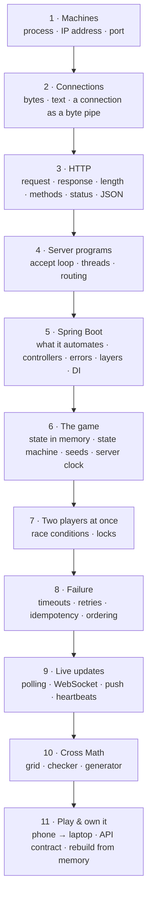

import { Aside } from '@astrojs/starlight/components';

<Aside type="tip" title="The rule this course follows">
**No lesson uses an idea that hasn't been taught yet**, apart from things you already know as an Android developer (Kotlin, apps, JSON data classes, calling an API with Retrofit). Each concept is a **brick** that rests only on bricks below it. If a lesson ever breaks this rule, tell me. That's a bug in the course.
</Aside>

## The layers

Each layer needs only the layers above it.

## Every brick

**Built on** lists the bricks that must come first. ✅ = taught, 🔜 = next.

| # | Brick | Built on | Lesson |
|---|---|---|---|
| T1 | **Source of truth**: one program the players don't control decides | (Android knowledge) | 1 ✅ |
| T2 | **Client & server roles**: request → response, the client speaks first | T1 | 1 ✅ |
| B1 | **Process**: a running program, with a PID; it can sit waiting | (none) | 2 ✅ |
| N1 | **IP address**: which machine; `127.0.0.1` means this one | (none) | 2 ✅ |
| N2 | **Port**: which process on that machine; *listening* | B1, N1 | 2 ✅ |
| B2 | **Bytes & text**: characters are bytes; `\n` and `\r\n` | (none) | 3 ✅ |
| N3 | **Connection**: a two-way pipe of bytes between two processes; no message boundaries | N2, B2 | 3 ✅ |
| N4 | **Client vs server, precisely**: the server listens, the client connects | N3 | 3 ✅ |
| H1 | **Protocol**: agreed rules for the bytes in a connection | N3 | 4 🔜 |
| H2 | **HTTP request**: request line, headers, empty line, body | H1, B2 | 4 🔜 |
| H3 | **HTTP response**: status line, headers, body | H2 | 5 |
| H4 | **Where a message ends**: `Content-Length` (and the alternatives) | H2, N3 | 5 |
| H5 | **Methods**: `GET` vs `POST` | H2 | 6 |
| H6 | **Status codes**: 2xx / 4xx / 5xx | H3 | 6 |
| H7 | **JSON bodies**: `Content-Type` | H2 | 6 |
| S1 | **A server is a loop**: accept → read → decide → write | N2, N3, H2, H3 | 7 |
| S2 | **A Kotlin server by hand** (`ServerSocket`) | S1 | 7 |
| S3 | **Threads**: serving two clients at once | S2, B1 | 8 |
| S4 | **Routing**: method + path picks the function | S2, H5 | 9 |
| S5 | **Spring Boot**: what it does for you (the loop, threads, routing, JSON) | S2–S4, H7 | 10 |
| S6 | **Gradle project**: dependencies, running the app | S5 | 10 |
| S7 | **Controllers & DTOs** | S5, H7 | 11 |
| S8 | **Errors → status codes**; reading logs and stack traces | S7, H6 | 12 |
| S9 | **Layers**: controller / service / domain / store | S7 | 13 |
| S10 | **Dependency injection** (like Hilt) | S9 | 13 |
| G1 | **State in memory**: duels in a map, alive while the process runs | B1, S9 | 14 |
| G2 | **State machine**: WAITING → PLAYING → FINISHED | G1 | 15 |
| G3 | **Seeds**: same seed, same questions | (Kotlin) | 16 |
| G4 | **The server's clock**: deadlines | G2 | 17 |
| C1 | **Race condition**: two threads, one duel, a lost update | S3, G1 | 18 |
| C2 | **Locks**: one thread at a time inside the duel | C1 | 19 |
| C3 | **Atomic check-then-act**, thread-safe maps | C2 | 19 |
| R1 | **Timeout ≠ failure**: the server may have done it | N3, H3 | 20 |
| R2 | **Retries & idempotency** | R1, G2 | 20 |
| R3 | **Out-of-order updates**: versions | R2 | 21 |
| W1 | **Why HTTP can't push**; polling and its cost | N4, H2 | 22 |
| W2 | **WebSocket**: upgrade, then two-way messages | W1, N3, H2 | 23 |
| W3 | **WebSockets in Spring**; sessions; push on change | W2, S10, C3 | 24 |
| W4 | **Disconnects**: heartbeats, reconnect, resync | W3, R3 | 25 |
| X1 | **Cross Math grid + checker** | G1 | 26 |
| X2 | **Cross Math generator** | X1, G3 | 27 |
| X3 | **Cross Math duel** (reuses the duel machinery) | X1, X2, G2, W3 | 28 |
| P1 | **Phone → laptop**: LAN IP, which address the server listens on, configuration | N1, N2, S6 | 29 |
| P2 | **API contract** → AI-built app → a real duel 🎮 | all of the above | 30 |
| ★ | **Own it**: rebuild the core from memory | everything | 31 |

Not in this project (on purpose): databases, accounts and logins, DNS, deploying to the internet. They come in the 100-session course.
