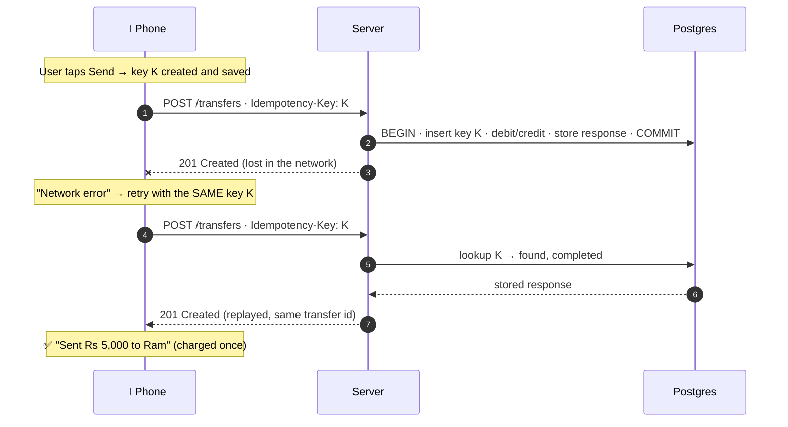

import Stepper from '../../../components/Stepper.astro';
import Think from '../../../components/Think.astro';
import Quiz from '../../../components/Quiz.astro';
import { Aside, Card, CardGrid } from '@astrojs/starlight/components';

<Aside type="tip" title="What you'll take away">
ACID makes each transaction all-or-nothing, but it can't tell that two transactions are **the same intent**. Only the client knows that, so the client has to say so explicitly with an **idempotency key**. We build the production version in **Session 44**.
</Aside>

## The scenario

A user taps **Send Rs 5,000** to Ram. The server commits the transfer, but the connection drops before the response reaches the phone. The app shows *"Network error"*, and the user taps **Retry**.

<Stepper
  caption="Step through it with the buttons or the ← → keys"
  steps={[
    {
      title: 'The phone sends the transfer',
      art: ` Phone                                   Server                        DB
   │  POST /transfers {to: Ram, 5000}      │                             │
   │──────────────────────────────────────▶│                             │`,
      note: 'Exactly what your Retrofit call does every day.',
    },
    {
      title: 'The server commits, atomically and completely',
      art: ` Phone                                   Server                        DB
   │  POST /transfers {to: Ram, 5000}      │                             │
   │──────────────────────────────────────▶│  BEGIN                      │
   │                                       │  debit  you  −5000          │
   │                                       │  credit Ram  +5000          │
   │                                       │  COMMIT ✅ ────────────────▶│  done, fully`,
      note: 'ACID did its job. Nothing is half-done.',
    },
    {
      title: 'The response is lost',
      art: ` Phone                                   Server                        DB
   │                                       │  COMMIT ✅ ────────────────▶│
   │          201 Created ✗ conn. drops    │                             │
   │◀ ─ ─ ─ ─ ─ ─ ─ ─ ─ ─ ─ ─ ─ ─ ─ ─ ─ ─ ─│                             │
   │                                       │                             │
  "Network error"`,
      note: 'The phone cannot tell "the request never arrived" apart from "the request arrived but the answer got lost".',
    },
    {
      title: 'The user taps Retry',
      art: ` Phone                                   Server                        DB
  "Network error" … user taps RETRY        │                             │
   │  POST /transfers {to: Ram, 5000}      │                             │
   │──────────────────────────────────────▶│                             │`,
      note: 'A brand-new HTTP request, byte-for-byte identical to the first.',
    },
    {
      title: 'Without a key, the server pays twice',
      art: ` Phone                                   Server                        DB
   │  POST /transfers {to: Ram, 5000}      │                             │
   │──────────────────────────────────────▶│  BEGIN                      │
   │                                       │  debit  you  −5000   💸     │
   │                                       │  credit Ram  +5000   💸     │
   │                                       │  COMMIT ✅ ────────────────▶│  Rs 10,000 gone`,
      note: 'Another complete, correct, atomic transaction. ACID is satisfied, and you are still wrong.',
    },
  ]}
/>

## The dialogue

### Round 1: whose job is it?

> **You:** The server's job. The transaction must happen as a whole, not in bits (ACID).

✅ You're right that the server is the final guard, and **atomicity** does prevent "debited you but never credited Ram".
⚠️ But transaction #1 wasn't partial. It *finished*. The retry created a **second** complete transaction. ACID protects each transaction on its own; it has no idea two transactions are the same intent.

### Round 2: telling a retry from a real second payment

> **You (Q1):** Same amount, same sender and receiver, close together in time means it's a duplicate.
> **You (Q2):** The client tells the server, in a header or somewhere.

Q2 points the right way. Q1 is a **heuristic**, which is a guess. Round 3 tested it.

### Round 3: making it precise

#### R3.1: does "same amount + same people + close in time" work?

> **You:** It doesn't really work in either case.

✅ **Correct.** It fails in both directions:

| Case | What the rule does | Result |
|---|---|---|
| Sita pays Ram Rs 500 for momo, then Rs 500 for tea a minute later | Flags the second one as a duplicate and blocks it | ❌ A legitimate payment is rejected (false positive) |
| The app is killed, reopened, and the retry arrives after 4 minutes | Outside the "quickly" window, so it's processed | ❌ Double debit (false negative) |

**The server cannot work out intent from the request content.** Two identical bodies can be two intents, and one intent can arrive twice, minutes apart.

#### R3.2: what is the "something", and when is it created?

> **You:** It's sent on every HTTP attempt.

✅ It's *sent* on every attempt. But when is it *created*? That's the part that matters.

❌ If the client **generates a new value on every HTTP attempt**, the retry carries a fresh value, the server sees a "new intent", and pays twice. That's no better than having no key.

The value is an **idempotency key**: a random unique ID (e.g. a UUID) that names **one user intent**.

```text
 when is the key created?

 Send screen opens   ──▶  too early: the user may change the amount, or send twice
                          from the same screen on purpose
 user taps "Send" ✅ ──▶  ONE intent = ONE key. Create it here (after MPIN confirm),
   (confirms intent)       SAVE it (Room/DataStore, so it survives an app kill),
                           and REUSE it on every retry of this intent
 every HTTP attempt  ──▶  ❌ each retry looks like a new intent, so a double debit
```

```kotlin
// Client side: one intent → one key, persisted, reused across retries
val key = pendingTransferDao.findOrCreate(draftId) { UUID.randomUUID().toString() }

api.createTransfer(
    idempotencyKey = key,             // header: Idempotency-Key: 6f1c…
    body = TransferRequest(to = "ram", amount = 5_000_00) // paisa, never Double
)
```

#### R3.3: the retry arrives with a key the server has already seen. Error or success?

> **You:** Return `409 Conflict`, maybe.

❌ Think about the phone. A `409` makes the app show **"Transfer failed"**, even though the money **already moved**. The user then sends it again *with a new key* (now Rs 10,000 is gone for real) or calls support, angry.

✅ The server should **replay the original response**: the same `201 Created` with the same transfer ID and body, as if the first response had simply arrived late. The phone shows ✅ *Sent to Ram*, which is the truth.

Your `409` instinct does have a home, just a different case:

| Server sees the key… | Correct response |
|---|---|
| for the first time | Process it, **store the key + response in the same DB transaction**, return `201` |
| again, first attempt **finished** | **Replay the stored response** (`201`, same body) |
| again, first attempt **still in progress** | `409 Conflict`: "still working on it, try again shortly" |
| again, but with a **different body** | `422 Unprocessable Content`: key reuse is a client bug |

That's how the IETF *Idempotency-Key* HTTP header draft and Stripe's API behave.

## The full picture



<CardGrid>
  <Card title="Client's job" icon="seti:kotlin">
    Create one key per intent, persist it, and reuse it on every retry.
  </Card>
  <Card title="Server's job" icon="seti:db">
    Store key + result atomically with the money movement, and replay the result on a repeat.
  </Card>
</CardGrid>

So the answer to "client, server, or both?" is **both**.

## Check yourself

<Quiz
  question="The app generates a fresh UUID for every HTTP attempt and sends it as Idempotency-Key. The first response is lost; the app retries. What happens?"
  options={[
    'The server recognises the retry and replays the response',
    'The server sees a new key, treats it as a new intent, and debits twice',
    'Postgres rejects the second transaction because of ACID',
  ]}
  answer={1}
>
A key only protects you if it's **stable across retries of one intent**. New key, new intent, double debit.
</Quiz>

<Quiz
  question="A retry arrives with a key whose first request already completed successfully. Best response?"
  options={['409 Conflict', '201 Created with the original stored body', '200 OK with an empty body', '422 Unprocessable Content']}
  answer={1}
>
Replay the original response so the client reaches the **true** final state. 409 is for a request that's *still in progress*; 422 is for the same key with a *different* body.
</Quiz>

<Think id="s0-teachback" prompt="Teach-back: in 3–4 sentences, explain to a junior Android dev why retrying a payment is dangerous and what both sides must do." revealLabel="Compare with a model answer">
*Model answer:* After a timeout, the phone can't know whether the server processed the payment, so a blind retry can charge twice, and ACID won't stop it because each transaction is valid on its own. The client creates one idempotency key per user intent, saves it, and sends the same key on every retry. The server stores that key and the result in the same transaction as the money movement. When it sees the key again, it returns the original result instead of moving money again.
</Think>

## Open threads (we pick these up in Session 44)
1. Where exactly does the server store keys, and for how long? Forever? 24 hours?
2. What if the server crashes *after* debiting but *before* saving the response? (Hint: why must they be in **one** DB transaction?)
3. Two retries with the same key arrive **at the same millisecond** on two server instances. What stops both from processing it?

## Read alongside
- 📗 [Sriniously notes · HTTP & CORS](https://backend-from-first-principle.vercel.app/01-http-and-cors/): method semantics (safe vs idempotent)
- RFC 9110 §9.2.2, *Idempotent Methods*
- Brandur Leach, *Implementing Stripe-like Idempotency Keys in Postgres* (save the deep read for S44)
