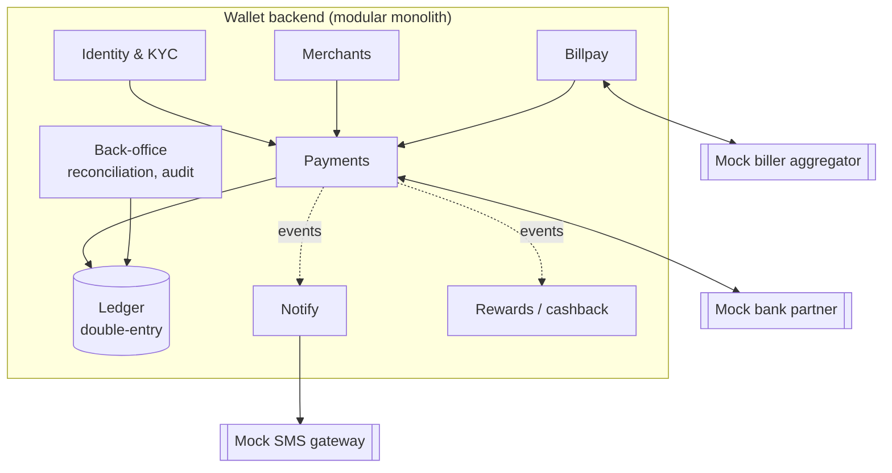

Inspired by how Nepal's digital wallets work, and built from scratch under our own name and branding. Working name: **TBD**.

```text
                    ┌──────────────────── Wallet backend (Spring Boot modular monolith) ────────────────────┐
 HTTP client ──────▶│ Identity & KYC │ Ledger │ Payments │ Merchants │ Billpay │ Notify │ Back-office        │
 (Bruno / app)      └──────┬─────────────┬───────────────┬──────────────┬─────────────────────────────────────┘
                           │             │               │              │
                      PostgreSQL       Redis           Kafka        MinIO (KYC docs)
                                                         │
               ┌─────────────────────────────────────────┴──────────────────────────────┐
               │  Mock external partners — deliberately flaky, slow, sometimes silent    │
               │   🏦 Bank partner (load / withdraw)   🧾 Biller aggregator   📩 SMS gateway │
               └─────────────────────────────────────────────────────────────────────────┘
```

## Bounded contexts



## Capabilities and what each one teaches

| Capability | Teaches |
|---|---|
| Sign-up, login, MPIN/TOTP, device binding, refresh rotation | Auth in depth, mobile-banking security |
| KYC tiers (unverified → verified) with per-tier limits; KYC document upload | Business rules as invariants, object storage |
| Wallet accounts on a **double-entry ledger** (user wallets, bank settlement, merchant, fee income, biller payable) | Correctness, ACID, isolation, immutability |
| **P2P transfer** by phone number, with idempotency keys | Idempotency, concurrency, state machines |
| **Load from bank / withdraw to bank** via the mock bank partner | External integrations, timeouts, **unknown status**, status inquiry, callbacks |
| **Merchant QR payments** with fees & commissions | Multi-leg postings, merchant webhooks |
| **Bill pay / mobile top-up** via the mock aggregator | Async fulfilment, reversals & refunds, sagas |
| Cashback / rewards | Event-driven side effects, exactly-once *effects* |
| History, statements, search | Cursor pagination, full-text search, background jobs |
| Real-time notifications | Outbox → Kafka → WebSocket/SSE, push/SMS stubs |
| Back-office: reconciliation, account freeze, audit | Settlement, admin authorization, audit trails |

## After session 100
A **Compose Multiplatform** client (Android + iOS) for this wallet, built on top of the API you designed.
