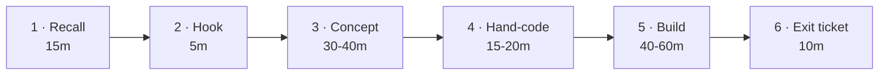

:::note[Plan status: v1.0, locked on 2026-11-10]
100 sessions · Kotlin + Spring Boot · eSewa/Khalti-style wallet · no DSA · CMP client after S100. Changes after this point go through a retro, not a whim.
:::

## The idea in three lines

1. **Earn every abstraction.** Build a crude version first, then use the real tool: raw-socket HTTP server → Spring MVC, DI container → Spring IoC, hand-written proxy → `@Transactional`, Postgres job queue → Kafka, hand-signed JWT → Spring Security.
2. **Build one serious fintech system.** A digital wallet in the style of the Nepali wallets: KYC tiers, a double-entry ledger, P2P transfers, loading money from banks, merchant QR, bill pay through unreliable partners, and reconciliation. It ends up deployed and monitored on your own server.
3. **Plan for forgetting.** Every session opens with spaced recall (1 / 3 / 7 / 14 / 30 sessions back). Every 7th session is review. Weak spots keep coming back until they stick.

## Leverage what you already know

You've spent years on the *client* side of every one of these ideas. Now you cross to the other side:

| You know (Android) | You'll learn (backend) |
|---|---|
| Retrofit / OkHttp calls | Writing the server that answers them, starting from raw sockets |
| OkHttp interceptors | Servlet filters, Spring interceptors, middleware chains |
| Hilt / Dagger (compile-time DI) | Spring IoC (runtime DI, proxies, AOP) |
| Room / SQLite | PostgreSQL: MVCC, isolation, locks, indexes, replication |
| Coroutines, `Dispatchers.IO` | Thread-per-request, virtual threads, event loops, connection pools |
| Certificate pinning, PKCE from the app | TLS termination, OAuth2/OIDC from the server side |
| FCM push, retry on a flaky network | Outbox, Kafka, idempotent consumers, WebSockets |

## Anatomy of a session (~2 h, can be split)

| Block | What happens |
|---|---|
| **Recall** | 5–8 closed-book questions: last session plus spaced items. Misses go into the weak-spots queue. |
| **Hook** | A broken scenario or a question *before* the concept. You guess first. |
| **Concept** | Dialogue, ASCII and Mermaid diagrams, and one targeted reading or video section. |
| **Hand-code** | A small exercise on paper or in an editor with no autocomplete. You send a photo and I review it line by line. |
| **Build** | An increment on the current lab or the flagship, ending in a commit. |
| **Exit ticket** | Learned / fuzzy / one question. 3–5 flashcards. |

**Review sessions** (every 7th): a cumulative quiz, one hand-written exercise redone from memory, a one-page teach-back ("explain it to a junior Android dev"), refactoring, and a retro. A blog post every 2–3 weeks.

## Where things live

| Layer | Where |
|---|---|
| Live Socratic session | Chat with your mentor (Claude): questions, ASCII diagrams, code review, hint ladder |
| Interactive visuals | Rendered inline during the session, and embedded on this site for hard topics (🎛 in the roadmap) |
| **Session notes** | This site → *Sessions*. Written **after** each session so they don't spoil the questions. They include your answers, corrections, diagrams, code, and quizzes. |
| Labs and the flagship | `labs/` in this repo, plus a separate public wallet repo |
| Progress | `progress/` in the repo (mentor's log) plus the [tracker](../../progress/) on this site |

## Ground rules

- **No AI autocomplete** on learning code.
- **Hint ladder:** nudge → hint → partial → answer. "I don't know" is fine; bluffing isn't.
- **Mastery gates** close each phase. You don't move on until the gate passes.
- **Learn in public:** blog posts, ADRs, and a deployed system are the credibility.
